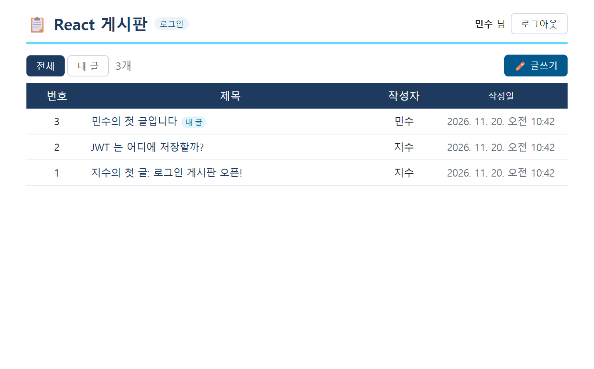
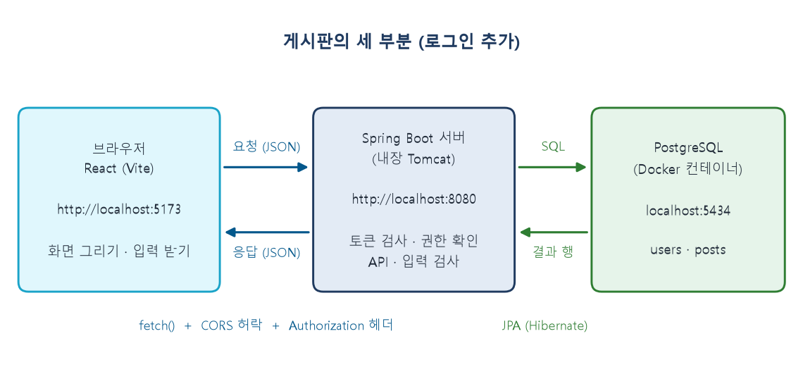

# 0장. 과정 안내

## 이 과정에서 만드는 것

1단계 기초 과정에서 **Spring Boot + PostgreSQL 게시판**을 만들었다. 이 심화 과정에서는 같은 게시판을 이어서 키운다.

1. **React Router** 로 화면마다 진짜 주소(`/posts/3`)를 붙인다.
2. **Context · 커스텀 훅 · API 모듈**로 코드를 정리한다.
3. **회원가입 · 로그인(JWT)** 을 붙이고, **내가 쓴 글만 수정·삭제**할 수 있게 한다.





> **처음부터 새로 만들지 않는다.** 기초 과정의 게시판을 고쳐 나가며 "왜 이 기능이 필요한지" 를 직접 느끼는 것이 이 과정의 목표다. 기초 과정을 마치지 않았다면 저장소의 `basic/board` 완성본을 먼저 실행해 보자.

## 진행 순서 (40시간)

| 일차 | 장 | 내용 | 시간 |
|---|---|---|---|
| 1일 | 0장 | 과정 안내, 저장소 준비 | 0.5 |
| | 1장 | 기초 복습 - 다시 그리기와 컴포넌트 설계 | 2.5 |
| | 2장 | useRef 와 useReducer | 5 |
| 2일 | 3장 | 커스텀 훅 | 3 |
| | 4장 | React Router | 5 |
| 3일 | 5장 | Context API | 3 |
| | 6장 | 인증의 이해 - 해시, JWT, 401 과 403 | 2.5 |
| | 7장 (1) | 프로젝트 ① 게시판을 Router 로 바꾸기 | 2.5 |
| 4일 | 7장 (2) | 프로젝트 ① API 모듈과 useApi 훅 | 2 |
| | 8장 | 프로젝트 ② Spring Boot 회원가입·로그인 API | 6 |
| 5일 | 9장 | 프로젝트 ③ React 로그인 연동 | 6 |
| | 정리 | 도전 과제, 복습 | 2 |

장마다 **개념 → 따라 치기 → 실행 결과 확인 → 확인 문제** 순서이고, 확인 문제 풀이는 부록 C 에 있다.

## 0-1. 준비

기초 과정과 같은 프로그램(Node.js, VS Code, IntelliJ IDEA, JDK 21, Git, Docker Desktop)을 쓴다. 저장소를 최신으로 받는다.

**[PS]** 처음 받는다면

```powershell
cd C:\study
git clone https://github.com/sinaboro/react-spring-postgresql.git
```

**[PS]** 이미 받았다면

```powershell
cd C:\study\react-spring-postgresql
git pull
```

심화 과정에서 쓰는 폴더는 `advanced` 다.

```text
react-spring-postgresql
├─ basic                 ← 1단계 기초 과정
└─ advanced              ← 2단계 심화 과정 (이 교안)
   ├─ examples           ← 1·2·3·5장 예제 완성본 (메뉴에서 골라 보기)
   ├─ router-demo        ← 4장 React Router 연습 프로젝트
   ├─ concepts           ← 6장 해시·JWT 실습 (AuthDemo.java, IntelliJ 로 열기)
   ├─ board-router       ← 7장 완성본: 기초 게시판 + Router + API 모듈
   │  └─ frontend          (백엔드는 기초 과정 basic/board/backend 를 그대로 쓴다)
   └─ board              ← 8·9장 완성본: 로그인 게시판
      ├─ docker-compose.yml  (PostgreSQL, 포트 5434)
      ├─ backend             (Spring Boot + Spring Security + JWT, IntelliJ 로 열기)
      └─ frontend            (React + Router + AuthContext)
```

> **단계별 완성본**이 따로 있는 이유: 중간에 막히거나 수업에 빠져도, 다음 장의 시작 상태를 저장소에서 바로 꺼내 이어 갈 수 있다. 예를 들어 8장을 시작할 때 7장이 끝나지 않았다면 `board-router` 를 복사해서 시작하면 된다.

**[PS]** 예제 앱 실행

```powershell
cd C:\study\react-spring-postgresql\advanced\examples
npm install
npm run dev
```

## 0-2. 이 과정에서 새로 쓰는 것

| 이름 | 종류 | 쓰는 장 |
|---|---|---|
| `useRef`, `useReducer`, `useContext`, `useCallback` | React Hook | 2·3·5장 |
| `react-router` (8.x) | React 주소·화면 연결 라이브러리 | 4·7·9장 |
| `localStorage` | 브라우저 저장소 | 3·9장 |
| `spring-boot-starter-security` | Spring Security (로그인 확인, 주소별 접근 규칙, BCrypt) | 6·8장 |
| `jjwt` (0.13) | Java JWT(로그인 토큰) 라이브러리 | 6·8장 |
