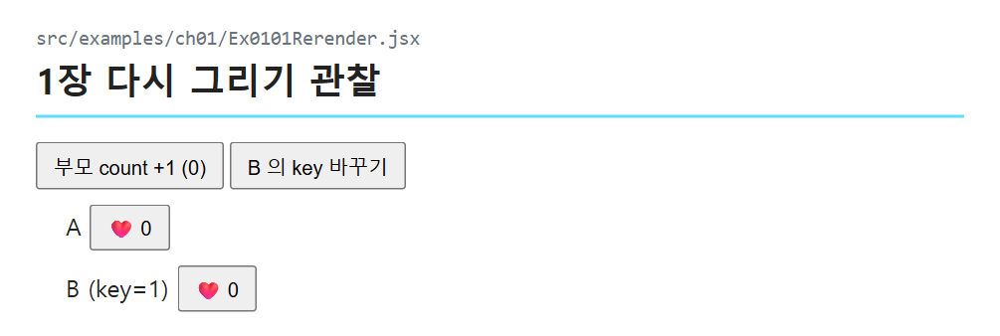

# 1장. 기초 복습 - 다시 그리기와 컴포넌트 설계

## 학습 목표

- 컴포넌트가 언제 다시 그려지는지(리렌더링) 정확히 말할 수 있다.
- `key` 를 바꾸면 컴포넌트가 새로 만들어지는 것을 안다.
- state 를 어디에 둘지, 컴포넌트를 어떻게 나눌지 기준을 세운다.
- 기초 게시판의 한계 세 가지를 알고, 이 과정에서 무엇으로 해결할지 안다.

## 1-1. 기초 과정 한 장 요약

| 개념 | 핵심 한 줄 |
|---|---|
| JSX | `{ }` 안에 식. `className`, `style={{ }}`, 부모 하나 |
| 컴포넌트·props | 대문자 함수. 부모 → 자식으로 값을 내려준다 (읽기 전용) |
| state | `const [x, setX] = useState(처음값)`. 바뀌면 다시 그린다 |
| 불변성 | 배열·객체 state 는 `...`, `map`, `filter` 로 **새로** 만든다 |
| 이벤트 | `onClick={() => ...}`. 자식은 부모가 내려준 함수를 불러 알린다 |
| useEffect | 그린 **뒤에** 실행. `[]` 처음 한 번, `[id]` id 가 바뀔 때 |
| fetch | `res.ok` 검사, `await res.json()`, JSON 보낼 땐 method·headers·body |

## 1-2. 언제 다시 그려지나?

컴포넌트가 다시 그려지는(함수가 다시 실행되는) 경우는 딱 세 가지다.

1. **자기 state** 가 바뀌었을 때
2. **부모가 다시 그려졌을 때** (props 가 같아도 자식은 기본적으로 함께 다시 그려진다)
3. 자기가 쓰는 **Context 값**이 바뀌었을 때 (5장)

<!-- file: advanced/examples/src/examples/ch01/Ex0101Rerender.jsx -->

```jsx
// Ex0101Rerender.jsx - "언제 다시 그려지나?" 를 눈으로 확인하기 (기초 복습)
//
// 이 예제가 보여 주는 것
//   - state 가 바뀐 컴포넌트는 다시 그려지고(함수가 다시 실행되고), 그 자식들도 함께 다시 그려진다.
//   - 다시 그려져도 state 값은 유지된다. 일반 변수는 매번 처음값으로 돌아간다.
//   - key 가 바뀌면 React 는 "다른 컴포넌트" 로 보고 새로 만든다 → 안의 state 가 초기화된다.
//   콘솔(F12)에 찍히는 순서를 보면서 버튼을 눌러 보자.

import { useState } from "react";

// 자식: 자기 state(좋아요 수)를 가진다
function Child({ label }) {
  const [likes, setLikes] = useState(0);
  console.log(`  └ Child(${label}) 그림, likes=${likes}`);
  return (
    <div style={{ margin: "6px 0 6px 20px" }}>
      {label} <button onClick={() => setLikes(likes + 1)}>❤️ {likes}</button>
    </div>
  );
}

function Ex0101Rerender() {
  const [count, setCount] = useState(0);
  const [resetKey, setResetKey] = useState(1);
  console.log(`Parent 그림, count=${count}`);

  return (
    <div>
      <button onClick={() => setCount(count + 1)}>부모 count +1 ({count})</button>
      <button onClick={() => setResetKey(resetKey + 1)}>B 의 key 바꾸기</button>
      {/* 부모가 다시 그려지면 A, B 모두 다시 그려지지만 각자의 likes 는 남아 있다 */}
      <Child label="A" />
      {/* key 가 바뀌면 B 는 새로 만들어진다 → likes 가 0 으로 */}
      <Child key={resetKey} label={`B (key=${resetKey})`} />
    </div>
  );
}

export default Ex0101Rerender;
```



예제 앱에서 해 보자.

- A 의 ❤️ 를 몇 번 누른 뒤 **부모 count +1** → 콘솔에 Parent, Child(A), Child(B) 가 모두 찍힌다(2번 경우). 그래도 A 의 좋아요 수는 그대로다. 다시 그려지는 것과 state 가 사라지는 것은 다르다.
- B 의 ❤️ 를 누른 뒤 **B 의 key 바꾸기** → B 의 좋아요가 0 이 된다. React 는 key 가 다르면 **다른 컴포넌트**로 보고 이전 것을 버린 뒤 새로 만든다.

> **key 로 초기화하는 기술** 기초 예제 앱의 `<Example key={current} />` 가 이 원리를 쓴 것이다. 예제를 바꿀 때마다 state 가 깨끗하게 새로 시작한다. 9장의 글 수정 화면처럼 "다른 글로 바뀌면 폼을 새로 시작" 할 때도 쓸 수 있다.

> **다시 그리기는 느리지 않을까?** 대부분은 괜찮다. React 는 함수를 다시 실행해 새 화면을 계산한 뒤 **실제로 달라진 부분만** 브라우저에 반영한다. 정말 느린 경우에만 `memo`, `useMemo`, `useCallback` 으로 최적화한다(3장에서 맛보기).

## 1-3. state 를 어디에 둘까?

| 질문 | 답 |
|---|---|
| 이 값이 바뀌면 화면이 바뀌어야 하나? | 아니면 state 가 아니다 (일반 변수나 ref - 2장) |
| 다른 state·props 로 **계산**할 수 있나? | 그러면 state 로 만들지 말고 그릴 때 계산한다 (예: `남은 할 일 개수`) |
| 이 값을 쓰는 컴포넌트가 여럿인가? | 그 컴포넌트들의 **가장 가까운 공통 부모**에 둔다 (state 끌어올리기) |
| 너무 멀리, 너무 많은 곳에서 쓰나? | **Context** (5장) - 로그인 사용자, 테마 등 |
| 주소에 남아야 하나? (새로 고침·공유) | **URL** (4장) - 글 번호, 검색어, 탭 |

## 1-4. 컴포넌트를 나누는 기준과 폴더 구조

- **한 컴포넌트는 한 가지 일.** 화면에서 "이 부분" 이라고 이름 붙일 수 있으면 컴포넌트 후보다.
- **보여 주기 전용**(props 만 받아 그림) 컴포넌트와 **데이터 담당**(state, fetch) 컴포넌트를 구분하면 재사용하기 쉽다. 기초 과정 할 일 앱의 `TodoItem` 이 보여 주기 전용이었다.
- 파일이 많아지면 역할별로 폴더를 나눈다. 이 과정의 게시판은 마지막에 이런 구조가 된다.

```text
src
├─ main.jsx          시작점 (Router, AuthProvider 로 감싸기)
├─ App.jsx           주소 → 화면 지도 (라우트)
├─ api.js            서버와 통신하는 함수 모음 (7장)
├─ format.js         날짜 표시 등 작은 함수
├─ components        여러 화면이 함께 쓰는 조각 (Layout, ProtectedRoute)
├─ pages             주소 하나에 연결되는 화면 (PostListPage, LoginPage ...)
├─ hooks             커스텀 훅 (useApi)
└─ context           Context (AuthContext)
```

## 1-5. 기초 게시판의 한계 - 이 과정의 로드맵

기초 과정 게시판을 실행해서 직접 확인해 보자.

| 한계 | 해 보면 | 해결 (장) |
|---|---|---|
| 주소가 항상 `/` | 3번 글을 읽다가 F5 → 목록으로 돌아간다. 3번 글 주소를 친구에게 보낼 수 없다. 브라우저 **뒤로 가기**를 누르면 게시판을 아예 벗어난다 | React Router (4·7장) |
| 화면마다 비슷한 fetch 코드 반복 | PostList, PostDetail, PostForm 에 `useState` 3개 + `useEffect` + `try/catch` 가 거의 같다 | 커스텀 훅, API 모듈 (3·7장) |
| 아무나 쓰고, 고치고, 지운다 | 작성자 칸에 아무 이름이나 쓸 수 있고, 남의 글도 지울 수 있다 | 로그인 + JWT + 소유권 검사 (6·8·9장) |

## 정리

- 다시 그려지는 경우: 자기 state 변경, 부모가 다시 그려짐, 쓰는 Context 변경.
- key 가 바뀌면 컴포넌트가 새로 만들어진다 → state 초기화.
- state 는 필요한 가장 가까운 곳에. 계산 가능한 값은 state 로 만들지 않는다. 공유가 넓으면 Context, 주소에 남길 것은 URL.

## 확인 문제

1. 다음 중 state 로 만들 필요가 **없는** 것을 모두 고르고 이유를 쓰시오. (가) 입력 칸의 글자 (나) 할 일 배열 (다) 남은 할 일 개수 (라) 로그인한 사용자 (마) 할 일 배열의 길이
2. 부모 컴포넌트의 state 가 바뀌면, props 를 하나도 받지 않는 자식 컴포넌트도 다시 그려지는가? Ex0101Rerender 로 확인하고 답하시오.
3. 글 수정 폼 `<PostForm id={3} />` 을 보다가 4번 글 수정으로 바뀌었는데, 폼에 3번 글 내용이 남아 있는 문제가 생겼다. key 로 해결하는 방법을 쓰시오.
