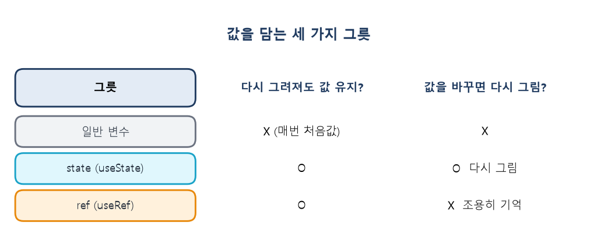
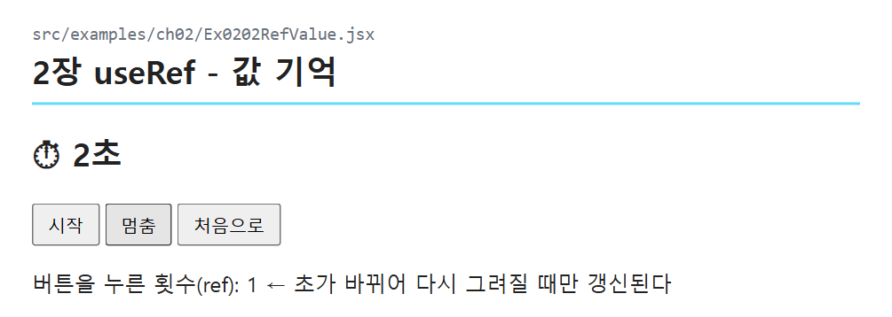
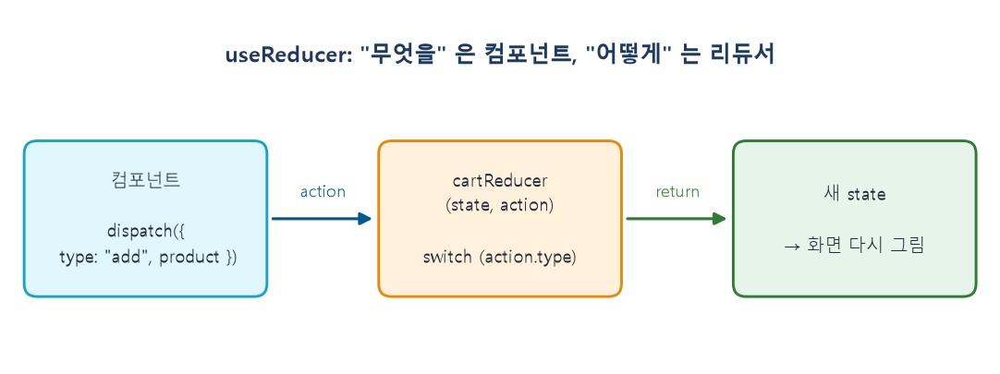
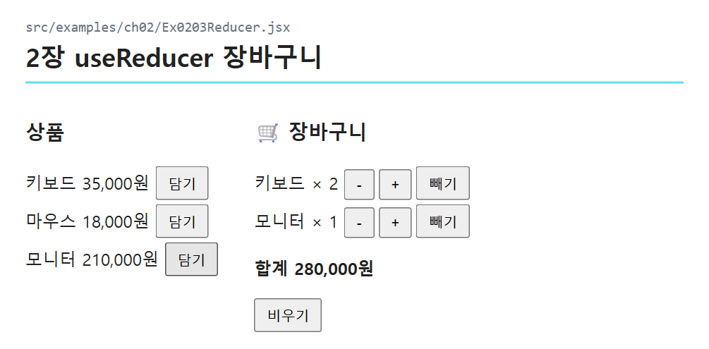

# 2장. useRef 와 useReducer

## 학습 목표

- `useRef` 로 화면의 태그(DOM)를 직접 잡아 포커스·스크롤을 다룬다.
- `useRef` 로 "다시 그리지 않고 기억만 하는 값" 을 보관한다.
- state·ref·일반 변수의 차이를 표로 설명할 수 있다.
- `useReducer` 로 state 를 바꾸는 규칙을 리듀서 함수 한 곳에 모은다.

## 2-1. useRef ① 태그를 직접 잡기

React 는 "데이터를 바꾸면 화면은 알아서" 가 원칙이다. 하지만 **입력 칸에 커서 두기**, **어느 위치로 스크롤하기**처럼 데이터로 표현하기 어려운 브라우저 동작도 있다. 이럴 때 `useRef` 로 실제 태그를 잡는다.

```jsx
const inputRef = useRef(null);   // ① 빈 상자 만들기
<input ref={inputRef} />          // ② 태그와 연결 (그려진 뒤 inputRef.current = 그 <input>)
inputRef.current.focus();         // ③ 태그의 기능 쓰기
```

<!-- file: advanced/examples/src/examples/ch02/Ex0201RefFocus.jsx -->

```jsx
// Ex0201RefFocus.jsx - useRef ① : 화면의 태그(DOM)를 직접 잡기
//
// 이 예제가 보여 주는 것
//   - const inputRef = useRef(null) 로 "상자" 를 만들고, <input ref={inputRef}> 로 태그와 연결한다.
//   - 그 뒤 inputRef.current 에 실제 <input> 태그가 들어 있다 → .focus() 같은 DOM 기능을 쓸 수 있다.
//   - 쓰는 곳: 입력 칸에 커서 두기, 스크롤 이동, 동영상 재생 등 "state 로 할 수 없는 브라우저 동작"

import { useEffect, useRef, useState } from "react";

function Ex0201RefFocus() {
  const nameRef = useRef(null); // 처음엔 비어 있다 (화면이 그려진 뒤에 태그가 들어온다)
  const listEndRef = useRef(null);
  const [name, setName] = useState("");
  const [names, setNames] = useState(["민수", "지수"]);

  // 화면이 처음 그려진 뒤, 이름 칸에 바로 커서를 둔다
  useEffect(() => {
    nameRef.current.focus();
  }, []);

  // 목록이 늘어날 때마다 맨 아래로 스크롤
  useEffect(() => {
    listEndRef.current?.scrollIntoView({ behavior: "smooth", block: "nearest" });
  }, [names]);

  const handleSubmit = (e) => {
    e.preventDefault();
    if (!name.trim()) {
      nameRef.current.focus(); // 비었으면 다시 그 칸으로 커서를 보낸다
      return;
    }
    setNames([...names, name.trim()]);
    setName("");
    nameRef.current.focus(); // 추가한 뒤에도 계속 입력할 수 있게
  };

  return (
    <div>
      <form onSubmit={handleSubmit}>
        <input ref={nameRef} value={name} onChange={(e) => setName(e.target.value)} placeholder="이름" />
        <button type="submit">추가</button>
      </form>
      <ul style={{ maxHeight: 120, overflowY: "auto", border: "1px solid #ddd" }}>
        {names.map((n, i) => (
          <li key={i}>{n}</li> // 지우지 않고 뒤에만 붙는 목록이라 index 를 key 로 써도 괜찮다
        ))}
        <li ref={listEndRef} style={{ listStyle: "none" }} /> {/* 스크롤 목표 지점 */}
      </ul>
    </div>
  );
}

export default Ex0201RefFocus;
```

- 처음 화면이 뜨면 이름 칸에 커서가 깜빡인다. `useEffect(..., [])` 안에서 focus 를 부른 이유는, **화면이 그려진 뒤에야** `nameRef.current` 에 태그가 들어 있기 때문이다.
- 빈칸으로 추가를 누르면 다시 이름 칸으로 커서가 돌아간다. 9장 로그인 화면의 `autoFocus` 도 같은 목적이다.

## 2-2. useRef ② 다시 그리지 않는 기억 상자

`ref.current` 는 **아무 값이나** 넣을 수 있는 상자다. 두 가지 특징이 있다.

- 다시 그려져도 값이 사라지지 않는다 (일반 변수와 다른 점)
- 값을 바꿔도 다시 그리지 않는다 (state 와 다른 점)



<!-- file: advanced/examples/src/examples/ch02/Ex0202RefValue.jsx -->

```jsx
// Ex0202RefValue.jsx - useRef ② : 다시 그리지 않고 값을 기억하는 상자
//
// 이 예제가 보여 주는 것
//   - ref.current 에 넣은 값은 다시 그려져도 사라지지 않는다 (일반 변수와 다른 점)
//   - ref.current 를 바꿔도 화면은 다시 그려지지 않는다 (state 와 다른 점)
//   - 그래서 "화면에 보일 필요는 없지만 기억해야 하는 값" 에 쓴다. 예) 타이머 번호
//
//              다시 그려져도 값 유지    값을 바꾸면 다시 그림
//   일반 변수          X                      X
//   state              O                      O
//   ref                O                      X

import { useRef, useState } from "react";

function Ex0202RefValue() {
  const [seconds, setSeconds] = useState(0); // 화면에 보여야 하므로 state
  const timerRef = useRef(null); //             setInterval 번호 - 화면엔 안 보이므로 ref
  const clickRef = useRef(0); //                버튼을 몇 번 눌렀는지 - 몰래 세기만

  const start = () => {
    clickRef.current += 1;
    if (timerRef.current) return; // 이미 돌고 있으면 또 만들지 않는다
    timerRef.current = setInterval(() => {
      setSeconds((s) => s + 1); // 함수형 업데이트: 최신 값 기준으로 +1
    }, 1000);
  };

  const stop = () => {
    clickRef.current += 1;
    clearInterval(timerRef.current); // 기억해 둔 번호로 멈춘다
    timerRef.current = null;
  };

  const reset = () => {
    stop();
    setSeconds(0);
  };

  return (
    <div>
      <h2>⏱ {seconds}초</h2>
      <button onClick={start}>시작</button>
      <button onClick={stop}>멈춤</button>
      <button onClick={reset}>처음으로</button>
      {/* clickRef 는 바뀌어도 바로 다시 그리지 않는다. 다른 이유로 다시 그려질 때 새 값이 보인다 */}
      <p>버튼을 누른 횟수(ref): {clickRef.current} ← 초가 바뀌어 다시 그려질 때만 갱신된다</p>
    </div>
  );
}

export default Ex0202RefValue;
```



`setInterval` 이 돌려주는 타이머 번호는 화면에 보일 필요가 없지만 "멈춤" 버튼을 누를 때까지 **기억해야** 한다. state 에 넣으면 쓸데없이 다시 그리고, 일반 변수에 넣으면 다시 그릴 때 사라진다. 그래서 ref 다.

> **주의** ref 값은 화면에 쓰지 않는 것이 원칙이다. 예제의 "버튼을 누른 횟수(ref)" 가 바로 갱신되지 않는 것처럼, 화면과 값이 어긋난다. 화면에 보여야 하면 state 를 쓰자.

## 2-3. useReducer - 바꾸는 규칙을 한 곳에

장바구니를 생각해 보자. 담기, 수량 줄이기, 빼기, 비우기… state 를 바꾸는 방법이 많아지면 `setCart(...)` 코드가 컴포넌트 곳곳에 흩어진다. `useReducer` 는 **"무엇을 할지"(action)** 와 **"어떻게 바꿀지"(reducer)** 를 나눈다.



```jsx
const [state, dispatch] = useReducer(리듀서함수, 처음값);
dispatch({ type: "add", product });  // "담아 줘" 라고 알리기만 한다
```

먼저 리듀서를 별도 파일로 만든다. React 를 import 하지 않는 **평범한 함수**다.

<!-- file: advanced/examples/src/examples/ch02/cartReducer.js -->

```js
// cartReducer.js - 장바구니 state 를 바꾸는 규칙을 한 곳에 모은 "리듀서" 함수
//
// 이 파일이 보여 주는 것
//   - 리듀서 = (지금 state, 행동 action) → 새 state 를 돌려주는 "순수 함수"
//   - action 은 보통 { type: "무엇을", ...필요한 값 } 모양의 객체
//   - 컴포넌트 밖의 평범한 함수이므로 React 없이도 테스트할 수 있다.
//   - 여기서도 state 를 직접 고치지 않고 새 배열/객체를 만든다 (기초 과정의 불변성 그대로)

export const initialCart = []; // [{ id, name, price, qty }]

export function cartReducer(state, action) {
  switch (action.type) {
    case "add": {
      const found = state.find((item) => item.id === action.product.id);
      if (found) {
        // 이미 담긴 상품이면 수량만 +1
        return state.map((item) => (item.id === action.product.id ? { ...item, qty: item.qty + 1 } : item));
      }
      return [...state, { ...action.product, qty: 1 }]; // 처음 담는 상품
    }
    case "decrease":
      return state
        .map((item) => (item.id === action.id ? { ...item, qty: item.qty - 1 } : item))
        .filter((item) => item.qty > 0); // 0 개가 되면 뺀다
    case "remove":
      return state.filter((item) => item.id !== action.id);
    case "clear":
      return initialCart;
    default:
      throw new Error(`모르는 action: ${action.type}`); // 오타를 빨리 알아채기 위해
  }
}
```

컴포넌트는 `dispatch` 만 부른다.

<!-- file: advanced/examples/src/examples/ch02/Ex0203Reducer.jsx -->

```jsx
// Ex0203Reducer.jsx - useReducer: state 를 바꾸는 방법이 여러 가지일 때
//
// 이 예제가 보여 주는 것
//   const [state, dispatch] = useReducer(리듀서함수, 처음값)
//   - 컴포넌트는 "무엇을 하고 싶은지" 만 dispatch({ type: ... }) 로 알린다.
//   - "어떻게 바꾸는지" 는 리듀서(cartReducer.js)가 모두 맡는다.
//   - useState 로도 만들 수 있지만, 바꾸는 방법(추가·감소·삭제·비우기)이 많아지면
//     컴포넌트 곳곳에 흩어진 set 코드를 리듀서 한 곳으로 모을 수 있어 읽기 쉬워진다.

import { useReducer } from "react";
import { cartReducer, initialCart } from "./cartReducer";

const PRODUCTS = [
  { id: 1, name: "키보드", price: 35000 },
  { id: 2, name: "마우스", price: 18000 },
  { id: 3, name: "모니터", price: 210000 },
];

function Ex0203Reducer() {
  const [cart, dispatch] = useReducer(cartReducer, initialCart);

  // state 로부터 계산되는 값 (따로 state 로 만들지 않는다)
  const total = cart.reduce((sum, item) => sum + item.price * item.qty, 0);

  return (
    <div style={{ display: "flex", gap: 30 }}>
      <div>
        <h3>상품</h3>
        {PRODUCTS.map((p) => (
          <div key={p.id}>
            {p.name} {p.price.toLocaleString()}원{" "}
            <button onClick={() => dispatch({ type: "add", product: p })}>담기</button>
          </div>
        ))}
      </div>
      <div>
        <h3>🛒 장바구니</h3>
        {cart.length === 0 && <p>비어 있습니다</p>}
        {cart.map((item) => (
          <div key={item.id}>
            {item.name} × {item.qty}{" "}
            <button onClick={() => dispatch({ type: "decrease", id: item.id })}>-</button>
            <button onClick={() => dispatch({ type: "add", product: item })}>+</button>
            <button onClick={() => dispatch({ type: "remove", id: item.id })}>빼기</button>
          </div>
        ))}
        <p>
          <strong>합계 {total.toLocaleString()}원</strong>
        </p>
        <button onClick={() => dispatch({ type: "clear" })}>비우기</button>
      </div>
    </div>
  );
}

export default Ex0203Reducer;
```



| | useState | useReducer |
|---|---|---|
| 바꾸는 법 | `setCart(새 값)` 을 여기저기서 | `dispatch({ type })` 만, 규칙은 리듀서에 |
| 어울리는 곳 | 값 하나, 바꾸는 방법이 한두 가지 | 바꾸는 방법이 여러 가지, 서로 관련된 값 여러 개 |
| 테스트 | 컴포넌트를 실행해야 함 | 리듀서 함수만 따로 호출해 볼 수 있음 |

리듀서는 **순수 함수**여야 한다. 같은 입력이면 항상 같은 결과를 돌려주고, 안에서 서버 요청(fetch) 같은 부수 효과나 원본 수정(`state.push`)을 하지 않는다. 서버 요청은 컴포넌트(이벤트 처리 함수나 useEffect)에서 하고, 결과만 dispatch 로 넘긴다.

## 정리

- `useRef(null)` + `ref={...}` → `ref.current` 로 실제 태그를 다룬다 (포커스, 스크롤).
- ref 는 다시 그려도 남고, 바꿔도 다시 그리지 않는 기억 상자. 타이머 번호 등에 쓴다.
- `useReducer(reducer, 처음값)` → `dispatch({ type, ... })`. 바꾸는 규칙을 리듀서 한 곳에 모은다.

## 확인 문제

1. 다음 값은 state, ref, 일반 변수 중 무엇에 두는 것이 알맞은가? (가) 화면에 보이는 검색어 (나) `setTimeout` 이 돌려준 번호 (다) 그릴 때마다 계산하는 합계
2. Ex0201RefFocus 에 "맨 위로" 버튼을 추가해, 누르면 목록의 첫 항목이 보이도록 스크롤하시오. (힌트: 첫 `<li>` 에 ref 를 하나 더)
3. `cartReducer` 에 `{ type: "increase", id }` 를 추가해 수량을 1 늘리게 하고, Ex0203Reducer 의 `+` 버튼이 이것을 쓰도록 바꾸시오.
4. 다음 리듀서의 문제점을 쓰고 고치시오.

```js
case "add":
  state.push({ ...action.product, qty: 1 });
  return state;
```
