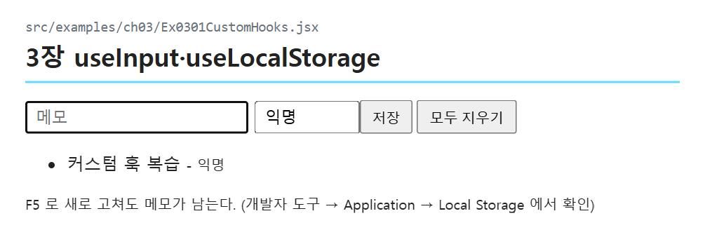
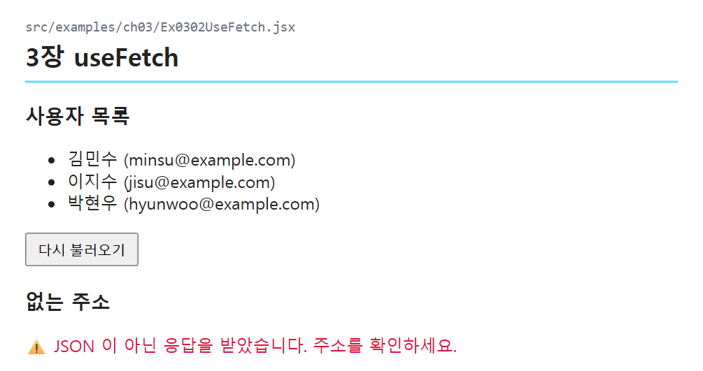

# 3장. 커스텀 훅

## 학습 목표

- 커스텀 훅이 무엇이고 언제 만드는지 안다.
- `useInput`, `useLocalStorage`, `useFetch` 를 만들고 쓴다.
- 지난 요청의 응답이 늦게 와서 화면이 꼬이는 문제를 정리 함수로 막는다.
- `useCallback`, `useMemo`, `memo` 가 무엇인지 맛본다.

## 3-1. 커스텀 훅이란?

기초 게시판의 PostList 와 PostDetail 을 나란히 놓으면 거의 같은 코드가 있다. `useState` 세 개, `useEffect`, `fetch`, `try / catch / finally`… 이렇게 **Hook 을 쓰는 코드 묶음**을 함수로 빼낸 것이 **커스텀 훅**이다.

- 이름은 반드시 `use` 로 시작한다. (React 가 Hook 규칙을 검사하는 기준)
- 안에서 `useState`, `useEffect` 등 다른 Hook 을 쓸 수 있다.
- 훅은 **코드**를 나눠 쓰는 것이지 **값**을 나눠 쓰는 것이 아니다. 두 컴포넌트가 같은 훅을 부르면 state 는 각자 따로 생긴다. (값을 나눠 쓰려면 Context - 5장)

## 3-2. useInput - 입력 칸 한 줄로

<!-- file: advanced/examples/src/hooks/useInput.js -->

```js
// useInput.js - 커스텀 훅 ① : 입력 칸 하나를 다루는 코드를 묶은 것
//
// 이 파일이 보여 주는 것
//   - 커스텀 훅 = 이름이 use 로 시작하고, 안에서 다른 Hook(useState 등)을 쓰는 "평범한 함수"
//   - 컴포넌트마다 반복되던 "useState + onChange" 를 한 줄로 줄인다.
//   - 훅을 쓰는 컴포넌트마다 state 가 따로 생긴다 (값을 나눠 갖는 것이 아니라 "코드" 를 나눠 쓰는 것)
//
// 사용: const title = useInput("");
//       <input {...title.bind} />      ← value 와 onChange 를 한 번에 펼쳐 넣는다
//       title.value / title.reset()

import { useState } from "react";

export function useInput(initialValue = "") {
  const [value, setValue] = useState(initialValue);

  const onChange = (e) => setValue(e.target.value);
  const reset = () => setValue(initialValue);

  return {
    value,
    setValue,
    reset,
    bind: { value, onChange }, // <input {...bind} /> 로 쓰기 좋게 묶음
  };
}
```

`<input {...title.bind} />` 는 `<input value={title.value} onChange={...} />` 와 같다. 객체의 전개 연산자를 JSX 속성에 쓴 것이다.

## 3-3. useLocalStorage - 새로 고침해도 남는 state

**localStorage** 는 브라우저에 글자를 저장하는 작은 저장소다. 탭을 닫고 다시 열어도 남는다. 9장에서 로그인 토큰을 여기에 보관한다.

<!-- file: advanced/examples/src/hooks/useLocalStorage.js -->

```js
// useLocalStorage.js - 커스텀 훅 ② : 새로 고침해도 남는 state
//
// 이 파일이 보여 주는 것
//   - useState 와 똑같이 [값, 바꾸는 함수] 를 돌려주지만, 값이 바뀔 때마다 브라우저의
//     localStorage 에도 저장한다. 처음에는 localStorage 에 저장된 값이 있으면 그것으로 시작한다.
//   - localStorage 는 문자열만 저장하므로 JSON.stringify / JSON.parse 로 바꿔 넣고 꺼낸다.
//   - useState(() => ...) : 함수를 넘기면 "처음 한 번만" 실행된다 (매번 localStorage 를 읽지 않게)
//   심화 9장에서 로그인 토큰을 이렇게 localStorage 에 보관한다.

import { useEffect, useState } from "react";

export function useLocalStorage(key, initialValue) {
  const [value, setValue] = useState(() => {
    const saved = localStorage.getItem(key); // 없으면 null
    return saved !== null ? JSON.parse(saved) : initialValue;
  });

  // 값이 바뀔 때마다 저장
  useEffect(() => {
    localStorage.setItem(key, JSON.stringify(value));
  }, [key, value]);

  return [value, setValue];
}
```

두 훅을 함께 써 보자.

<!-- file: advanced/examples/src/examples/ch03/Ex0301CustomHooks.jsx -->

```jsx
// Ex0301CustomHooks.jsx - useInput 과 useLocalStorage 를 써 보기
//
// 이 예제가 보여 주는 것
//   - useInput 덕분에 입력 칸마다 useState + onChange 를 따로 쓰지 않아도 된다.
//   - useLocalStorage 로 만든 메모 목록은 새로 고침(F5)해도 남아 있다.
//   - 훅을 두 번 부르면(title, author) state 도 두 개 따로 생긴다.

import { useInput } from "../../hooks/useInput";
import { useLocalStorage } from "../../hooks/useLocalStorage";

function Ex0301CustomHooks() {
  const title = useInput("");
  const author = useInput("익명");
  const [memos, setMemos] = useLocalStorage("memos", []); // localStorage 의 "memos" 칸에 저장

  const handleSubmit = (e) => {
    e.preventDefault();
    if (!title.value.trim()) return;
    setMemos([...memos, { id: Date.now(), title: title.value, author: author.value }]);
    title.reset(); // 제목 칸만 비우고 작성자는 남긴다
  };

  return (
    <div>
      <form onSubmit={handleSubmit}>
        <input {...title.bind} placeholder="메모" /> {/* value, onChange 가 한 번에 들어간다 */}
        <input {...author.bind} placeholder="작성자" style={{ width: 80 }} />
        <button type="submit">저장</button>
        <button type="button" onClick={() => setMemos([])}>
          모두 지우기
        </button>
      </form>
      <ul>
        {memos.map((m) => (
          <li key={m.id}>
            {m.title} <small>- {m.author}</small>
          </li>
        ))}
      </ul>
      <p>
        <small>F5 로 새로 고쳐도 메모가 남는다. (개발자 도구 → Application → Local Storage 에서 확인)</small>
      </p>
    </div>
  );
}

export default Ex0301CustomHooks;
```



F12 → **Application** 탭 → 왼쪽 **Local storage** → `http://localhost:5173` 을 누르면 `memos` 칸에 JSON 글자로 저장된 것이 보인다.

## 3-4. useFetch - 불러오기 세트를 한 줄로

<!-- file: advanced/examples/src/hooks/useFetch.js -->

```js
// useFetch.js - 커스텀 훅 ③ : "불러오기 + 로딩 + 오류" 세트를 한 줄로
//
// 이 파일이 보여 주는 것
//   - 기초 과정 게시판에서 목록·읽기 화면마다 반복했던 코드
//       (useState 3개 + useEffect + fetch + try/catch)
//     를 훅 하나로 묶는다 → 컴포넌트에는 const { data, loading, error } = useFetch(url) 한 줄
//   - url 이 바뀌면 다시 불러온다 (의존성 배열 [url])
//   - 정리 함수에서 ignore = true 로 표시해, 응답이 늦게 도착해도 "이미 지나간 요청" 의
//     결과로 state 를 덮어쓰지 않게 한다. (빠르게 다른 글을 눌렀을 때 생기는 꼬임 방지)
//   - reload() 를 부르면 같은 주소를 다시 불러온다.

import { useCallback, useEffect, useState } from "react";

export function useFetch(url) {
  const [data, setData] = useState(null);
  const [loading, setLoading] = useState(true);
  const [error, setError] = useState(null);
  const [version, setVersion] = useState(0); // reload 용: 숫자를 바꾸면 effect 가 다시 실행된다

  useEffect(() => {
    if (!url) return; // url 이 아직 없으면 아무것도 안 함
    let ignore = false; // 이 요청이 아직 "유효한지" 표시

    async function load() {
      setLoading(true);
      setError(null);
      try {
        const res = await fetch(url);
        if (!res.ok) throw new Error(`요청 실패 (${res.status})`);
        // 없는 파일이면 Vite 개발 서버가 index.html(200)을 주므로 JSON 인지도 확인한다 (기초 8장)
        if (!res.headers.get("content-type")?.includes("application/json")) {
          throw new Error("JSON 이 아닌 응답을 받았습니다. 주소를 확인하세요.");
        }
        const json = await res.json();
        if (!ignore) setData(json); // 지나간 요청이면 무시
      } catch (err) {
        if (!ignore) setError(err.message);
      } finally {
        if (!ignore) setLoading(false);
      }
    }
    load();

    return () => {
      ignore = true; // url 이 바뀌거나 화면에서 사라지면 이전 요청은 무시
    };
  }, [url, version]);

  // useCallback: 다시 그려져도 같은 함수를 유지 (자식에게 넘길 때 불필요한 다시 그리기 방지)
  const reload = useCallback(() => setVersion((v) => v + 1), []);

  return { data, loading, error, reload };
}
```

<!-- file: advanced/examples/src/examples/ch03/Ex0302UseFetch.jsx -->

```jsx
// Ex0302UseFetch.jsx - useFetch 훅으로 데이터 불러오기
//
// 이 예제가 보여 주는 것
//   - 기초 과정의 Ex0802Fetch 와 같은 일을 하는데, 컴포넌트 코드는 훨씬 짧다.
//   - 같은 훅을 다른 주소로 두 번 써도 서로 섞이지 않는다.
//   - reload() 로 다시 불러오기

import { useFetch } from "../../hooks/useFetch";

function UserList() {
  const { data: users, loading, error, reload } = useFetch("/data/users.json");
  // data: users → 꺼내면서 이름을 users 로 바꾼다 (구조 분해의 이름 바꾸기)

  if (loading) return <p>⏳ 불러오는 중...</p>;
  if (error) return <p style={{ color: "crimson" }}>⚠️ {error}</p>;
  return (
    <div>
      <ul>
        {users.map((u) => (
          <li key={u.id}>
            {u.name} ({u.email})
          </li>
        ))}
      </ul>
      <button onClick={reload}>다시 불러오기</button>
    </div>
  );
}

function Broken() {
  const { error, loading } = useFetch("/data/없는파일.json");
  if (loading) return <p>⏳ 불러오는 중...</p>;
  return <p style={{ color: "crimson" }}>⚠️ {error}</p>;
}

function Ex0302UseFetch() {
  return (
    <div>
      <h3>사용자 목록</h3>
      <UserList />
      <h3>없는 주소</h3>
      <Broken />
    </div>
  );
}

export default Ex0302UseFetch;
```



> 없는 파일인데 404 가 아니라 "JSON 이 아닌 응답" 이 보이는 이유는 기초 교안 8-3 에서 본 것처럼 Vite 개발 서버가 index.html 을 돌려주기 때문이다. useFetch 에도 같은 검사를 넣어 두었다.

**`ignore` 변수는 왜 필요할까?** 1번 글을 눌렀다가 바로 2번 글을 눌렀다고 하자. 1번 요청이 느려서 2번보다 **늦게** 도착하면, 화면에는 2번 글 주소인데 1번 글 내용이 보이는 꼬임이 생긴다. url 이 바뀌면 정리 함수가 먼저 실행되어 이전 요청의 `ignore` 를 `true` 로 만들고, 늦게 온 1번 응답은 무시된다. (StrictMode 가 effect 를 두 번 실행해도 첫 번째 결과가 무시되는 것도 이 덕분이다.)

## 3-5. 맛보기: useCallback, useMemo, memo

다시 그리기를 줄이는 최적화 도구다. **느리다는 것이 확인된 뒤에** 쓰는 것이 원칙이고, 이 과정에서는 이름과 용도만 알아 둔다.

| 도구 | 하는 일 | 예 |
|---|---|---|
| `useCallback(함수, [의존성])` | 다시 그려도 **같은 함수**를 유지 | useFetch 의 `reload` |
| `useMemo(() => 계산, [의존성])` | 의존성이 같으면 **계산 결과를 재사용** | 수천 개 목록의 정렬·필터 |
| `memo(컴포넌트)` | props 가 같으면 **자식 다시 그리기를 건너뜀** | 무거운 목록 항목 |

```jsx
// 예: products 나 keyword 가 바뀔 때만 다시 거른다
const filtered = useMemo(
  () => products.filter((p) => p.name.includes(keyword)),
  [products, keyword],
);
```

## 정리

- 커스텀 훅 = `use` 로 시작하고 Hook 을 쓰는 함수. 반복되는 Hook 코드를 묶는다.
- 같은 훅을 여러 곳에서 써도 state 는 따로다.
- `useLocalStorage`: `useState(() => 처음 한 번 읽기)` + `useEffect` 로 저장.
- `useFetch`: 정리 함수의 `ignore` 로 늦게 온 지난 응답을 무시한다.
- 최적화(`useCallback`, `useMemo`, `memo`)는 필요할 때만.

## 확인 문제

1. 커스텀 훅의 이름이 `use` 로 시작해야 하는 이유를 쓰시오.
2. `useToggle(처음값)` 훅을 만드시오. `[on, toggle]` 을 돌려주고, `toggle()` 을 부르면 true/false 가 뒤집힌다.
3. 두 컴포넌트 A, B 가 각각 `useLocalStorage("count", 0)` 을 쓴다. A 에서 값을 바꾸면 B 의 화면도 바로 바뀌는가? 이유를 쓰시오.
4. useFetch 에서 `return () => { ignore = true; }` 를 지우면 어떤 상황에서 문제가 생기는지 설명하시오.
