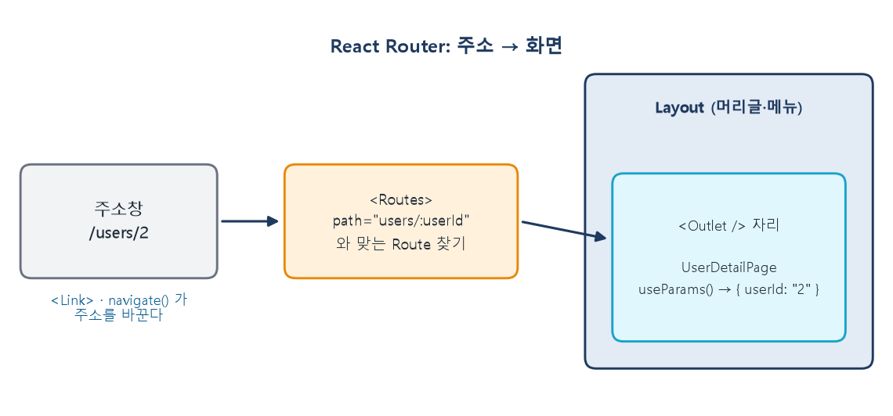
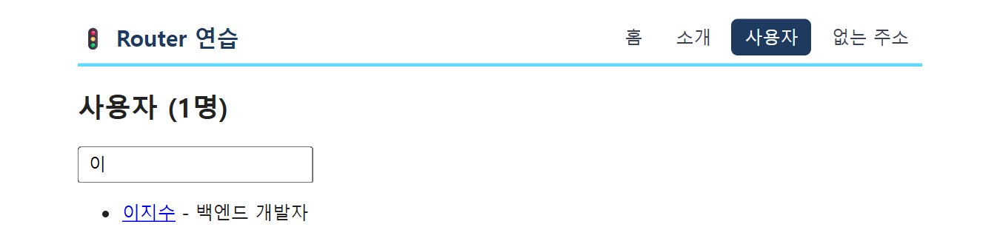
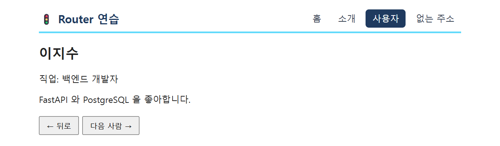
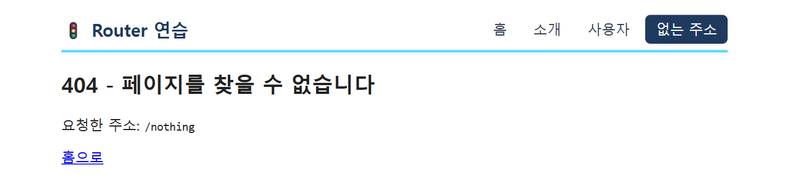

# 4장. React Router

## 학습 목표

- SPA 에서 주소(URL)와 화면을 연결하는 라우팅을 이해한다.
- `BrowserRouter`, `Routes`, `Route` 로 주소별 화면을 만든다.
- `Link`, `NavLink`, `useNavigate` 로 화면을 이동한다.
- `useParams` 로 주소 속 값(:id)을, `useSearchParams` 로 `?q=` 를 읽는다.
- 중첩 라우트와 `Outlet` 으로 공통 레이아웃을 만든다.

## 4-1. 왜 Router 가 필요한가

React 앱은 **SPA**(Single Page Application)다. 서버에서 HTML 을 한 번만 받고, 그 뒤로는 자바스크립트가 화면을 바꾼다. 기초 게시판은 state 로 화면을 바꿨기 때문에 주소가 항상 `/` 였다. 그래서 새로 고침·뒤로 가기·주소 공유가 안 됐다.

**React Router** 는 화면을 바꿀 때 **주소도 함께 바꾸고**, 반대로 주소를 보고 맞는 화면을 그린다. 페이지를 새로 받지 않으므로 SPA 의 빠르기는 그대로다.



## 4-2. 연습 프로젝트 준비

Router 는 주소창을 직접 다루기 때문에 예제 앱 메뉴와 섞지 않고 **별도 프로젝트**로 연습한다. 완성본은 `advanced/router-demo` 다.

**[PS]** 내 연습 프로젝트를 만든다면

```powershell
cd C:\study
# npm create vite@latest <폴더> : Vite(React 개발 도구)로 새 프로젝트 뼈대를 만든다
#   -- 뒤는 Vite 에 넘기는 옵션.  --template react = React 용으로,  --no-interactive = 질문 없이 기본값으로
npm create vite@latest router-practice -- --template react --no-interactive   # 연습용 새 프로젝트
cd router-practice
npm install                  # 기본 라이브러리
npm install react-router     # npm install <이름> : 라이브러리 하나를 추가로 설치하고 package.json 에 적어 둔다 (주소에 따라 화면을 바꿔 주는 React Router)
```

`npm install react-router` 가 Router 라이브러리를 추가한다. `package.json` 의 dependencies 에 `"react-router": "^8.5.2"` 같은 줄이 생긴다. (이 교안은 8.5.2 로 확인했다.)

> 인터넷 자료에서 `react-router-dom` 패키지를 보게 될 수 있다. 예전(6 버전까지)에 쓰던 이름이고, 7 버전부터는 `react-router` 하나로 합쳐졌다. 이 과정은 `react-router` 에서 import 한다.

**[PS]** 완성본 실행

```powershell
cd C:\study\react-spring-postgresql\advanced\router-demo   # 이 장의 완성본
npm install      # package.json 에 적힌 라이브러리(React 등)를 node_modules 폴더로 받는다. 폴더마다 처음 한 번만 (1~2분)
npm run dev      # http://localhost:5173
```

## 4-3. BrowserRouter - Router 켜기

<!-- file: advanced/router-demo/src/main.jsx -->

```jsx
// main.jsx - 앱의 시작점 + Router 켜기
//
// 이 파일이 보여 주는 것
//   - <BrowserRouter> 로 앱 전체를 감싸면, 그 안쪽 어디서든 Routes·Link·useNavigate 등
//     Router 기능을 쓸 수 있다. (앱에 딱 한 번만 감싼다)
//   - BrowserRouter 는 브라우저 주소창의 주소(/users/2 등)를 읽고 바꾸는 일을 맡는다.

import { StrictMode } from "react";
import { createRoot } from "react-dom/client";
import { BrowserRouter } from "react-router";
import "./index.css";
import App from "./App.jsx";

createRoot(document.getElementById("root")).render(
  <StrictMode>
    <BrowserRouter>
      <App />
    </BrowserRouter>
  </StrictMode>,
);
```

## 4-4. Routes 와 Route - 주소 지도 만들기

<!-- file: advanced/router-demo/src/App.jsx -->

```jsx
// App.jsx - "주소 → 화면" 지도 (라우트 설정)
//
// 이 파일이 보여 주는 것
//   - <Routes> 안에 <Route path="주소" element={<화면 />} /> 를 나열한다.
//     지금 주소와 맞는 Route 하나의 element 만 그려진다.
//   - 중첩 라우트: 바깥 Route(Layout) 안에 안쪽 Route 들을 넣으면,
//     Layout 의 <Outlet /> 자리에 안쪽 화면이 들어간다 → 머리글·메뉴를 모든 화면이 함께 쓴다.
//   - index      : 부모 주소(/) 그대로일 때 보여 줄 화면
//   - :userId    : 주소의 그 자리 값을 변수처럼 받는다 (useParams 로 꺼냄)
//   - path="*"   : 위의 어느 것과도 맞지 않는 주소 → 404 화면
//
//   주소              화면
//   /                 HomePage
//   /about            AboutPage
//   /users            UserListPage
//   /users/2          UserDetailPage (userId = "2")
//   /아무거나         NotFoundPage

import { Route, Routes } from "react-router";
import Layout from "./Layout";
import HomePage from "./pages/HomePage";
import AboutPage from "./pages/AboutPage";
import UserListPage from "./pages/UserListPage";
import UserDetailPage from "./pages/UserDetailPage";
import NotFoundPage from "./pages/NotFoundPage";
import "./App.css";

function App() {
  return (
    <Routes>
      <Route path="/" element={<Layout />}>
        <Route index element={<HomePage />} />
        <Route path="about" element={<AboutPage />} /> {/* 앞에 / 를 안 쓰면 부모 주소 뒤에 붙는다 → /about */}
        <Route path="users" element={<UserListPage />} />
        <Route path="users/:userId" element={<UserDetailPage />} />
        <Route path="*" element={<NotFoundPage />} />
      </Route>
    </Routes>
  );
}

export default App;
```

| 표기 | 뜻 |
|---|---|
| `path="about"` | 부모 주소 뒤에 붙는 상대 경로 → `/about` |
| `index` | 부모 주소 그 자체(`/`)일 때 |
| `path="users/:userId"` | `:` 이 붙은 칸은 아무 값이나 받는 **주소 매개변수** |
| `path="*"` | 위의 어느 것과도 맞지 않을 때 (404) |

## 4-5. 공통 레이아웃: 중첩 라우트와 Outlet

<!-- file: advanced/router-demo/src/Layout.jsx -->

```jsx
// Layout.jsx - 모든 화면이 함께 쓰는 틀 (머리글 + 메뉴 + 본문 자리)
//
// 이 파일이 보여 주는 것
//   - <Link to="/about"> : <a href> 처럼 보이지만 페이지를 새로 받지 않고 화면만 바꾼다.
//                          (그래서 state 가 날아가지 않고 빠르다)
//   - <NavLink>          : Link 와 같은데, 지금 주소와 맞으면 class="active" 가 자동으로 붙는다
//                          → 지금 어느 메뉴에 있는지 표시하기 좋다
//   - <Outlet />         : App.jsx 에서 이 Layout 안에 넣은 화면(자식 Route)이 그려질 자리

import { Link, NavLink, Outlet } from "react-router";

function Layout() {
  return (
    <div className="container">
      <header className="header">
        <Link to="/" className="logo">
          🚦 Router 연습
        </Link>
        <nav>
          {/* end : "/" 는 모든 주소의 앞부분이므로, 정확히 "/" 일 때만 active 가 되게 한다 */}
          <NavLink to="/" end>
            홈
          </NavLink>
          <NavLink to="/about">소개</NavLink>
          <NavLink to="/users">사용자</NavLink>
          <NavLink to="/nothing">없는 주소</NavLink>
        </nav>
      </header>
      <main>
        <Outlet /> {/* ← 여기에 HomePage, AboutPage ... 중 하나가 들어온다 */}
      </main>
    </div>
  );
}

export default Layout;
```

```css
/* App.css 의 일부 - NavLink 는 지금 주소와 맞으면 class="active" 가 붙는다 */
.header nav a.active {
  background: #1f3a5f;
  color: white;
}
```

> **`<a href>` 를 쓰면 안 될까?** `<a href="/about">` 은 브라우저가 서버에서 페이지를 **새로 받는다.** 화면이 깜빡이고 모든 state 가 사라진다. 앱 안의 이동은 항상 `<Link to>` 를 쓰고, 다른 사이트로 나갈 때만 `<a href>` 를 쓴다.

## 4-6. 코드로 이동하기: useNavigate

<!-- file: advanced/router-demo/src/pages/HomePage.jsx -->

```jsx
// HomePage.jsx - 첫 화면 ( / )
//
// 이 파일이 보여 주는 것
//   - useNavigate() 가 돌려주는 navigate 함수로 "코드에서" 주소를 바꾼다.
//     Link 는 사용자가 누르는 링크, navigate 는 저장 성공 후 이동처럼 코드가 이동시킬 때 쓴다.

import { useNavigate } from "react-router";

function HomePage() {
  const navigate = useNavigate();

  return (
    <div>
      <h2>홈</h2>
      <p>위 메뉴를 눌러 보세요. 주소창의 주소가 바뀌는데도 페이지가 깜빡이지 않습니다.</p>
      <button onClick={() => navigate("/users")}>사용자 목록으로 이동 (navigate)</button>
      <button onClick={() => navigate("/users/2")}>2번 사용자 바로 가기</button>
    </div>
  );
}

export default HomePage;
```

| 쓰는 법 | 뜻 |
|---|---|
| `navigate("/users")` | 그 주소로 이동 (방문 기록에 추가) |
| `navigate("/posts/3", { replace: true })` | 지금 기록을 **바꿔치기** (뒤로 가기로 돌아오지 않게) |
| `navigate(-1)` | 뒤로 가기 |

## 4-7. 주소 속 값 읽기: useParams 와 useSearchParams

<!-- file: advanced/router-demo/src/data.js -->

```js
// data.js - 연습용 사용자 데이터 (서버 대신)
//   심화 7장 게시판에서는 이 자리에 Spring Boot 서버의 글 데이터가 온다.
export const USERS = [
  { id: 1, name: "김민수", job: "프론트엔드 개발자", bio: "React 로 화면을 만듭니다." },
  { id: 2, name: "이지수", job: "백엔드 개발자", bio: "Spring Boot 와 PostgreSQL 을 좋아합니다." },
  { id: 3, name: "박현우", job: "디자이너", bio: "사용하기 편한 화면을 고민합니다." },
];
```

<!-- file: advanced/router-demo/src/pages/UserListPage.jsx -->

```jsx
// UserListPage.jsx - 사용자 목록 ( /users )
//
// 이 파일이 보여 주는 것
//   - 목록의 각 항목을 <Link to={`/users/${id}`}> 로 만들어 상세 주소로 연결한다.
//   - useSearchParams : 주소 끝의 ?q=김 같은 "검색 조건" 을 읽고 바꾼다.
//     검색어를 state 가 아니라 주소에 두면, 새로 고침·뒤로 가기를 해도 검색 결과가 유지된다.

import { Link, useSearchParams } from "react-router";
import { USERS } from "../data";

function UserListPage() {
  const [searchParams, setSearchParams] = useSearchParams();
  const q = searchParams.get("q") ?? ""; // ?q=... 가 없으면 빈 글자

  const filtered = USERS.filter((u) => u.name.includes(q));

  return (
    <div>
      <h2>사용자 ({filtered.length}명)</h2>
      <input
        value={q}
        // 입력할 때마다 주소가 /users?q=입력값 으로 바뀐다. 빈 칸이면 ?q 를 없앤다
        onChange={(e) => setSearchParams(e.target.value ? { q: e.target.value } : {})}
        placeholder="이름 검색"
      />
      <ul>
        {filtered.map((u) => (
          <li key={u.id}>
            <Link to={`/users/${u.id}`}>{u.name}</Link> - {u.job}
          </li>
        ))}
      </ul>
    </div>
  );
}

export default UserListPage;
```



<!-- file: advanced/router-demo/src/pages/UserDetailPage.jsx -->

```jsx
// UserDetailPage.jsx - 사용자 한 명 ( /users/:userId )
//
// 이 파일이 보여 주는 것
//   - useParams() 로 주소의 :userId 자리 값을 꺼낸다. 값은 항상 "문자열" 이다 ("2")
//     → 숫자 id 와 비교하려면 Number() 로 바꾼다.
//   - 없는 번호(/users/99)면 안내 문구를 보여 준다.
//   - navigate(-1) : 브라우저의 "뒤로 가기" 와 같다.

import { useNavigate, useParams } from "react-router";
import { USERS } from "../data";

function UserDetailPage() {
  const { userId } = useParams(); // App.jsx 의 path="users/:userId" 에서 이름이 정해졌다
  const navigate = useNavigate();
  const user = USERS.find((u) => u.id === Number(userId));

  if (!user) {
    return (
      <div>
        <h2>사용자를 찾을 수 없습니다 (번호 {userId})</h2>
        <button onClick={() => navigate("/users")}>목록으로</button>
      </div>
    );
  }

  return (
    <div>
      <h2>{user.name}</h2>
      <p>직업: {user.job}</p>
      <p>{user.bio}</p>
      <button onClick={() => navigate(-1)}>← 뒤로</button>
      {/* 다음 사람으로: 주소만 바뀌고 같은 컴포넌트가 새 userId 로 다시 그려진다 */}
      {user.id < USERS.length && <button onClick={() => navigate(`/users/${user.id + 1}`)}>다음 사람 →</button>}
    </div>
  );
}

export default UserDetailPage;
```



<!-- file: advanced/router-demo/src/pages/NotFoundPage.jsx -->

```jsx
// NotFoundPage.jsx - 없는 주소일 때 ( path="*" )
//   useLocation() 으로 지금 주소 정보를 읽어 어떤 주소로 왔는지 보여 준다.

import { Link, useLocation } from "react-router";

function NotFoundPage() {
  const location = useLocation(); // { pathname: "/nothing", search: "", ... }
  return (
    <div>
      <h2>404 - 페이지를 찾을 수 없습니다</h2>
      <p>
        요청한 주소: <code>{location.pathname}</code>
      </p>
      <Link to="/">홈으로</Link>
    </div>
  );
}

export default NotFoundPage;
```



**직접 확인해 보자**

1. `/users/2` 에서 **F5** → 그대로 2번 사용자가 보인다. (기초 게시판과 다른 점!)
2. 검색 칸에 `이` 를 치고 F5 → 검색어와 결과가 남아 있다. 주소가 `/users?q=%EC%9D%B4` 처럼 바뀌어 있다(한글은 %로 인코딩되어 보인다).
3. 메뉴를 여러 번 누른 뒤 브라우저 **뒤로 가기** → 앱 안에서 이전 화면으로 돌아간다.

> **배포할 때 주의** 개발 서버(Vite)는 `/users/2` 같은 주소도 `index.html` 을 내려주지만, 일반 웹 서버에 배포하면 404 가 날 수 있다. "모든 주소에서 index.html 을 주라" 는 설정이 필요하다. 이 과정 범위 밖이니 이름만 기억해 두자.

## 정리

- `main.jsx` 에서 `<BrowserRouter>` 로 감싸고, `App.jsx` 에 `<Routes><Route path element /></Routes>` 지도를 만든다.
- 이동: 링크는 `<Link to>`, 메뉴는 `<NavLink>`(active 표시), 코드는 `navigate()`.
- 주소 값: `/users/:userId` → `useParams()`, `?q=` → `useSearchParams()`. 값은 항상 **문자열**.
- 공통 틀은 부모 Route 의 element 에 두고, 자식 화면은 `<Outlet />` 자리에 그린다.

## 확인 문제

1. `/posts/7/edit` 주소에서 7 을 꺼내려면 Route 의 path 와 꺼내는 코드를 어떻게 쓰는가?
2. `<a href="/about">` 대신 `<Link to="/about">` 을 써야 하는 이유를 쓰시오.
3. router-demo 에 `/contact` 주소와 `ContactPage` 를 추가하고 메뉴에도 넣으시오.
4. UserDetailPage 에서 `USERS.find((u) => u.id === userId)` 로 쓰면 항상 사용자를 찾지 못한다. 이유와 고치는 방법을 쓰시오.
5. 글 저장 후 `navigate("/posts/3")` 대신 `navigate("/posts/3", { replace: true })` 를 쓰면 무엇이 달라지는가?
