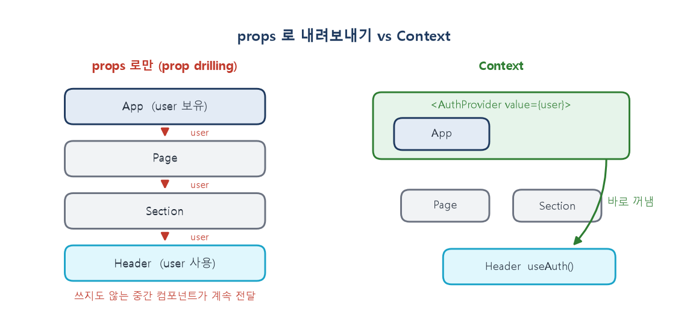
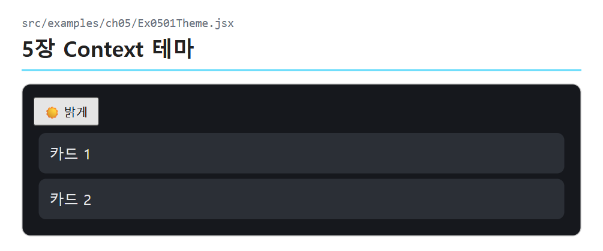
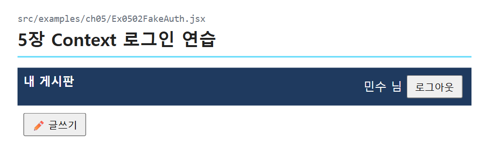

# 5장. Context API

## 학습 목표

- prop drilling 이 무엇이고 왜 불편한지 안다.
- `createContext` → Provider → `useContext` 세 단계로 값을 나눠 쓴다.
- Context 를 쓰기 편하게 커스텀 훅(`useTheme`, `useAuth`)으로 감싼다.
- 로그인 상태를 Context 로 관리하는 모양을 미리 익힌다 (9장 준비).

## 5-1. prop drilling

로그인한 사용자 정보는 머리글, 글쓰기 버튼, 글 읽기 화면… 여러 곳에서 필요하다. props 로만 전달하면 **쓰지도 않는 중간 컴포넌트들이 값을 받아서 아래로 넘기기만** 해야 한다. 이것을 **prop drilling**(드릴로 뚫듯 내려보내기)이라 한다.



**Context** 는 값을 Provider 에 한 번 올려 두면, 그 안쪽의 **어느 깊이의 컴포넌트든 바로 꺼내 쓰게** 해 준다.

## 5-2. Context 만들기 3단계

<!-- file: advanced/examples/src/context/ThemeContext.jsx -->

```jsx
// ThemeContext.jsx - Context ① : 앱 전체가 함께 쓰는 "밝은/어두운 테마"
//
// 이 파일이 보여 주는 것 (Context 를 만드는 3단계)
//   1. createContext()      : 값을 실어 나를 "통로" 를 만든다
//   2. <ThemeContext value> : Provider. 이 태그 안쪽의 모든 컴포넌트가 값을 받을 수 있다
//                             (React 19 부터는 <ThemeContext.Provider> 대신 <ThemeContext> 로 바로 쓴다)
//   3. useContext()         : 받는 쪽. props 로 여러 단계를 내려보내지 않아도 바로 꺼낸다
//   - 받는 쪽이 쓰기 편하게 useTheme() 라는 커스텀 훅으로 감싸 둔다.

import { createContext, useContext, useState } from "react";

const ThemeContext = createContext(null); // 1. 통로 만들기

// 2. 값을 공급하는 컴포넌트
export function ThemeProvider({ children }) {
  const [dark, setDark] = useState(false);
  const toggle = () => setDark((d) => !d);

  // 내려보낼 값: 지금 테마 + 바꾸는 함수
  return <ThemeContext value={{ dark, toggle }}>{children}</ThemeContext>;
}

// 3. 받는 쪽이 쓸 훅
export function useTheme() {
  const value = useContext(ThemeContext);
  if (value === null) {
    // Provider 바깥에서 쓰면 값이 없다 → 실수를 바로 알려 준다
    throw new Error("useTheme 은 <ThemeProvider> 안에서만 쓸 수 있습니다");
  }
  return value;
}
```

| 단계 | 코드 | 하는 일 |
|---|---|---|
| ① 통로 | `const ThemeContext = createContext(null)` | 값을 실어 나를 통로 |
| ② 공급 | `<ThemeContext value={...}>{children}</ThemeContext>` | 안쪽 전체에 값 공급 |
| ③ 사용 | `useContext(ThemeContext)` | 가장 가까운 Provider 의 값을 꺼냄 |

> React 18 까지는 공급할 때 `<ThemeContext.Provider value={...}>` 라고 썼다. React 19 부터는 `<ThemeContext value={...}>` 로 바로 쓸 수 있다. 인터넷 자료에서 `.Provider` 를 보면 같은 뜻으로 읽으면 된다.

## 5-3. 테마 바꾸기 예제

<!-- file: advanced/examples/src/examples/ch05/Ex0501Theme.jsx -->

```jsx
// Ex0501Theme.jsx - Context 로 테마 나눠 쓰기
//
// 이 예제가 보여 주는 것
//   - Page → Section → Card 처럼 깊이 들어간 컴포넌트도 useTheme() 한 줄로 테마를 꺼낸다.
//   - 중간의 Section 은 테마를 쓰지 않으므로 props 로 받지도 넘기지도 않는다.
//     (props 로만 했다면 Section 이 쓰지도 않는 dark 를 받아서 Card 에 넘겨야 한다 = prop drilling)

import { ThemeProvider, useTheme } from "../../context/ThemeContext";

function ThemeButton() {
  const { dark, toggle } = useTheme();
  return <button onClick={toggle}>{dark ? "☀️ 밝게" : "🌙 어둡게"}</button>;
}

function Card({ title }) {
  const { dark } = useTheme(); // 깊은 곳에서 바로 꺼낸다
  const style = {
    padding: 12,
    margin: 6,
    borderRadius: 8,
    background: dark ? "#2b2f36" : "#f4f7fb",
    color: dark ? "#e8eaed" : "#222",
  };
  return <div style={style}>{title}</div>;
}

// 테마를 모르는 중간 컴포넌트
function Section() {
  return (
    <div>
      <Card title="카드 1" />
      <Card title="카드 2" />
    </div>
  );
}

function Page() {
  const { dark } = useTheme();
  return (
    <div style={{ padding: 12, borderRadius: 10, background: dark ? "#16181d" : "white", border: "1px solid #ccc" }}>
      <ThemeButton />
      <Section />
    </div>
  );
}

function Ex0501Theme() {
  // Provider 로 감싼 안쪽에서만 useTheme 을 쓸 수 있다
  return (
    <ThemeProvider>
      <Page />
    </ThemeProvider>
  );
}

export default Ex0501Theme;
```



`Section` 은 테마를 모르는데도 그 안의 `Card` 는 테마를 받는다. Provider 의 값이 바뀌면 그 값을 **쓰는** 컴포넌트들이 다시 그려진다.

## 5-4. 로그인 상태를 Context 로 (9장 미리 보기)

서버 없이 닉네임만으로 "로그인" 하는 연습판이다. 9장의 `AuthContext.jsx` 가 이 모양과 같다.

<!-- file: advanced/examples/src/context/FakeAuthContext.jsx -->

```jsx
// FakeAuthContext.jsx - Context ② : 로그인 상태를 앱 전체에 알리기 (서버 없는 연습판)
//
// 이 파일이 보여 주는 것
//   - "지금 로그인한 사용자" 는 머리글, 글쓰기 버튼, 내 정보 화면 등 여러 곳에서 필요하다
//     → Context 에 두기 딱 좋은 값이다.
//   - Provider 가 user state 와 login / logout 함수를 함께 내려준다.
//   - 심화 9장의 AuthContext.jsx 는 이 파일과 모양이 같고,
//     login 안에서 진짜 Spring Boot 서버에 요청하는 것만 다르다.

import { createContext, useContext, useState } from "react";

const AuthContext = createContext(null);

export function FakeAuthProvider({ children }) {
  const [user, setUser] = useState(null); // null = 로그인 안 함

  const login = (nickname) => setUser({ nickname }); // 진짜 앱에서는 서버에 아이디·비밀번호를 보낸다
  const logout = () => setUser(null);

  return <AuthContext value={{ user, login, logout }}>{children}</AuthContext>;
}

export function useFakeAuth() {
  const value = useContext(AuthContext);
  if (value === null) throw new Error("useFakeAuth 는 <FakeAuthProvider> 안에서만 쓸 수 있습니다");
  return value;
}
```

<!-- file: advanced/examples/src/examples/ch05/Ex0502FakeAuth.jsx -->

```jsx
// Ex0502FakeAuth.jsx - 로그인 상태를 Context 로 나눠 쓰기 (9장 미리 보기)
//
// 이 예제가 보여 주는 것
//   - Header, WriteButton, LoginBox 가 서로 props 를 주고받지 않는데도
//     같은 로그인 상태를 보고 함께 바뀐다.
//   - 로그인 여부에 따라 버튼을 보여 주거나 숨기는 조건부 렌더링 (기초 5장)

import { useState } from "react";
import { FakeAuthProvider, useFakeAuth } from "../../context/FakeAuthContext";

function Header() {
  const { user, logout } = useFakeAuth();
  return (
    <div style={{ display: "flex", justifyContent: "space-between", padding: 8, background: "#1f3a5f", color: "white" }}>
      <strong>내 게시판</strong>
      {user ? (
        <span>
          {user.nickname} 님 <button onClick={logout}>로그아웃</button>
        </span>
      ) : (
        <span>로그인하지 않음</span>
      )}
    </div>
  );
}

function WriteButton() {
  const { user } = useFakeAuth();
  if (!user) return <p>🔒 글을 쓰려면 로그인하세요.</p>;
  return <button>✏️ 글쓰기</button>;
}

function LoginBox() {
  const { user, login } = useFakeAuth();
  const [name, setName] = useState("");
  if (user) return null; // 로그인했으면 이 상자는 숨긴다 (null 을 돌려주면 아무것도 안 그림)
  return (
    <form
      onSubmit={(e) => {
        e.preventDefault();
        if (name.trim()) login(name.trim());
      }}
    >
      <input value={name} onChange={(e) => setName(e.target.value)} placeholder="닉네임" />
      <button type="submit">로그인</button>
    </form>
  );
}

function Ex0502FakeAuth() {
  return (
    <FakeAuthProvider>
      <Header />
      <div style={{ padding: 8 }}>
        <LoginBox />
        <WriteButton />
      </div>
    </FakeAuthProvider>
  );
}

export default Ex0502FakeAuth;
```



`Header`, `LoginBox`, `WriteButton` 은 서로 props 를 주고받지 않는다. 그런데 LoginBox 에서 로그인하면 셋이 **동시에** 바뀐다. 모두 같은 Provider 의 `user` 를 보고 있기 때문이다.

## 5-5. Context 를 쓸 때 주의할 점

- **아무 값이나 Context 에 넣지 않는다.** 정말 여러 곳에서 쓰는 값(로그인 사용자, 테마, 언어)만. 몇 단계 내려보내는 정도는 props 가 더 읽기 쉽다.
- Provider 의 값이 바뀌면 그 Context 를 쓰는 **모든** 컴포넌트가 다시 그려진다. 자주 바뀌는 값(입력 중인 글자 등)은 넣지 않는다.
- 꺼내 쓰는 훅(`useTheme`)에서 Provider 밖이면 오류를 던지게 해 두면, Provider 로 감싸는 것을 잊었을 때 바로 알 수 있다.

## 정리

- prop drilling: 쓰지 않는 중간 컴포넌트가 값을 계속 전달하는 불편함.
- `createContext` → `<Ctx value={값}>` 로 감싸기 → `useContext(Ctx)` 로 꺼내기.
- 쓰는 쪽을 위해 `useXxx()` 커스텀 훅으로 감싸 두자.
- 로그인 사용자 = Context 에 두기 가장 알맞은 값.

## 확인 문제

1. Context 를 만들고 쓰는 세 단계를 코드 한 줄씩으로 쓰시오.
2. Ex0501Theme 에서 `<ThemeProvider>` 감싸기를 지우면 어떤 일이 생기는가? 그 오류 문구는 어디서 나오는가?
3. `LanguageContext` 를 만들어 "한국어 / English" 버튼으로 바꾸고, 깊은 곳의 `Greeting` 컴포넌트가 `안녕하세요` 또는 `Hello` 를 보여 주게 하시오.
4. FakeAuthContext 에 로그인한 시각(`loginAt`)을 함께 저장하고, Header 에 `민수 님 (10:30 로그인)` 처럼 보여 주시오.
