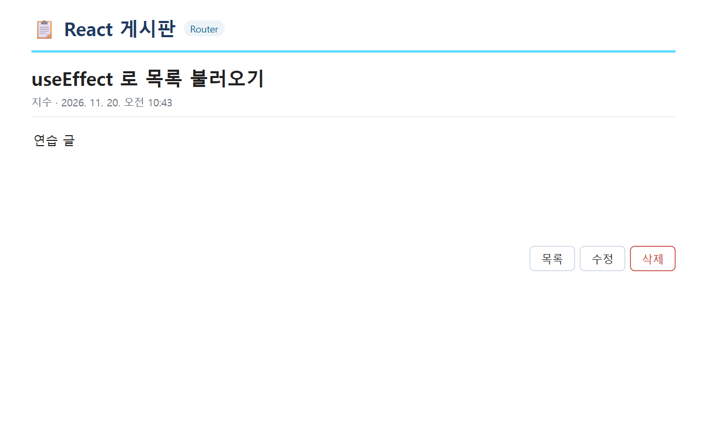

# 7장. 프로젝트 ① 게시판을 Router 로 바꾸기

## 학습 목표

- 기초 게시판의 state 화면 전환을 React Router 로 바꾼다.
- 서버 통신 코드를 `api.js` 모듈로 모으고, `ApiError` 로 상태 코드를 전달한다.
- `useApi` 커스텀 훅으로 화면 코드의 반복을 없앤다.
- 바꾸기 전과 후를 비교해 무엇이 좋아졌는지 설명한다.

## 7-1. 바꿀 것

백엔드(Spring Boot)와 DB 는 **기초 과정 것을 그대로** 쓴다. 바뀌는 것은 React 쪽뿐이다.

| | 기초 게시판 | 이 장의 게시판 |
|---|---|---|
| 화면 전환 | App 의 `page` state | 주소 + `<Routes>` |
| 화면 파일 | `components/PostList.jsx` 등 | `pages/PostListPage.jsx` 등 |
| 서버 통신 | 화면마다 `fetch` + 오류 검사 | `api.js` 의 함수 (`getPosts()` ...) |
| 불러오기 코드 | 화면마다 state 3개 + useEffect | `useApi(() => getPost(id), [id])` 한 줄 |
| 화면 이동 | 부모가 내려준 `onSelect`, `onBack` ... | `<Link to>`, `navigate()` |

| 주소 | 화면 |
|---|---|
| `/` | PostListPage (목록) |
| `/posts/new` | PostFormPage (글쓰기) |
| `/posts/:id` | PostDetailPage (읽기) |
| `/posts/:id/edit` | PostFormPage (수정) |
| 그 밖 | NotFoundPage |

## 7-2. 준비

기초 과정의 DB 와 API 서버를 켠다 (기초 교안 9-13).

**[PS]** DB

```powershell
cd C:\study\board
docker compose up -d      # 기초 게시판 DB 켜기 (뒤에서 켜고 프롬프트를 돌려준다). 서버는 IntelliJ 에서 BoardApplication ▶
```

API 서버는 IntelliJ 로 `C:\study\board\backend` 를 열고 `BoardApplication` 을 ▶ 실행한다. http://localhost:8080/docs 가 열리면 준비 끝.

> 기초 과정 폴더(`C:\study\board`)가 없다면 저장소의 `basic\board` 폴더를 `C:\study\board` 로 복사한 뒤 기초 교안 9-3 처럼 IntelliJ 로 backend 를 열면 된다.

새 React 프로젝트는 기초 게시판 프런트엔드를 **복사해서** 시작한다. (원래 것은 비교용으로 남겨 둔다.)

**[PS]** 터미널 3

```powershell
# 기초 완성본 React 를 frontend-router 라는 새 폴더로 복사해서 고친다 (원본은 그대로 두어 비교할 수 있게)
Copy-Item -Recurse C:\study\react-spring-postgresql\basic\board\frontend C:\study\board\frontend-router
cd C:\study\board\frontend-router
npm install                  # 복사한 폴더에도 라이브러리가 필요하다 (node_modules 는 복사되지 않았거나 깨졌을 수 있다)
npm install react-router     # 이번 장에서 새로 쓰는 라이브러리
```

그다음 폴더를 정리한다.

1. `src/components/PostList.jsx`, `PostDetail.jsx`, `PostForm.jsx` 를 지운다. (pages 로 새로 만든다)
2. `src/config.js` 를 지운다. (주소는 `api.js` 로, 날짜 함수는 `format.js` 로 옮긴다)
3. `src/pages`, `src/hooks` 폴더를 만든다.

완성본은 저장소의 `advanced/board-router/frontend` 다.

## 7-3. api.js - 서버 통신을 한 곳에

<!-- file: advanced/board-router/frontend/src/api.js -->

```js
// api.js - 서버와 주고받는 코드를 한 파일에 모은 "API 모듈"
//
// 기초 과정에서는 화면 컴포넌트마다 fetch(...) 와 오류 검사를 직접 썼다.
// 이 파일로 모으면 좋은 점
//   - 화면 코드에는 getPosts(), createPost(form) 처럼 "무엇을" 만 남고 "어떻게" 는 사라진다.
//   - 주소·헤더·오류 처리를 고칠 때 이 파일만 고치면 된다.
//     (9장에서 로그인 토큰을 붙일 때도 request 함수 한 곳만 고친다)

export const API_URL = "http://localhost:8080/api";

// 서버가 실패 상태 코드(400, 404 ...)를 돌려줬을 때 던질 오류.
// status 를 함께 담아 두면 화면에서 "404 면 이렇게" 처럼 나눠 처리할 수 있다.
export class ApiError extends Error {
  constructor(status, message) {
    super(message);
    this.status = status;
  }
}

// 모든 요청이 거쳐 가는 함수
//   path    : "/posts" 처럼 API_URL 뒤에 붙을 주소
//   options : { method, body } - body 에는 객체를 넣으면 JSON 으로 바꿔 보낸다
export async function request(path, { method = "GET", body } = {}) {
  let res;
  try {
    res = await fetch(API_URL + path, {
      method,
      headers: body ? { "Content-Type": "application/json" } : {},
      body: body ? JSON.stringify(body) : undefined,
    });
  } catch {
    // 서버가 꺼져 있거나 주소가 틀리면 응답 자체가 없다
    throw new ApiError(0, "API 서버에 연결할 수 없습니다. 서버가 켜져 있나요?");
  }

  if (res.status === 204) return null; // 204 No Content: 돌려줄 내용 없음 (삭제 성공)

  const data = await res.json().catch(() => null); // 본문이 JSON 이 아니면 null
  if (!res.ok) {
    // 우리 Spring Boot 서버는 오류 이유를 { "detail": "..." } 로 보낸다 (GlobalExceptionHandler)
    const message = typeof data?.detail === "string" ? data.detail : `요청 실패 (${res.status})`;
    throw new ApiError(res.status, message);
  }
  return data;
}

// ---------------------------------------------------------------- 게시글 API
export const getPosts = () => request("/posts");
export const getPost = (id) => request(`/posts/${id}`);
export const createPost = (post) => request("/posts", { method: "POST", body: post });
export const updatePost = (id, post) => request(`/posts/${id}`, { method: "PUT", body: post });
export const deletePost = (id) => request(`/posts/${id}`, { method: "DELETE" });
```

- 모든 요청이 `request` 한 함수를 거친다. 연결 실패, 204, 오류 메시지 꺼내기가 여기서 한 번에 처리된다.
- `ApiError` 는 `Error` 를 확장(`extends`)해 **상태 코드(status)** 를 함께 담는다. 화면에서 `err.status === 404` 처럼 나눠 처리할 수 있다.
- 9장에서 로그인 토큰을 붙일 때도 `request` **한 곳만** 고치면 모든 요청에 붙는다.

날짜 함수는 따로 둔다.

<!-- file: advanced/board-router/frontend/src/format.js -->

```js
// format.js - 화면 표시용 작은 함수
//   "2026-11-20T10:30:00+09:00" → "2026. 11. 20. 오전 10:30"
export function formatDate(text) {
  return new Date(text).toLocaleString("ko-KR", {
    year: "numeric",
    month: "2-digit",
    day: "2-digit",
    hour: "2-digit",
    minute: "2-digit",
  });
}
```

## 7-4. useApi - 불러오기 훅

3장 useFetch 는 주소(url)를 받았다. 이번에는 api.js 함수를 쓰기 위해 **불러오는 함수**를 받는다.

<!-- file: advanced/board-router/frontend/src/hooks/useApi.js -->

```js
// useApi.js - "불러오기 + 로딩 + 오류" 를 묶은 커스텀 훅 (3장 useFetch 의 게시판판)
//
// 3장 useFetch(url) 와 다른 점
//   - 주소 대신 "불러오는 함수" 를 받는다 → api.js 의 getPosts, getPost(id) 를 그대로 쓸 수 있다.
//       const { data, loading, error } = useApi(() => getPost(id), [id]);
//   - deps(의존성 배열)를 함께 받아, 그 값이 바뀌면 다시 불러온다.
//     (함수는 그릴 때마다 새로 만들어지므로 함수 자체를 의존성으로 쓰면 무한 반복된다)

import { useEffect, useState } from "react";

export function useApi(loader, deps) {
  const [data, setData] = useState(null);
  const [loading, setLoading] = useState(true);
  const [error, setError] = useState(null);

  useEffect(() => {
    let ignore = false; // 늦게 도착한 지난 요청의 결과는 버린다
    setLoading(true);
    setError(null);
    loader()
      .then((result) => !ignore && setData(result))
      .catch((err) => !ignore && setError(err)) // err 는 ApiError (status, message)
      .finally(() => !ignore && setLoading(false));
    return () => {
      ignore = true;
    };
    // 의존성 배열은 부르는 쪽이 정해서 넘긴다 (deps)
  }, deps);

  return { data, loading, error };
}
```

```jsx
const { data: posts, loading, error } = useApi(getPosts, []);           // 목록: 처음 한 번
const { data: post, loading, error } = useApi(() => getPost(id), [id]); // 글 하나: id 가 바뀔 때마다
```

## 7-5. main.jsx 와 App.jsx - 주소 지도

<!-- file: advanced/board-router/frontend/src/main.jsx -->

```jsx
// main.jsx - 앱의 시작점
//   기초 과정과 달라진 점: <BrowserRouter> 로 감싸 Router 기능을 켰다 (4장).

import { StrictMode } from "react";
import { createRoot } from "react-dom/client";
import { BrowserRouter } from "react-router";
import "./index.css";
import App from "./App.jsx";

// index.html 의 <div id="root"> 를 찾아 그 안에 React 앱을 그린다
createRoot(document.getElementById("root")).render(
  // StrictMode: 개발 중에만 실수(부작용 등)를 더 잘 찾도록 검사를 켠다. 화면에는 아무것도 그리지 않는다
  <StrictMode>
    {/* BrowserRouter: 브라우저 주소창과 React 를 이어 준다. 이 안쪽에서만 Route·Link·useNavigate 를 쓸 수 있다 */}
    <BrowserRouter>
      <App />
    </BrowserRouter>
  </StrictMode>,
);
```

<!-- file: advanced/board-router/frontend/src/App.jsx -->

```jsx
// App.jsx - 게시판의 "주소 → 화면" 지도 (7장: 기초 게시판을 Router 로 바꾸기)
//
// 기초 과정 App.jsx 와 비교
//   기초: const [page, setPage] = useState({ name: "list" })  → 주소는 항상 "/"
//   심화: 주소 자체가 지금 화면을 나타낸다
//
//   주소                 화면                기초 과정의 page state
//   /                    PostListPage        { name: "list" }
//   /posts/new           PostFormPage        { name: "form" }
//   /posts/3             PostDetailPage      { name: "detail", id: 3 }
//   /posts/3/edit        PostFormPage        { name: "form", id: 3 }
//   그 밖                NotFoundPage        (없었음)
//
//   → 화면 전환 함수(goList, goDetail ...)를 props 로 내려줄 필요가 없어졌다.
//     각 화면이 <Link> 나 navigate() 로 직접 주소를 바꾼다.

import { Route, Routes } from "react-router";
import Layout from "./components/Layout";
import PostListPage from "./pages/PostListPage";
import PostDetailPage from "./pages/PostDetailPage";
import PostFormPage from "./pages/PostFormPage";
import NotFoundPage from "./pages/NotFoundPage";
import "./App.css";

function App() {
  return (
    <Routes>
      <Route element={<Layout />}>
        {/* path 없는 Route = 주소에는 영향 없이 "틀(Layout)" 만 씌운다 */}
        <Route path="/" element={<PostListPage />} />
        <Route path="/posts/new" element={<PostFormPage />} /> {/* /posts/:id 보다 구체적인 주소가 우선 */}
        <Route path="/posts/:id" element={<PostDetailPage />} />
        <Route path="/posts/:id/edit" element={<PostFormPage />} />
        <Route path="*" element={<NotFoundPage />} />
      </Route>
    </Routes>
  );
}

export default App;
```

> `/posts/new` 와 `/posts/:id` 는 둘 다 `/posts/무엇` 모양이다. React Router 는 순서와 상관없이 **더 구체적인 주소**(글자로 정해진 `new`)를 먼저 고르므로, `/posts/new` 가 `id="new"` 로 잘못 잡히지 않는다.

<!-- file: advanced/board-router/frontend/src/components/Layout.jsx -->

```jsx
// Layout.jsx - 모든 화면이 함께 쓰는 머리글 + 본문 자리(Outlet)
//   기초 과정 App.jsx 의 <header> 부분이 여기로 옮겨 왔다.
//   제목을 누르면 목록으로: onClick={goList} 대신 <Link to="/">

import { Link, Outlet } from "react-router";

function Layout() {
  return (
    <div className="container">
      <header className="header">
        <Link to="/" className="logo">
          📋 React 게시판
        </Link>
        <span className="badge">Router</span>
      </header>
      <Outlet />
    </div>
  );
}

export default Layout;
```

## 7-6. 화면(pages) 만들기

### 목록 - PostListPage

<!-- file: advanced/board-router/frontend/src/pages/PostListPage.jsx -->

```jsx
// PostListPage.jsx - 글 목록 ( / )
//
// 기초 과정 PostList.jsx 와 비교
//   - useState 3개 + useEffect + fetch + try/catch  →  useApi(getPosts, []) 한 줄
//   - onSelect(id) 버튼 → <Link to={`/posts/${id}`}>  (진짜 주소가 생겼다)
//   - onWrite 버튼     → <Link to="/posts/new">

import { Link } from "react-router";
import { getPosts } from "../api";
import { useApi } from "../hooks/useApi";
import { formatDate } from "../format";

function PostListPage() {
  // useApi: 불러오기·로딩·오류 상태를 한 번에 돌려주는 사용자 정의 Hook (3장). [] = 처음 한 번만 불러온다
  const { data: posts, loading, error } = useApi(getPosts, []);

  // 불러오는 중·오류면 여기서 먼저 끝낸다 → 아래에서는 posts 가 항상 있다
  if (loading) return <p className="info">⏳ 불러오는 중...</p>;
  if (error) return <p className="error">⚠️ {error.message}</p>;

  return (
    <div>
      <div className="toolbar">
        <span>전체 {posts.length}개</span>
        {/* 버튼 대신 Link: 글쓰기 화면에도 /posts/new 라는 진짜 주소가 생겼다 */}
        <Link to="/posts/new" className="button primary">
          ✏️ 글쓰기
        </Link>
      </div>

      {posts.length === 0 ? (
        <p className="info">아직 글이 없습니다. 첫 글을 써 보세요!</p>
      ) : (
        <table className="post-table">
          <thead>
            <tr>
              <th className="col-id">번호</th>
              <th>제목</th>
              <th className="col-writer">작성자</th>
              <th className="col-date">작성일</th>
            </tr>
          </thead>
          <tbody>
            {/* 글마다 한 줄. key 는 React 가 줄을 구분하는 이름표 */}
            {posts.map((post) => (
              <tr key={post.id}>
                <td className="col-id">{post.id}</td>
                <td>
                  {/* 제목을 누르면 /posts/번호 로 → App.jsx 의 Route 가 상세 화면을 그린다 */}
                  <Link to={`/posts/${post.id}`}>{post.title}</Link>
                </td>
                <td className="col-writer">{post.writer}</td>
                <td className="col-date">{formatDate(post.created_at)}</td>
              </tr>
            ))}
          </tbody>
        </table>
      )}
    </div>
  );
}

export default PostListPage;
```

### 읽기·삭제 - PostDetailPage

<!-- file: advanced/board-router/frontend/src/pages/PostDetailPage.jsx -->

```jsx
// PostDetailPage.jsx - 글 읽기 ( /posts/:id )
//
// 기초 과정 PostDetail.jsx 와 비교
//   - 글 번호를 props(id) 가 아니라 주소에서 꺼낸다: useParams()
//   - 삭제 후 목록으로: onDeleted() → navigate("/")
//   - 이제 /posts/3 주소를 새로 고침해도, 복사해서 보내도 같은 글이 열린다.

import { Link, useNavigate, useParams } from "react-router";
import { deletePost, getPost } from "../api";
import { useApi } from "../hooks/useApi";
import { formatDate } from "../format";

function PostDetailPage() {
  const { id } = useParams(); // "/posts/3" → id = "3" (문자열)
  const navigate = useNavigate();
  const { data: post, loading, error } = useApi(() => getPost(id), [id]);

  const handleDelete = async () => {
    if (!confirm("정말 삭제할까요? 되돌릴 수 없습니다.")) return;
    try {
      await deletePost(id);
      navigate("/"); // 목록으로 이동
    } catch (err) {
      alert(err.message);
    }
  };

  if (loading) return <p className="info">⏳ 불러오는 중...</p>;
  if (error)
    return (
      <div>
        <p className="error">⚠️ {error.status === 404 ? "글을 찾을 수 없습니다." : error.message}</p>
        <Link to="/">목록으로</Link>
      </div>
    );

  return (
    <article className="post-detail">
      <h2>{post.title}</h2>
      <div className="meta">
        {post.writer} · {formatDate(post.created_at)}
        {post.updated_at !== post.created_at && ` · 수정 ${formatDate(post.updated_at)}`}
      </div>
      <div className="content">{post.content || "(내용 없음)"}</div>

      <div className="buttons">
        <Link to="/" className="button">
          목록
        </Link>
        <Link to={`/posts/${post.id}/edit`} className="button">
          수정
        </Link>
        <button className="danger" onClick={handleDelete}>
          삭제
        </button>
      </div>
    </article>
  );
}

export default PostDetailPage;
```

### 글쓰기·수정 - PostFormPage

<!-- file: advanced/board-router/frontend/src/pages/PostFormPage.jsx -->

```jsx
// PostFormPage.jsx - 글쓰기 ( /posts/new ) · 수정 ( /posts/:id/edit )
//
// 기초 과정 PostForm.jsx 와 비교
//   - 수정인지 아닌지를 주소로 판단: useParams() 에 id 가 있으면 수정
//   - 저장 성공 → navigate(`/posts/${새 번호}`)
//   - 취소 → navigate(-1) (바로 전 화면으로. 기초에서는 어디서 왔는지 직접 따져야 했다)
//   - fetch 코드는 api.js 의 createPost / updatePost 로 바뀌었다.

import { useEffect, useState } from "react";
import { useNavigate, useParams } from "react-router";
import { createPost, getPost, updatePost } from "../api";

const EMPTY = { title: "", writer: "", content: "" };

function PostFormPage() {
  const { id } = useParams(); // /posts/new 에서는 undefined
  const isEdit = id !== undefined;
  const navigate = useNavigate();
  const [form, setForm] = useState(EMPTY);
  const [saving, setSaving] = useState(false);
  const [error, setError] = useState(null);

  useEffect(() => {
    if (!isEdit) return;
    getPost(id)
      .then((post) => setForm({ title: post.title, writer: post.writer, content: post.content }))
      .catch((err) => setError(err.message));
  }, [id, isEdit]);

  const handleChange = (e) => setForm({ ...form, [e.target.name]: e.target.value });

  const handleSubmit = async (e) => {
    e.preventDefault();
    if (!form.title.trim() || !form.writer.trim()) {
      setError("제목과 작성자를 입력하세요.");
      return;
    }
    setSaving(true);
    try {
      const saved = isEdit ? await updatePost(id, form) : await createPost(form);
      // replace: true → 방금 본 글쓰기 화면을 방문 기록에서 바꿔치기한다.
      //   그래서 저장 후 "뒤로" 를 눌러도 다시 글쓰기 화면으로 돌아가지 않는다.
      navigate(`/posts/${saved.id}`, { replace: true });
    } catch (err) {
      setError(err.message);
      setSaving(false);
    }
  };

  return (
    <form className="post-form" onSubmit={handleSubmit}>
      <h2>{isEdit ? `${id}번 글 수정` : "새 글 쓰기"}</h2>
      {error && <p className="error">⚠️ {error}</p>}
      <label>
        제목
        <input name="title" value={form.title} onChange={handleChange} maxLength={100} />
      </label>
      <label>
        작성자
        <input name="writer" value={form.writer} onChange={handleChange} maxLength={30} />
      </label>
      <label>
        내용
        <textarea name="content" value={form.content} onChange={handleChange} rows={8} />
      </label>
      <div className="buttons">
        <button type="button" onClick={() => navigate(-1)}>
          취소
        </button>
        <button type="submit" className="primary" disabled={saving}>
          {saving ? "저장 중..." : "저장"}
        </button>
      </div>
    </form>
  );
}

export default PostFormPage;
```

### 404 - NotFoundPage

<!-- file: advanced/board-router/frontend/src/pages/NotFoundPage.jsx -->

```jsx
// NotFoundPage.jsx - 없는 주소 ( path="*" )
//   App.jsx 의 <Route path="*"> 에 연결된다. * 는 "위의 어떤 주소에도 맞지 않으면" 이라는 뜻.
//   /abc 처럼 없는 주소로 들어오면 빈 화면 대신 이 안내를 보여 준다.
import { Link } from "react-router";

function NotFoundPage() {
  return (
    <div className="info">
      <h2>404 - 없는 페이지입니다</h2>
      {/* <a href> 대신 <Link>: 페이지를 새로 받지 않고 React 안에서 주소만 바꾼다 (4장) */}
      <Link to="/">목록으로 가기</Link>
    </div>
  );
}

export default NotFoundPage;
```

## 7-7. 스타일 보충

`<Link>` 는 `<a>` 태그로 그려지므로, 버튼처럼 보이게 하려면 `a.button` 스타일이 필요하다. 기초 게시판 `App.css` 에서 다음 부분을 고친다. (완성본 `advanced/board-router/frontend/src/App.css` 참고)

```css
/* 제목 글자 링크 (Layout 의 <Link className="logo">) */
.logo {
  font-size: 24px;
  font-weight: bold;
  color: #1f3a5f;
  text-decoration: none;
}

/* 목록 표 안의 제목 링크 */
.post-table a {
  color: #1f3a5f;
  text-decoration: none;
}

/* 버튼 규칙에 a.button 을 함께 적는다 */
button,
a.button {
  display: inline-block;
  /* ... 원래 button 규칙 ... */
  color: #222;
  text-decoration: none;
}

button.primary,
a.button.primary {
  border-color: #03588c;
  background: #03588c;
  color: white;
}
```

## 7-8. 확인하기

`npm run dev` 후 http://localhost:5173 에서 다음을 확인한다. (교안을 만들 때 브라우저 자동 시험으로 모두 확인한 항목이다.)

| 해 보기 | 기대 결과 |
|---|---|
| 글 제목 클릭 | 주소가 `/posts/2` 처럼 바뀐다 |
| 글 화면에서 **F5** | 같은 글이 그대로 보인다 |
| 수정 → 저장 | `/posts/2/edit` → `/posts/2`. 이때 **뒤로 가기**를 누르면 수정 화면(`/edit`)으로 돌아가지 않는다. 수정 전에 보던 같은 글 화면이 한 번 더 나오고, 한 번 더 누르면 목록이다 (`replace: true` 가 수정 화면 기록을 바꿔치기했기 때문) |
| 글쓰기 → 저장 | 새 글 번호 주소로 이동 |
| 삭제 | 목록(`/`)으로 이동 |
| 주소창에 `/posts/999` | "글을 찾을 수 없습니다." |
| 주소창에 `/nothing` | 404 화면 |



## 정리

- 화면 전환 state 를 없애고 **주소**가 화면을 정하게 했다. 새로 고침·뒤로 가기·주소 공유가 된다.
- 서버 통신은 `api.js` 한 곳에. 화면은 `getPosts()` 처럼 "무엇을" 만 부른다.
- 반복되던 불러오기 코드는 `useApi` 훅 한 줄로.
- 부모가 화면 전환 함수를 내려줄 필요가 없어져 컴포넌트가 서로 덜 묶였다.

## 확인 문제

1. 기초 게시판의 `goDetail(id)` 는 Router 버전에서 무엇으로 바뀌었는가? 두 가지 방법을 쓰시오.
2. `useApi(() => getPost(id), [id])` 에서 `[id]` 를 `[]` 로 바꾸면 어떤 문제가 생기는지 설명하시오. (힌트: 글 화면에서 다른 글로 바로 이동하는 링크가 있다면)
3. api.js 에 `searchPosts(q)` 를 추가한다면 어떻게 쓰겠는가? (서버가 `/api/posts?q=검색어` 를 받는다고 가정)
4. PostDetailPage 에서 404 일 때와 서버가 꺼졌을 때 보이는 문구가 다르다. 각각 어디서 정해지는지 쓰시오.
