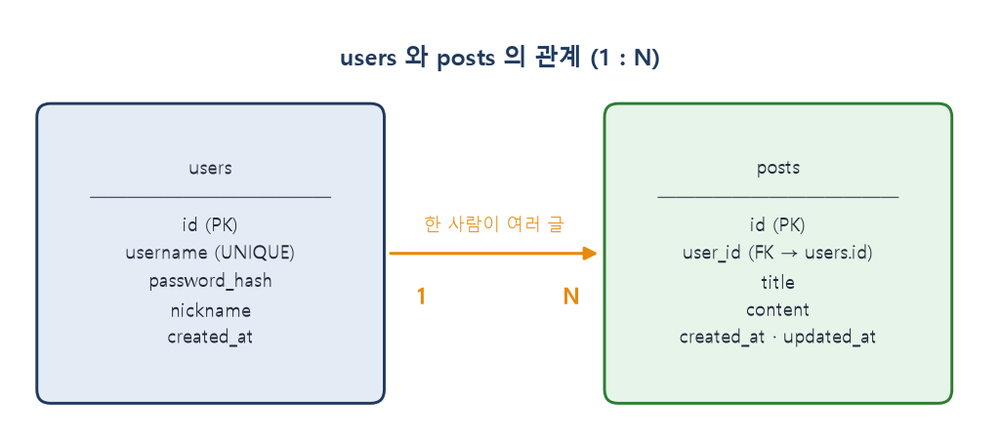
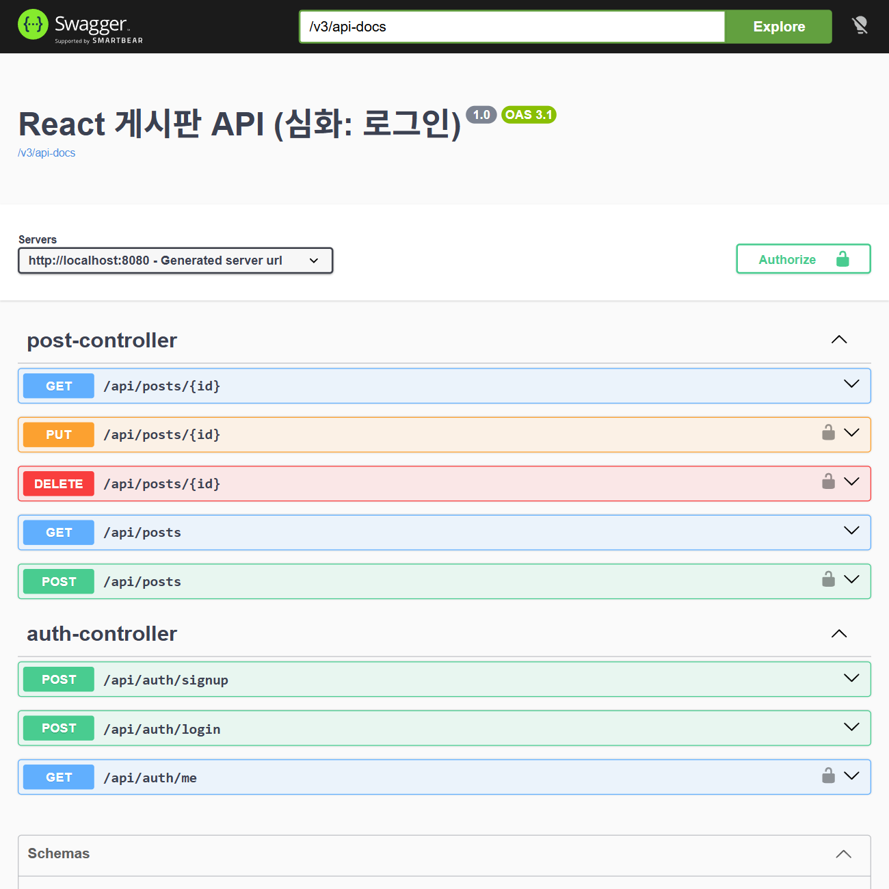

# 8장. 프로젝트 ② Spring Boot 회원가입·로그인 API

## 학습 목표

- users 테이블(User Entity)을 만들고 posts 와 `@ManyToOne` 외래 키로 잇는다.
- 회원가입(BCrypt 해시 저장)과 로그인(JWT 발급) API 를 만든다.
- Spring Security 에 JWT 필터를 끼워 "토큰 검사 → 지금 요청한 사람" 을 알아낸다.
- 주소별 접근 규칙(401)과 글쓴이 본인 검사(403)를 구분해 넣는다.
- `/docs` 의 **Authorize** 로 토큰을 넣어 API 를 시험한다.

## 8-1. 무엇이 바뀌나

**데이터베이스** - 사용자 표가 생기고, 글은 작성자 **이름(글자)** 대신 작성자 **번호(user_id)** 를 가진다.



| | 기초 과정 | 심화 과정 |
|---|---|---|
| 작성자 | 글쓰기 폼에서 아무 이름이나 입력 (`writer`) | 로그인한 사람 (토큰에서 알아냄) |
| 글쓰기 | 누구나 | 로그인한 사람만 (아니면 401) |
| 수정·삭제 | 누구나 | 글쓴이 본인만 (아니면 403) |
| DB | `board` (포트 5433) | `authboard` (포트 5434) |
| 새 라이브러리 | - | `spring-boot-starter-security`, `jjwt` |

**API** - 인증 API 3개가 늘고, 글 API 에 로그인 확인이 붙는다. JSON 모양은 기초 과정과 같게 맞췄기 때문에 9장 React 코드가 거의 그대로 쓰인다.

| 주소 | 방식 | 로그인 | 하는 일 | 성공 |
|---|---|---|---|---|
| `/api/auth/signup` | POST | - | 회원가입 | 201 |
| `/api/auth/login` | POST | - | 로그인 → 토큰 | 200 |
| `/api/auth/me` | GET | 필요 | 토큰 주인 정보 | 200 |
| `/api/posts` | GET | - | 목록 (`?user_id=3` 이면 그 사람 글만) | 200 |
| `/api/posts/{id}` | GET | - | 글 하나 | 200 |
| `/api/posts` | POST | 필요 | 글쓰기 | 201 |
| `/api/posts/{id}` | PUT | 본인 | 수정 | 200 |
| `/api/posts/{id}` | DELETE | 본인 | 삭제 | 204 |

**새 패키지 구조**

```text
src/main/java/com/example/board
├─ BoardApplication.java
├─ user        User(Entity), UserRepository
├─ auth        AuthController, AuthService, SignupRequest, LoginRequest, UserResponse, TokenResponse
├─ post        Post(작성자 = User), PostRepository, PostRequest, PostResponse, PostService, PostController
├─ security    SecurityConfig, JwtAuthenticationFilter, JwtProvider, LoginUser
├─ common      ApiException, GlobalExceptionHandler (기초와 같음)
└─ config      OpenApiConfig (/docs 의 Authorize 버튼)
```

## 8-2. 준비 - 폴더 만들기, DB 켜기, IntelliJ 로 열기

**[PS]**

```powershell
mkdir C:\study\authboard
cd C:\study\authboard
Copy-Item C:\study\react-spring-postgresql\advanced\board\docker-compose.yml .
Copy-Item -Recurse C:\study\react-spring-postgresql\advanced\board\backend .\backend
docker compose up -d
docker compose ps
```

<!-- file: advanced/board/docker-compose.yml -->

```yaml
# =====================================================================
# 심화 과정 8~9장 - 로그인 게시판 데이터베이스 (PostgreSQL 18)
#
#   시작        : docker compose up -d        (이 파일이 있는 폴더에서)
#   상태 확인   : docker compose ps           (STATUS 가 healthy 이면 준비 완료)
#   멈추기      : docker compose stop         (데이터는 남는다)
#   완전히 지우기: docker compose down -v      (컨테이너 + 데이터 볼륨 삭제, 되돌릴 수 없음)
#
# 접속 정보
#   호스트 localhost / 포트 5434 / DB authboard / 사용자 postgres / 비밀번호 postgres
#   ※ 기초 과정 DB(5433, spring-board-db)와 따로 쓴다. 테이블 구조(users 추가)가 달라서
#     기초 과정 글과 섞이지 않게 하려는 것. 두 DB 를 동시에 켜 두어도 포트가 달라 괜찮다.
# =====================================================================

# 프로젝트 이름. 적지 않으면 "폴더 이름"(board)이 프로젝트 이름이 되는데,
# 기초·심화 두 과정의 폴더 이름이 모두 board 라서 서로를 같은 프로젝트로 보고
# 한쪽을 켜면 다른 쪽 컨테이너를 지워 버린다. 이름을 따로 붙여 이 문제를 막는다.
name: react-spring-auth-board

services:
  db:
    image: postgres:18
    container_name: spring-auth-db
    restart: unless-stopped
    ports:
      - "5434:5432"                   # 내 PC 5434 → 컨테이너 5432
    environment:
      POSTGRES_USER: postgres
      POSTGRES_PASSWORD: postgres     # 실습용 비밀번호
      POSTGRES_DB: authboard
      TZ: Asia/Seoul
    command: ["postgres", "-c", "timezone=Asia/Seoul"]
    volumes:
      - authboard_data:/var/lib/postgresql
    healthcheck:
      test: ["CMD-SHELL", "pg_isready -U postgres -d authboard"]
      interval: 5s
      timeout: 3s
      retries: 20

volumes:
  authboard_data:
```

`spring-auth-db` 가 `(healthy)` 이면 DB 준비 끝. 기초 과정 DB(spring-board-db, 5433)와 **동시에 켜 두어도** 포트와 프로젝트 이름이 달라 괜찮다.

그다음 IntelliJ 에서 **File → Open** → `C:\study\authboard\backend` 를 연다. (기초 과정 서버가 IntelliJ 에서 실행 중이면 먼저 ■ 로 끈다. 두 서버 모두 8080 포트를 쓴다.)

<!-- file: advanced/board/backend/build.gradle -->

```groovy
// build.gradle - 심화 과정 로그인 게시판 API 서버의 빌드 설정 (Gradle)
//
// 기초 과정 build.gradle 에 더해진 것
//   - spring-boot-starter-security : 로그인 확인, 주소별 접근 규칙, BCrypt 비밀번호 해시
//   - jjwt (api / impl / jackson)  : JWT 토큰 만들기·검사하기
// IntelliJ 로 backend 폴더를 열면 이 파일을 읽어 라이브러리를 자동으로 받는다.

plugins {
	id 'java'
	id 'org.springframework.boot' version '4.1.2'
	id 'io.spring.dependency-management' version '1.1.7'
}

group = 'com.example'
version = '0.0.1-SNAPSHOT'

java {
	toolchain {
		languageVersion = JavaLanguageVersion.of(21)
	}
}

repositories {
	mavenCentral()
}

dependencies {
	implementation 'org.springframework.boot:spring-boot-starter-webmvc'
	implementation 'org.springframework.boot:spring-boot-starter-data-jpa'
	implementation 'org.springframework.boot:spring-boot-starter-validation'
	implementation 'org.springframework.boot:spring-boot-starter-security'     // ← 심화에서 추가: 인증·인가
	implementation 'org.springdoc:springdoc-openapi-starter-webmvc-ui:3.2.0'
	implementation 'io.jsonwebtoken:jjwt-api:0.13.0'                           // ← 심화에서 추가: JWT
	runtimeOnly 'io.jsonwebtoken:jjwt-impl:0.13.0'
	runtimeOnly 'io.jsonwebtoken:jjwt-jackson:0.13.0'
	runtimeOnly 'org.postgresql:postgresql'

	testImplementation 'org.springframework.boot:spring-boot-starter-webmvc-test'
	testRuntimeOnly 'org.junit.platform:junit-platform-launcher'
}

tasks.named('test') {
	useJUnitPlatform()
}
```

<!-- file: advanced/board/backend/src/main/resources/application.yml -->

```yaml
# application.yml - 로그인 게시판 API 서버 설정
#   ${이름:기본값} → 환경 변수 "이름" 이 있으면 그 값, 없으면 기본값

server:
  port: 8080

spring:
  application:
    name: board
  datasource:                    # 심화 과정 DB (docker-compose.yml: 포트 5434, DB authboard)
    url: ${DB_URL:jdbc:postgresql://localhost:5434/authboard}
    username: postgres
    password: postgres
  jpa:
    hibernate:
      ddl-auto: update           # Entity 를 보고 users, posts 테이블을 만든다
    show-sql: true
    properties:
      hibernate:
        format_sql: true
    open-in-view: false

# JWT(로그인 토큰) 설정 - JwtProvider 가 읽어 간다
jwt:
  # 토큰 서명에 쓰는 비밀 열쇠. 이 값이 새면 누구나 토큰을 위조할 수 있다.
  # 실제 서비스에서는 환경 변수 JWT_SECRET 으로 넣고 코드·GitHub 에 올리지 않는다. (32글자 이상)
  secret: ${JWT_SECRET:dev-only-secret-change-me-0123456789abcdef}
  expiration-minutes: ${ACCESS_TOKEN_MINUTES:60}    # 토큰 유효 시간(분)

springdoc:
  swagger-ui:
    path: /docs
```

> **jwt.secret 은 비밀이다.** 이 값을 아는 사람은 누구의 토큰이든 만들 수 있다. 실제 서비스에서는 코드에 적지 않고 환경 변수(`JWT_SECRET`)로 넣으며, GitHub 에 올리지 않는다.

## 8-3. Entity - User 와 Post 의 관계

<!-- file: advanced/board/backend/src/main/java/com/example/board/user/User.java -->

```java
package com.example.board.user;

import jakarta.persistence.Column;
import jakarta.persistence.Entity;
import jakarta.persistence.GeneratedValue;
import jakarta.persistence.GenerationType;
import jakarta.persistence.Id;
import jakarta.persistence.PrePersist;
import jakarta.persistence.Table;
import java.time.LocalDateTime;
import java.time.temporal.ChronoUnit;

/**
 * User - 회원 Entity (users 테이블)
 *
 *   id             bigint        자동 번호
 *   username       varchar(30)   로그인 아이디 (UNIQUE: 중복 불가)
 *   password_hash  varchar(255)  비밀번호가 아니라 "해시" 를 저장한다 (BCrypt)
 *   nickname       varchar(30)   화면에 보일 이름
 *   created_at     timestamp     가입 시각
 *
 * 테이블 이름을 user 가 아니라 users 로 정한 이유: PostgreSQL 에서 user 는 예약어라서
 * 그대로 쓰면 SQL 오류가 난다.
 */
@Entity
@Table(name = "users")
public class User {

	@Id
	@GeneratedValue(strategy = GenerationType.IDENTITY)
	private Long id;

	@Column(nullable = false, unique = true, length = 30)
	private String username;

	@Column(nullable = false)
	private String passwordHash;

	@Column(nullable = false, length = 30)
	private String nickname;

	@Column(nullable = false, updatable = false)
	private LocalDateTime createdAt;

	protected User() {
	}

	public User(String username, String passwordHash, String nickname) {
		this.username = username;
		this.passwordHash = passwordHash;
		this.nickname = nickname;
	}

	@PrePersist
	void onCreate() {
		createdAt = LocalDateTime.now().truncatedTo(ChronoUnit.MICROS);
	}

	public Long getId() { return id; }
	public String getUsername() { return username; }
	public String getPasswordHash() { return passwordHash; }
	public String getNickname() { return nickname; }
	public LocalDateTime getCreatedAt() { return createdAt; }
}
```

<!-- file: advanced/board/backend/src/main/java/com/example/board/user/UserRepository.java -->

```java
package com.example.board.user;

import java.util.Optional;
import org.springframework.data.jpa.repository.JpaRepository;

/**
 * UserRepository - users 테이블 창구
 *
 *   findByUsername("minsu")   → SELECT ... WHERE username = 'minsu'      (로그인할 때)
 *   existsByUsername("minsu") → SELECT 1 ... WHERE username = 'minsu'    (가입할 때 중복 확인)
 *   findById(3)               → 토큰 속 사용자 번호로 찾기 (JpaRepository 기본 기능)
 *
 * 메서드 이름만 규칙대로 지으면 Spring Data JPA 가 SQL 을 만들어 준다.
 */
public interface UserRepository extends JpaRepository<User, Long> {

	Optional<User> findByUsername(String username);

	boolean existsByUsername(String username);
}
```

기초 과정 `Post` 의 `String writer` 가 `User author` 로 바뀌었다.

<!-- file: advanced/board/backend/src/main/java/com/example/board/post/Post.java -->

```java
package com.example.board.post;

import com.example.board.user.User;
import jakarta.persistence.Column;
import jakarta.persistence.Entity;
import jakarta.persistence.FetchType;
import jakarta.persistence.GeneratedValue;
import jakarta.persistence.GenerationType;
import jakarta.persistence.Id;
import jakarta.persistence.JoinColumn;
import jakarta.persistence.ManyToOne;
import jakarta.persistence.PrePersist;
import jakarta.persistence.PreUpdate;
import jakarta.persistence.Table;
import java.time.LocalDateTime;
import java.time.temporal.ChronoUnit;
import org.hibernate.annotations.OnDelete;
import org.hibernate.annotations.OnDeleteAction;

/**
 * Post - 게시글 Entity (심화: 작성자가 "이름 글자" 에서 "회원(User)" 으로 바뀌었다)
 *
 * 기초 과정 Post 와 달라진 점
 *   - String writer 대신 User author
 *     @ManyToOne : 글 여러 개(Many)가 회원 한 명(One)에게 속한다 → posts.user_id 외래 키(FK) 열이 생긴다
 *     @JoinColumn(name = "user_id") : 외래 키 열 이름
 *     @OnDelete(CASCADE) : 회원이 지워지면 그 사람 글도 DB 가 함께 지운다 (ON DELETE CASCADE)
 *     fetch = LAZY : 글을 읽을 때 회원 정보는 "필요할 때" 읽는다 (Repository 의 @EntityGraph 로 한 번에 읽게 했다)
 *   - 수정 메서드에 작성자가 없다. 작성자는 처음 쓴 사람으로 고정된다.
 */
@Entity
@Table(name = "posts")
public class Post {

	@Id
	@GeneratedValue(strategy = GenerationType.IDENTITY)
	private Long id;

	@ManyToOne(fetch = FetchType.LAZY, optional = false)
	@JoinColumn(name = "user_id", nullable = false)
	@OnDelete(action = OnDeleteAction.CASCADE)
	private User author;

	@Column(nullable = false, length = 100)
	private String title;

	@Column(nullable = false, columnDefinition = "text")
	private String content;

	@Column(nullable = false, updatable = false)
	private LocalDateTime createdAt;

	@Column(nullable = false)
	private LocalDateTime updatedAt;

	protected Post() {
	}

	public Post(User author, String title, String content) {
		this.author = author;
		this.title = title;
		this.content = content;
	}

	@PrePersist
	void onCreate() {
		createdAt = now();
		updatedAt = createdAt;
	}

	@PreUpdate
	void onUpdate() {
		updatedAt = now();
	}

	private static LocalDateTime now() {
		return LocalDateTime.now().truncatedTo(ChronoUnit.MICROS); // PostgreSQL 저장 단위(마이크로초)에 맞춘다
	}

	public void update(String title, String content) {
		this.title = title;
		this.content = content;
	}

	/** 이 글을 쓴 사람이 userId 인가? (소유권 검사) */
	public boolean isWrittenBy(Long userId) {
		return author.getId().equals(userId);
	}

	public Long getId() { return id; }
	public User getAuthor() { return author; }
	public String getTitle() { return title; }
	public String getContent() { return content; }
	public LocalDateTime getCreatedAt() { return createdAt; }
	public LocalDateTime getUpdatedAt() { return updatedAt; }
}
```

<!-- file: advanced/board/backend/src/main/java/com/example/board/post/PostRepository.java -->

```java
package com.example.board.post;

import java.util.List;
import java.util.Optional;
import org.springframework.data.jpa.repository.EntityGraph;
import org.springframework.data.jpa.repository.JpaRepository;

/**
 * PostRepository - posts 테이블 창구 (심화)
 *
 * @EntityGraph(attributePaths = "author") : 글을 읽을 때 작성자(users)도 JOIN 으로 "한 번에" 읽는다.
 *   이것이 없으면 글 10개 목록에서 작성자 닉네임을 꺼낼 때 SELECT 가 1 + 10 번 실행된다 (N+1 문제).
 *   콘솔의 SQL 로그(show-sql)에서 left join users 가 보이는지 확인해 보자.
 *
 *   findAllByOrderByIdDesc()                  전체 글, 최근 글이 위로
 *   findAllByAuthorIdOrderByIdDesc(3)         3번 회원의 글만 ("내 글" 보기) → WHERE p.user_id = 3
 *   findWithAuthorById(5)                     글 하나 + 작성자
 */
public interface PostRepository extends JpaRepository<Post, Long> {

	@EntityGraph(attributePaths = "author")
	List<Post> findAllByOrderByIdDesc();

	@EntityGraph(attributePaths = "author")
	List<Post> findAllByAuthorIdOrderByIdDesc(Long authorId);

	@EntityGraph(attributePaths = "author")
	Optional<Post> findWithAuthorById(Long id);
}
```

서버를 처음 켜면 Hibernate 가 두 테이블과 외래 키를 만든다. (IntelliJ Run 창에 실제로 찍힌 SQL 중 일부)

```text
create table users (
    id bigint generated by default as identity,
    created_at timestamp(6) not null,
    nickname varchar(30) not null,
    password_hash varchar(255) not null,
    username varchar(30) not null,
    primary key (id)
)
...
alter table if exists users
   add constraint UKr43af9ap4edm43mmtq01oddj6 unique (username)
alter table if exists posts
   add constraint FK5lidm6cqbc7u4xhqpxm898qme
   foreign key (user_id)
   references users
   on delete cascade
```

> 처음 켤 때 `constraint "uk..." of relation "users" does not exist, skipping` 같은 WARN 이 한 줄 보일 수 있다. Hibernate 가 "제약 조건이 있으면 지우고 다시 만든다" 를 시도한 것이라 무시해도 된다.

## 8-4. JwtProvider - 토큰 만들기와 검사

<!-- file: advanced/board/backend/src/main/java/com/example/board/security/JwtProvider.java -->

```java
package com.example.board.security;

import io.jsonwebtoken.Claims;
import io.jsonwebtoken.JwtException;
import io.jsonwebtoken.Jwts;
import io.jsonwebtoken.security.Keys;
import java.nio.charset.StandardCharsets;
import java.time.Duration;
import java.time.Instant;
import java.util.Date;
import javax.crypto.SecretKey;
import org.springframework.beans.factory.annotation.Value;
import org.springframework.stereotype.Component;

/**
 * JwtProvider - JWT(로그인 토큰) 만들기와 검사하기 (jjwt 라이브러리)
 *
 * 이 파일이 보여 주는 것
 *   - 토큰 안에 "누구인지(sub)" 와 "언제까지 유효한지(exp)" 를 적고 SECRET_KEY 로 서명(HS256)한다.
 *   - 서버는 토큰을 따로 저장하지 않는다. 서명만 검사하면 위조 여부를 알 수 있다.
 *   - 토큰 내용은 누구나 읽을 수 있다(암호화가 아님). 그래서 비밀번호 같은 것은 넣지 않는다.
 *   - @Value("${jwt.secret}") : application.yml 의 jwt.secret 값을 넣어 준다.
 */
@Component
public class JwtProvider {

	private final SecretKey key;
	private final Duration expiration;

	public JwtProvider(@Value("${jwt.secret}") String secret,
			@Value("${jwt.expiration-minutes}") long expirationMinutes) {
		// HS256 은 32바이트(256비트) 이상의 열쇠가 필요하다. 짧으면 서버가 켜질 때 오류가 난다
		this.key = Keys.hmacShaKeyFor(secret.getBytes(StandardCharsets.UTF_8));
		this.expiration = Duration.ofMinutes(expirationMinutes);
	}

	/** 사용자 번호를 담은 토큰을 만든다 */
	public String createToken(Long userId) {
		Instant now = Instant.now();
		return Jwts.builder()
				.subject(String.valueOf(userId)) //              sub: 토큰 주인 (문자열로 넣는 것이 규칙)
				.issuedAt(Date.from(now)) //                     iat: 발급 시각
				.expiration(Date.from(now.plus(expiration))) //  exp: 만료 시각
				.signWith(key) //                                서명 (열쇠 길이를 보고 HS256 을 고른다)
				.compact(); //                                   "헤더.내용.서명" 글자로
	}

	/**
	 * 토큰을 검사해 사용자 번호를 돌려준다. 위조됐거나 만료됐으면 null.
	 * parseSignedClaims 가 서명과 만료 시각을 함께 검사하고, 문제가 있으면 JwtException 을 던진다.
	 *   ExpiredJwtException(만료), SignatureException(위조), MalformedJwtException(모양이 틀림) ...
	 */
	public Long parseUserId(String token) {
		try {
			Claims claims = Jwts.parser().verifyWith(key).build()
					.parseSignedClaims(token)
					.getPayload();
			return Long.valueOf(claims.getSubject());
		} catch (JwtException | IllegalArgumentException e) {
			return null;
		}
	}
}
```

<!-- file: advanced/board/backend/src/main/java/com/example/board/security/LoginUser.java -->

```java
package com.example.board.security;

/**
 * LoginUser - "지금 요청한 사람" 을 담는 작은 객체
 *
 * JwtAuthenticationFilter 가 토큰을 검사한 뒤 이 객체를 만들어 Spring Security 에 맡겨 둔다.
 * Controller 에서는 @AuthenticationPrincipal LoginUser user 로 꺼내 쓴다.
 */
public record LoginUser(Long id, String username, String nickname) {
}
```

## 8-5. Spring Security - 필터와 주소 규칙

Spring Security 를 추가하면 모든 요청이 Controller 에 닿기 전에 **필터 줄(filter chain)** 을 지나간다. 우리는 그 줄에 토큰 검사 필터를 하나 끼워 넣는다.

```text
요청 ─▶ CORS 필터 ─▶ JwtAuthenticationFilter ─▶ 주소 규칙 검사 ─▶ Controller ─▶ Service
         (5173 허락)     (토큰 → LoginUser)        (로그인 필요한데     (404 없는 글,
                                                   없으면 401)          403 남의 글)
```

<!-- file: advanced/board/backend/src/main/java/com/example/board/security/JwtAuthenticationFilter.java -->

```java
package com.example.board.security;

import com.example.board.user.UserRepository;
import jakarta.servlet.FilterChain;
import jakarta.servlet.ServletException;
import jakarta.servlet.http.HttpServletRequest;
import jakarta.servlet.http.HttpServletResponse;
import java.io.IOException;
import java.util.List;
import org.springframework.security.authentication.UsernamePasswordAuthenticationToken;
import org.springframework.security.core.context.SecurityContextHolder;
import org.springframework.web.filter.OncePerRequestFilter;

/**
 * JwtAuthenticationFilter - 모든 요청에서 토큰을 먼저 검사하는 "필터"
 *
 * 요청이 Controller 에 닿기 전에 이 필터를 지나간다. 하는 일:
 *   1. 헤더 "Authorization: Bearer <토큰>" 에서 토큰을 꺼낸다.
 *   2. JwtProvider 로 서명·만료를 검사해 사용자 번호를 얻는다.
 *   3. DB 에 그 사용자가 있으면 LoginUser 를 만들어 SecurityContext 에 넣는다 = "이 요청은 로그인한 요청"
 *   4. 토큰이 없거나 틀려도 여기서 막지 않는다. 그냥 "로그인 안 한 요청" 으로 다음으로 넘긴다.
 *      → 글 목록처럼 누구나 볼 수 있는 주소는 그대로 통과하고,
 *        로그인이 필요한 주소는 SecurityConfig 의 규칙에 걸려 401 이 된다.
 *      토큰이 틀렸었다는 표시(JWT_ERROR)를 남겨 두면, 401 응답 문구를 "만료되었습니다" 로 고를 수 있다.
 *
 * @Component 를 붙이지 않은 이유: 붙이면 Spring Boot 가 일반 서블릿 필터로도 한 번 더 등록해서
 * 필터가 두 번 실행된다. SecurityConfig 에서 직접 new 로 만들어 Security 필터 줄에만 넣는다.
 */
public class JwtAuthenticationFilter extends OncePerRequestFilter {

	public static final String JWT_ERROR = "jwt_error"; // 요청에 남겨 두는 표시 이름

	private final JwtProvider jwtProvider;
	private final UserRepository userRepository;

	public JwtAuthenticationFilter(JwtProvider jwtProvider, UserRepository userRepository) {
		this.jwtProvider = jwtProvider;
		this.userRepository = userRepository;
	}

	@Override
	protected void doFilterInternal(HttpServletRequest request, HttpServletResponse response, FilterChain chain)
			throws ServletException, IOException {
		String header = request.getHeader("Authorization");
		if (header != null && header.startsWith("Bearer ")) {
			String token = header.substring(7); // "Bearer " 뒤의 글자
			Long userId = jwtProvider.parseUserId(token);
			var user = (userId == null) ? null : userRepository.findById(userId).orElse(null); // 탈퇴했을 수도 있다
			if (user != null) {
				LoginUser loginUser = new LoginUser(user.getId(), user.getUsername(), user.getNickname());
				// 권한 목록은 이 과정에서 쓰지 않으므로 빈 목록 (관리자 기능을 만들면 ROLE_ADMIN 등을 넣는다)
				var authentication = new UsernamePasswordAuthenticationToken(loginUser, null, List.of());
				SecurityContextHolder.getContext().setAuthentication(authentication);
			} else {
				request.setAttribute(JWT_ERROR, true); // 토큰은 왔지만 쓸 수 없음 (만료·위조·없는 사용자)
			}
		}
		chain.doFilter(request, response); // 다음 필터(그리고 Controller)로 넘긴다
	}
}
```

<!-- file: advanced/board/backend/src/main/java/com/example/board/security/SecurityConfig.java -->

```java
package com.example.board.security;

import com.example.board.user.UserRepository;
import jakarta.servlet.http.HttpServletResponse;
import java.io.IOException;
import java.util.List;
import org.springframework.context.annotation.Bean;
import org.springframework.context.annotation.Configuration;
import org.springframework.http.HttpMethod;
import org.springframework.security.config.Customizer;
import org.springframework.security.config.annotation.web.builders.HttpSecurity;
import org.springframework.security.config.http.SessionCreationPolicy;
import org.springframework.security.core.userdetails.UserDetailsService;
import org.springframework.security.core.userdetails.UsernameNotFoundException;
import org.springframework.security.crypto.bcrypt.BCryptPasswordEncoder;
import org.springframework.security.crypto.password.PasswordEncoder;
import org.springframework.security.web.SecurityFilterChain;
import org.springframework.security.web.authentication.UsernamePasswordAuthenticationFilter;
import org.springframework.web.cors.CorsConfiguration;
import org.springframework.web.cors.CorsConfigurationSource;
import org.springframework.web.cors.UrlBasedCorsConfigurationSource;

/**
 * SecurityConfig - Spring Security 설정: "어느 주소를 누가 쓸 수 있나"
 *
 * 이 파일이 보여 주는 것
 *   1. 주소별 규칙 (authorizeHttpRequests)
 *        GET  /api/posts/**                   누구나
 *        POST /api/auth/signup, /api/auth/login  누구나
 *        /docs 등 API 시험 화면                 누구나
 *        그 밖 (글쓰기·수정·삭제, /api/auth/me)   로그인한 사람만 → 아니면 401
 *   2. 세션을 만들지 않는다 (STATELESS) - 요청마다 토큰으로 확인하는 JWT 방식이므로
 *   3. csrf 끄기 - 쿠키로 로그인 상태를 유지하지 않으므로(토큰을 헤더로 보냄) 필요 없다
 *   4. 우리가 만든 JwtAuthenticationFilter 를 Security 필터 줄에 끼워 넣는다
 *   5. 401·403 응답을 { "detail": "..." } JSON 으로 (React 가 그대로 보여 줄 수 있게)
 *   6. CORS - Security 를 쓰면 CORS 도 여기서 켜 줘야 한다 (WebConfig 대신)
 *   7. 비밀번호 해시 도구(PasswordEncoder)로 BCrypt 를 등록
 *   8. 빈 UserDetailsService 등록 - Spring 의 "아이디·비밀번호 로그인 기능" 을 쓰지 않는다는 표시
 */
@Configuration
public class SecurityConfig {

	@Bean
	public SecurityFilterChain filterChain(HttpSecurity http, JwtProvider jwtProvider, UserRepository userRepository)
			throws Exception {
		http
				.csrf(csrf -> csrf.disable())
				.cors(Customizer.withDefaults()) // 아래 corsConfigurationSource() 를 쓴다
				.sessionManagement(s -> s.sessionCreationPolicy(SessionCreationPolicy.STATELESS))
				.formLogin(form -> form.disable()) //  Spring 기본 로그인 화면 끄기
				.httpBasic(basic -> basic.disable()) // 브라우저 기본 로그인 창 끄기
				.authorizeHttpRequests(auth -> auth
						.requestMatchers(HttpMethod.GET, "/api/posts", "/api/posts/**").permitAll()
						.requestMatchers(HttpMethod.POST, "/api/auth/signup", "/api/auth/login").permitAll()
						.requestMatchers("/docs", "/swagger-ui/**", "/v3/api-docs/**", "/error").permitAll()
						.anyRequest().authenticated())
				.exceptionHandling(e -> e
						// 로그인이 필요한데 안 됨 → 401. 토큰이 틀렸었다면 "만료" 문구
						.authenticationEntryPoint((request, response, ex) -> writeJson(response, 401,
								request.getAttribute(JwtAuthenticationFilter.JWT_ERROR) != null
										? "로그인이 만료되었습니다. 다시 로그인하세요"
										: "로그인이 필요합니다"))
						// 로그인은 했지만 권한 없음 → 403 (이 과정에서는 거의 쓰이지 않는다)
						.accessDeniedHandler((request, response, ex) -> writeJson(response, 403, "권한이 없습니다")))
				.addFilterBefore(new JwtAuthenticationFilter(jwtProvider, userRepository),
						UsernamePasswordAuthenticationFilter.class);
		return http.build();
	}

	/** BCrypt: 비밀번호 전용 해시. 일부러 느리고 매번 다른 소금(salt)을 섞는다 */
	@Bean
	public PasswordEncoder passwordEncoder() {
		return new BCryptPasswordEncoder();
	}

	/**
	 * 이 서버는 로그인을 AuthService(직접 비밀번호 비교) + JWT 로 처리하므로 Spring 의 기본 사용자 조회는 쓰지 않는다.
	 * 이 Bean 이 없으면 Spring 이 임시 계정을 만들고 콘솔에 "Using generated security password: ..." 를 찍는다.
	 */
	@Bean
	public UserDetailsService userDetailsService() {
		return username -> {
			throw new UsernameNotFoundException(username);
		};
	}

	/** React 개발 서버(5173)에서 오는 요청 허락. Authorization 헤더도 허락해야 토큰을 보낼 수 있다 */
	@Bean
	public CorsConfigurationSource corsConfigurationSource() {
		CorsConfiguration config = new CorsConfiguration();
		config.setAllowedOrigins(List.of("http://localhost:5173", "http://127.0.0.1:5173"));
		config.setAllowedMethods(List.of("GET", "POST", "PUT", "DELETE"));
		config.setAllowedHeaders(List.of("*"));
		UrlBasedCorsConfigurationSource source = new UrlBasedCorsConfigurationSource();
		source.registerCorsConfiguration("/api/**", config);
		return source;
	}

	private static void writeJson(HttpServletResponse response, int status, String detail) throws IOException {
		response.setStatus(status);
		response.setContentType("application/json;charset=UTF-8");
		response.getWriter().write("{\"detail\":\"" + detail + "\"}");
	}
}
```

| 규칙 | 코드 | 뜻 |
|---|---|---|
| 누구나 | `.requestMatchers(HttpMethod.GET, "/api/posts", "/api/posts/**").permitAll()` | 글 목록·읽기는 로그인 없이 |
| 누구나 | `.requestMatchers(HttpMethod.POST, "/api/auth/signup", "/api/auth/login").permitAll()` | 가입·로그인 |
| 로그인 필요 | `.anyRequest().authenticated()` | 위에 없는 나머지 전부 (글쓰기·수정·삭제, /me) |

> **기초 과정의 WebConfig(CORS) 는 어디 갔지?** Spring Security 를 쓰면 CORS 를 Security 필터 줄에서 처리해야 preflight(OPTIONS) 요청이 로그인 검사에 막히지 않는다. 그래서 `SecurityConfig` 의 `corsConfigurationSource()` 로 옮겼고, Authorization 헤더도 허락해 두었다.

## 8-6. 인증 API - 가입·로그인·내 정보

<!-- file: advanced/board/backend/src/main/java/com/example/board/auth/SignupRequest.java -->

```java
package com.example.board.auth;

import jakarta.validation.constraints.NotBlank;
import jakarta.validation.constraints.Pattern;
import jakarta.validation.constraints.Size;

/**
 * SignupRequest - 회원가입 요청 JSON
 *
 *   { "username": "minsu", "password": "password123", "nickname": "민수" }
 *
 * 규칙 (React SignupPage 의 validate 함수와 같다. 화면 검사는 친절, 서버 검사는 보안)
 *   username : 영문 소문자·숫자·밑줄 4~20자 (정규 표현식 ^[a-z0-9_]{4,20}$)
 *   password : 8~72자 (BCrypt 는 72바이트까지만 쓰기 때문에 위쪽 한계를 둔다)
 *   nickname : 1~30자
 */
public record SignupRequest(
		@NotBlank(message = "아이디를 입력하세요")
		@Pattern(regexp = "^[a-z0-9_]{4,20}$", message = "아이디는 영문 소문자·숫자·밑줄(_)로 4~20자입니다")
		String username,

		@NotBlank(message = "비밀번호를 입력하세요")
		@Size(min = 8, max = 72, message = "비밀번호는 8~72자입니다")
		String password,

		@NotBlank(message = "닉네임을 입력하세요")
		@Size(max = 30, message = "닉네임은 30자까지 쓸 수 있습니다")
		String nickname
) {
}
```

<!-- file: advanced/board/backend/src/main/java/com/example/board/auth/LoginRequest.java -->

```java
package com.example.board.auth;

import jakarta.validation.constraints.NotBlank;

/**
 * LoginRequest - 로그인 요청 JSON  { "username": "minsu", "password": "password123" }
 * 로그인할 때는 형식 규칙을 검사하지 않는다. 틀리면 그냥 "아이디 또는 비밀번호가 올바르지 않습니다".
 */
public record LoginRequest(
		@NotBlank(message = "아이디를 입력하세요") String username,
		@NotBlank(message = "비밀번호를 입력하세요") String password
) {
}
```

<!-- file: advanced/board/backend/src/main/java/com/example/board/auth/UserResponse.java -->

```java
package com.example.board.auth;

import com.example.board.user.User;

/**
 * UserResponse - 회원 정보 응답 JSON  { "id": 3, "username": "minsu", "nickname": "민수" }
 * 비밀번호 해시는 절대 응답에 넣지 않는다. 그래서 Entity(User)를 그대로 돌려주지 않고 이 DTO 를 쓴다.
 */
public record UserResponse(Long id, String username, String nickname) {

	public static UserResponse from(User user) {
		return new UserResponse(user.getId(), user.getUsername(), user.getNickname());
	}
}
```

<!-- file: advanced/board/backend/src/main/java/com/example/board/auth/TokenResponse.java -->

```java
package com.example.board.auth;

import com.fasterxml.jackson.annotation.JsonProperty;

/**
 * TokenResponse - 로그인 성공 응답 JSON
 *
 *   { "access_token": "eyJhbGciOi...", "token_type": "bearer",
 *     "user": { "id": 3, "username": "minsu", "nickname": "민수" } }
 *
 * user 를 함께 돌려주는 이유: 로그인하자마자 화면 머리글에 닉네임을 보여 주려고.
 */
public record TokenResponse(
		@JsonProperty("access_token") String accessToken,
		@JsonProperty("token_type") String tokenType,
		UserResponse user
) {

	public static TokenResponse bearer(String token, UserResponse user) {
		return new TokenResponse(token, "bearer", user);
	}
}
```

<!-- file: advanced/board/backend/src/main/java/com/example/board/auth/AuthService.java -->

```java
package com.example.board.auth;

import com.example.board.common.ApiException;
import com.example.board.security.JwtProvider;
import com.example.board.user.User;
import com.example.board.user.UserRepository;
import org.springframework.http.HttpStatus;
import org.springframework.security.crypto.password.PasswordEncoder;
import org.springframework.stereotype.Service;
import org.springframework.transaction.annotation.Transactional;

/**
 * AuthService - 회원가입·로그인 규칙
 *
 *   가입  : 아이디 중복이면 409 → 비밀번호를 BCrypt 해시로 바꿔 저장 (원래 비밀번호는 어디에도 저장하지 않는다)
 *   로그인 : 아이디로 회원 찾기 → 입력한 비밀번호와 저장된 해시 비교 → 맞으면 JWT 발급
 *
 * PasswordEncoder 는 SecurityConfig 에서 BCryptPasswordEncoder 로 등록했다.
 *   encode("password123")           → "$2a$10$Q5..." (매번 다른 값. 소금(salt)을 섞기 때문)
 *   matches("password123", 해시)     → true / false
 */
@Service
@Transactional(readOnly = true)
public class AuthService {

	private final UserRepository userRepository;
	private final PasswordEncoder passwordEncoder;
	private final JwtProvider jwtProvider;

	public AuthService(UserRepository userRepository, PasswordEncoder passwordEncoder, JwtProvider jwtProvider) {
		this.userRepository = userRepository;
		this.passwordEncoder = passwordEncoder;
		this.jwtProvider = jwtProvider;
	}

	@Transactional
	public UserResponse signup(SignupRequest request) {
		if (userRepository.existsByUsername(request.username())) {
			throw new ApiException(HttpStatus.CONFLICT, "이미 사용 중인 아이디입니다"); // 409
		}
		String hash = passwordEncoder.encode(request.password()); // 비밀번호 → 해시
		User user = userRepository.save(new User(request.username(), hash, request.nickname().strip()));
		return UserResponse.from(user);
	}

	public TokenResponse login(LoginRequest request) {
		User user = userRepository.findByUsername(request.username())
				// 아이디가 없을 때와 비밀번호가 틀릴 때 같은 메시지를 준다
				// → "이 아이디는 가입되어 있다" 는 정보를 공격자에게 주지 않기 위해
				.filter(u -> passwordEncoder.matches(request.password(), u.getPasswordHash()))
				.orElseThrow(() -> new ApiException(HttpStatus.UNAUTHORIZED, "아이디 또는 비밀번호가 올바르지 않습니다"));
		String token = jwtProvider.createToken(user.getId());
		return TokenResponse.bearer(token, UserResponse.from(user));
	}

	public UserResponse me(Long userId) {
		return userRepository.findById(userId)
				.map(UserResponse::from)
				.orElseThrow(() -> new ApiException(HttpStatus.UNAUTHORIZED, "로그인이 만료되었습니다. 다시 로그인하세요"));
	}
}
```

<!-- file: advanced/board/backend/src/main/java/com/example/board/auth/AuthController.java -->

```java
package com.example.board.auth;

import com.example.board.security.LoginUser;
import io.swagger.v3.oas.annotations.security.SecurityRequirement;
import jakarta.validation.Valid;
import org.springframework.http.HttpStatus;
import org.springframework.security.core.annotation.AuthenticationPrincipal;
import org.springframework.web.bind.annotation.GetMapping;
import org.springframework.web.bind.annotation.PostMapping;
import org.springframework.web.bind.annotation.RequestBody;
import org.springframework.web.bind.annotation.RequestMapping;
import org.springframework.web.bind.annotation.ResponseStatus;
import org.springframework.web.bind.annotation.RestController;

/**
 * AuthController - 회원가입·로그인·내 정보 API
 *
 *   주소                 방식   로그인   하는 일                 성공
 *   /api/auth/signup     POST   -        회원가입                 201
 *   /api/auth/login      POST   -        로그인 → 토큰 발급        200
 *   /api/auth/me         GET    필요     토큰 주인의 정보          200
 *
 *   상태 코드 정리
 *     400 Bad Request  : 입력 규칙 위반 (아이디 형식, 비밀번호 길이)
 *     401 Unauthorized : 로그인 실패, 토큰 없음·만료·위조 → "누구세요?"
 *     403 Forbidden    : 로그인은 했지만 남의 글 → "당신은 알지만 안 됩니다"
 *     409 Conflict     : 이미 있는 아이디로 가입
 */
@RestController
@RequestMapping("/api/auth")
public class AuthController {

	private final AuthService authService;

	public AuthController(AuthService authService) {
		this.authService = authService;
	}

	@PostMapping("/signup")
	@ResponseStatus(HttpStatus.CREATED)
	public UserResponse signup(@Valid @RequestBody SignupRequest request) {
		return authService.signup(request);
	}

	@PostMapping("/login")
	public TokenResponse login(@Valid @RequestBody LoginRequest request) {
		return authService.login(request);
	}

	@GetMapping("/me")
	@SecurityRequirement(name = "bearerAuth")
	public UserResponse me(@AuthenticationPrincipal LoginUser user) {
		return authService.me(user.id());
	}
}
```

**로그인 실패 메시지를 하나로** 아이디가 없을 때와 비밀번호가 틀릴 때 같은 문구("아이디 또는 비밀번호가 올바르지 않습니다")를 돌려준다. 다르게 알려 주면 공격자가 "이 아이디는 가입되어 있구나" 를 알아낼 수 있다.

## 8-7. 게시글 API - 작성자와 소유권 검사

<!-- file: advanced/board/backend/src/main/java/com/example/board/post/PostRequest.java -->

```java
package com.example.board.post;

import jakarta.validation.constraints.NotBlank;
import jakarta.validation.constraints.Size;

/**
 * PostRequest - 글쓰기·수정 요청 JSON (심화)
 *
 *   { "title": "제목", "content": "내용" }
 *
 * 기초 과정과 달리 writer(작성자)가 없다. 작성자는 서버가 로그인 토큰을 보고 정한다.
 * → 남의 이름으로 글을 쓸 수 없다. 본문에 "user_id": 99 를 넣어 보내도 이 record 에 칸이 없어서 무시된다.
 */
public record PostRequest(
		@NotBlank(message = "제목을 입력하세요")
		@Size(max = 100, message = "제목은 100자까지 쓸 수 있습니다")
		String title,

		String content
) {
}
```

<!-- file: advanced/board/backend/src/main/java/com/example/board/post/PostResponse.java -->

```java
package com.example.board.post;

import com.fasterxml.jackson.annotation.JsonProperty;
import java.time.LocalDateTime;

/**
 * PostResponse - 글 하나의 응답 JSON (심화)
 *
 *   { "id": 1, "user_id": 3, "writer": "민수", "title": "...", "content": "...",
 *     "created_at": "...", "updated_at": "..." }
 *
 *   - user_id : 글쓴이 번호. React 가 "내 글인가?" (user.id === post.user_id) 를 판단할 때 쓴다.
 *   - writer  : 글쓴이 닉네임. 기초 과정과 같은 이름이라 React 화면 코드를 거의 고치지 않아도 된다.
 */
public record PostResponse(
		Long id,
		@JsonProperty("user_id") Long userId,
		String writer,
		String title,
		String content,
		@JsonProperty("created_at") LocalDateTime createdAt,
		@JsonProperty("updated_at") LocalDateTime updatedAt
) {

	public static PostResponse from(Post post) {
		return new PostResponse(post.getId(), post.getAuthor().getId(), post.getAuthor().getNickname(),
				post.getTitle(), post.getContent(), post.getCreatedAt(), post.getUpdatedAt());
	}
}
```

<!-- file: advanced/board/backend/src/main/java/com/example/board/post/PostService.java -->

```java
package com.example.board.post;

import com.example.board.common.ApiException;
import com.example.board.security.LoginUser;
import com.example.board.user.User;
import com.example.board.user.UserRepository;
import java.util.List;
import org.springframework.http.HttpStatus;
import org.springframework.stereotype.Service;
import org.springframework.transaction.annotation.Transactional;

/**
 * PostService - 게시글 업무 규칙 (심화: 작성자 = 로그인한 사람, 수정·삭제는 본인만)
 *
 * 수정·삭제 검사 순서
 *   1. 글이 있는가?      없으면 404 "글을 찾을 수 없습니다"
 *   2. 내 글인가?        아니면 403 "본인이 쓴 글만 수정·삭제할 수 있습니다"
 *   (로그인 여부 401 은 이 메서드에 오기 전에 Spring Security 가 먼저 검사한다)
 */
@Service
@Transactional(readOnly = true)
public class PostService {

	private final PostRepository postRepository;
	private final UserRepository userRepository;

	public PostService(PostRepository postRepository, UserRepository userRepository) {
		this.postRepository = postRepository;
		this.userRepository = userRepository;
	}

	/** 글 목록. userId 가 있으면 그 사람 글만 */
	public List<PostResponse> findAll(Long userId) {
		List<Post> posts = (userId == null)
				? postRepository.findAllByOrderByIdDesc()
				: postRepository.findAllByAuthorIdOrderByIdDesc(userId);
		return posts.stream().map(PostResponse::from).toList();
	}

	public PostResponse findOne(Long id) {
		return PostResponse.from(getPost(id));
	}

	@Transactional
	public PostResponse create(PostRequest request, LoginUser loginUser) {
		// 토큰 주인(loginUser)을 작성자로. getReferenceById 는 SELECT 없이 "번호만 아는 User" 를 만든다
		User author = userRepository.getReferenceById(loginUser.id());
		Post post = postRepository.save(new Post(author, request.title().strip(), clean(request.content())));
		return findOne(post.getId()); // 닉네임까지 붙은 모양으로 다시 읽어 돌려준다
	}

	@Transactional
	public PostResponse update(Long id, PostRequest request, LoginUser loginUser) {
		Post post = getPost(id); //      1. 있는가? (404)
		checkOwner(post, loginUser); //  2. 내 글인가? (403)
		post.update(request.title().strip(), clean(request.content()));
		postRepository.flush(); //       UPDATE 를 지금 실행 → updatedAt 이 채워진 값으로 응답
		return PostResponse.from(post);
	}

	@Transactional
	public void delete(Long id, LoginUser loginUser) {
		Post post = getPost(id);
		checkOwner(post, loginUser);
		postRepository.delete(post);
	}

	private Post getPost(Long id) {
		return postRepository.findWithAuthorById(id)
				.orElseThrow(() -> new ApiException(HttpStatus.NOT_FOUND, "글을 찾을 수 없습니다"));
	}

	private void checkOwner(Post post, LoginUser loginUser) {
		if (!post.isWrittenBy(loginUser.id())) {
			throw new ApiException(HttpStatus.FORBIDDEN, "본인이 쓴 글만 수정·삭제할 수 있습니다");
		}
	}

	private String clean(String content) {
		return content == null ? "" : content.strip();
	}
}
```

<!-- file: advanced/board/backend/src/main/java/com/example/board/post/PostController.java -->

```java
package com.example.board.post;

import com.example.board.security.LoginUser;
import io.swagger.v3.oas.annotations.security.SecurityRequirement;
import jakarta.validation.Valid;
import java.util.List;
import org.springframework.http.HttpStatus;
import org.springframework.security.core.annotation.AuthenticationPrincipal;
import org.springframework.web.bind.annotation.DeleteMapping;
import org.springframework.web.bind.annotation.GetMapping;
import org.springframework.web.bind.annotation.PathVariable;
import org.springframework.web.bind.annotation.PostMapping;
import org.springframework.web.bind.annotation.PutMapping;
import org.springframework.web.bind.annotation.RequestBody;
import org.springframework.web.bind.annotation.RequestMapping;
import org.springframework.web.bind.annotation.RequestParam;
import org.springframework.web.bind.annotation.ResponseStatus;
import org.springframework.web.bind.annotation.RestController;

/**
 * PostController - 게시글 API (심화)
 *
 *   주소                  방식     로그인   하는 일
 *   /api/posts            GET      -        글 목록 (?user_id=3 이면 그 사람 글만)
 *   /api/posts/{id}       GET      -        글 하나
 *   /api/posts            POST     필요     새 글 (작성자 = 토큰 주인)
 *   /api/posts/{id}       PUT      본인     글 수정
 *   /api/posts/{id}       DELETE   본인     글 삭제 (204)
 *
 *   "로그인 필요" 는 SecurityConfig 의 주소 규칙이 정하고,
 *   "본인" 검사는 PostService 가 한다.
 *
 *   @AuthenticationPrincipal LoginUser user
 *     → JwtAuthenticationFilter 가 토큰을 검사해 넣어 둔 "지금 요청한 사람" 을 받는다.
 *   @SecurityRequirement(name = "bearerAuth")
 *     → /docs 화면에서 자물쇠 표시를 붙이고 Authorize 로 넣은 토큰을 보내게 한다 (OpenApiConfig).
 */
@RestController
@RequestMapping("/api/posts")
public class PostController {

	private final PostService postService;

	public PostController(PostService postService) {
		this.postService = postService;
	}

	@GetMapping
	public List<PostResponse> list(@RequestParam(name = "user_id", required = false) Long userId) {
		return postService.findAll(userId); // ?user_id=3 (없어도 된다)
	}

	@GetMapping("/{id}")
	public PostResponse get(@PathVariable Long id) {
		return postService.findOne(id);
	}

	@PostMapping
	@ResponseStatus(HttpStatus.CREATED)
	@SecurityRequirement(name = "bearerAuth")
	public PostResponse create(@Valid @RequestBody PostRequest request, @AuthenticationPrincipal LoginUser user) {
		return postService.create(request, user);
	}

	@PutMapping("/{id}")
	@SecurityRequirement(name = "bearerAuth")
	public PostResponse update(@PathVariable Long id, @Valid @RequestBody PostRequest request,
			@AuthenticationPrincipal LoginUser user) {
		return postService.update(id, request, user);
	}

	@DeleteMapping("/{id}")
	@ResponseStatus(HttpStatus.NO_CONTENT)
	@SecurityRequirement(name = "bearerAuth")
	public void delete(@PathVariable Long id, @AuthenticationPrincipal LoginUser user) {
		postService.delete(id, user);
	}
}
```

**403 과 404 의 순서** `PostService.update` 는 ① 글이 있는지(404) → ② 내 글인지(403) 순서로 검사한다. Repository 에 `findByIdAndAuthorId` 같은 메서드를 만들어 한 번에 찾는 방법도 있지만, 그러면 "없는 글" 과 "남의 글" 을 구분할 수 없어 화면에 정확한 이유를 보여 주기 어렵다.

`/docs` 화면의 Authorize 버튼을 만드는 설정은 다음과 같다.

<!-- file: advanced/board/backend/src/main/java/com/example/board/config/OpenApiConfig.java -->

```java
package com.example.board.config;

import io.swagger.v3.oas.annotations.OpenAPIDefinition;
import io.swagger.v3.oas.annotations.enums.SecuritySchemeType;
import io.swagger.v3.oas.annotations.info.Info;
import io.swagger.v3.oas.annotations.security.SecurityScheme;
import org.springframework.context.annotation.Configuration;

/**
 * OpenApiConfig - /docs (Swagger UI) 화면 설정
 *
 * "bearerAuth" 라는 이름의 인증 방식(Authorization: Bearer 토큰)을 등록한다.
 *   → /docs 오른쪽 위에 Authorize 버튼이 생기고, 넣은 토큰이
 *     @SecurityRequirement(name = "bearerAuth") 가 붙은 API 요청에 자동으로 붙는다.
 */
@Configuration
@OpenAPIDefinition(info = @Info(title = "React 게시판 API (심화: 로그인)", version = "1.0"))
@SecurityScheme(name = "bearerAuth", type = SecuritySchemeType.HTTP, scheme = "bearer", bearerFormat = "JWT")
public class OpenApiConfig {
}
```

## 8-8. 서버 실행과 /docs 로 시험하기

IntelliJ 에서 `BoardApplication` 을 ▶ 실행하고 http://localhost:8080/docs 를 연다. 자물쇠 🔒 가 붙은 API 가 로그인이 필요한 API 다.



**순서대로 시험하기**

1. **POST /api/auth/signup** → Try it out → 아래 본문으로 Execute → **201**

```json
{ "username": "minsu", "password": "password123", "nickname": "민수" }
```

2. 같은 본문으로 한 번 더 → **409** `"이미 사용 중인 아이디입니다"`
3. **POST /api/auth/login** → `{"username": "minsu", "password": "password123"}` → **200**. 응답의 `access_token` 값(따옴표 안)을 복사한다.

```json
{
  "access_token": "eyJhbGciOiJIUzI1NiJ9.eyJzdWIiOiIxIiwiaWF0Ijox...",
  "token_type": "bearer",
  "user": { "id": 1, "username": "minsu", "nickname": "민수" }
}
```

4. **POST /api/posts** 를 토큰 없이 Execute → **401** `"로그인이 필요합니다"`
5. 위쪽 **Authorize** 버튼 → Value 칸에 복사한 토큰을 붙여 넣고(앞에 Bearer 는 쓰지 않는다) → Authorize → Close
6. 다시 **POST /api/posts** → `{"title": "민수의 첫 글", "content": "hi"}` → **201**. `writer` 가 `"민수"` 로 들어가 있다.
7. 회원을 하나 더 만들고(`jisu`) 그 토큰으로 Authorize 를 바꾼 뒤, 민수의 글을 **PUT** 또는 **DELETE** → **403** `"본인이 쓴 글만 수정·삭제할 수 있습니다"`

교안을 만들 때 같은 시험을 자동으로 돌린 실제 결과다.

```text
signup 201 {'id': 1, 'username': 'minsu', 'nickname': '민수'}
dup 409 {'detail': '이미 사용 중인 아이디입니다'}
wrongpw 401 {'detail': '아이디 또는 비밀번호가 올바르지 않습니다'}
login 200 {'id': 1, 'username': 'minsu', 'nickname': '민수'} bearer eyJhbGciOiJIUzI1NiJ9
me 200 {'id': 1, 'username': 'minsu', 'nickname': '민수'}
noauth post 401 {'detail': '로그인이 필요합니다'}
bad token 401 {'detail': '로그인이 만료되었습니다. 다시 로그인하세요'}
bad token list 200 []
create 201 {'id': 1, 'user_id': 1, 'writer': '민수', 'title': '민수의 글', ...}
other put 403 {'detail': '본인이 쓴 글만 수정·삭제할 수 있습니다'}
own put 200 {'id': 1, 'user_id': 1, 'writer': '민수', 'title': '수정', ...}
other del 403 {'detail': '본인이 쓴 글만 수정·삭제할 수 있습니다'}
own del 204
404 404 {'detail': '글을 찾을 수 없습니다'}
expired 401 {'detail': '로그인이 만료되었습니다. 다시 로그인하세요'}
```

`bad token list 200 []` 줄을 보자. 잘못된 토큰을 붙여 **글 목록**을 요청하면 401 이 아니라 그냥 목록이 온다(그때는 글이 없어 빈 배열). 필터는 토큰이 틀려도 막지 않고 "로그인 안 한 요청" 으로 넘기고, 글 목록은 누구나 볼 수 있는 주소이기 때문이다.

**DB 에서 확인하기** - 비밀번호가 아니라 BCrypt 해시가 저장되어 있다.

**[PS]**

```powershell
docker exec spring-auth-db psql -U postgres -d authboard -c "SELECT id, username, left(password_hash, 40) AS password_hash, nickname FROM users;"
```

```text
 id | username |              password_hash               | nickname
----+----------+------------------------------------------+----------
  1 | jisu     | $2a$10$Xluv52IJL.diEEaAkf8xhufkH/IZOX1rX | 지수
  2 | minsu    | $2a$10$kqtm67fPeysChKS8.PVizO80IkYNGGknD | 민수
(2 rows)
```

## 정리

- users(아이디 UNIQUE, 비밀번호 **해시**, 닉네임) 1 : N posts(`@ManyToOne` → user_id FK, ON DELETE CASCADE).
- 가입: BCrypt 로 해시해서 저장, 중복이면 409. 로그인: `matches` 로 비교 → JWT 발급.
- `JwtAuthenticationFilter` 가 토큰을 `LoginUser` 로 바꾸고, Controller 는 `@AuthenticationPrincipal` 로 받는다.
- 401 은 `SecurityConfig` 의 주소 규칙이, 404·403 은 `PostService` 가 정한다.
- 작성자는 입력받지 않고 토큰에서 정한다 → 남의 이름으로 쓸 수 없다.

## 확인 문제

1. 다음 요청이 각각 어디(SecurityConfig / PostService / GlobalExceptionHandler)에서 막히고 몇 번 상태 코드가 되는지 쓰시오. (가) 토큰 없이 글쓰기 (나) 지수가 민수의 글 삭제 (다) 제목이 빈 글쓰기 (라) 없는 글 수정
2. 글쓰기 요청 본문에 `"user_id": 99` 를 넣어 보내면 99번 사용자의 글로 저장되는가? 코드를 근거로 답하시오.
3. 비밀번호를 8자 미만으로 가입 요청하면 어떤 응답이 오는가? 그 검사는 어느 코드가 하는가?
4. `/api/auth/me` 에 회원의 가입 시각(`created_at`)도 함께 돌려주려면 어느 파일을 어떻게 고쳐야 하는가?
5. `jwt.secret` 을 바꾸고 서버를 다시 켜면, 이미 로그인해 있던 사용자들은 어떻게 되는가?
6. `PostRepository` 의 `@EntityGraph(attributePaths = "author")` 를 지우고 글이 10개인 목록을 요청하면 IntelliJ Run 창의 SQL 은 어떻게 달라지는가?
