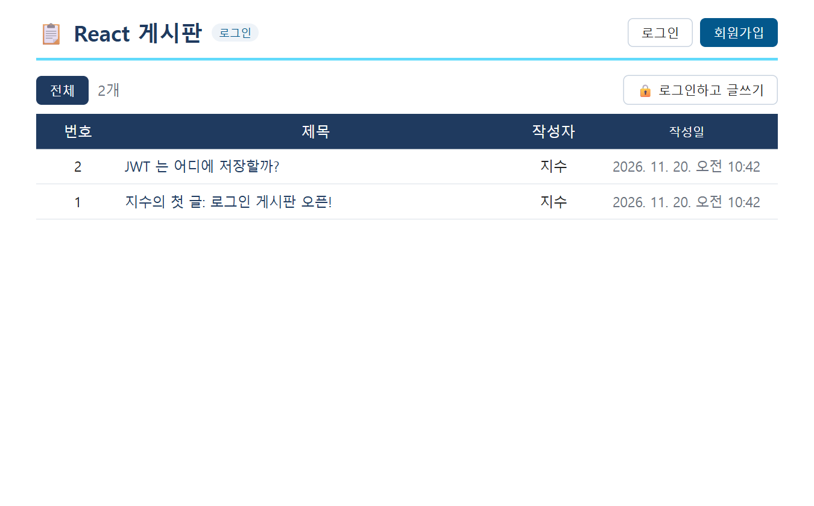
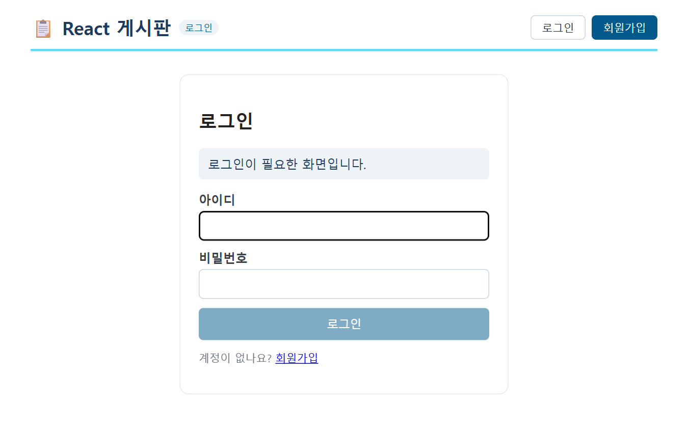
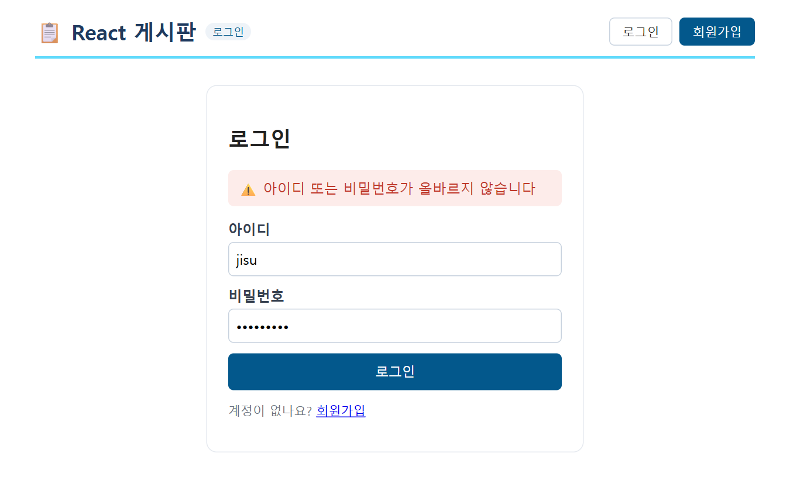
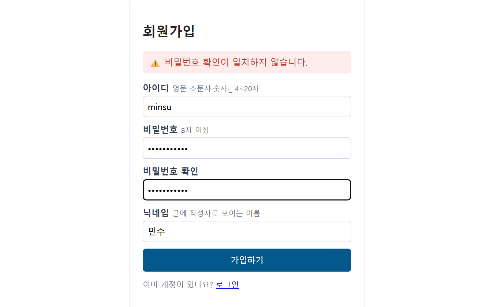
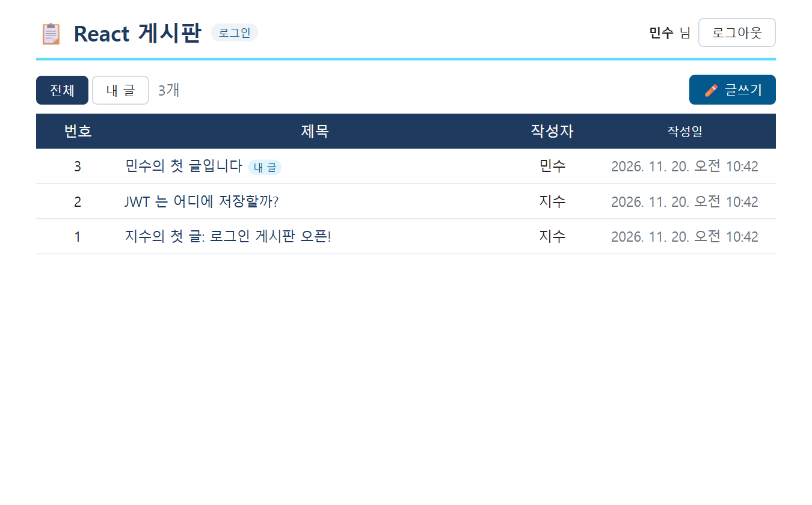
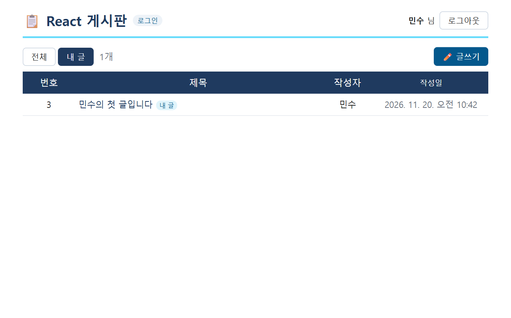
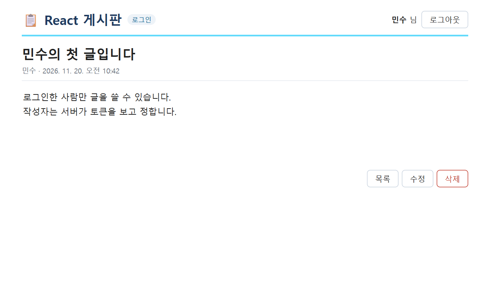
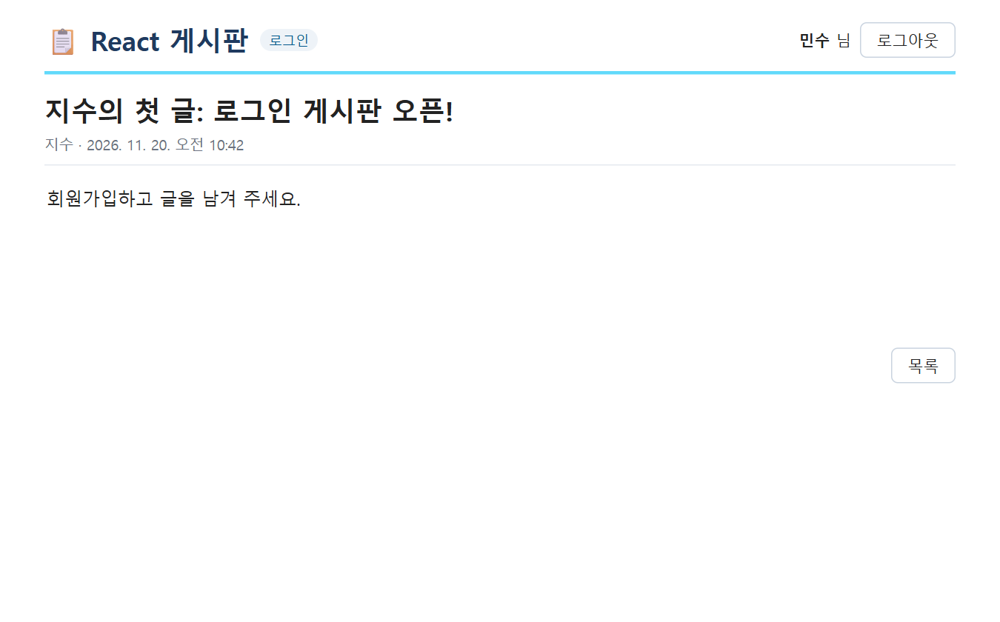
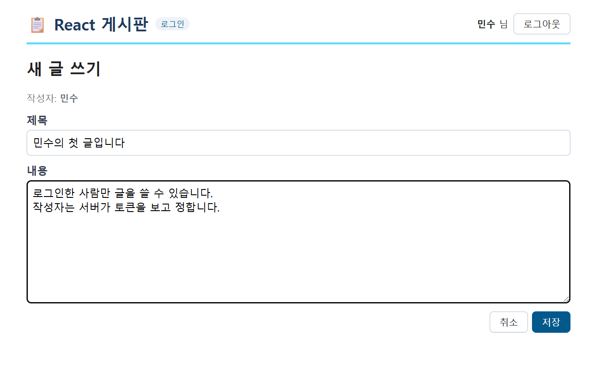

# 9장. 프로젝트 ③ React 로그인 연동

## 학습 목표

- api.js 가 모든 요청에 토큰을 자동으로 붙이게 한다.
- AuthContext 로 로그인 상태를 앱 전체에 공급하고, 새로 고침해도 로그인을 유지한다.
- 회원가입·로그인 화면을 만들고, 로그인 후 원래 가려던 화면으로 돌려보낸다.
- ProtectedRoute 로 로그인이 필요한 화면을 막는다.
- 글쓴이에게만 수정·삭제 버튼을 보여 주고, 토큰이 만료되면 자동으로 로그아웃한다.

## 9-1. 무엇을 만드나

| 화면 | 로그인 전 | 로그인 후 |
|---|---|---|
| 머리글 | [로그인] [회원가입] | **민수** 님 [로그아웃] |
| 목록 | "전체" 탭, [🔒 로그인하고 글쓰기] | [전체] [내 글] 탭, [✏️ 글쓰기], 내 글에 "내 글" 표시 |
| 글 읽기 | [목록] | 내 글이면 [수정] [삭제] 도 |
| 글쓰기·수정 | 로그인 화면으로 보냄 | 작성자 칸 없음 (서버가 토큰으로 정함) |



새로 만드는 파일과 고치는 파일은 다음과 같다.

| 파일 | 새로/고침 | 하는 일 |
|---|---|---|
| `src/api.js` | 고침 | 토큰 보관함, Authorization 헤더, 401 처리, 인증 API |
| `src/context/AuthContext.jsx` | **새로** | 로그인 상태(user)와 login·logout·signup |
| `src/components/ProtectedRoute.jsx` | **새로** | 로그인 안 했으면 /login 으로 |
| `src/pages/LoginPage.jsx`, `SignupPage.jsx` | **새로** | 로그인·회원가입 화면 |
| `src/main.jsx`, `App.jsx` | 고침 | AuthProvider 로 감싸기, 라우트 추가 |
| `src/components/Layout.jsx` | 고침 | 머리글에 로그인 상태 |
| `src/pages/PostListPage.jsx`, `PostDetailPage.jsx`, `PostFormPage.jsx` | 고침 | 내 글 탭, 본인만 버튼, 작성자 칸 없애기 |

## 9-2. 준비

8장의 DB 와 로그인 API 서버가 켜져 있어야 한다 (8-2, 8-8).

7장에서 만든 Router 게시판을 복사해서 시작한다.

**[PS]**

```powershell
Copy-Item -Recurse C:\study\board\frontend-router C:\study\authboard\frontend
cd C:\study\authboard\frontend
npm install
mkdir src\context
```

> `node_modules` 까지 복사되어 조금 걸린다. 7장을 끝내지 못했다면 저장소의 `advanced\board-router\frontend` 를 복사한 뒤 `npm install` 하면 된다. 이 장의 완성본은 `advanced\board\frontend` 다.

## 9-3. api.js - 토큰을 자동으로

<!-- file: advanced/board/frontend/src/api.js -->

```js
// api.js - 서버와 주고받는 코드를 모은 API 모듈 (9장: 로그인 토큰 추가)
//
// 7장 api.js 에서 달라진 점
//   1. 토큰 보관함(tokenStore): 로그인 토큰을 브라우저 localStorage 에 저장·꺼내기·지우기
//   2. request 함수가 토큰이 있으면 모든 요청 헤더에 자동으로 붙인다
//        Authorization: Bearer eyJhbGciOi...
//      → 화면 코드는 토큰을 전혀 신경 쓰지 않아도 된다. (API 모듈로 모아 둔 덕분!)
//   3. 서버가 401(토큰 만료·위조)을 돌려주면 토큰을 지우고, AuthContext 에 "로그아웃 됐어요" 라고 알린다.
//   4. 회원가입 · 로그인 · 내 정보 API 함수 추가, 글쓰기에서 writer 가 빠짐

export const API_URL = "http://localhost:8080/api";

// ---------------------------------------------------------------- 토큰 보관함
// localStorage: 브라우저를 껐다 켜도 남는 저장소 (도메인별로 따로). 문자열만 저장된다.
const TOKEN_KEY = "access_token";
export const tokenStore = {
  get: () => localStorage.getItem(TOKEN_KEY),
  set: (token) => localStorage.setItem(TOKEN_KEY, token),
  clear: () => localStorage.removeItem(TOKEN_KEY),
};

// 401 을 받았을 때 부를 함수. AuthContext 가 setUnauthorizedHandler 로 등록해 둔다.
let onUnauthorized = () => {};
export function setUnauthorizedHandler(fn) {
  onUnauthorized = fn;
}

export class ApiError extends Error {
  constructor(status, message) {
    super(message);
    this.status = status;
  }
}

// ---------------------------------------------------------------- 모든 요청이 거쳐 가는 함수
export async function request(path, { method = "GET", body } = {}) {
  const headers = {};
  if (body) headers["Content-Type"] = "application/json";
  const token = tokenStore.get();
  if (token) headers["Authorization"] = `Bearer ${token}`; // ← 로그인했으면 토큰을 붙인다

  let res;
  try {
    res = await fetch(API_URL + path, {
      method,
      headers,
      body: body ? JSON.stringify(body) : undefined,
    });
  } catch {
    throw new ApiError(0, "API 서버에 연결할 수 없습니다. 서버가 켜져 있나요?");
  }

  if (res.status === 204) return null;

  const data = await res.json().catch(() => null);
  if (!res.ok) {
    // 토큰을 보냈는데 401 → 토큰이 만료됐거나 잘못됐다. 지우고 로그아웃 상태로 만든다.
    // (로그인 요청 자체의 401 "비밀번호 틀림" 은 토큰 없이 보내므로 여기에 걸리지 않는다)
    if (res.status === 401 && token) {
      tokenStore.clear();
      onUnauthorized();
    }
    // 서버(GlobalExceptionHandler)는 오류 이유를 { "detail": "한국어 메시지" } 로 보낸다
    const message = typeof data?.detail === "string" ? data.detail : `요청 실패 (${res.status})`;
    throw new ApiError(res.status, message);
  }
  return data;
}

// ---------------------------------------------------------------- 인증 API
export const signup = (form) => request("/auth/signup", { method: "POST", body: form });
export const login = (username, password) =>
  request("/auth/login", { method: "POST", body: { username, password } }); // → { access_token, user }
export const getMe = () => request("/auth/me");

// ---------------------------------------------------------------- 게시글 API
// userId 를 주면 그 사람 글만 (/posts?user_id=3)
export const getPosts = (userId) => request(userId ? `/posts?user_id=${userId}` : "/posts");
export const getPost = (id) => request(`/posts/${id}`);
export const createPost = (post) => request("/posts", { method: "POST", body: post }); // post = { title, content }
export const updatePost = (id, post) => request(`/posts/${id}`, { method: "PUT", body: post });
export const deletePost = (id) => request(`/posts/${id}`, { method: "DELETE" });
```

7장 api.js 와 비교하면 `request` 함수에 몇 줄이 늘었을 뿐인데, **모든 요청**에 토큰이 붙고 **모든 요청**의 401 이 처리된다. API 모듈로 모아 둔 효과다.

**`setUnauthorizedHandler` 는 왜 필요할까?** api.js 는 React 컴포넌트가 아니라서 `useAuth()` 로 로그아웃 함수를 꺼낼 수 없다. 그래서 AuthContext 가 "401 이 나면 이 함수를 불러 줘" 하고 함수를 **등록**해 둔다.

## 9-4. AuthContext - 로그인 상태 공급

5장 FakeAuthContext 와 비교하며 읽어 보자.

<!-- file: advanced/board/frontend/src/context/AuthContext.jsx -->

```jsx
// AuthContext.jsx - "지금 누가 로그인했나" 를 앱 전체에 알려 주는 Context (9장)
//
// 5장 FakeAuthContext 와 모양이 같다. 다른 점은
//   - login : 진짜 서버(/api/auth/login)에 아이디·비밀번호를 보내고, 받은 토큰을 저장한다.
//   - 앱을 새로 열었을 때 저장된 토큰이 있으면 /api/auth/me 로 "아직 유효한지" 확인해
//     로그인 상태를 되살린다. 확인이 끝날 때까지는 ready=false (그동안 화면을 잠시 기다리게 한다)
//   - 어떤 요청에서든 401 을 받으면(api.js) 자동으로 로그아웃 상태가 된다.
//
// 쓰는 쪽: const { user, login, logout } = useAuth();
//   user 는 로그인 전에는 null, 로그인 후에는 { id, username, nickname }

import { createContext, useContext, useEffect, useState } from "react";
import * as api from "../api"; // api.login, api.getMe ... 처럼 쓰려고 통째로 가져온다

const AuthContext = createContext(null);

export function AuthProvider({ children }) {
  const [user, setUser] = useState(null);
  const [ready, setReady] = useState(false); // 처음 토큰 확인이 끝났나?

  // 1) 앱이 처음 열릴 때: 저장된 토큰으로 로그인 상태 되살리기
  useEffect(() => {
    if (!api.tokenStore.get()) {
      setReady(true); // 토큰이 없으면 확인할 것도 없다
      return;
    }
    api
      .getMe()
      .then(setUser) //           토큰이 유효 → 사용자 정보 저장
      .catch(() => api.tokenStore.clear()) // 만료·위조 → 토큰 버림
      .finally(() => setReady(true));
  }, []);

  // 2) 어디서든 401 이 나면 로그아웃 상태로 (api.js 가 부른다)
  useEffect(() => {
    api.setUnauthorizedHandler(() => setUser(null));
  }, []);

  const login = async (username, password) => {
    const data = await api.login(username, password); // 실패하면 ApiError 가 던져져 화면에서 잡는다
    api.tokenStore.set(data.access_token);
    setUser(data.user);
  };

  const logout = () => {
    api.tokenStore.clear(); // JWT 는 서버에 저장되지 않으므로, 브라우저에서 지우면 로그아웃이다
    setUser(null);
  };

  // 회원가입 후 바로 로그인까지
  const signup = async (form) => {
    await api.signup(form);
    await login(form.username, form.password);
  };

  // 토큰 확인 중에는 화면 대신 안내만 (로그인한 사람이 잠깐 "로그인 페이지" 로 튕기는 것을 막는다)
  if (!ready) return <p className="info">로그인 정보를 확인하는 중...</p>;

  return <AuthContext value={{ user, login, logout, signup }}>{children}</AuthContext>;
}

export function useAuth() {
  const value = useContext(AuthContext);
  if (value === null) throw new Error("useAuth 는 <AuthProvider> 안에서만 쓸 수 있습니다");
  return value;
}
```

| 시점 | 일어나는 일 |
|---|---|
| 앱이 처음 열릴 때 | localStorage 에 토큰이 있으면 `/api/auth/me` 로 확인 → 성공하면 user 복원 (새로 고침해도 로그인 유지) |
| 로그인 | `/api/auth/login` → 받은 토큰을 localStorage 에 저장, user 갱신 |
| 로그아웃 | localStorage 의 토큰을 지우고 user = null |
| 어떤 요청이 401 | api.js 가 토큰을 지우고 등록된 함수 호출 → user = null |

> **JWT 로그아웃은 "토큰 버리기"** 서버는 토큰을 저장하지 않으므로 서버에 "로그아웃" 요청을 보낼 필요가 없다. 대신 이미 발급된 토큰은 만료 시각(60분)까지 유효하다는 점은 알아 두자.

## 9-5. main.jsx 와 App.jsx

<!-- file: advanced/board/frontend/src/main.jsx -->

```jsx
// main.jsx - 앱의 시작점
//   <BrowserRouter> : Router 기능 켜기 (4장)
//   <AuthProvider>  : 로그인 상태를 앱 전체에 공급 (9장)
//     AuthProvider 안에서도 Router 기능(useNavigate 등)을 쓸 수 있도록 BrowserRouter 가 바깥에 있다.

import { StrictMode } from "react";
import { createRoot } from "react-dom/client";
import { BrowserRouter } from "react-router";
import { AuthProvider } from "./context/AuthContext";
import "./index.css";
import App from "./App.jsx";

createRoot(document.getElementById("root")).render(
  <StrictMode>
    <BrowserRouter>
      <AuthProvider>
        <App />
      </AuthProvider>
    </BrowserRouter>
  </StrictMode>,
);
```

<!-- file: advanced/board/frontend/src/components/ProtectedRoute.jsx -->

```jsx
// ProtectedRoute.jsx - 로그인한 사람만 들어올 수 있는 화면을 감싸는 "문지기"
//
// 이 파일이 보여 주는 것
//   - 로그인 안 했으면 <Navigate> 로 /login 에 보낸다. (그리는 순간 주소를 바꾸는 컴포넌트)
//   - state={{ from: 원래 가려던 주소 }} 를 함께 넘겨, 로그인 후 그 주소로 되돌려 보낸다.
//   - replace : 막힌 주소를 방문 기록에 남기지 않는다 (뒤로 가기를 눌러도 다시 튕기지 않게)
//   - 로그인했으면 감싼 화면(children)을 그대로 보여 준다.
//
//   ※ 이것은 "화면" 을 막을 뿐이다. 진짜 보안은 서버(Spring Boot)가 토큰을 검사하는 것이다.
//     주소를 직접 쳐서 들어와도, 개발자 도구로 요청을 보내도 서버가 401/403 으로 막는다.

import { Navigate, useLocation } from "react-router";
import { useAuth } from "../context/AuthContext";

function ProtectedRoute({ children }) {
  const { user } = useAuth();
  const location = useLocation();

  if (!user) {
    return <Navigate to="/login" replace state={{ from: location.pathname }} />;
  }
  return children;
}

export default ProtectedRoute;
```

<!-- file: advanced/board/frontend/src/App.jsx -->

```jsx
// App.jsx - 주소 → 화면 지도 (9장: 로그인 화면과 보호된 화면 추가)
//
//   주소                 화면              누가?
//   /                    PostListPage      누구나   (?mine=1 이면 내 글만)
//   /posts/:id           PostDetailPage    누구나   (수정·삭제 버튼은 글쓴이에게만 보임)
//   /posts/new           PostFormPage      로그인한 사람    ← ProtectedRoute
//   /posts/:id/edit      PostFormPage      로그인한 사람    ← ProtectedRoute (+ 서버가 본인인지 검사)
//   /login               LoginPage         누구나
//   /signup              SignupPage        누구나

import { Route, Routes } from "react-router";
import Layout from "./components/Layout";
import ProtectedRoute from "./components/ProtectedRoute";
import PostListPage from "./pages/PostListPage";
import PostDetailPage from "./pages/PostDetailPage";
import PostFormPage from "./pages/PostFormPage";
import LoginPage from "./pages/LoginPage";
import SignupPage from "./pages/SignupPage";
import NotFoundPage from "./pages/NotFoundPage";
import "./App.css";

function App() {
  return (
    <Routes>
      <Route element={<Layout />}>
        <Route path="/" element={<PostListPage />} />
        <Route
          path="/posts/new"
          element={
            <ProtectedRoute>
              <PostFormPage />
            </ProtectedRoute>
          }
        />
        <Route path="/posts/:id" element={<PostDetailPage />} />
        <Route
          path="/posts/:id/edit"
          element={
            <ProtectedRoute>
              <PostFormPage />
            </ProtectedRoute>
          }
        />
        <Route path="/login" element={<LoginPage />} />
        <Route path="/signup" element={<SignupPage />} />
        <Route path="*" element={<NotFoundPage />} />
      </Route>
    </Routes>
  );
}

export default App;
```

## 9-6. 머리글 - Layout

<!-- file: advanced/board/frontend/src/components/Layout.jsx -->

```jsx
// Layout.jsx - 머리글 + 본문 자리 (9장: 로그인 상태 표시 추가)
//   로그인했으면 "닉네임 님 · 로그아웃", 아니면 "로그인 · 회원가입" 링크.
//   useAuth() 로 꺼내므로 App 이 props 로 user 를 내려줄 필요가 없다 (Context 의 힘).

import { Link, Outlet, useNavigate } from "react-router";
import { useAuth } from "../context/AuthContext";

function Layout() {
  const { user, logout } = useAuth();
  const navigate = useNavigate();

  const handleLogout = () => {
    logout();
    navigate("/"); // 로그아웃하면 목록으로
  };

  return (
    <div className="container">
      <header className="header">
        <Link to="/" className="logo">
          📋 React 게시판
        </Link>
        <span className="badge">로그인</span>
        <nav className="auth-nav">
          {user ? (
            <>
              <span>
                <strong>{user.nickname}</strong> 님
              </span>
              <button onClick={handleLogout}>로그아웃</button>
            </>
          ) : (
            <>
              <Link to="/login" className="button">
                로그인
              </Link>
              <Link to="/signup" className="button primary">
                회원가입
              </Link>
            </>
          )}
        </nav>
      </header>
      <Outlet />
    </div>
  );
}

export default Layout;
```

## 9-7. 로그인과 회원가입 화면

<!-- file: advanced/board/frontend/src/pages/LoginPage.jsx -->

```jsx
// LoginPage.jsx - 로그인 ( /login )
//
// 이 파일이 보여 주는 것
//   - 아이디·비밀번호 폼 → useAuth().login() → 성공하면 원래 가려던 곳으로 이동
//   - ProtectedRoute 가 보내 준 location.state.from 에 "원래 가려던 주소" 가 들어 있다.
//     (없으면 목록 "/" 로)
//   - 이미 로그인했으면 이 화면을 보여 줄 필요가 없으므로 <Navigate> 로 목록에 보낸다.

import { useState } from "react";
import { Link, Navigate, useLocation, useNavigate } from "react-router";
import { useAuth } from "../context/AuthContext";

function LoginPage() {
  const { user, login } = useAuth();
  const navigate = useNavigate();
  const location = useLocation();
  const from = location.state?.from || "/"; // ?. : state 가 없어도(null) 오류 없이 undefined

  const [form, setForm] = useState({ username: "", password: "" });
  const [error, setError] = useState(null);
  const [busy, setBusy] = useState(false);

  if (user) return <Navigate to={from} replace />;

  const handleChange = (e) => setForm({ ...form, [e.target.name]: e.target.value });

  const handleSubmit = async (e) => {
    e.preventDefault();
    setBusy(true);
    setError(null);
    try {
      await login(form.username.trim(), form.password);
      navigate(from, { replace: true }); // 로그인 화면은 방문 기록에서 지운다
    } catch (err) {
      setError(err.message); // "아이디 또는 비밀번호가 올바르지 않습니다"
      setBusy(false);
    }
  };

  return (
    <form className="post-form auth-form" onSubmit={handleSubmit}>
      <h2>로그인</h2>
      {/* ProtectedRoute 에서 튕겨 왔으면 이유를 알려 준다 */}
      {location.state?.from && !error && <p className="info-box">로그인이 필요한 화면입니다.</p>}
      {error && <p className="error">⚠️ {error}</p>}
      <label>
        아이디
        <input name="username" value={form.username} onChange={handleChange} autoComplete="username" autoFocus />
      </label>
      <label>
        비밀번호
        <input
          name="password"
          type="password" // 입력한 글자를 ●●● 로 가린다
          value={form.password}
          onChange={handleChange}
          autoComplete="current-password"
        />
      </label>
      <button type="submit" className="primary wide" disabled={busy || !form.username || !form.password}>
        {busy ? "확인 중..." : "로그인"}
      </button>
      <p className="hint">
        계정이 없나요? <Link to="/signup">회원가입</Link>
      </p>
    </form>
  );
}

export default LoginPage;
```





<!-- file: advanced/board/frontend/src/pages/SignupPage.jsx -->

```jsx
// SignupPage.jsx - 회원가입 ( /signup )
//
// 이 파일이 보여 주는 것
//   - 서버(SignupRequest.java)와 같은 규칙을 화면에서도 미리 검사해, 무엇이 틀렸는지 한국어로 알려 준다.
//       아이디: 영문 소문자·숫자·밑줄 4~20자 / 비밀번호: 8자 이상 / 닉네임: 1~30자
//     (화면 검사는 "친절" 을 위한 것이고, 진짜 검사는 서버가 한다. 둘 다 필요하다)
//   - 비밀번호 확인 칸은 서버로 보내지 않는다 (화면에서만 쓰는 값)
//   - 가입 성공 → 자동 로그인 → 목록으로

import { useState } from "react";
import { Link, Navigate, useNavigate } from "react-router";
import { useAuth } from "../context/AuthContext";

// 검사 함수: 문제가 있으면 안내 문장을, 없으면 null 을 돌려준다
function validate(form) {
  if (!/^[a-z0-9_]{4,20}$/.test(form.username)) return "아이디는 영문 소문자·숫자·밑줄(_)로 4~20자입니다.";
  if (form.password.length < 8) return "비밀번호는 8자 이상이어야 합니다.";
  if (form.password !== form.password2) return "비밀번호 확인이 일치하지 않습니다.";
  if (!form.nickname.trim()) return "닉네임을 입력하세요.";
  return null;
}

function SignupPage() {
  const { user, signup } = useAuth();
  const navigate = useNavigate();
  const [form, setForm] = useState({ username: "", password: "", password2: "", nickname: "" });
  const [error, setError] = useState(null);
  const [busy, setBusy] = useState(false);

  if (user) return <Navigate to="/" replace />;

  const handleChange = (e) => setForm({ ...form, [e.target.name]: e.target.value });

  const handleSubmit = async (e) => {
    e.preventDefault();
    const problem = validate(form);
    if (problem) {
      setError(problem);
      return;
    }
    setBusy(true);
    setError(null);
    try {
      // password2 는 빼고 서버가 원하는 세 값만 보낸다
      await signup({ username: form.username, password: form.password, nickname: form.nickname.trim() });
      navigate("/", { replace: true });
    } catch (err) {
      setError(err.message); // 예: "이미 사용 중인 아이디입니다" (409)
      setBusy(false);
    }
  };

  return (
    <form className="post-form auth-form" onSubmit={handleSubmit}>
      <h2>회원가입</h2>
      {error && <p className="error">⚠️ {error}</p>}
      <label>
        아이디 <small>영문 소문자·숫자·_ 4~20자</small>
        <input name="username" value={form.username} onChange={handleChange} autoComplete="username" />
      </label>
      <label>
        비밀번호 <small>8자 이상</small>
        <input name="password" type="password" value={form.password} onChange={handleChange} autoComplete="new-password" />
      </label>
      <label>
        비밀번호 확인
        <input name="password2" type="password" value={form.password2} onChange={handleChange} autoComplete="new-password" />
      </label>
      <label>
        닉네임 <small>글에 작성자로 보이는 이름</small>
        <input name="nickname" value={form.nickname} onChange={handleChange} maxLength={30} />
      </label>
      <button type="submit" className="primary wide" disabled={busy}>
        {busy ? "가입 중..." : "가입하기"}
      </button>
      <p className="hint">
        이미 계정이 있나요? <Link to="/login">로그인</Link>
      </p>
    </form>
  );
}

export default SignupPage;
```



## 9-8. 게시판 화면 고치기

### 목록 - 내 글 탭

<!-- file: advanced/board/frontend/src/pages/PostListPage.jsx -->

```jsx
// PostListPage.jsx - 글 목록 ( / , 내 글만: /?mine=1 )
//
// 7장 목록에서 달라진 점 (9장)
//   - 로그인했으면 [전체 | 내 글] 탭을 보여 준다. 고른 탭은 주소의 ?mine=1 에 둔다
//     (state 가 아니라 주소에 두면 새로 고침·뒤로 가기에도 유지된다 - 4장 useSearchParams)
//   - 내 글 탭이면 getPosts(user.id) → 서버에 /posts?user_id=번호 로 요청
//   - 글쓰기 버튼: 로그인 전에는 "로그인하고 글쓰기" 로 바뀐다

import { Link, useSearchParams } from "react-router";
import { getPosts } from "../api";
import { useApi } from "../hooks/useApi";
import { useAuth } from "../context/AuthContext";
import { formatDate } from "../format";

function PostListPage() {
  const { user } = useAuth();
  const [searchParams, setSearchParams] = useSearchParams();
  const mine = Boolean(user) && searchParams.get("mine") === "1"; // 로그아웃 상태면 항상 전체
  const userId = mine ? user.id : null;

  // userId 가 바뀌면(탭을 바꾸면) 다시 불러온다
  const { data: posts, loading, error } = useApi(() => getPosts(userId), [userId]);

  return (
    <div>
      <div className="toolbar">
        <div className="tabs">
          <button className={mine ? "" : "active"} onClick={() => setSearchParams({})}>
            전체
          </button>
          {user && (
            <button className={mine ? "active" : ""} onClick={() => setSearchParams({ mine: "1" })}>
              내 글
            </button>
          )}
          {posts && <span className="count">{posts.length}개</span>}
        </div>
        {user ? (
          <Link to="/posts/new" className="button primary">
            ✏️ 글쓰기
          </Link>
        ) : (
          <Link to="/login" state={{ from: "/posts/new" }} className="button">
            🔒 로그인하고 글쓰기
          </Link>
        )}
      </div>

      {loading && <p className="info">⏳ 불러오는 중...</p>}
      {error && <p className="error">⚠️ {error.message}</p>}
      {posts && !loading && posts.length === 0 && (
        <p className="info">{mine ? "아직 내가 쓴 글이 없습니다." : "아직 글이 없습니다."}</p>
      )}
      {posts && !loading && posts.length > 0 && (
        <table className="post-table">
          <thead>
            <tr>
              <th className="col-id">번호</th>
              <th>제목</th>
              <th className="col-writer">작성자</th>
              <th className="col-date">작성일</th>
            </tr>
          </thead>
          <tbody>
            {posts.map((post) => (
              <tr key={post.id}>
                <td className="col-id">{post.id}</td>
                <td>
                  <Link to={`/posts/${post.id}`}>{post.title}</Link>
                  {/* 내 글 표시 */}
                  {user?.id === post.user_id && <span className="mine-badge">내 글</span>}
                </td>
                <td className="col-writer">{post.writer}</td>
                <td className="col-date">{formatDate(post.created_at)}</td>
              </tr>
            ))}
          </tbody>
        </table>
      )}
    </div>
  );
}

export default PostListPage;
```





### 읽기 - 본인에게만 수정·삭제

<!-- file: advanced/board/frontend/src/pages/PostDetailPage.jsx -->

```jsx
// PostDetailPage.jsx - 글 읽기 ( /posts/:id )
//
// 7장에서 달라진 점 (9장)
//   - 글쓴이 본인(user.id === post.user_id)에게만 수정·삭제 버튼을 보여 준다.
//   - 버튼을 숨기는 것은 "편의" 일 뿐이다. 남이 주소(/posts/3/edit)를 직접 치거나
//     요청을 직접 보내도 서버가 403 으로 막는다 (PostService.checkOwner).

import { Link, useNavigate, useParams } from "react-router";
import { deletePost, getPost } from "../api";
import { useApi } from "../hooks/useApi";
import { useAuth } from "../context/AuthContext";
import { formatDate } from "../format";

function PostDetailPage() {
  const { id } = useParams();
  const navigate = useNavigate();
  const { user } = useAuth();
  const { data: post, loading, error } = useApi(() => getPost(id), [id]);

  const handleDelete = async () => {
    if (!confirm("정말 삭제할까요? 되돌릴 수 없습니다.")) return;
    try {
      await deletePost(id);
      navigate("/", { replace: true });
    } catch (err) {
      alert(err.message); // 403: "본인이 쓴 글만 ...", 401: "로그인이 만료되었습니다 ..."
    }
  };

  if (loading) return <p className="info">⏳ 불러오는 중...</p>;
  if (error)
    return (
      <div>
        <p className="error">⚠️ {error.status === 404 ? "글을 찾을 수 없습니다." : error.message}</p>
        <Link to="/">목록으로</Link>
      </div>
    );

  const isOwner = user?.id === post.user_id; // 로그인 안 했으면 user 가 null → user?.id 는 undefined → false

  return (
    <article className="post-detail">
      <h2>{post.title}</h2>
      <div className="meta">
        {post.writer} · {formatDate(post.created_at)}
        {post.updated_at !== post.created_at && ` · 수정 ${formatDate(post.updated_at)}`}
      </div>
      <div className="content">{post.content || "(내용 없음)"}</div>

      <div className="buttons">
        <Link to="/" className="button">
          목록
        </Link>
        {isOwner && (
          <>
            <Link to={`/posts/${post.id}/edit`} className="button">
              수정
            </Link>
            <button className="danger" onClick={handleDelete}>
              삭제
            </button>
          </>
        )}
      </div>
    </article>
  );
}

export default PostDetailPage;
```





### 글쓰기·수정 - 작성자 칸 없애기

<!-- file: advanced/board/frontend/src/pages/PostFormPage.jsx -->

```jsx
// PostFormPage.jsx - 글쓰기 ( /posts/new ) · 수정 ( /posts/:id/edit )
//
// 7장에서 달라진 점 (9장)
//   - 작성자 입력 칸이 없어졌다. 작성자는 서버가 토큰을 보고 정한다 (남의 이름으로 쓰기 불가)
//   - 이 화면은 ProtectedRoute 안에 있으므로, 여기까지 왔다면 user 는 항상 있다.
//   - 수정 화면에서 남의 글을 불러오면 안내 문구를 보여 주고 저장 버튼을 막는다.
//     (그래도 서버가 마지막에 한 번 더 403 으로 막는다)

import { useEffect, useState } from "react";
import { useNavigate, useParams } from "react-router";
import { createPost, getPost, updatePost } from "../api";
import { useAuth } from "../context/AuthContext";

function PostFormPage() {
  const { id } = useParams();
  const isEdit = id !== undefined;
  const navigate = useNavigate();
  const { user } = useAuth();
  const [form, setForm] = useState({ title: "", content: "" });
  const [notMine, setNotMine] = useState(false);
  const [saving, setSaving] = useState(false);
  const [error, setError] = useState(null);

  useEffect(() => {
    if (!isEdit) return;
    getPost(id)
      .then((post) => {
        setForm({ title: post.title, content: post.content });
        setNotMine(post.user_id !== user.id);
      })
      .catch((err) => setError(err.message));
  }, [id, isEdit, user.id]);

  const handleChange = (e) => setForm({ ...form, [e.target.name]: e.target.value });

  const handleSubmit = async (e) => {
    e.preventDefault();
    if (!form.title.trim()) {
      setError("제목을 입력하세요.");
      return;
    }
    setSaving(true);
    try {
      const saved = isEdit ? await updatePost(id, form) : await createPost(form);
      navigate(`/posts/${saved.id}`, { replace: true });
    } catch (err) {
      setError(err.message);
      setSaving(false);
    }
  };

  return (
    <form className="post-form" onSubmit={handleSubmit}>
      <h2>{isEdit ? `${id}번 글 수정` : "새 글 쓰기"}</h2>
      <p className="hint">
        작성자: <strong>{user.nickname}</strong>
      </p>
      {notMine && <p className="error">⚠️ 본인이 쓴 글만 수정할 수 있습니다.</p>}
      {error && <p className="error">⚠️ {error}</p>}
      <label>
        제목
        <input name="title" value={form.title} onChange={handleChange} maxLength={100} />
      </label>
      <label>
        내용
        <textarea name="content" value={form.content} onChange={handleChange} rows={8} />
      </label>
      <div className="buttons">
        <button type="button" onClick={() => navigate(-1)}>
          취소
        </button>
        <button type="submit" className="primary" disabled={saving || notMine}>
          {saving ? "저장 중..." : "저장"}
        </button>
      </div>
    </form>
  );
}

export default PostFormPage;
```



## 9-9. 스타일 추가

`src/App.css` 맨 끝에 덧붙인다.

```css
/* 머리글 오른쪽의 로그인 상태 (margin-left: auto 로 오른쪽 끝에 붙인다) */
.auth-nav { display: flex; align-items: center; gap: 8px; margin-left: auto; font-size: 14px; }

/* 전체 | 내 글 탭 */
.tabs { display: flex; align-items: center; gap: 4px; }
.tabs button.active { border-color: #1f3a5f; background: #1f3a5f; color: white; }
.count { margin-left: 6px; color: #6b7280; }

/* 목록에서 내 글 옆의 작은 표시 */
.mine-badge { margin-left: 6px; padding: 1px 6px; border-radius: 8px;
  background: #e0f4fb; color: #03588c; font-size: 11px; }

/* 로그인·회원가입 폼 */
.auth-form { max-width: 380px; margin: 30px auto; padding: 24px;
  border: 1px solid #e5e9ef; border-radius: 12px; }
.auth-form small { font-weight: normal; color: #6b7280; }
button.wide { width: 100%; padding: 10px; font-size: 15px; }
.hint { color: #6b7280; font-size: 14px; text-align: center; }
.post-form .hint { text-align: left; }
.info-box { padding: 10px 12px; border-radius: 6px; background: #eef3f8; color: #1f3a5f; }
```

(완성본 `advanced/board/frontend/src/App.css` 에는 같은 내용이 한 줄에 한 속성씩 주석과 함께 들어 있다.)

## 9-10. 전체 시험하기

세 가지를 켠다.

| 어디서 | 폴더 | 할 일 |
|---|---|---|
| VS Code 터미널 1 | `C:\study\authboard` | `docker compose up -d` |
| IntelliJ | `C:\study\authboard\backend` | `BoardApplication` ▶ 실행 |
| VS Code 터미널 2 | `C:\study\authboard\frontend` | `npm run dev` |

아래 시나리오는 교안을 만들 때 브라우저 자동 시험(Playwright)으로 그대로 해 보고 모두 통과한 것이다. 하나씩 따라 해 보자.

| # | 해 보기 | 기대 결과 |
|---|---|---|
| 1 | 로그인 전 목록 | [🔒 로그인하고 글쓰기], 탭은 "전체" 만 |
| 2 | 🔒 버튼 클릭 | `/login` 으로 이동, "로그인이 필요한 화면입니다." |
| 3 | 틀린 비밀번호로 로그인 | "아이디 또는 비밀번호가 올바르지 않습니다" |
| 4 | 주소창에 `/posts/new` 직접 입력 | 로그인 화면으로 보내진다 (ProtectedRoute) |
| 5 | 회원가입: 아이디 `MinSu` | "아이디는 영문 소문자·숫자·밑줄(_)로 4~20자입니다." (화면 검사) |
| 6 | 회원가입: 이미 있는 아이디 | "이미 사용 중인 아이디입니다" (서버 409) |
| 7 | 회원가입: 비밀번호 확인 불일치 | "비밀번호 확인이 일치하지 않습니다." |
| 8 | 올바르게 가입 | 자동 로그인, 머리글에 "민수 님" |
| 9 | 글쓰기 → 저장 | 내 글 화면, [수정] [삭제] 보임 |
| 10 | 남의 글 열기 | [목록] 만 보임 |
| 11 | 주소창에 `/posts/1/edit` (남의 글) | "본인이 쓴 글만 수정할 수 있습니다.", 저장 버튼 막힘 |
| 12 | [내 글] 탭 | 주소 `/?mine=1`, 내 글만. F5 해도 그대로 |
| 13 | F5 (새로 고침) | 로그인 유지 |
| 14 | F12 → Application → Local storage 의 `access_token` 끝 글자를 고치고 F5 | 로그아웃 상태가 되고 토큰이 지워진다 |
| 15 | 로그인 상태에서 토큰을 `expired.token.value` 로 바꾸고 삭제 클릭 | "로그인이 만료되었습니다. 다시 로그인하세요" 알림, 머리글이 로그아웃 상태로 |
| 16 | [로그아웃] | 토큰 삭제, 목록으로 |

> 14·15번은 "토큰이 위조·만료되면?" 을 흉내 낸 것이다. 실제로는 로그인하고 60분이 지나면 15번과 같은 일이 생긴다. 시험해 보고 싶으면 서버를 `ACCESS_TOKEN_MINUTES` 환경 변수로 1분으로 줄여 실행한다. IntelliJ 오른쪽 위 실행 목록(BoardApplication) → **Edit Configurations...** → **Environment variables** 칸에 `ACCESS_TOKEN_MINUTES=1` 을 넣고 다시 ▶. (터미널이라면 `$env:ACCESS_TOKEN_MINUTES = "1"` 을 친 뒤 같은 터미널에서 `.\gradlew.bat bootRun`)

**F12 → Network** 탭에서 글쓰기 요청을 눌러 **Headers → Request Headers** 를 보면 `Authorization: Bearer eyJ...` 가 붙어 있는 것을 확인할 수 있다.

## 9-11. 도전 과제

1. **내 정보 화면** - `/me` 주소에 아이디·닉네임·내가 쓴 글 수를 보여 주는 화면을 만들고 ProtectedRoute 로 보호하기.
2. **닉네임 변경** - 백엔드에 `PUT /api/auth/me` (닉네임만 바꾸기)를 만들고, React 에서 바꾼 뒤 머리글에 바로 반영하기. (힌트: AuthContext 에 `setUser` 를 이용하는 `updateUser` 함수 추가)
3. **댓글** - `comments` 테이블(post_id, user_id, content)과 API 를 만들고, 글 읽기 화면 아래에 댓글 목록·작성(로그인 필요)·삭제(본인만)를 붙이기. 이 과정에서 배운 모든 것을 다시 쓰게 된다.

## 정리

- 토큰은 api.js 의 `request` 한 곳에서 붙이고, 401 도 한 곳에서 처리한다.
- AuthContext: 시작 시 `/me` 로 복원, login 은 토큰 저장 + user 갱신, logout 은 토큰 삭제.
- ProtectedRoute: `<Navigate to="/login" state={{ from }} replace />` → 로그인 후 `from` 으로 돌아간다.
- 버튼 숨기기(화면)는 친절함, 401·403(서버)이 진짜 보안.

## 확인 문제

1. 로그인 상태에서 F5 를 눌러도 로그인이 유지되는 원리를 순서대로 쓰시오.
2. AuthProvider 의 `if (!ready) return <p>...확인하는 중...</p>;` 를 지우면, 로그인한 사람이 `/posts/new` 에서 F5 를 눌렀을 때 어떤 일이 생기는가?
3. 남의 글 수정 버튼은 화면에 보이지 않는다. 그런데도 서버의 403 검사가 꼭 필요한 이유를 쓰시오.
4. LoginPage 에서 로그인 성공 후 `navigate(from, { replace: true })` 를 쓰는 이유를 쓰시오. (replace 가 없으면 뒤로 가기를 눌렀을 때?)
5. 목록의 "내 글" 탭 상태를 `useState` 가 아니라 주소(`?mine=1`)에 둔 장점을 두 가지 쓰시오.
