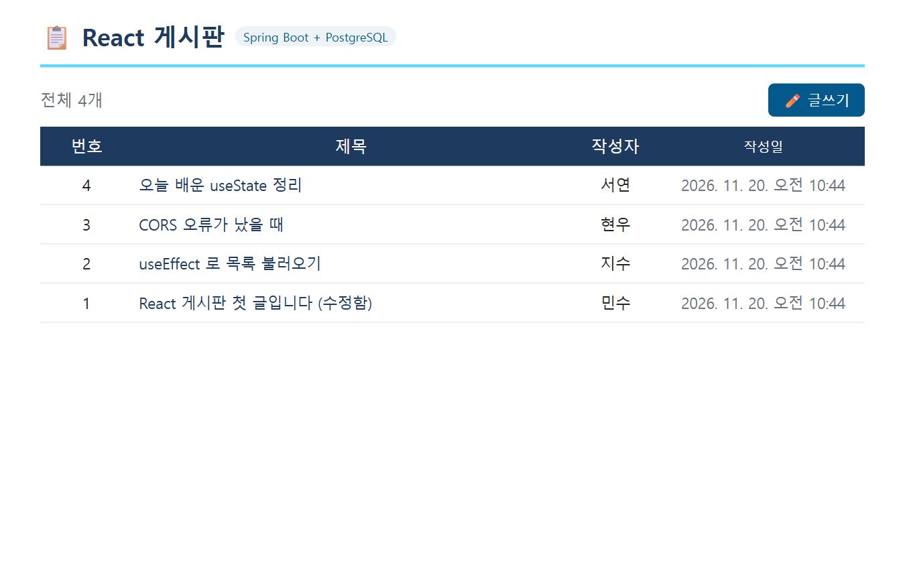
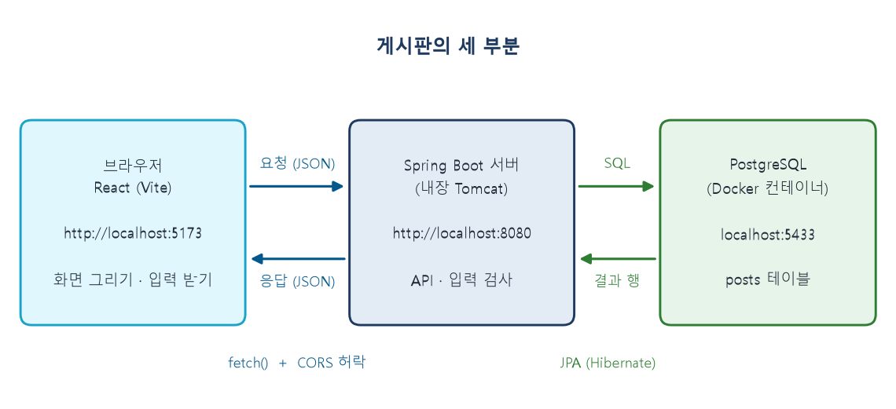
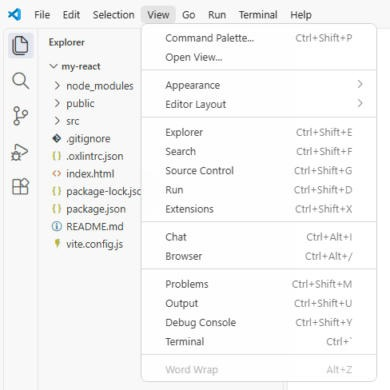
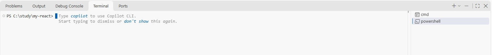
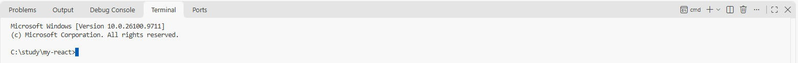
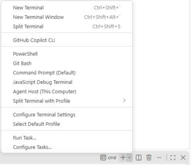

# 0장. 과정 안내와 실습 준비

## 이 과정에서 만드는 것

이 과정은 **React 를 처음 배우는 사람**을 위한 40시간(5일) 과정이다. 장마다 작은 예제를 하나씩 쌓아 올린다. 마지막 9장에서는 지금까지 배운 것을 모두 써서 **진짜 데이터베이스에 글을 저장하는 게시판**을 만든다.



게시판은 세 부분이 함께 일한다. 브라우저에서 화면을 그리는 **React**, 요청을 받아 처리하는 **Spring Boot** 서버, 글을 보관하는 **PostgreSQL** 데이터베이스다. PostgreSQL 은 **Docker** 로 띄운다.



> 이 과정을 마치면 2단계 **React 심화 과정**으로 이어진다. 심화 과정에서는 이 게시판에 **회원가입·로그인** 기능을 더한다.

## 진행 순서 (40시간)

| 일차 | 장 | 내용 | 시간 |
|---|---|---|---|
| 1일 | 0장 | 과정 안내, 프로그램 설치 확인 | 0.5 |
| | 1장 | React 시작하기 - Vite 로 첫 프로젝트 만들기 | 2.5 |
| | 2장 | React 를 위한 JavaScript 문법 | 3 |
| | 3장 | JSX - 자바스크립트 안의 HTML | 2 |
| 2일 | 4장 | 컴포넌트와 props | 4 |
| | 5장 | 조건부 렌더링과 목록 그리기 | 4 |
| 3일 | 6장 | state 와 이벤트 | 4.5 |
| | 7장 | 폼 다루기 + 할 일 앱 | 3.5 |
| 4일 | 8장 | useEffect 와 데이터 불러오기 | 3 |
| | 9장 (1) | 프로젝트: Docker PostgreSQL + Spring Boot CRUD API | 5 |
| 5일 | 9장 (2) | 프로젝트: React 로 게시판 화면 만들기 | 6 |
| | 정리 | 도전 과제, 복습 | 2 |

## 장마다 공부하는 방법

모든 장은 같은 순서로 되어 있다.

1. **개념** - 그림과 짧은 설명으로 "왜 필요한지" 를 먼저 이해한다.
2. **따라 치기** - 예제 코드를 **내 프로젝트에 직접 친다.** 복사·붙여넣기보다 직접 치는 것이 훨씬 오래 기억에 남는다.
3. **실행 결과 확인** - 교안의 화면과 내 화면을 비교한다.
4. **확인 문제** - 장 끝의 문제를 스스로 풀어 본다. 풀이는 부록 C 에 있다.

> **막히면** 저장소의 `basic/examples` 폴더에 모든 예제의 완성본이 있다. 완성본을 실행해서 내 코드와 무엇이 다른지 비교해 보자 (1-6절). 오류가 나면 **부록 A 오류 해결**을 먼저 찾아보자.

교안의 코드 상자 왼쪽 색 띠는 파일 종류를 나타낸다.

| 표시 | 뜻 |
|---|---|
| **[PS]** 표시가 붙은 상자 | **PowerShell** (또는 VS Code 터미널)에 치는 명령 |
| 하늘색 띠 | React 컴포넌트 파일 (`.jsx`) |
| 노란색 띠 | 자바스크립트 파일 (`.js`) |
| 갈색 띠 | Java 파일 (`.java`), Gradle 설정 (`build.gradle`) |
| 파란색 띠 | 설정 파일 (`.yml`) |
| 연한 노란 바탕 상자 | 실행 결과 (직접 치는 것이 아님) |

## 0-1. 설치할 프로그램

아래 프로그램이 모두 필요하다. 이미 설치했다면 0-2 의 확인 명령만 실행해 보자.

| 프로그램 | 쓰는 곳 | 받는 곳 |
|---|---|---|
| **Node.js** (LTS, 22 이상) | React 개발 서버, npm | https://nodejs.org → LTS 버튼 |
| **VS Code** | 코드 편집기 | https://code.visualstudio.com |
| **Git** | 실습 저장소 받기 | https://git-scm.com |
| **JDK 21** (Eclipse Temurin) | Spring Boot 서버 실행 (9장) | https://adoptium.net → Temurin 21 (LTS) |
| **IntelliJ IDEA** | Spring Boot 서버 코드 편집·실행 (9장) | https://www.jetbrains.com/idea |
| **Docker Desktop** | PostgreSQL 실행 (9장) | https://www.docker.com/products/docker-desktop |

> **JDK 설치할 때** Temurin 설치 화면의 기능 목록에서 **"Set JAVA_HOME variable"** 을 "설치" 로 바꿔 준다. 그래야 터미널과 Gradle 이 Java 를 찾는다. (IntelliJ 안에서 **File → Project Structure → SDK → Download JDK** 로 받아도 IntelliJ 안에서는 동작한다)

> **도구 나누어 쓰기** React 코드는 **VS Code**, Spring Boot 서버 코드는 **IntelliJ IDEA** 로 연다. IntelliJ 는 무료로 쓸 수 있는 기능만으로 충분하다. 이 과정에서는 Gradle 프로젝트를 열고 ▶ 버튼으로 실행하는 기능만 쓴다.

VS Code 에서는 확장(Extensions, `Ctrl+Shift+X`)에서 다음 두 가지를 설치해 두면 편하다.

- **ES7+ React/Redux/React-Native snippets** - `rafce` 처럼 짧게 쳐서 컴포넌트 틀을 만든다.
- **Prettier - Code formatter** - 저장할 때 코드 모양을 자동으로 정리한다.

## 0-2. 설치 확인

VS Code 를 열고 메뉴 **보기(View) → 터미널(Terminal)** (단축키 `` Ctrl+` ``)을 누르면 아래쪽에 터미널이 열린다. (화면은 VS Code 영어판이다. 한국어 메뉴를 쓰면 괄호 밖의 한국어 이름을 찾는다)



**터미널 종류부터 확인한다.** 이 교안의 명령은 모두 **PowerShell** 용이다. 프롬프트가 `PS C:\...>` 로 시작하고 오른쪽에 `powershell` 이 보이면 된다.



프롬프트에 `PS` 가 없고 `C:\...>` 만 보이거나 오른쪽에 `cmd` 라고 나오면 **명령 프롬프트(cmd)** 다. cmd 에서는 `Copy-Item`, `.venv\Scripts\Activate.ps1` 같은 명령이 동작하지 않는다.



그럴 때는 터미널 오른쪽 위 **+** 옆의 **∨** 를 눌러 **PowerShell** 을 고른다. 앞으로 늘 PowerShell 로 열리게 하려면 같은 목록의 **Select Default Profile**(기본 프로필 선택) → **PowerShell**.



이제 다음 명령을 하나씩 쳐 보자.

**[PS]**

```powershell
node -v
npm -v
git --version
java -version
docker --version
```

버전 숫자가 나오면 성공이다. 숫자는 내 화면과 달라도 괜찮다.

```text
v26.13.1
11.20.0
git version 2.56.0.windows.2
openjdk version "21.0.13" 2026-10-20 LTS
OpenJDK Runtime Environment Temurin-21.0.13+9 (build 21.0.13+9-LTS)
OpenJDK 64-Bit Server VM Temurin-21.0.13+9 (build 21.0.13+9-LTS, mixed mode, sharing)
Docker version 29.9.3, build 5457199
```

> `'node' 용어가 cmdlet ... 이름으로 인식되지 않습니다` 처럼 나오면 설치가 안 됐거나, 설치 **전에** 열어 둔 터미널이다. VS Code 를 완전히 껐다 켠 뒤 다시 해 본다.

## 0-3. 실습 저장소 받기

모든 실습은 `C:\study` 폴더에서 한다. (바탕 화면이나 OneDrive 폴더는 경로에 한글·빈칸이 섞여 오류가 나기 쉽다.)

**[PS]**

```powershell
mkdir C:\study
cd C:\study
git clone https://github.com/sinaboro/react-spring-postgresql.git
```

받은 저장소는 이렇게 생겼다.

```text
react-spring-postgresql
├─ basic                ← 1단계 기초 과정 (이 교안)
│  ├─ js                ← 2장 JavaScript 문법 예제 (node 로 실행)
│  ├─ examples          ← 3~8장 React 예제 완성본 (메뉴에서 골라 보기)
│  └─ board             ← 9장 게시판 프로젝트 완성본
│     ├─ docker-compose.yml   (PostgreSQL)
│     ├─ backend              (Spring Boot, IntelliJ 로 연다)
│     └─ frontend             (React)
├─ advanced             ← 2단계 심화 과정
└─ docs                 ← 교안 PDF 와 원고
```

> `C:\study` 폴더가 이미 있으면 `mkdir` 이 빨간 글씨로 "이미 있습니다" 오류를 낸다. 폴더가 있다는 뜻이니 무시하고 다음 줄로 넘어가면 된다. (9장 등에서 `mkdir` 할 때도 마찬가지)

> 수업 중 내가 직접 만드는 프로젝트(`C:\study\my-react`)는 저장소 **바깥**에 둔다. 저장소의 완성본은 비교용이다.
