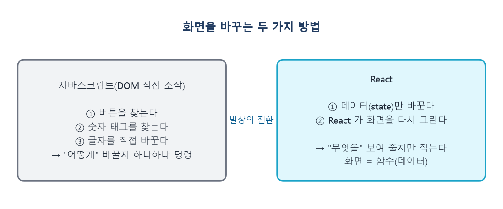
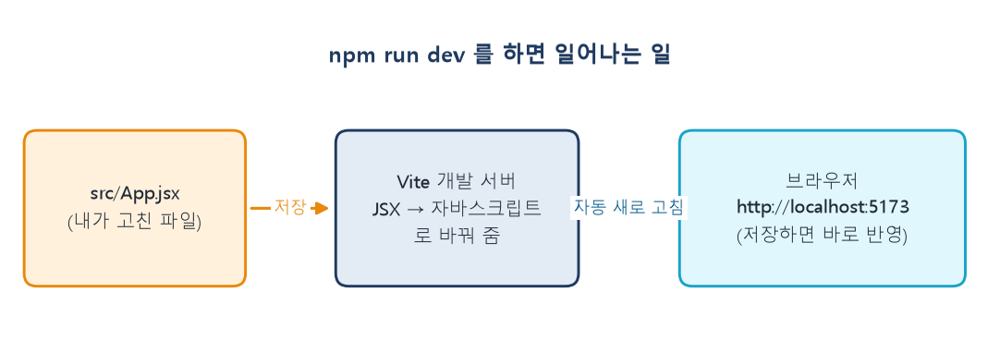
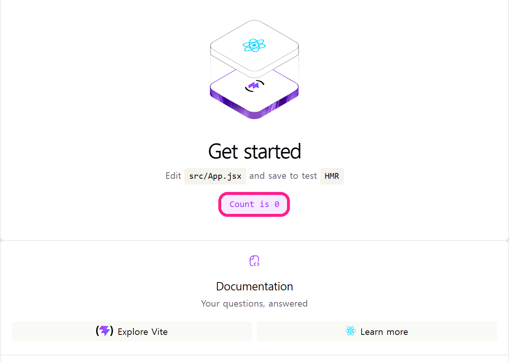
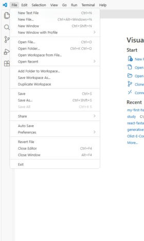
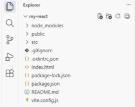

# 1장. React 시작하기

## 학습 목표

- React 가 무엇이고 왜 쓰는지 한 문장으로 말할 수 있다.
- Vite 로 React 프로젝트를 만들고 개발 서버를 켜고 끌 수 있다.
- 프로젝트 폴더에서 어떤 파일이 무슨 일을 하는지 안다.
- 코드를 고쳐 저장하면 브라우저에 바로 반영되는 것을 확인한다.

## 1-1. React 란?

**React** 는 웹 화면(UI)을 만드는 자바스크립트 **라이브러리**다. Facebook(현 Meta)이 만들었고, 지금 가장 많이 쓰이는 화면 도구다.

HTML·CSS·JavaScript 만으로도 화면은 만들 수 있다. 그런데 화면이 복잡해지면 "버튼을 찾고, 숫자 태그를 찾고, 글자를 바꾸고…" 하는 코드가 끝없이 늘어난다. React 는 생각을 바꾼다.



React 의 핵심 아이디어는 세 가지다.

| 아이디어 | 뜻 | 배우는 장 |
|---|---|---|
| **컴포넌트** | 화면을 레고 블록처럼 작은 조각으로 나눠 만들고 조립한다 | 4장 |
| **state** | 바뀌는 데이터. 데이터가 바뀌면 React 가 화면을 알아서 다시 그린다 | 6장 |
| **JSX** | 자바스크립트 안에 HTML 처럼 화면을 적는 문법 | 3장 |

> **라이브러리 vs 프레임워크** React 는 "화면" 만 책임진다. 서버, 데이터베이스, 주소(라우팅) 등은 다른 도구와 함께 쓴다. 이 과정에서는 서버로 **Spring Boot**, 데이터베이스로 **PostgreSQL** 을 쓴다.

## 1-2. Vite 로 첫 프로젝트 만들기

React 프로젝트는 보통 **Vite**(비트, 프랑스어로 "빠르다")라는 도구로 만든다. Vite 는 프로젝트 틀을 만들어 주고, 개발하는 동안 화면을 띄워 주는 **개발 서버** 역할도 한다.



VS Code 터미널에서 다음을 차례로 친다.

**[PS]** ① 실습 폴더로 이동해 프로젝트 만들기

```powershell
cd C:\study
npm create vite@latest my-react -- --template react --no-interactive
```

| 부분 | 뜻 |
|---|---|
| `npm create vite@latest` | 최신 Vite 의 "프로젝트 만들기" 도구를 실행 |
| `my-react` | 만들 폴더(프로젝트) 이름 |
| `--template react` | React + JavaScript 틀로 만든다 |
| `--no-interactive` | 질문 없이 바로 만든다 |

```text
> npx
> cva my-react --template react --no-interactive

create-vite v9.3.4

│
◇  Scaffolding project in C:\study\my-react...
│
└  Done. Now run:

  cd my-react
  npm install
  npm run dev
```

> 처음 실행하면 `Need to install the following packages: create-vite ... Ok to proceed? (y)` 라고 물을 수 있다. `y` 를 치고 Enter.

**[PS]** ② 필요한 패키지 설치 (처음 한 번)

```powershell
cd my-react
npm install
```

`npm install` 은 `package.json` 에 적힌 패키지(React, Vite 등)를 인터넷에서 받아 `node_modules` 폴더에 넣는다. 1~2분 걸릴 수 있다.

**[PS]** ③ 개발 서버 켜기

```powershell
npm run dev
```

```text
  VITE v8.3.8  ready in 570 ms

  ➜  Local:   http://localhost:5173/
  ➜  Network: use --host to expose
```

`Ctrl` 키를 누른 채 `http://localhost:5173/` 을 클릭하면 브라우저가 열린다.



가운데 **Count is 0** 버튼을 눌러 보자. 숫자가 올라간다. 이미 React 앱 하나가 돌아가고 있는 것이다.

> **개발 서버는 켜 둔 채로** 코드를 고친다. 터미널을 하나 더 쓰고 싶으면 터미널 창 오른쪽 위의 **+** 를 누른다(0장 0-2 의 그림). 새 터미널은 오른쪽 목록에 하나씩 쌓이고, 눌러서 오갈 수 있다. 서버를 끌 때는 서버가 돌고 있는 터미널을 클릭하고 **Ctrl+C**. 교안에서 **"새 터미널(+)을 열고"** 라고 하면 이 **+** 를 누르라는 뜻이다.

## 1-3. 프로젝트 폴더 둘러보기

VS Code 메뉴 **파일(File) → 폴더 열기(Open Folder...)** 로 `C:\study\my-react` 를 연다. 폴더를 고르는 창에서 `C:\study` 로 들어가 `my-react` 를 한 번 클릭하고 **폴더 선택**(Select folder). "이 폴더의 작성자를 신뢰합니까?" 라고 물으면 **예, 작성자를 신뢰합니다**(Yes, I trust the authors).



열리면 왼쪽 **탐색기**(Explorer)에 프로젝트 파일이 보인다. 터미널도 이 폴더(`C:\study\my-react`)에서 열린다.



```text
my-react
├─ node_modules      ← npm install 로 받은 패키지 (직접 고치지 않는다, 아주 크다)
├─ public            ← 그대로 내보낼 파일 (favicon.svg 등). /favicon.svg 주소로 열린다
├─ src               ← ★ 우리가 코드를 쓰는 곳
│  ├─ assets         ← 그림 파일
│  ├─ App.jsx        ← ★ 첫 화면 컴포넌트
│  ├─ App.css        ← App 의 스타일
│  ├─ index.css      ← 전체 스타일
│  └─ main.jsx       ← 시작점: App 을 index.html 에 붙인다
├─ index.html        ← 브라우저가 처음 여는 HTML. <div id="root"> 가 있다
├─ package.json      ← 프로젝트 이름, 패키지 목록, 명령(npm run dev 등)
└─ vite.config.js    ← Vite 설정
```

실행 순서는 이렇다.

1. 브라우저가 `index.html` 을 연다. 안에는 빈 `<div id="root"></div>` 와 `main.jsx` 를 불러오는 줄이 있다.
2. `main.jsx` 가 `App` 컴포넌트를 `#root` 안에 그린다.
3. `App.jsx` 가 돌려준 화면이 브라우저에 보인다.

`package.json` 의 `scripts` 부분이 `npm run ...` 명령의 정체다.

```json
"scripts": {
  "dev": "vite",
  "build": "vite build",
  "lint": "oxlint",
  "preview": "vite preview"
},
```

| 명령 | 하는 일 |
|---|---|
| `npm run dev` | 개발 서버 켜기 (고치면 바로 반영) |
| `npm run build` | 배포용 파일을 `dist` 폴더에 만들기 |
| `npm run preview` | 만든 배포용 파일을 미리 보기 |

## 1-4. 첫 번째 수정: 나만의 화면

`src/App.jsx` 를 열고 **내용을 모두 지운 뒤** 다음처럼 친다.

```jsx
// App.jsx - 나의 첫 React 컴포넌트
// 컴포넌트 = 화면 조각(JSX)을 돌려주는 함수. 이름은 대문자로 시작한다.
function App() {
  return (
    <div>
      <h1>안녕하세요, React!</h1>
      <p>나의 첫 React 앱입니다.</p>
    </div>
  );
}

export default App; // 다른 파일(main.jsx)에서 가져다 쓸 수 있게 내보낸다
```

그리고 기본 스타일이 섞이지 않도록 두 CSS 파일을 정리한다.

1. `src/App.css` 를 열어 내용을 **모두 지우고** 저장한다.
2. `src/index.css` 를 열어 내용을 모두 지우고 아래 내용으로 바꿔 저장한다.

<!-- file: basic/examples/src/index.css -->

```css
/* index.css - 앱 전체에 적용되는 기본 글꼴과 여백 */
body {
  margin: 0;
  font-family: "Malgun Gothic", "맑은 고딕", system-ui, sans-serif;
  color: #222;
  background: white;
}
```

**저장(Ctrl+S)하는 순간** 브라우저가 새로 고침 없이 바뀐다. 이것을 **HMR**(Hot Module Replacement, 바뀐 부분만 바로 바꿔 끼우기)이라고 한다.

> `<h1>` 의 글자를 바꿔 저장해 보자. 몇 번이고 바로 반영된다. 바뀌지 않으면 파일을 **저장**했는지(VS Code 탭 이름 옆의 동그라미 ● 가 없어야 저장된 것) 확인한다.

## 1-5. main.jsx 읽어 보기

`src/main.jsx` 는 앱의 시작점이다. 거의 고칠 일이 없지만 한 번은 읽어 두자. 저장소 예제 앱의 `main.jsx` 에 주석을 단 것이다.

<!-- file: basic/examples/src/main.jsx -->

```jsx
// main.jsx - 앱의 시작점 (Vite 가 index.html 에서 가장 먼저 불러오는 파일)
//
// 이 파일이 하는 일
//   - index.html 의 <div id="root"> 를 찾아서 그 안에 <App /> 을 그린다.
//   - StrictMode 는 개발 중에만 동작하는 "실수 찾기 도우미". 화면에는 아무것도 그리지 않는다.
//     (개발 모드에서 컴포넌트·useEffect 를 일부러 한 번 더 실행해 본다 → 콘솔 로그가 두 번 보이는 이유)

import { StrictMode } from "react";
import { createRoot } from "react-dom/client";
import "./index.css"; // 전체 스타일
import App from "./App.jsx";

createRoot(document.getElementById("root")).render(
  <StrictMode>
    <App />
  </StrictMode>,
);
```

- `createRoot(...).render(...)` - `#root` 칸 안에 React 화면을 그리기 시작한다.
- `import App from "./App.jsx"` - 2장에서 배울 **import** 문법. 다른 파일의 컴포넌트를 가져온다.
- `<StrictMode>` - 개발할 때만 동작하는 검사 도우미. 8장에서 다시 만난다.

## 1-6. 완성본 예제 앱 실행해 보기

저장소의 `basic/examples` 에는 3~8장의 모든 예제가 들어 있다. 왼쪽 메뉴에서 예제를 고르면 오른쪽에 그 예제가 실행된다. 공부하다 막히면 여기서 정답 화면과 코드를 확인하자.

**[PS]** 새 터미널(+)을 열고

```powershell
cd C:\study\react-spring-postgresql\basic\examples
npm install
npm run dev
```

```text
Port 5173 is in use, trying another one...

  VITE v8.3.8  ready in 167 ms

  ➜  Local:   http://localhost:5174/
  ➜  Network: use --host to expose
```

내 프로젝트(my-react)가 이미 5173 을 쓰고 있으면, Vite 가 알아서 **5174** 같은 다른 번호를 쓴다. 터미널에 나온 주소를 연다.

> 예제 앱은 각 화면 위에 파일 경로(`src/examples/ch03/Ex0301Hello.jsx` 등)를 보여 준다. VS Code 에서 저장소 폴더를 따로 열어 그 파일을 읽어 보면 된다.

## 정리

- React 는 화면(UI)을 **컴포넌트** 단위로 만들고, **데이터(state)가 바뀌면 화면을 알아서 다시 그리는** 라이브러리다.
- `npm create vite@latest 이름 -- --template react --no-interactive` → `npm install` → `npm run dev` 순서로 프로젝트를 만들고 실행한다.
- 코드는 `src` 폴더에 쓴다. 시작점은 `main.jsx`, 첫 화면은 `App.jsx` 다.
- 개발 서버는 켜 둔 채로 고치고, 끌 때는 **Ctrl+C**.

## 확인 문제

1. 개발 서버를 켜는 명령과 끄는 방법을 쓰시오.
2. 새로 만든 프로젝트에서 `npm install` 을 빠뜨리고 `npm run dev` 를 하면 어떻게 될지 생각해 보고, 왜 그런지 설명하시오.
3. `App.jsx` 의 `<p>` 아래에 `<p>오늘의 다짐: 매일 30분 코딩</p>` 을 추가해 화면에 보이게 하시오.
4. 브라우저가 가장 먼저 여는 파일과, React 화면이 그려지는 태그의 id 를 쓰시오.
