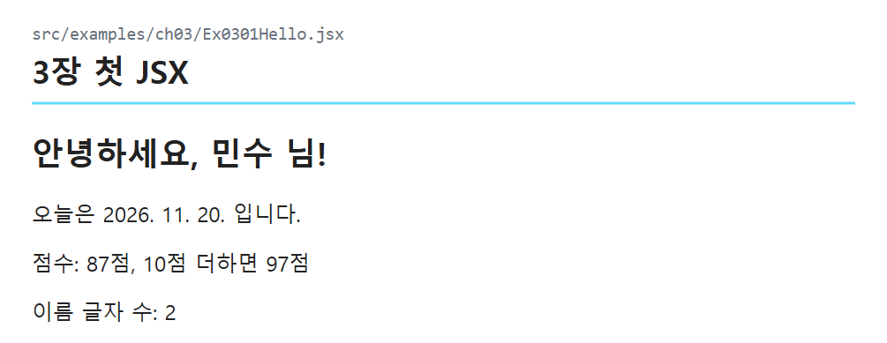
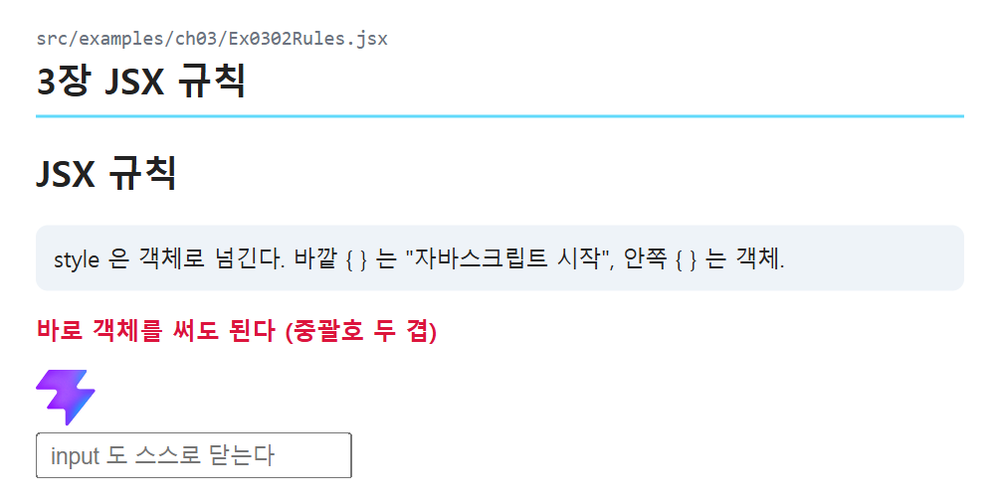

# 3장. JSX - 자바스크립트 안의 HTML

## 학습 목표

- JSX 가 무엇이고 HTML 과 무엇이 다른지 안다.
- `{ }` 안에 변수와 식을 넣어 화면에 값을 보여 준다.
- JSX 의 다섯 가지 규칙(부모 하나, 닫기, className, style 객체, 주석)을 지킨다.
- 예제 파일을 내 프로젝트에 만들고 App 에서 불러 실행할 수 있다.

## 3-1. JSX 란?

1장의 `App` 함수는 이런 것을 돌려줬다.

```jsx
return (
  <div>
    <h1>안녕하세요, React!</h1>
  </div>
);
```

자바스크립트 함수가 HTML 을 돌려주다니 이상하다. 이것이 **JSX**(JavaScript XML)다. HTML 처럼 보이지만, Vite 가 이것을 아래 같은 **자바스크립트 함수 호출**로 바꿔서 실행한다.

```js
// 위 JSX 가 실제로 바뀌는 모양 (직접 쓸 일은 없다)
jsx("div", { children: jsx("h1", { children: "안녕하세요, React!" }) });
```

그래서 JSX 안에서는 **자바스크립트 값을 자유롭게 섞어 쓸 수** 있다. 대신 HTML 과 조금 다른 규칙이 있다.

## 3-2. 이 장부터의 실습 방법

3~8장은 1장에서 만든 `my-react` 프로젝트에서 실습한다.

1. 예제마다 `src/examples/장번호` 폴더에 파일을 만든다. 예: `src/examples/ch03/Ex0301Hello.jsx`
   (VS Code 탐색기에서 `src` 를 오른쪽 클릭 → **새 파일** → `examples/ch03/Ex0301Hello.jsx` 라고 치면 폴더까지 한 번에 만들어진다.)
2. `src/App.jsx` 를 아래처럼 바꿔, 지금 공부하는 예제만 보이게 한다.

```jsx
// App.jsx - 지금 연습하는 예제 하나를 보여 준다
import Ex0301Hello from "./examples/ch03/Ex0301Hello";

function App() {
  return <Ex0301Hello />;
}

export default App;
```

다음 예제로 넘어갈 때는 `import` 줄과 `<Ex0301Hello />` 의 이름만 바꾸면 된다.

> 저장소 `basic/examples` 완성본 앱은 이 일을 왼쪽 메뉴가 대신해 준다. 파일 이름과 경로는 완성본과 똑같이 맞춰 두었다.

## 3-3. { } 로 값 넣기

<!-- file: basic/examples/src/examples/ch03/Ex0301Hello.jsx -->

```jsx
// Ex0301Hello.jsx - 첫 JSX: { } 안에 자바스크립트 값 넣기
//
// 이 예제가 보여 주는 것
//   - 컴포넌트 = "화면 조각(JSX)을 돌려주는 함수". 이름은 반드시 대문자로 시작한다.
//   - JSX 안의 { } 에는 변수, 계산식, 함수 호출처럼 "값이 되는 식" 을 넣을 수 있다.
//   - export default 로 내보내야 다른 파일(App.jsx)에서 가져다 쓸 수 있다.

function Ex0301Hello() {
  // return 위쪽은 보통 자바스크립트 영역 - 화면에 쓸 값을 미리 준비한다
  const name = "민수";
  const today = new Date().toLocaleDateString("ko-KR"); // 예: 2026. 11. 20.
  const score = 87;

  // return 아래는 JSX 영역 - HTML 처럼 생겼지만 자바스크립트로 바뀌어 실행된다
  return (
    <div>
      <h2>안녕하세요, {name} 님!</h2> {/* { } 안의 변수 값이 들어간다 */}
      <p>오늘은 {today} 입니다.</p>
      <p>점수: {score}점, 10점 더하면 {score + 10}점</p> {/* 계산식도 된다 */}
      <p>이름 글자 수: {name.length}</p> {/* 속성·메서드도 된다 */}
    </div>
  );
}

export default Ex0301Hello;
```



`{ }` 안에는 **값이 되는 식(expression)** 이면 무엇이든 넣을 수 있다.

| 넣을 수 있다 (식) | 넣을 수 없다 (문장) |
|---|---|
| `{name}`, `{score + 10}`, `{name.length}` | `{if (a) ...}` |
| `{isOk ? "예" : "아니오"}` (삼항 연산자) | `{for (...) ...}` |
| `{list.map(...)}` (5장) | `{const x = 1}` |

> **if 와 for 는 어떻게 하지?** `return` **위쪽**(자바스크립트 영역)에서 미리 계산해 두거나, 삼항 연산자 `? :` 와 `map` 을 쓴다. 5장에서 자세히 배운다.

## 3-4. JSX 의 다섯 가지 규칙

<!-- file: basic/examples/src/examples/ch03/Ex0302Rules.jsx -->

```jsx
// Ex0302Rules.jsx - JSX 의 규칙 5가지
//
// 이 예제가 보여 주는 것
//   1. 돌려주는 JSX 는 "부모 태그 하나" 로 감싼다. 감쌀 태그가 필요 없으면 <> </> (Fragment)
//   2. 모든 태그는 닫는다. , <br>, <input> 도  처럼 스스로 닫는다
//   3. class 대신 className (class 는 자바스크립트 예약어라서)
//   4. style 은 문자열이 아니라 객체로 쓰고, 속성 이름은 camelCase (font-size → fontSize)
//   5. JSX 안의 주석은 {/* ... */}

function Ex0302Rules() {
  // 4번 규칙: style 에 넘길 객체. 값이 숫자면 px 이 붙는다 (fontSize: 20 → 20px)
  const boxStyle = {
    backgroundColor: "#eef3f8",
    padding: 12,
    borderRadius: 8,
    fontSize: 15,
  };

  return (
    // 1번 규칙: 여러 태그를 Fragment(<> </>) 하나로 감쌌다. 화면에 <div> 가 더 생기지 않는다
    <>
      {/* 5번 규칙: JSX 안의 주석은 이렇게 쓴다 */}
      <h2 className="title">JSX 규칙</h2> {/* 3번 규칙: className */}
      <div style={boxStyle}>
        style 은 객체로 넘긴다. 바깥 {"{ }"} 는 "자바스크립트 시작", 안쪽 {"{ }"} 는 객체.
      </div>
      <p style={{ color: "crimson", fontWeight: "bold" }}>바로 객체를 써도 된다 (중괄호 두 겹)</p>
       {/* 2번 규칙: 스스로 닫기 */}
      <br />
      <input placeholder="input 도 스스로 닫는다" />
    </>
  );
}

export default Ex0302Rules;
```



| 규칙 | HTML | JSX |
|---|---|---|
| 1. 부모 태그 하나 | 여러 태그를 나란히 써도 됨 | `<div>` 나 `<> </>` 로 하나로 감싼다 |
| 2. 모든 태그를 닫는다 | `<br>`, `` | `<br />`, `` |
| 3. 클래스 | `class="title"` | `className="title"` |
| 4. 인라인 스타일 | `style="font-size: 15px"` | `style={{ fontSize: 15 }}` (객체, camelCase) |
| 5. 주석 | `<!-- 주석 -->` | `{/* 주석 */}` |

규칙을 어기면 Vite 가 브라우저와 터미널에 오류를 띄운다. 예를 들어 부모 태그 없이 두 태그를 나란히 쓰면 다음과 같은 오류가 난다.

```jsx
// 잘못된 예: 부모가 둘
return (
  <h2>제목</h2>
  <p>내용</p>
);
```

```text
Adjacent JSX elements must be wrapped in an enclosing tag.
   ╭─[ src/App.jsx:4:5 ]
   │
 4 │     <p>내용</p>
   │     ┬
   │     ╰──
   │
   │ Help: Did you want a JSX fragment `<>...</>`?
```

"이웃한 JSX 태그는 감싸는 태그 하나로 묶어야 한다" 는 뜻이고, `src/App.jsx:4:5` 는 **4번째 줄 5번째 글자**라는 뜻이다. 마지막 줄은 친절하게 `<>...</>` 로 감싸 보라고 알려 준다. 오류가 나면 겁먹지 말고 **파일 이름·줄 번호·Help** 부터 읽자.

## 3-5. 컴포넌트 이름은 대문자로

```jsx
function hello() { ... }   // ✗ 소문자 → <hello /> 를 HTML 태그로 착각한다
function Hello() { ... }   // ✓ 대문자 → React 컴포넌트
```

React 는 `<div>` 처럼 **소문자로 시작하면 HTML 태그**, `<Hello>` 처럼 **대문자로 시작하면 컴포넌트**로 본다.

## 정리

- JSX 는 자바스크립트로 바뀌어 실행되는 "HTML 처럼 생긴 문법" 이다.
- `{ }` 안에는 값이 되는 식(변수, 계산, 함수 호출, 삼항 연산자)을 넣는다.
- 부모 하나로 감싸기, 모든 태그 닫기, `className`, `style={{ }}`, `{/* 주석 */}`.
- 컴포넌트 이름은 대문자로 시작한다.

## 확인 문제

1. 다음 HTML 을 JSX 로 바르게 고치시오.

```html
<label class="name">이름</label>
<input type="text">
<p style="color: red; font-size: 12px">필수 입력</p>
```

2. `const price = 12000; const count = 3;` 일 때 화면에 `합계: 36,000원` 이 보이도록 JSX 를 쓰시오. (힌트: `toLocaleString()`)
3. `{if (age >= 20) "성인"}` 이 왜 오류인지 설명하고, 삼항 연산자로 고쳐 쓰시오.
4. 자기소개 컴포넌트 `MyIntro` 를 `src/examples/ch03/MyIntro.jsx` 에 만들어 App 에서 보여 주시오. 이름·좋아하는 음식·오늘 날짜(`new Date().toLocaleDateString("ko-KR")`)가 나와야 한다.
