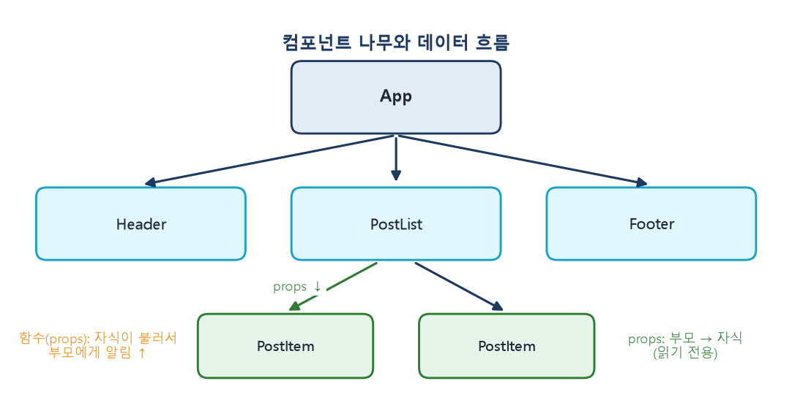
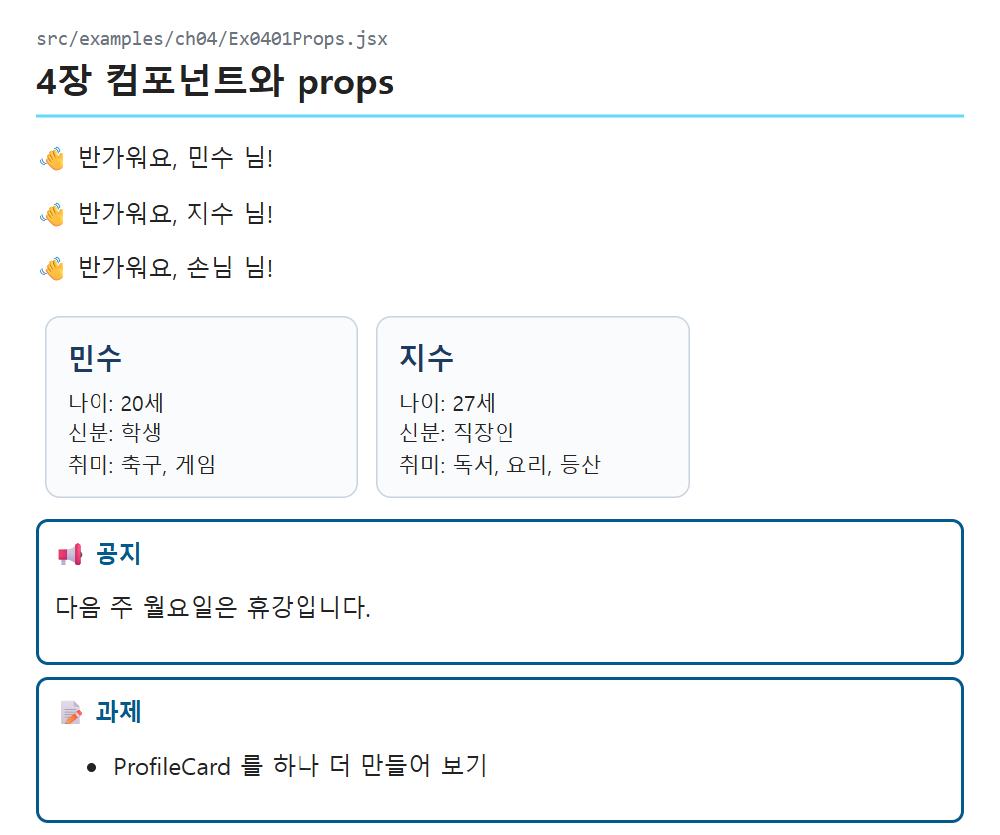

# 4장. 컴포넌트와 props

## 학습 목표

- 화면을 여러 컴포넌트로 나누고 파일 하나에 컴포넌트 하나를 둔다.
- props 로 부모가 자식에게 값을 넘기고, 자식은 구조 분해로 받는다.
- 문자열·숫자·불린·배열 props 를 바르게 넘긴다.
- `children` 으로 태그 사이의 내용을 받는 컴포넌트를 만든다.

## 4-1. 컴포넌트로 나누는 이유

게시판 화면을 떠올려 보자. 머리글, 글 목록, 글 한 줄, 바닥글… 이것을 한 파일에 다 쓰면 수백 줄이 된다. React 는 화면을 **컴포넌트**(component, 부품)로 나눈다.



- 큰 컴포넌트(App)가 작은 컴포넌트를 **조립**한다. 부모-자식 관계가 나무 모양으로 이어진다.
- 같은 컴포넌트(PostItem)를 **다른 값으로 여러 번** 쓸 수 있다. 이때 값을 넘기는 방법이 **props** 다.
- 값은 **부모 → 자식** 한 방향으로만 흐른다. (자식이 부모에게 알리는 방법은 6장)

## 4-2. 첫 컴포넌트 파일과 props

`src/examples/ch04/components` 폴더를 만들고 첫 컴포넌트를 쓴다.

<!-- file: basic/examples/src/examples/ch04/components/Greeting.jsx -->

```jsx
// Greeting.jsx - props 를 받는 가장 작은 컴포넌트 (파일 하나 = 컴포넌트 하나)
//
// 이 예제가 보여 주는 것
//   - 부모가 <Greeting name="민수" /> 처럼 속성을 쓰면, 그 값들이 객체 하나(props)로 들어온다.
//   - 매개변수 자리에서 { name } 으로 구조 분해하면 props.name 대신 name 으로 바로 쓸 수 있다.
//   - = "손님" 은 부모가 name 을 안 넘겼을 때 쓸 기본값이다.

function Greeting({ name = "손님" }) {
  return <p>👋 반가워요, {name} 님!</p>;
}

export default Greeting;
```

쓰는 쪽(부모)은 HTML 속성처럼 값을 적는다.

```jsx
<Greeting name="민수" />
```

그러면 React 가 `Greeting({ name: "민수" })` 처럼 **속성들을 객체 하나로 묶어** 함수에 넘긴다. 이 객체가 **props**(properties)다. 다음 두 코드는 같다.

```jsx
// 1) props 객체를 통째로 받기
function Greeting(props) {
  return <p>반가워요, {props.name} 님!</p>;
}

// 2) 받으면서 바로 구조 분해 (2장) - React 에서 더 많이 쓰는 모양
function Greeting({ name }) {
  return <p>반가워요, {name} 님!</p>;
}
```

## 4-3. 여러 종류의 props

<!-- file: basic/examples/src/examples/ch04/components/ProfileCard.jsx -->

```jsx
// ProfileCard.jsx - 여러 종류의 props (문자열, 숫자, 불린, 배열)
//
// 이 예제가 보여 주는 것
//   - 문자열이 아닌 값(숫자, true/false, 배열, 객체, 함수)은 { } 로 감싸서 넘긴다.
//   - 받는 쪽은 그냥 자바스크립트 값으로 쓴다.
//   - props 는 "읽기 전용" 이다. 받은 컴포넌트가 고치면 안 된다 (고치는 방법은 6장 state).

import "./ProfileCard.css"; // 이 컴포넌트에서만 쓰는 스타일 파일을 불러온다

function ProfileCard({ name, age, isStudent, hobbies }) {
  return (
    <div className="profile-card">
      <h3>{name}</h3>
      <p>나이: {age}세</p>
      {/* 불린은 화면에 그대로 찍히지 않으므로 글자로 바꿔 보여 준다 */}
      <p>신분: {isStudent ? "학생" : "직장인"}</p>
      {/* 배열의 join 으로 쉼표를 넣어 한 줄로 */}
      <p>취미: {hobbies.join(", ")}</p>
    </div>
  );
}

export default ProfileCard;
```

<!-- file: basic/examples/src/examples/ch04/components/ProfileCard.css -->

```css
/* ProfileCard.css - ProfileCard 컴포넌트의 모양
   className="profile-card" 이 붙은 태그에 적용된다. (CSS 문법은 HTML 때와 똑같다) */
.profile-card {
  display: inline-block;
  width: 180px;
  margin: 6px;
  padding: 10px 14px;
  border: 1px solid #c9d3df;
  border-radius: 10px;
  background: #f9fbfd;
  vertical-align: top;
}

.profile-card h3 {
  margin: 4px 0 8px;
  color: #1f3a5f;
}

.profile-card p {
  margin: 3px 0;
  font-size: 14px;
}
```

> **CSS 파일 연결** `import "./ProfileCard.css"` 한 줄이면 그 CSS 가 화면에 적용된다. CSS 문법은 HTML 수업 때와 똑같고, JSX 쪽에서는 `className` 으로 이름을 붙인다.

## 4-4. children: 태그 사이의 내용 받기

<!-- file: basic/examples/src/examples/ch04/components/Box.jsx -->

```jsx
// Box.jsx - children: 태그 사이에 넣은 내용을 받는 특별한 prop
//
// 이 예제가 보여 주는 것
//   - <Box title="공지">여기 내용</Box> 처럼 여는 태그와 닫는 태그 사이에 넣은 JSX 는
//     props.children 으로 들어온다.
//   - 테두리·제목처럼 "겉모양" 은 Box 가 맡고, 안의 내용은 쓰는 쪽이 정한다 → 재사용이 쉽다.

function Box({ title, children }) {
  return (
    <section style={{ border: "2px solid #03588C", borderRadius: 8, padding: 10, margin: "8px 0" }}>
      <strong style={{ color: "#03588C" }}>{title}</strong>
      <div>{children}</div> {/* 태그 사이에 넣은 내용이 이 자리에 들어간다 */}
    </section>
  );
}

export default Box;
```

## 4-5. 조립하기

세 컴포넌트를 가져와 조립하는 예제다. App 에서 이 컴포넌트를 불러 실행하자 (3-2절 방법).

<!-- file: basic/examples/src/examples/ch04/Ex0401Props.jsx -->

```jsx
// Ex0401Props.jsx - 컴포넌트를 여러 파일로 나누고 props 로 값 넘기기
//
// 이 예제가 보여 주는 것
//   - components 폴더의 컴포넌트를 import 해서 태그처럼 쓴다.
//   - 같은 컴포넌트에 다른 props 를 넘기면 다른 내용이 그려진다 (재사용).
//   - 부모 → 자식 방향으로만 값이 흐른다 (단방향 데이터 흐름).

import Greeting from "./components/Greeting";
import ProfileCard from "./components/ProfileCard";
import Box from "./components/Box";

function Ex0401Props() {
  return (
    <div>
      {/* 1) 문자열 props 는 따옴표로 */}
      <Greeting name="민수" />
      <Greeting name="지수" />
      <Greeting /> {/* name 을 안 넘기면 기본값 "손님" */}

      {/* 2) 숫자·불린·배열은 { } 로 */}
      <ProfileCard name="민수" age={20} isStudent={true} hobbies={["축구", "게임"]} />
      <ProfileCard name="지수" age={27} isStudent={false} hobbies={["독서", "요리", "등산"]} />

      {/* 3) children: 태그 사이의 내용이 Box 안으로 들어간다 */}
      <Box title="📢 공지">
        <p>다음 주 월요일은 휴강입니다.</p>
      </Box>
      <Box title="📝 과제">
        <ul>
          <li>ProfileCard 를 하나 더 만들어 보기</li>
        </ul>
      </Box>
    </div>
  );
}

export default Ex0401Props;
```



| 넘기는 값 | 쓰는 법 | 예 |
|---|---|---|
| 문자열 | 따옴표 | `name="민수"` |
| 숫자, 불린, 배열, 객체, 함수 | 중괄호 | `age={20}`, `isStudent={true}`, `hobbies={["축구"]}` |
| 태그 사이의 내용 | 여는 태그와 닫는 태그 사이 | `<Box>내용</Box>` → `children` |

> **흔한 실수** `age="20"` 으로 쓰면 숫자가 아니라 **문자열** "20" 이 넘어간다. `age + 1` 이 `"201"` 이 되어 버린다. 숫자는 꼭 `age={20}`.

## 4-6. props 는 읽기 전용

자식은 받은 props 를 **고치면 안 된다.**

```jsx
function Greeting({ name }) {
  name = "바꾼 이름";   // ✗ 이렇게 하지 않는다. 화면이 예측과 다르게 움직인다
  return <p>{name}</p>;
}
```

값을 바꿔야 한다면 그 값은 props 가 아니라 **state** 여야 한다. 6장에서 배운다.

## 4-7. import 경로 읽는 법

| 경로 | 뜻 |
|---|---|
| `"./components/Greeting"` | 지금 파일과 **같은 폴더** 안의 components 폴더 |
| `"../config"` | 한 칸 **위 폴더**의 config.js |
| `"react"` | 경로가 아니라 **패키지 이름** (node_modules 에서 찾는다) |

`.jsx`, `.js` 확장자는 Vite 프로젝트에서는 생략해도 된다.

## 정리

- 컴포넌트 = 대문자로 시작하는 함수 + JSX 를 return. 파일 하나에 하나, `export default`.
- props = 부모가 자식에게 넘기는 값들의 객체. `function Comp({ a, b })` 로 받는다.
- 문자열이 아닌 값은 `{ }` 로 넘긴다. 태그 사이의 내용은 `children`.
- props 는 읽기 전용. 값은 부모 → 자식 한 방향으로 흐른다.

## 확인 문제

1. `<Product name="노트북" price={1200000} soldOut={false} />` 를 받아 `노트북 - 1,200,000원` 을 보여 주고, `soldOut` 이 참이면 `(품절)` 을 덧붙이는 `Product` 컴포넌트를 만드시오.
2. 다음 코드의 결과가 `나이: 201` 로 나왔다. 무엇이 문제인지 쓰고 고치시오.

```jsx
<Person age="20" />
function Person({ age }) { return <p>나이: {age + 1}</p>; }
```

3. 제목(`title`)과 `children` 을 받아 노란 바탕 상자로 보여 주는 `Notice` 컴포넌트를 만들고, 안에 `<ul>` 목록을 넣어 보시오.
4. `Greeting` 에 `emoji` props 를 추가해, 넘기지 않으면 기본값 `"👋"` 이 쓰이게 바꾸시오.
