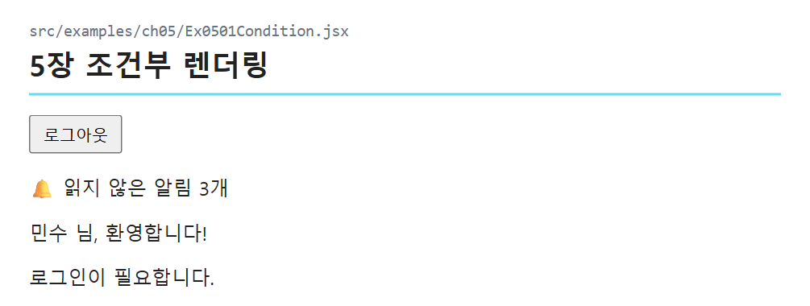
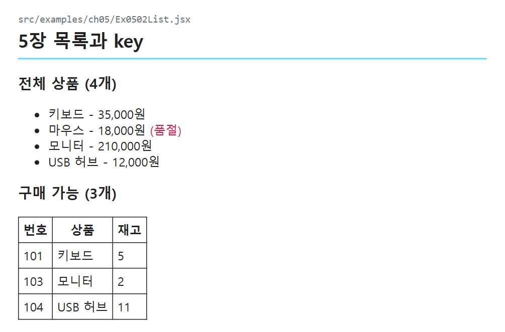

# 5장. 조건부 렌더링과 목록 그리기

## 학습 목표

- 조건에 따라 다른 화면을 보여 준다: 삼항 연산자, `&&`, `if` + 일찍 return.
- 배열을 `map` 으로 목록(`<li>`, `<tr>`)으로 그린다.
- 목록의 각 항목에 알맞은 `key` 를 준다.
- `filter` 로 걸러 낸 결과를 그린다.

## 5-1. 조건부 렌더링

로그인했으면 "로그아웃" 버튼, 아니면 "로그인" 버튼. 데이터가 없으면 "글이 없습니다". 이처럼 **조건에 따라 다른 화면**을 그리는 것을 조건부 렌더링이라 한다. JSX 의 `{ }` 에는 `if` 문을 못 쓰므로 세 가지 방법을 쓴다.

| 방법 | 모양 | 언제 |
|---|---|---|
| 삼항 연산자 | `{조건 ? <A /> : <B />}` | 둘 중 하나 |
| `&&` | `{조건 && <A />}` | 참일 때만 보이고 거짓이면 아무것도 없음 |
| `if` + `return` | 컴포넌트 위쪽에서 `if (!ok) return <X />;` | 경우에 따라 화면 전체가 다를 때 |

<!-- file: basic/examples/src/examples/ch05/Ex0501Condition.jsx -->

```jsx
// Ex0501Condition.jsx - 조건부 렌더링 (조건에 따라 다른 화면 보여 주기)
//
// 이 예제가 보여 주는 것
//   1. 조건 ? A : B   → 둘 중 하나를 보여 줄 때
//   2. 조건 && A      → 조건이 참일 때만 보여 줄 때 (거짓이면 아무것도 안 그림)
//   3. if 문 + 일찍 return → 경우가 완전히 다를 때
//   JSX 의 { } 안에는 "식" 만 들어가므로 if 문은 쓸 수 없다. 그래서 1·2 를 주로 쓴다.

// 3번 방식: 컴포넌트 안에서 if 로 먼저 걸러 내기
function LoginMessage({ isLogin, name }) {
  if (!isLogin) {
    return <p>로그인이 필요합니다.</p>; // 여기서 끝. 아래 줄은 실행되지 않는다
  }
  return <p>{name} 님, 환영합니다!</p>;
}

function Ex0501Condition() {
  const isLogin = true; // false 로 바꿔 저장하면 화면이 어떻게 바뀌는지 보자
  const name = "민수";
  const unread = 3; // 0 으로도 바꿔 보자

  return (
    <div>
      {/* 1. 삼항 연산자: 버튼 글자를 둘 중 하나로 */}
      <button>{isLogin ? "로그아웃" : "로그인"}</button>

      {/* 2. && : 읽지 않은 알림이 있을 때만 보여 준다 */}
      {unread > 0 && <p>🔔 읽지 않은 알림 {unread}개</p>}
      {/* 주의: {unread && ...} 로 쓰면 unread 가 0 일 때 화면에 0 이 찍힌다. 비교식을 쓰자 */}

      {/* 3. if 문을 쓴 컴포넌트 */}
      <LoginMessage isLogin={isLogin} name={name} />
      <LoginMessage isLogin={false} />
    </div>
  );
}

export default Ex0501Condition;
```



`isLogin` 을 `false` 로, `unread` 를 `0` 으로 바꿔 저장하고 화면이 어떻게 바뀌는지 확인하자.

> **`&&` 의 함정** `{count && <p>...</p>}` 에서 `count` 가 `0` 이면 화면에 **0 이 그대로 찍힌다.** React 는 `false`, `null`, `undefined` 는 그리지 않지만 숫자 0 은 그린다. 그래서 `{count > 0 && ...}` 처럼 **비교식**을 쓰는 습관을 들이자.

## 5-2. map 으로 목록 그리기

서버에서 받은 글 목록, 상품 목록은 모두 **배열**이다. 배열의 칸마다 태그를 하나씩 만들려면 2장에서 배운 `map` 을 쓴다.

```jsx
const fruits = ["사과", "배", "포도"];

<ul>
  {fruits.map((f) => <li key={f}>{f}</li>)}
</ul>
// → <ul><li>사과</li><li>배</li><li>포도</li></ul>
```

`map` 이 **JSX 의 배열**을 돌려주고, React 는 배열 안의 JSX 를 차례대로 그린다.

<!-- file: basic/examples/src/examples/ch05/Ex0502List.jsx -->

```jsx
// Ex0502List.jsx - 배열을 map 으로 목록 그리기 + key
//
// 이 예제가 보여 주는 것
//   - 배열.map(항목 => <태그>...</태그>) 로 배열의 칸마다 태그를 하나씩 만든다.
//   - 목록의 각 태그에는 key 를 꼭 준다. 어느 칸이 바뀌었는지 React 가 알아보는 이름표다.
//   - key 는 형제끼리 겹치지 않는 값(보통 DB 의 id)을 쓴다. 배열 순서(index)는 되도록 피한다.
//   - filter 로 걸러 낸 뒤 map 으로 그리면 "검색 결과" 가 된다.

// 서버에서 받아 왔다고 생각하자 (9장에서는 진짜로 Spring Boot 서버에서 받아 온다)
const products = [
  { id: 101, name: "키보드", price: 35000, stock: 5 },
  { id: 102, name: "마우스", price: 18000, stock: 0 },
  { id: 103, name: "모니터", price: 210000, stock: 2 },
  { id: 104, name: "USB 허브", price: 12000, stock: 11 },
];

function Ex0502List() {
  const inStock = products.filter((p) => p.stock > 0); // 재고가 있는 것만

  return (
    <div>
      <h3>전체 상품 ({products.length}개)</h3>
      <ul>
        {products.map((p) => (
          // key 는 map 이 돌려주는 "가장 바깥" 태그에 준다
          <li key={p.id}>
            {p.name} - {p.price.toLocaleString()}원 {/* 35000 → 35,000 */}
            {p.stock === 0 && <span style={{ color: "crimson" }}> (품절)</span>}
          </li>
        ))}
      </ul>

      <h3>구매 가능 ({inStock.length}개)</h3>
      <table border="1" cellPadding="6" style={{ borderCollapse: "collapse" }}>
        <thead>
          <tr>
            <th>번호</th>
            <th>상품</th>
            <th>재고</th>
          </tr>
        </thead>
        <tbody>
          {inStock.map((p) => (
            <tr key={p.id}>
              <td>{p.id}</td>
              <td>{p.name}</td>
              <td>{p.stock}</td>
            </tr>
          ))}
        </tbody>
      </table>
    </div>
  );
}

export default Ex0502List;
```



## 5-3. key 는 왜 필요한가?

목록에 항목이 추가·삭제되면 React 는 "어느 칸이 바뀌었나" 를 찾아 **바뀐 칸만** 다시 그린다. 이때 칸마다 붙은 이름표가 **key** 다.

- key 가 없으면 콘솔(F12)에 경고가 뜬다: `Each child in a list should have a unique "key" prop.`
- key 는 **형제끼리 겹치지 않는 고유한 값**이어야 한다. DB 에서 온 데이터라면 `id` 가 딱 좋다.
- 배열 순서 번호(index)를 key 로 쓰면, 중간에 삭제·끼워 넣기를 할 때 엉뚱한 칸이 바뀌는 문제가 생길 수 있다. **바뀌지 않는 목록**일 때만 쓰자.
- key 는 `map` 이 돌려주는 **가장 바깥 태그**에 준다.

> **F12 개발자 도구** 브라우저에서 F12 를 누르고 **Console** 탭을 보자. React 의 경고와 오류, 그리고 `console.log` 로 찍은 값이 여기에 나온다. 앞으로 자주 연다.

## 5-4. 표(table)로 그리기

게시판 목록은 보통 `<table>` 로 그린다. `<tbody>` 안에서 `map` 으로 `<tr>` 을 만들면 된다 (Ex0502List 아래쪽). 9장 게시판의 목록이 정확히 이 모양이다.

## 정리

- 둘 중 하나는 `? :`, 보이거나 말거나는 `&&`(비교식으로!), 화면 전체가 다르면 `if` + `return`.
- 목록은 `배열.map(x => <태그 key={x.id}>...</태그>)`.
- key 는 형제 사이에서 고유하고 바뀌지 않는 값(보통 id).
- `filter` 로 걸러 낸 뒤 `map` 으로 그리면 검색·분류 결과가 된다.

## 확인 문제

1. `const score = 75;` 가 60 이상이면 `합격`, 아니면 `불합격` 을 보여 주는 JSX 를 쓰시오.
2. 다음 코드에서 `items` 가 빈 배열일 때 화면에 무엇이 보이는지 쓰고, 아무것도 안 보이게 고치시오.

```jsx
{items.length && <p>{items.length}개 있습니다</p>}
```

3. 아래 배열을 `<ol>` 목록으로 그리되, `done` 이 참인 항목은 글자 뒤에 ` ✔` 를 붙이시오.

```js
const tasks = [
  { id: 1, text: "JSX 복습", done: true },
  { id: 2, text: "props 연습", done: false },
  { id: 3, text: "map 연습", done: true },
];
```

4. Ex0502List 의 상품 중 가격이 **3만 원 이상**인 것만 표로 보여 주도록 바꾸시오.
