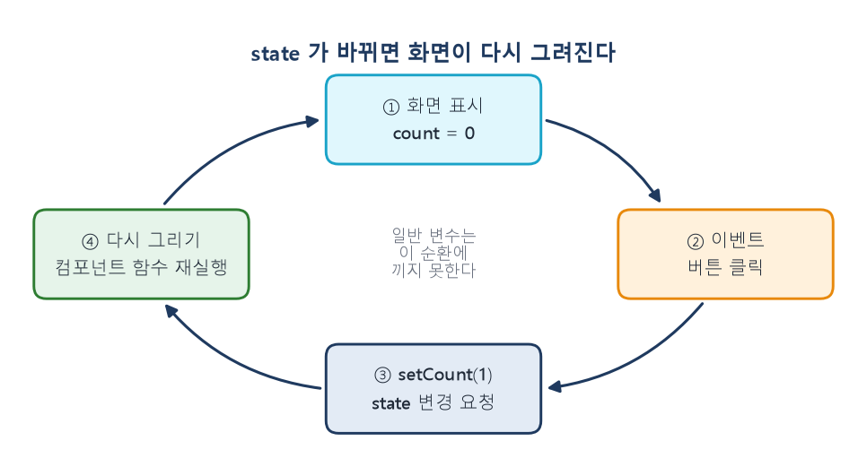
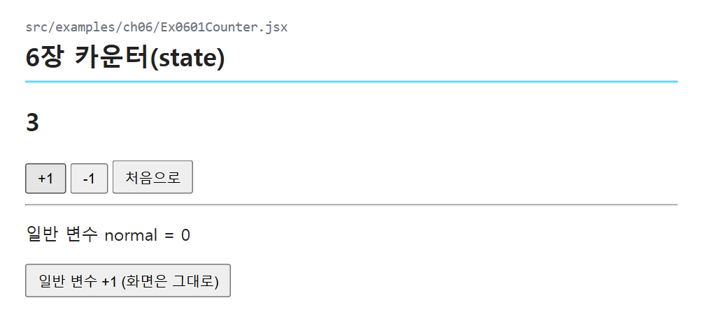
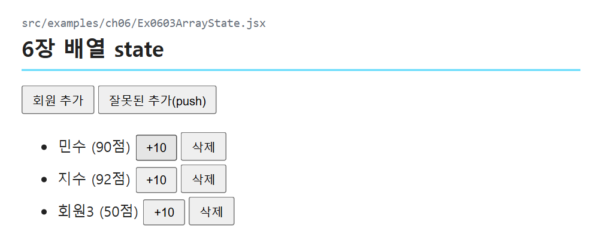
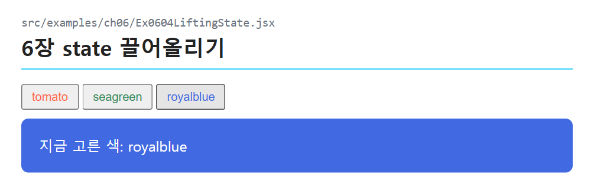

# 6장. state 와 이벤트

## 학습 목표

- 화면에서 바뀌는 값은 `useState` 로 만든 state 에 담는다.
- `onClick`, `onMouseEnter` 같은 이벤트에 함수를 연결한다.
- 이전 값으로 계산할 때 `setX(prev => ...)` 를 쓴다.
- 배열·객체 state 를 "새로 만들어서" 바꾼다 (추가·삭제·수정).
- state 를 부모로 끌어올려 형제 컴포넌트가 함께 쓰게 한다.

## 6-1. 일반 변수로는 화면이 안 바뀐다

버튼을 누르면 숫자가 1 씩 오르는 카운터를 만들고 싶다. 일반 변수로 해 보면 실패한다. 값은 바뀌지만 **React 는 그 사실을 모르기 때문에** 화면을 다시 그리지 않는다.

React 에게 "이 값이 바뀌면 화면을 다시 그려 줘" 라고 부탁하는 방법이 **state** 다.



```jsx
import { useState } from "react";

const [count, setCount] = useState(0);
//     지금 값  바꾸는 함수         처음값
```

- `useState` 처럼 `use` 로 시작하는 React 함수를 **Hook(훅)** 이라고 부른다.
- `setCount(5)` 를 부르면 → count 가 5 가 되고 → React 가 **컴포넌트 함수를 다시 실행**해서 → 새 화면을 그린다.
- Hook 은 **컴포넌트 함수의 맨 위쪽**에서만 부른다. `if` 나 `for` 안, 일반 함수 안에서 부르면 안 된다.

## 6-2. 카운터

<!-- file: basic/examples/src/examples/ch06/Ex0601Counter.jsx -->

```jsx
// Ex0601Counter.jsx - state 와 이벤트의 첫걸음: 카운터
//
// 이 예제가 보여 주는 것
//   - useState(처음값) 은 [지금 값, 값을 바꾸는 함수] 를 돌려준다.
//   - 화면에 쓰이는 값이 바뀌어야 하면 일반 변수가 아니라 state 에 담는다.
//   - set 함수로 값을 바꾸면 React 가 컴포넌트 함수를 "다시 실행" 해서 화면을 새로 그린다.
//   - onClick={함수} 에는 함수를 "넘긴다". onClick={함수()} 처럼 부르면 안 된다.

import { useState } from "react"; // React 가 주는 Hook 을 가져온다

function Ex0601Counter() {
  const [count, setCount] = useState(0); // count 의 처음값은 0

  // 일반 변수는 다시 그릴 때마다 처음값으로 돌아간다 → 화면 값 저장에 못 쓴다
  let normal = 0;

  console.log("Ex0601Counter 함수 실행! count =", count); // 다시 그려질 때마다 찍힌다

  const handleMinus = () => setCount(count - 1); // 이벤트 처리 함수를 미리 만들어 두는 방법

  return (
    <div>
      <h2>{count}</h2>
      {/* 함수를 바로 써 넣는 방법: 클릭할 때 화살표 함수가 실행된다 */}
      <button onClick={() => setCount(count + 1)}>+1</button>
      <button onClick={handleMinus}>-1</button>
      <button onClick={() => setCount(0)}>처음으로</button>

      <hr />
      <p>일반 변수 normal = {normal}</p>
      <button
        onClick={() => {
          normal = normal + 1; // 값은 바뀌지만 React 는 다시 그리지 않는다
          console.log("normal =", normal);
        }}
      >
        일반 변수 +1 (화면은 그대로)
      </button>
    </div>
  );
}

export default Ex0601Counter;
```



F12 → Console 탭을 열고 버튼을 눌러 보자. 누를 때마다 `Ex0601Counter 함수 실행! count = ...` 이 찍힌다. **state 가 바뀔 때마다 함수 전체가 다시 실행된다**는 증거다. 그런데도 count 가 0 으로 돌아가지 않는 것은 React 가 state 값을 따로 기억해 두었다가 돌려주기 때문이다. 반면 일반 변수 `normal` 은 함수가 다시 실행될 때마다 `let normal = 0` 으로 다시 만들어진다.

> 처음 화면이 뜰 때 로그가 **두 번**(두 번째는 흐리게) 찍힌다. 개발 모드의 `StrictMode` 가 일부러 한 번 더 실행해 실수를 찾기 때문이다. 배포용 빌드에서는 한 번만 실행된다.

**이벤트 연결에서 가장 흔한 실수**

```jsx
<button onClick={setCount(count + 1)}>   // ✗ 그리는 순간 바로 실행 → 무한 반복 오류
<button onClick={() => setCount(count + 1)}>   // ✓ "누르면 실행할 함수" 를 넘긴다
<button onClick={handleMinus}>   // ✓ 함수 이름만 (괄호 없이)
```

## 6-3. 여러 state 와 이벤트 객체

<!-- file: basic/examples/src/examples/ch06/Ex0602Events.jsx -->

```jsx
// Ex0602Events.jsx - 여러 개의 state 와 여러 가지 이벤트
//
// 이 예제가 보여 주는 것
//   - state 는 필요한 만큼 여러 개 만들 수 있다 (불린, 문자열, 숫자 ...)
//   - 이벤트 이름은 camelCase: onClick, onMouseEnter, onChange ...
//   - 이벤트 처리 함수는 이벤트 객체(e)를 받는다. e.target 은 이벤트가 일어난 태그
//   - 값을 하나 올리는 것처럼 "이전 값" 을 바탕으로 바꿀 때는 setX(prev => prev + 1) 이 안전하다

import { useState } from "react";

function Ex0602Events() {
  const [isOn, setIsOn] = useState(false); // 전등 켜짐/꺼짐
  const [message, setMessage] = useState("버튼 위로 마우스를 올려 보세요");
  const [likes, setLikes] = useState(0);

  // 이벤트 객체 e 에서 누른 버튼의 글자를 꺼낸다
  const handleColor = (e) => {
    setMessage(`"${e.target.textContent}" 버튼을 눌렀습니다`);
  };

  // 한 번 클릭에 3씩 올리고 싶다면?
  const addThree = () => {
    // setLikes(likes + 1) 을 세 번 쓰면 세 번 모두 같은 likes(예: 0) 를 보고 계산해서 1 만 오른다.
    // 함수를 넘기면 React 가 "바로 앞의 최신 값" 을 prev 로 넣어 준다 → 정확히 3 오른다.
    setLikes((prev) => prev + 1);
    setLikes((prev) => prev + 1);
    setLikes((prev) => prev + 1);
  };

  return (
    <div>
      {/* 1) 불린 state 뒤집기: !isOn */}
      <div style={{ fontSize: 40 }}>{isOn ? "💡" : "⚫"}</div>
      <button onClick={() => setIsOn(!isOn)}>{isOn ? "끄기" : "켜기"}</button>

      {/* 2) 이벤트 객체와 마우스 이벤트 */}
      <p>{message}</p>
      <button onClick={handleColor} onMouseEnter={() => setMessage("마우스가 올라왔다!")}>
        빨강
      </button>
      <button onClick={handleColor}>파랑</button>

      {/* 3) 이전 값으로 계산하기 */}
      <p>❤️ {likes}</p>
      <button onClick={addThree}>좋아요 +3</button>
    </div>
  );
}

export default Ex0602Events;
```

| 이벤트 | 언제 |
|---|---|
| `onClick` | 클릭 |
| `onChange` | 입력 칸 글자가 바뀔 때 (7장) |
| `onSubmit` | 폼 제출 (7장) |
| `onMouseEnter` / `onMouseLeave` | 마우스가 올라옴 / 나감 |
| `onKeyDown` | 키보드 누름 |

**`setLikes(likes + 1)` 을 세 번 써도 1 만 오르는 이유**: 한 번의 클릭 안에서 `likes` 는 계속 같은 값(예: 0)이다. 세 줄 모두 `setLikes(0 + 1)` 이 되어 결과가 1 이다. **이전 값으로 계산**할 때는 함수를 넘기자. `setLikes(prev => prev + 1)` 은 React 가 바로 앞의 최신 값을 `prev` 로 넣어 준다.

## 6-4. 배열·객체 state 바꾸기 (불변성)

2장 2-4 에서 본 것처럼, React 는 "같은 배열이면 안 바뀐 것" 으로 본다. 그래서 배열·객체 state 는 **원본을 고치지 말고 새로 만들어** set 함수에 넘긴다.

| 하고 싶은 일 | ✗ 원본 고치기 | ✓ 새로 만들기 |
|---|---|---|
| 추가 | `arr.push(x)` | `[...arr, x]` |
| 삭제 | `arr.splice(i, 1)` | `arr.filter(item => item.id !== id)` |
| 하나 수정 | `arr[i].score = 90` | `arr.map(item => item.id === id ? { ...item, score: 90 } : item)` |
| 객체 수정 | `obj.name = "새"` | `{ ...obj, name: "새" }` |

<!-- file: basic/examples/src/examples/ch06/Ex0603ArrayState.jsx -->

```jsx
// Ex0603ArrayState.jsx - 배열·객체 state 는 "새로 만들어서" 바꾼다 (불변성)
//
// 이 예제가 보여 주는 것
//   - 배열에 추가: [...배열, 새것]            (push 쓰지 않기)
//   - 배열에서 삭제: 배열.filter(x => 조건)    (splice 쓰지 않기)
//   - 배열 안 하나 수정: 배열.map(x => x.id === id ? {...x, 바뀐값} : x)
//   - 원본을 직접 고치면(push 등) 같은 배열이라서 React 가 바뀐 줄 모르고 다시 그리지 않는다.

import { useState } from "react";

function Ex0603ArrayState() {
  const [members, setMembers] = useState([
    { id: 1, name: "민수", score: 80 },
    { id: 2, name: "지수", score: 92 },
  ]);
  const [nextId, setNextId] = useState(3); // 새 회원에게 줄 번호

  // 추가: 기존 배열을 펼치고 새 객체를 뒤에 붙인 "새 배열" 로 바꾼다
  const addMember = () => {
    setMembers([...members, { id: nextId, name: `회원${nextId}`, score: 50 }]);
    setNextId(nextId + 1);
  };

  // 삭제: 그 id 만 빼고 남긴 새 배열
  const removeMember = (id) => {
    setMembers(members.filter((m) => m.id !== id));
  };

  // 수정: 그 id 의 객체만 점수를 +10 한 새 객체로 바꾼 새 배열
  const addScore = (id) => {
    setMembers(members.map((m) => (m.id === id ? { ...m, score: m.score + 10 } : m)));
  };

  // 잘못된 방법: 원본을 직접 고친다 → 화면이 바뀌지 않는다
  const wrongAdd = () => {
    members.push({ id: 999, name: "몰래 추가", score: 0 });
    setMembers(members); // 같은 배열이므로 React 는 "그대로네" 하고 넘어간다
    console.log("배열 길이는 늘었는데 화면은 그대로:", members.length);
  };

  return (
    <div>
      <button onClick={addMember}>회원 추가</button>
      <button onClick={wrongAdd}>잘못된 추가(push)</button>
      <ul>
        {members.map((m) => (
          <li key={m.id}>
            {m.name} ({m.score}점) <button onClick={() => addScore(m.id)}>+10</button>
            {/* 인자를 넘겨야 하는 함수는 화살표 함수로 한 번 감싼다 */}
            <button onClick={() => removeMember(m.id)}>삭제</button>
          </li>
        ))}
      </ul>
    </div>
  );
}

export default Ex0603ArrayState;
```



**잘못된 추가(push)** 버튼을 눌러 보자. 콘솔에는 배열 길이가 늘었다고 찍히지만 화면은 그대로다. 그 상태에서 다른 버튼을 누르면 그제야 "몰래 추가" 가 나타난다. 이런 버그는 찾기 어렵기 때문에 처음부터 새로 만드는 습관을 들이자.

## 6-5. state 끌어올리기

색을 고르는 컴포넌트와 고른 색을 보여 주는 컴포넌트가 **같은 값**을 써야 한다. 형제끼리는 props 를 주고받을 수 없으므로, state 를 **공통 부모**로 끌어올린다.

<!-- file: basic/examples/src/examples/ch06/Ex0604LiftingState.jsx -->

```jsx
// Ex0604LiftingState.jsx - state 끌어올리기 (형제 컴포넌트끼리 값 나누기)
//
// 이 예제가 보여 주는 것
//   - 두 자식이 같은 값을 써야 하면, state 를 "공통 부모" 에 둔다.
//   - 부모는 값은 props 로, 값을 바꾸는 함수도 props 로 자식에게 내려준다.
//   - 자식은 받은 함수를 불러서 부모에게 "바꿔 줘" 라고 알린다. (자식 → 부모 소통 방법)
//   9장 게시판의 App.jsx 가 이 방식으로 "지금 보여 줄 화면" 을 관리한다.

import { useState } from "react";

// 자식 1: 값을 바꾸는 버튼들. 값은 모르고 "바꾸는 함수" 만 받는다
function ColorPicker({ onPick }) {
  const colors = ["tomato", "seagreen", "royalblue"];
  return (
    <div>
      {colors.map((c) => (
        <button key={c} onClick={() => onPick(c)} style={{ color: c }}>
          {c}
        </button>
      ))}
    </div>
  );
}

// 자식 2: 값을 보여 주기만 한다
function Preview({ color }) {
  return (
    <div style={{ background: color, color: "white", padding: 20, marginTop: 8, borderRadius: 8 }}>
      지금 고른 색: {color}
    </div>
  );
}

// 부모: state 를 가지고 두 자식을 이어 준다
function Ex0604LiftingState() {
  const [color, setColor] = useState("tomato");
  return (
    <div>
      <ColorPicker onPick={setColor} /> {/* 바꾸는 함수를 내려준다 */}
      <Preview color={color} /> {/*        값을 내려준다 */}
    </div>
  );
}

export default Ex0604LiftingState;
```



1. 부모가 `color` state 를 가진다.
2. 값(`color`)은 Preview 에게, 바꾸는 함수(`setColor`)는 ColorPicker 에게 props 로 내려준다.
3. ColorPicker 가 `onPick("seagreen")` 을 부르면 → 부모의 state 가 바뀌고 → 부모와 두 자식이 다시 그려진다.

**자식이 부모에게 무언가 알릴 때는 "부모가 내려준 함수를 부른다".** 9장 게시판에서 "제목을 누르면 읽기 화면으로" 를 이 방법으로 만든다.

## 정리

- 화면에 쓰이고 바뀌는 값 → `const [값, set값] = useState(처음값)`.
- set 함수로 바꾸면 컴포넌트가 다시 실행되어 화면이 새로 그려진다.
- 이벤트에는 함수를 넘긴다: `onClick={() => ...}` 또는 `onClick={함수이름}`.
- 이전 값으로 계산: `setX(prev => prev + 1)`.
- 배열·객체 state 는 `...`, `map`, `filter` 로 **새로** 만든다.
- 여러 컴포넌트가 같이 쓰는 state 는 공통 부모에 두고 props 로 내려준다.

## 확인 문제

1. 버튼을 누를 때마다 `좋아요 👍` ↔ `좋아요 취소` 로 글자가 번갈아 바뀌는 컴포넌트를 만드시오.
2. 다음 코드는 무엇이 잘못되었고 어떻게 고쳐야 하는가?

```jsx
const [count, setCount] = useState(0);
return <button onClick={setCount(count + 1)}>{count}</button>;
```

3. `const [user, setUser] = useState({ name: "민수", age: 20 });` 에서 나이만 1 올리는 코드를 쓰시오.
4. Ex0603ArrayState 에 **"점수 높은 순 정렬"** 버튼을 추가하시오. (힌트: `[...members].sort((a, b) => b.score - a.score)` - `sort` 는 원본을 바꾸므로 먼저 복사한다)
5. 0 부터 시작해 `+1`, `+5`, `-1` 버튼이 있고, 값이 0 보다 작아지지 않는 카운터를 만드시오.
