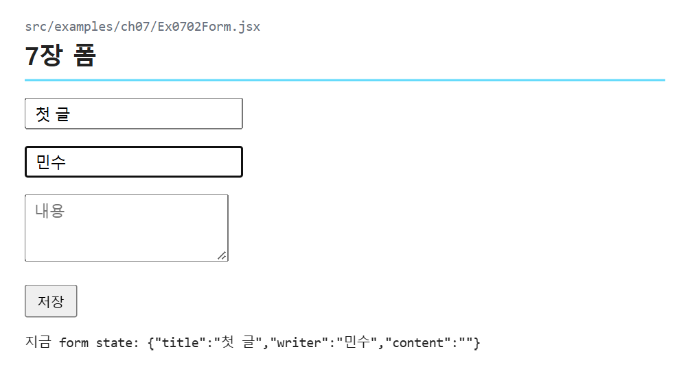
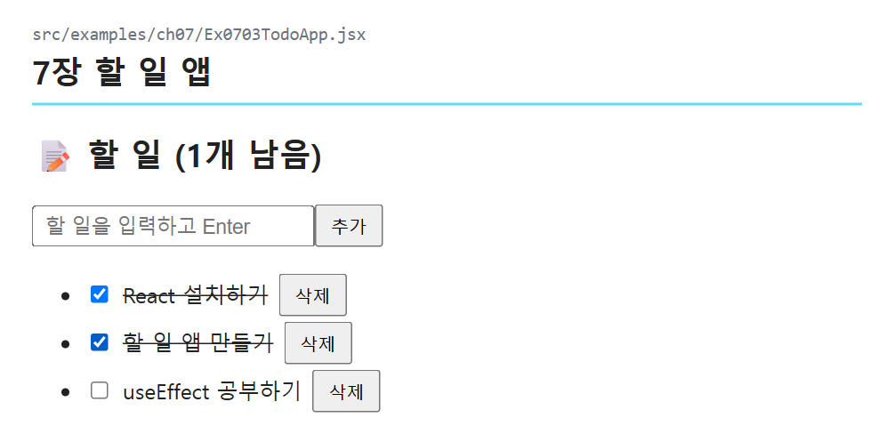

# 7장. 폼 다루기와 할 일 앱

## 학습 목표

- 입력 칸의 값을 state 와 묶는 "제어 컴포넌트" 를 만든다.
- 입력 칸이 여러 개인 폼을 객체 state 하나와 `handleChange` 하나로 다룬다.
- `onSubmit` 과 `e.preventDefault()` 로 폼 제출을 처리한다.
- 컴포넌트를 나눠 할 일(Todo) 앱을 완성한다: 추가·완료 표시·삭제.

## 7-1. 제어 컴포넌트

입력 칸(`<input>`)은 원래 브라우저가 스스로 글자를 관리한다. React 에서는 이 값을 **state 와 묶어서** React 가 관리하게 한다. 이것을 **제어 컴포넌트**(controlled component)라 한다.

```jsx
const [name, setName] = useState("");

<input value={name} onChange={(e) => setName(e.target.value)} />
```

1. 사용자가 한 글자 친다 → `onChange` 가 실행된다.
2. `e.target.value`(입력 칸에 지금 있는 글자 전체)로 state 를 바꾼다.
3. 다시 그려지면서 `value={name}` 으로 입력 칸에 새 값이 보인다.

<!-- file: basic/examples/src/examples/ch07/Ex0701Input.jsx -->

```jsx
// Ex0701Input.jsx - 제어 컴포넌트(controlled input): 입력 칸의 값을 state 와 묶기
//
// 이 예제가 보여 주는 것
//   - value={state} : 입력 칸에 보이는 글자는 항상 state 의 값이다.
//   - onChange={e => setState(e.target.value)} : 한 글자 칠 때마다 state 를 새 글자로 바꾼다.
//   - 이렇게 묶어 두면 입력값을 언제든 state 로 읽고, 코드로 비우거나 바꿀 수도 있다.

import { useState } from "react";

function Ex0701Input() {
  const [name, setName] = useState("");

  return (
    <div>
      <input
        value={name} //                                  보이는 값 = state
        onChange={(e) => setName(e.target.value)} //      친 글자 → state
        placeholder="이름을 입력하세요"
      />
      <button onClick={() => setName("")}>지우기</button> {/* state 만 비우면 입력 칸도 비워진다 */}

      <p>입력한 이름: {name}</p>
      <p>글자 수: {name.length} / 10</p>
      {name.length > 10 && <p style={{ color: "crimson" }}>10글자를 넘었습니다!</p>}
    </div>
  );
}

export default Ex0701Input;
```

> **value 만 쓰고 onChange 를 빼면?** 입력 칸에 아무리 쳐도 글자가 안 바뀐다. 보이는 값이 항상 state(빈 글자)로 고정되기 때문이다. 콘솔에도 `You provided a value prop to a form field without an onChange handler` 경고가 뜬다.

## 7-2. 입력 칸이 여러 개인 폼

제목·작성자·내용 칸마다 state 를 따로 만들면 코드가 길어진다. **객체 state 하나**에 모으고, 입력 칸의 `name` 속성으로 어느 칸인지 구분한다.

<!-- file: basic/examples/src/examples/ch07/Ex0702Form.jsx -->

```jsx
// Ex0702Form.jsx - 입력 칸이 여러 개인 폼: 객체 state 하나로 관리하기
//
// 이 예제가 보여 주는 것
//   - 입력 칸마다 name 속성을 주고, 하나의 handleChange 로 모두 처리한다.
//     [name]: value  → "name 속성값" 을 키로 쓰는 문법 (계산된 속성 이름)
//   - <form onSubmit> 에서 e.preventDefault() 로 새로 고침(페이지 이동)을 막는다.
//   - 제출 전에 값을 검사하고, 끝나면 폼을 비운다.
//   9장 게시판의 글쓰기·수정 화면(PostForm)이 이 모양 그대로다.

import { useState } from "react";

const EMPTY = { title: "", writer: "", content: "" }; // 빈 폼 (처음값과 비울 때 함께 쓴다)

function Ex0702Form() {
  const [form, setForm] = useState(EMPTY);
  const [saved, setSaved] = useState(null); // 제출된 내용을 보여 주기 위한 state

  // 모든 입력 칸이 같이 쓰는 함수
  const handleChange = (e) => {
    const { name, value } = e.target; // 어느 칸(name)에 무엇(value)을 쳤는지
    setForm({ ...form, [name]: value }); // 나머지는 그대로, 그 칸만 새 값으로
  };

  const handleSubmit = (e) => {
    e.preventDefault(); // <form> 의 기본 동작(페이지 새로 고침)을 막는다. 꼭 필요!
    if (!form.title.trim() || !form.writer.trim()) {
      alert("제목과 작성자는 꼭 입력하세요.");
      return;
    }
    setSaved(form); // 실제 앱이라면 여기서 서버에 보낸다 (9장)
    setForm(EMPTY); // 폼 비우기
  };

  return (
    <div>
      <form onSubmit={handleSubmit}>
        <p>
          <input name="title" value={form.title} onChange={handleChange} placeholder="제목" />
        </p>
        <p>
          <input name="writer" value={form.writer} onChange={handleChange} placeholder="작성자" />
        </p>
        <p>
          {/* textarea 도 value / onChange 로 똑같이 다룬다 */}
          <textarea name="content" value={form.content} onChange={handleChange} placeholder="내용" rows={3} />
        </p>
        <button type="submit">저장</button> {/* 폼 안의 submit 버튼 → onSubmit 이 실행된다 */}
      </form>

      <pre>지금 form state: {JSON.stringify(form)}</pre>
      {saved && (
        <div style={{ background: "#eef3f8", padding: 10 }}>
          <strong>저장된 글</strong>
          <p>
            [{saved.title}] {saved.writer} - {saved.content}
          </p>
        </div>
      )}
    </div>
  );
}

export default Ex0702Form;
```



핵심 두 줄을 풀어 보자.

```jsx
const { name, value } = e.target;    // <input name="title"> 에 "첫 글" 을 치면 → name="title", value="첫 글"
setForm({ ...form, [name]: value }); // → setForm({ ...form, title: "첫 글" })
```

`[name]` 은 "변수 name 에 들어 있는 글자를 키 이름으로 쓴다" 는 뜻이다. 덕분에 입력 칸이 10 개여도 `handleChange` 하나로 충분하다.

**`e.preventDefault()` 를 빼먹으면?** `<form>` 은 제출하면 페이지를 새로 불러오는 것이 기본 동작이다. 새로 고침되면서 state 가 모두 날아가 버린다. React 에서 폼을 다룰 때는 거의 항상 첫 줄에 쓴다.

## 7-3. 미니 프로젝트: 할 일 앱

지금까지 배운 것을 모두 모아 할 일 앱을 만든다. 컴포넌트를 세 개로 나눈다.

| 컴포넌트 | 하는 일 | state |
|---|---|---|
| `Ex0703TodoApp` (부모) | 할 일 배열을 가지고 추가·수정·삭제 함수를 만든다 | `todos`, `nextId` |
| `TodoForm` | 입력 칸과 추가 버튼. 제출하면 `onAdd(글자)` 를 부른다 | `text` (입력 중인 글자) |
| `TodoItem` | 할 일 한 줄을 그린다. 체크·삭제 때 `onToggle(id)`, `onDelete(id)` 를 부른다 | 없음 |

`src/examples/ch07/todo` 폴더에 자식 두 개를 먼저 만든다.

<!-- file: basic/examples/src/examples/ch07/todo/TodoForm.jsx -->

```jsx
// TodoForm.jsx - 할 일 입력 폼 (자식 컴포넌트)
//
// 이 컴포넌트가 하는 일
//   - 입력 칸의 글자는 자기 state(text)로 관리한다. 부모는 몰라도 되는 값이기 때문.
//   - 제출하면 부모가 내려준 onAdd(글자) 를 불러 "이 할 일을 추가해 줘" 라고 알린다.

import { useState } from "react";

function TodoForm({ onAdd }) {
  const [text, setText] = useState("");

  const handleSubmit = (e) => {
    e.preventDefault(); //       페이지 새로 고침 막기
    if (!text.trim()) return; // 빈칸만 있으면 무시
    onAdd(text.trim()); //       부모에게 알린다
    setText(""); //              입력 칸 비우기
  };

  return (
    <form onSubmit={handleSubmit}>
      <input value={text} onChange={(e) => setText(e.target.value)} placeholder="할 일을 입력하고 Enter" />
      <button type="submit">추가</button>
    </form>
  );
}

export default TodoForm;
```

<!-- file: basic/examples/src/examples/ch07/todo/TodoItem.jsx -->

```jsx
// TodoItem.jsx - 할 일 한 줄 (자식 컴포넌트)
//
// 이 컴포넌트가 하는 일
//   - 할 일 하나(todo)를 받아 그린다.
//   - 체크박스·삭제 버튼을 누르면 부모가 내려준 함수에 id 를 넘겨 알린다.
//   - 자기 state 는 없다. 받은 값을 그리기만 하는 "보여 주기 전용" 컴포넌트.

function TodoItem({ todo, onToggle, onDelete }) {
  return (
    <li>
      <input type="checkbox" checked={todo.done} onChange={() => onToggle(todo.id)} />
      {/* 끝낸 일은 가운데 줄을 긋는다: 조건에 따라 style 값을 고른다 */}
      <span style={{ textDecoration: todo.done ? "line-through" : "none", margin: "0 8px" }}>{todo.text}</span>
      <button onClick={() => onDelete(todo.id)}>삭제</button>
    </li>
  );
}

export default TodoItem;
```

그리고 부모를 만든다.

<!-- file: basic/examples/src/examples/ch07/Ex0703TodoApp.jsx -->

```jsx
// Ex0703TodoApp.jsx - 지금까지 배운 것을 모은 작은 앱: 할 일 목록
//
// 이 예제가 보여 주는 것 (6장 + 7장 종합)
//   - 할 일 배열(todos)은 부모(TodoApp)가 state 로 가진다 → 목록·개수 표시가 함께 쓰기 때문
//   - 추가(Create) : [...todos, 새 할 일]
//   - 읽기(Read)   : todos.map(...) 으로 목록 그리기
//   - 수정(Update) : map 으로 그 id 만 done 을 뒤집기
//   - 삭제(Delete) : filter 로 그 id 빼기
//   9장에서는 이 배열을 브라우저 메모리가 아니라 PostgreSQL 에 저장한다.

import { useState } from "react";
import TodoForm from "./todo/TodoForm";
import TodoItem from "./todo/TodoItem";

function Ex0703TodoApp() {
  const [todos, setTodos] = useState([
    { id: 1, text: "React 설치하기", done: true },
    { id: 2, text: "할 일 앱 만들기", done: false },
  ]);
  const [nextId, setNextId] = useState(3);

  const addTodo = (text) => {
    setTodos([...todos, { id: nextId, text, done: false }]); // Create
    setNextId(nextId + 1);
  };

  const toggleTodo = (id) => {
    setTodos(todos.map((t) => (t.id === id ? { ...t, done: !t.done } : t))); // Update
  };

  const deleteTodo = (id) => {
    setTodos(todos.filter((t) => t.id !== id)); // Delete
  };

  const left = todos.filter((t) => !t.done).length; // state 로부터 계산할 수 있는 값은 state 로 만들지 않는다

  return (
    <div>
      <h2>📝 할 일 ({left}개 남음)</h2>
      <TodoForm onAdd={addTodo} />
      {todos.length === 0 ? (
        <p>할 일이 없습니다. 하나 추가해 보세요!</p>
      ) : (
        <ul>
          {todos.map((t) => (
            <TodoItem key={t.id} todo={t} onToggle={toggleTodo} onDelete={deleteTodo} />
          ))}
        </ul>
      )}
    </div>
  );
}

export default Ex0703TodoApp;
```



이 앱 안에 **CRUD** 가 모두 들어 있다.

| CRUD | 뜻 | 할 일 앱 | 9장 게시판 |
|---|---|---|---|
| **C**reate | 만들기 | `[...todos, 새것]` | POST 요청 → INSERT |
| **R**ead | 읽기 | `todos.map(...)` | GET 요청 → SELECT |
| **U**pdate | 고치기 | `todos.map(... ? {...t, done} : t)` | PUT 요청 → UPDATE |
| **D**elete | 지우기 | `todos.filter(...)` | DELETE 요청 → DELETE |

다만 새로 고침(F5)하면 할 일이 처음으로 돌아간다. 데이터가 브라우저 메모리에만 있기 때문이다. 9장에서는 데이터를 **서버의 데이터베이스**에 저장해서 이 문제를 해결한다.

## 정리

- 제어 컴포넌트: `value={state}` + `onChange={e => setState(e.target.value)}`.
- 여러 칸은 객체 state + `name` 속성 + `setForm({ ...form, [name]: value })`.
- 폼 제출은 `<form onSubmit>` 에서 처리하고, 첫 줄에 `e.preventDefault()`.
- 데이터(배열)는 부모가 갖고, 자식은 props 로 받은 함수를 불러 부모에게 알린다.

## 확인 문제

1. Ex0701Input 에 "대문자로" 버튼을 추가해, 누르면 입력값이 대문자로 바뀌게 하시오. (`toUpperCase()`)
2. Ex0702Form 에 `email` 칸을 추가하시오. `handleChange` 는 고치지 않아도 되는 이유를 설명하시오.
3. 할 일 앱에 **"완료한 일 모두 지우기"** 버튼을 추가하시오.
4. 할 일 앱의 TodoItem 에서 할 일 글자를 **더블클릭**하면 `prompt("새 내용", todo.text)` 로 내용을 고칠 수 있게 하시오. (힌트: 부모에 `editTodo(id, text)` 를 만들어 내려준다. 이벤트는 `onDoubleClick`)
