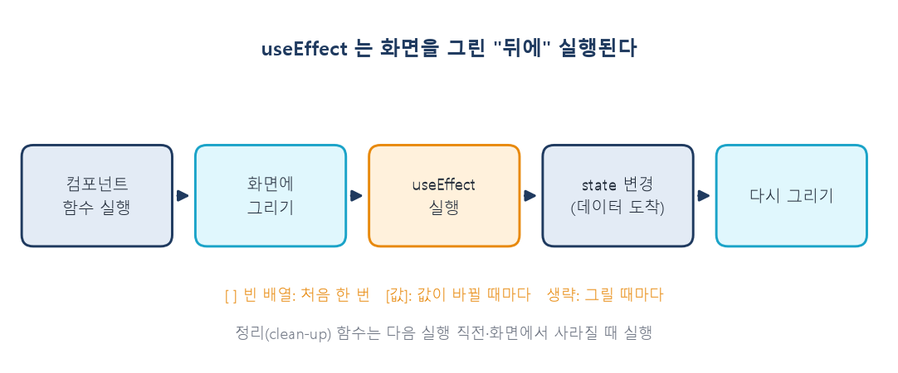
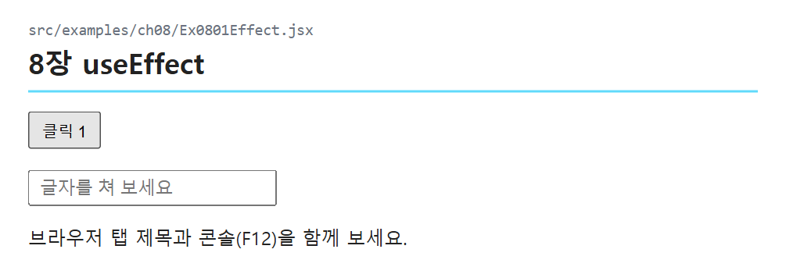
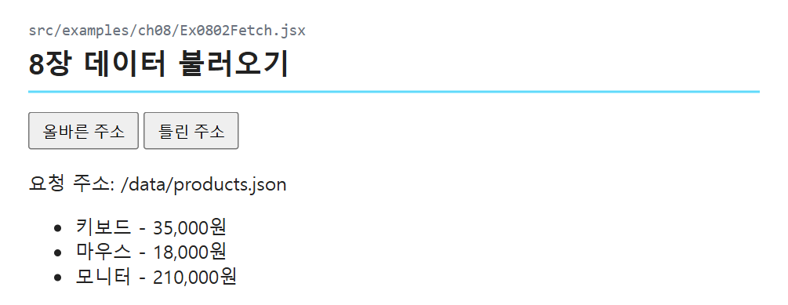
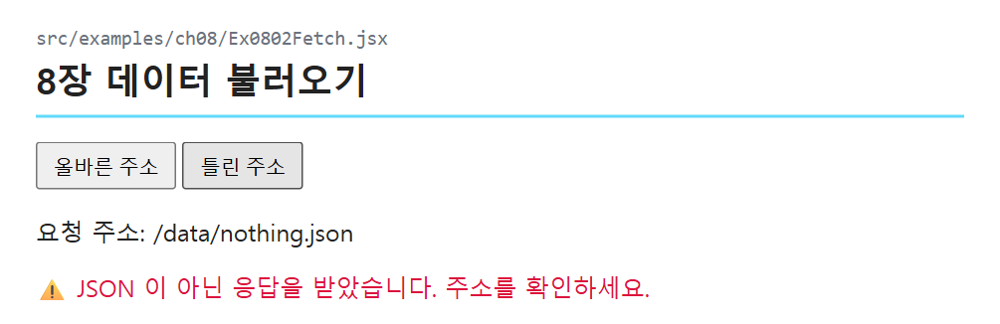

# 8장. useEffect 와 데이터 불러오기

## 학습 목표

- `useEffect` 가 "화면을 그린 뒤에" 실행된다는 것을 안다.
- 의존성 배열(`[]`, `[값]`, 생략)에 따라 언제 실행되는지 구분한다.
- `fetch` 로 데이터를 받아 화면에 그리고, 로딩·오류 상태를 보여 준다.
- 타이머처럼 정리(clean-up)가 필요한 일을 정리 함수로 끝낸다.

## 8-1. 부수 효과(side effect)와 useEffect

컴포넌트 함수가 하는 일은 원래 하나다. **props·state 를 받아 JSX 를 돌려주는 것.** 그런데 실제 앱에는 화면 그리기 말고도 할 일이 있다.

- 서버에 데이터 요청하기
- 브라우저 탭 제목 바꾸기
- 타이머 켜기·끄기

이런 일을 **부수 효과**라고 하고, `useEffect` 안에 넣는다. useEffect 는 **화면을 다 그린 뒤에** 실행된다.



```jsx
useEffect(() => {
  // 할 일
  return () => {
    // (선택) 정리할 일
  };
}, [의존성 배열]);
```

| 의존성 배열 | 실행 시점 | 주로 쓰는 곳 |
|---|---|---|
| `[]` (빈 배열) | 처음 화면에 나타났을 때 **한 번** | 처음 데이터 불러오기 |
| `[id]` | 처음 + `id` 가 바뀔 때마다 | id 에 맞는 글 불러오기 |
| 생략 | 그릴 때마다 매번 | 거의 쓰지 않는다 |

## 8-2. 실행 시점 눈으로 보기

<!-- file: basic/examples/src/examples/ch08/Ex0801Effect.jsx -->

```jsx
// Ex0801Effect.jsx - useEffect: 화면을 그린 "뒤에" 할 일
//
// 이 예제가 보여 주는 것
//   useEffect(할 일, [의존성 배열])
//   - 배열을 아예 안 쓰면   : 그릴 때마다 매번 실행
//   - 빈 배열 []            : 처음 화면에 나타났을 때 한 번만 실행 (데이터 불러오기에 쓴다)
//   - [count] 처럼 값을 쓰면 : 처음 + 그 값이 바뀔 때마다 실행
//   - 할 일 안에서 함수를 return 하면 "정리(clean-up)" 함수. 사라지기 직전에 실행된다.
//
//   브라우저 개발자 도구(F12) → Console 탭에서 찍히는 순서를 확인하자.
//   (개발 모드의 StrictMode 는 일부러 처음에 두 번 실행해 실수를 찾게 해 준다. 8장 본문 참고)

import { useEffect, useState } from "react";

function Ex0801Effect() {
  const [count, setCount] = useState(0);
  const [text, setText] = useState("");

  // 1) 처음 한 번만
  useEffect(() => {
    console.log("① 처음 한 번: 화면에 나타났다");
    return () => console.log("① 정리: 화면에서 사라진다");
  }, []);

  // 2) count 가 바뀔 때마다 → 브라우저 탭 제목을 바꾼다 (화면 밖의 일 = 부수 효과)
  useEffect(() => {
    console.log("② count 가 바뀜:", count);
    document.title = `클릭 ${count}번`;
  }, [count]);

  // 3) 의존성 배열이 없으면 글자를 칠 때도, 버튼을 눌러도 매번 실행된다
  useEffect(() => {
    console.log("③ 그릴 때마다 실행");
  });

  return (
    <div>
      <button onClick={() => setCount(count + 1)}>클릭 {count}</button>
      <p>
        <input value={text} onChange={(e) => setText(e.target.value)} placeholder="글자를 쳐 보세요" />
      </p>
      <p>브라우저 탭 제목과 콘솔(F12)을 함께 보세요.</p>
    </div>
  );
}

export default Ex0801Effect;
```



예제를 열고 **클릭 0** 버튼을 한 번 누른 뒤 콘솔을 보면 이렇게 찍혀 있다. (실제로 실행해 모은 로그)

```text
① 처음 한 번: 화면에 나타났다
② count 가 바뀜: 0
③ 그릴 때마다 실행
① 정리: 화면에서 사라진다
① 처음 한 번: 화면에 나타났다
② count 가 바뀜: 0
③ 그릴 때마다 실행
② count 가 바뀜: 1
③ 그릴 때마다 실행
```

- 처음 세 줄 → **정리** → 다시 세 줄: 개발 모드의 **StrictMode** 가 "화면에 붙였다 → 뗐다 → 다시 붙였다" 를 일부러 해 본 것이다. 정리 함수를 빠뜨린 실수를 찾게 해 주는 기능이며, 배포 빌드에서는 한 번만 실행된다.
- 버튼을 누르면 `②` 와 `③` 만 실행된다. `①` 은 `[]` 라서 다시 실행되지 않는다.
- 입력 칸에 글자를 치면 `③` 만 실행된다. `count` 가 안 바뀌었으니 `②` 는 쉰다.

## 8-3. fetch 로 데이터 불러오기

서버에서 데이터를 받아 오는 코드는 거의 항상 이 모양이다.

1. state 3개: `데이터`, `loading`(기다리는 중?), `error`(실패 이유)
2. `useEffect(..., [])` 안에서 `fetch` 로 요청
3. 결과에 따라 state 를 바꾸고, 화면은 state 에 따라 세 가지로 나눠 그린다

이 예제는 `public/data/products.json` 파일을 서버 대신 쓴다. Vite 는 `public` 폴더의 파일을 그대로 내려주므로 `/data/products.json` 주소로 받을 수 있다.

<!-- file: basic/examples/public/data/products.json -->

```json
[
  { "id": 101, "name": "키보드", "price": 35000 },
  { "id": 102, "name": "마우스", "price": 18000 },
  { "id": 103, "name": "모니터", "price": 210000 }
]
```

<!-- file: basic/examples/src/examples/ch08/Ex0802Fetch.jsx -->

```jsx
// Ex0802Fetch.jsx - useEffect + fetch 로 데이터 불러오기 (로딩·오류 처리 포함)
//
// 이 예제가 보여 주는 것
//   - 화면에 처음 나타날 때([]) 데이터를 요청한다.
//   - 데이터가 오기 전 / 온 뒤 / 실패했을 때를 state 3개로 나눠 보여 준다.
//       loading : 기다리는 중인가?   error : 실패했나?   products : 받은 데이터
//   - useEffect 에 넘기는 함수 자체는 async 로 만들 수 없다.
//     그래서 안쪽에 async 함수를 만들고 바로 부른다.
//   데이터는 public/data/products.json (Vite 가 /data/products.json 주소로 내려준다).
//   9장에서는 이 주소만 Spring Boot 서버 주소로 바뀐다.

import { useEffect, useState } from "react";

function Ex0802Fetch() {
  const [products, setProducts] = useState([]); // 처음엔 빈 배열 (map 이 오류 나지 않게)
  const [loading, setLoading] = useState(true);
  const [error, setError] = useState(null);
  const [url, setUrl] = useState("/data/products.json"); // 일부러 틀린 주소로 바꿔 오류도 보자

  useEffect(() => {
    async function load() {
      setLoading(true);
      setError(null);
      try {
        await new Promise((r) => setTimeout(r, 700)); // 느린 서버 흉내 (로딩 문구를 보려고)
        const res = await fetch(url); //                 요청 보내고 응답 기다리기
        if (!res.ok) throw new Error(`요청 실패 (상태 코드 ${res.status})`); // 404, 500 등
        // Vite 개발 서버는 없는 파일을 요청하면 404 대신 index.html(HTML, 상태 200)을 돌려준다.
        // 그대로 res.json() 을 하면 "Unexpected token '<'" 오류가 나므로, JSON 인지 한 번 더 확인한다.
        if (!res.headers.get("content-type")?.includes("application/json")) {
          throw new Error("JSON 이 아닌 응답을 받았습니다. 주소를 확인하세요.");
        }
        const data = await res.json(); //                응답 본문(JSON 글자)을 객체로 바꾸기
        setProducts(data);
      } catch (err) {
        setError(err.message);
        setProducts([]);
      } finally {
        setLoading(false); // 성공이든 실패든 기다림은 끝
      }
    }
    load();
  }, [url]); // url 이 바뀌면 다시 불러온다

  return (
    <div>
      <button onClick={() => setUrl("/data/products.json")}>올바른 주소</button>
      <button onClick={() => setUrl("/data/nothing.json")}>틀린 주소</button>
      <p>요청 주소: {url}</p>

      {/* 세 가지 상태에 따라 다른 화면 */}
      {loading && <p>⏳ 불러오는 중...</p>}
      {error && <p style={{ color: "crimson" }}>⚠️ {error}</p>}
      {!loading && !error && (
        <ul>
          {products.map((p) => (
            <li key={p.id}>
              {p.name} - {p.price.toLocaleString()}원
            </li>
          ))}
        </ul>
      )}
    </div>
  );
}

export default Ex0802Fetch;
```





> **왜 404 가 아니라 "JSON 이 아닌 응답" 일까?** Vite 개발 서버는 없는 주소를 요청받으면 404 대신 **index.html**(상태 200)을 돌려준다. 화면 주소(라우팅)를 위한 기능인데, fetch 입장에서는 "성공(200)했는데 내용이 HTML" 이 된다. 이 검사가 없으면 `res.json()` 이 `Unexpected token '<', "<!doctype "... is not valid JSON` 오류를 낸다. 이 오류를 보면 **주소가 틀려서 HTML 을 받았구나** 하고 떠올리자. Spring Boot 같은 API 서버는 없는 글에 진짜 **404** 를 돌려주므로 `res.ok` 검사에서 걸린다(9장).

| 코드 | 뜻 |
|---|---|
| `await fetch(url)` | 요청을 보내고 **응답(Response)** 이 올 때까지 기다린다 |
| `res.ok` | 상태 코드가 200~299 면 `true`. 404·500 이면 `false` (fetch 는 이때 오류를 던지지 않으니 직접 검사!) |
| `res.headers.get("content-type")` | 응답 내용의 종류. JSON 이면 `application/json` 이 들어 있다 |
| `await res.json()` | 응답 본문(JSON 글자)을 자바스크립트 값으로 바꾼다 |
| `catch` | 서버가 꺼져 있는 등 응답 자체를 못 받으면 여기로 온다 |
| `finally` | 성공이든 실패든 마지막에 실행 → `setLoading(false)` |

> **useEffect 에 async 를 바로 붙이면 안 된다.** `useEffect(async () => {...})` 처럼 쓰면 함수가 Promise 를 돌려주는데, React 는 useEffect 가 "정리 함수" 나 아무것도 돌려주지 않기를 기대한다. 그래서 안쪽에 `async function load()` 를 만들고 바로 `load()` 를 부른다.

> **F12 → Network 탭**을 열고 다시 불러오면 `products.json` 요청과 상태 코드(200, 404)를 직접 볼 수 있다. 9장에서 서버와 통신할 때 가장 많이 보게 될 탭이다.

## 8-4. 정리(clean-up) 함수

<!-- file: basic/examples/src/examples/ch08/Ex0803Clock.jsx -->

```jsx
// Ex0803Clock.jsx - 정리(clean-up) 함수가 필요한 경우: 타이머
//
// 이 예제가 보여 주는 것
//   - setInterval 로 1초마다 시각을 바꾸는 시계
//   - 컴포넌트가 사라질 때 clearInterval 로 타이머를 멈추지 않으면,
//     보이지 않는 곳에서 타이머가 계속 돌아 메모리와 CPU 를 낭비한다.
//   - "시계 숨기기" 를 누르면 Clock 이 사라지면서 정리 함수가 실행된다(콘솔 확인).

import { useEffect, useState } from "react";

function Clock() {
  const [now, setNow] = useState(new Date());

  useEffect(() => {
    const id = setInterval(() => setNow(new Date()), 1000); // 1초마다 새 시각
    console.log("타이머 시작", id);
    return () => {
      clearInterval(id); // 정리: 타이머 멈춤
      console.log("타이머 정리", id);
    };
  }, []);

  return <h2>🕒 {now.toLocaleTimeString("ko-KR")}</h2>;
}

function Ex0803Clock() {
  const [show, setShow] = useState(true);
  return (
    <div>
      <button onClick={() => setShow(!show)}>{show ? "시계 숨기기" : "시계 보이기"}</button>
      {show && <Clock />} {/* show 가 false 가 되면 Clock 이 화면에서 사라진다 */}
    </div>
  );
}

export default Ex0803Clock;
```

"시계 숨기기" 를 누르면 Clock 이 화면에서 사라지면서 정리 함수가 실행되어 `타이머 정리` 가 찍힌다. 정리 함수가 없으면 시계가 안 보여도 타이머가 1초마다 계속 `setNow` 를 부른다.

정리가 필요한 대표적인 일: `setInterval`/`setTimeout`, 이벤트 리스너(`window.addEventListener`), 웹소켓 연결.

## 정리

- `useEffect(할일, [의존성])` 은 **화면을 그린 뒤** 실행된다.
- `[]` 처음 한 번, `[값]` 값이 바뀔 때마다, 생략하면 매번.
- 데이터 불러오기 = state 3개(데이터·loading·error) + useEffect + fetch + try/catch/finally.
- `fetch` 는 404·500 에서도 오류를 던지지 않는다 → `res.ok` 를 검사한다. (Vite 개발 서버의 없는 파일은 index.html 로 오므로 content-type 도 확인)
- 타이머 등은 return 하는 정리 함수로 끝낸다.

## 확인 문제

1. 다음 세 useEffect 가 각각 언제 실행되는지 쓰시오.

```jsx
useEffect(() => { console.log("A"); });
useEffect(() => { console.log("B"); }, []);
useEffect(() => { console.log("C"); }, [keyword]);
```

2. Spring Boot 서버에 없는 글을 요청한 `fetch("http://localhost:8080/api/posts/999")` 는 404 응답을 받는데도 `catch` 로 가지 않는다. 왜 그런지, 그리고 어떻게 실패로 처리하는지 쓰시오.
3. `public/data/notices.json` 에 공지 3개(`id`, `title`)를 만들고, 불러와서 목록으로 보여 주는 `NoticeList` 컴포넌트를 만드시오. 로딩 중에는 "불러오는 중..." 을 보여 주시오.
4. Ex0803Clock 의 `return () => clearInterval(id)` 를 지우고 시계를 숨겼다 보였다 여러 번 해 보시오. 콘솔에 무슨 일이 생기는지 관찰하고 이유를 설명하시오.
