# 9장. 프로젝트 - Spring Boot + PostgreSQL 게시판 CRUD

## 학습 목표

- Docker 로 PostgreSQL 데이터베이스를 띄운다.
- IntelliJ IDEA 로 Spring Boot 프로젝트를 열고 실행한다.
- Spring Boot 로 게시글 CRUD REST API 를 만들고 `/docs` 에서 시험한다.
- React 에서 `fetch` 로 GET·POST·PUT·DELETE 요청을 보내 게시판을 완성한다.
- CORS 가 무엇이고 왜 서버에서 허락해 줘야 하는지 안다.

## 9-1. 만들 것 한눈에 보기

글 목록 보기, 글 읽기, 글쓰기, 수정, 삭제가 되는 게시판이다. 글은 브라우저가 아니라 **PostgreSQL 데이터베이스**에 저장되므로 새로 고침해도, 브라우저를 껐다 켜도 남는다.

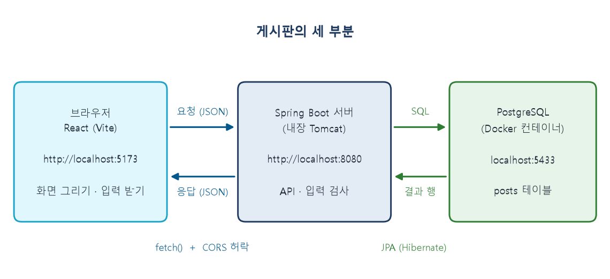

| 부분 | 기술 | 주소 | 실행 방법 |
|---|---|---|---|
| 화면 | React (Vite) | http://localhost:5173 | VS Code 터미널에서 `npm run dev` |
| API 서버 | Spring Boot 4 (내장 Tomcat) | http://localhost:8080 | IntelliJ 에서 `BoardApplication` ▶ 실행 |
| 데이터베이스 | PostgreSQL 18 (Docker) | localhost:5433 | `docker compose up -d` |

**API 설계** - 주소와 방식(HTTP 메서드)으로 "무엇을 할지" 를 나타낸다. 이런 규칙을 **REST API** 라고 부른다.

| 하는 일 | 방식 | 주소 | 보내는 것 | 받는 것 (성공 코드) |
|---|---|---|---|---|
| 글 목록 (Read) | GET | `/api/posts` | - | 글 배열 (200) |
| 글 하나 (Read) | GET | `/api/posts/3` | - | 글 객체 (200), 없으면 404 |
| 글쓰기 (Create) | POST | `/api/posts` | `{title, writer, content}` | 저장된 글 (201) |
| 수정 (Update) | PUT | `/api/posts/3` | `{title, writer, content}` | 고친 글 (200) |
| 삭제 (Delete) | DELETE | `/api/posts/3` | - | 내용 없음 (204) |

**작업 순서** - 아래쪽(데이터베이스)부터 위쪽(화면)으로 쌓는다. 아래가 잘 되는지 확인하고 올라가야 문제가 생겨도 어디서 났는지 금방 찾는다.

1. 9-2 Docker 로 PostgreSQL 켜기
2. 9-3 ~ 9-6 Spring Boot 서버를 IntelliJ 로 열고 `/docs` 에서 시험
3. 9-7 ~ 9-12 React 화면 만들기

## 9-2. 실습 폴더 준비와 PostgreSQL 켜기

이 장에서는 `C:\study\board` 폴더에 프로젝트를 만든다. 데이터베이스 설정과 API 서버(백엔드)는 **저장소의 완성본을 복사해서 읽으며 이해**하고, React 화면(프론트엔드)은 **직접 만든다.**

**[PS]**

```powershell
mkdir C:\study\board
cd C:\study\board
Copy-Item C:\study\react-spring-postgresql\basic\board\docker-compose.yml .
Copy-Item -Recurse C:\study\react-spring-postgresql\basic\board\backend .\backend
```

> `Copy-Item 원본 .` 의 마지막 점(`.`)은 "지금 폴더로" 라는 뜻이다.

먼저 **Docker Desktop 을 실행**한다. (시작 메뉴 → Docker Desktop. 왼쪽 아래가 초록색 **Engine running** 이 될 때까지 기다린다.)

<!-- file: basic/board/docker-compose.yml -->

```yaml
# =====================================================================
# 기초 과정 9장 - 게시판 데이터베이스 (PostgreSQL 18) 를 Docker 로 실행
#
#   시작        : docker compose up -d        (이 파일이 있는 폴더에서)
#   상태 확인   : docker compose ps           (STATUS 가 healthy 이면 준비 완료)
#   로그 보기   : docker compose logs -f db   (Ctrl+C 로 빠져나옴)
#   멈추기      : docker compose stop         (데이터는 남는다)
#   완전히 지우기: docker compose down -v      (컨테이너 + 데이터 볼륨 삭제, 되돌릴 수 없음)
#
# 접속 정보 (Spring Boot·DBeaver 공통)
#   호스트 localhost / 포트 5433 / DB board / 사용자 postgres / 비밀번호 postgres
#   ※ 5432 가 아니라 5433 이다. 다른 과정에서 만든 PostgreSQL(5432)과 겹치지 않게 하려고.
# =====================================================================

# 프로젝트 이름. 적지 않으면 "폴더 이름"(board)이 프로젝트 이름이 되는데,
# 기초·심화 두 과정의 폴더 이름이 모두 board 라서 서로를 같은 프로젝트로 보고
# 한쪽을 켜면 다른 쪽 컨테이너를 지워 버린다. 이름을 따로 붙여 이 문제를 막는다.
name: react-spring-basic-board

services:
  db:
    image: postgres:18                # Docker Hub 의 공식 PostgreSQL 18 이미지
    container_name: spring-board-db    # docker 명령에서 부를 컨테이너 이름
    restart: unless-stopped           # Docker Desktop 이 켜지면 자동으로 다시 시작
    ports:
      - "5433:5432"                   # "내 PC 포트:컨테이너 포트"
    environment:
      POSTGRES_USER: postgres         # 관리자 계정
      POSTGRES_PASSWORD: postgres     # 실습용 비밀번호 (실제 서비스에서는 절대 이렇게 쓰지 않는다)
      POSTGRES_DB: board              # 처음 시작할 때 만들어 둘 데이터베이스 이름
      TZ: Asia/Seoul
    command: ["postgres", "-c", "timezone=Asia/Seoul"]   # now() 가 한국 시간으로 나오게
    volumes:
      - board_data:/var/lib/postgresql   # 데이터는 볼륨에 → 컨테이너를 지워도 글이 남는다
    healthcheck:                         # "접속 받을 준비가 됐나?" 를 5초마다 검사
      test: ["CMD-SHELL", "pg_isready -U postgres -d board"]
      interval: 5s
      timeout: 3s
      retries: 20

volumes:
  board_data:                         # Docker 가 관리하는 저장 공간
```

**[PS]** `C:\study\board` 에서

```powershell
docker compose up -d
```

처음에는 `postgres:18` 이미지를 받느라 `Pulling` 줄이 여러 개 나오며 1~2분 걸린다. 끝나면 이렇게 나온다.

```text
 Network react-spring-basic-board_default Created
 Volume react-spring-basic-board_board_data Created
 Container spring-board-db Created
 Container spring-board-db Started
```

**[PS]** 상태 확인

```powershell
docker compose ps
```

`spring-board-db` 의 `STATUS` 에 **(healthy)** 가 보이면 접속할 준비가 된 것이다. `(health: starting)` 이면 몇 초 뒤 다시 확인한다.

> **name: 줄이 꼭 필요한 이유** compose 는 `name:` 이 없으면 **폴더 이름**을 프로젝트 이름으로 쓴다. 심화 과정 폴더도 이름이 `board` 라서, 이름을 안 붙이면 한쪽을 켤 때 다른 쪽 컨테이너를 지워 버린다. 실제로 이 교안을 만들다가 겪은 일이다.

## 9-3. IntelliJ 로 Spring Boot 프로젝트 열기

**Spring Boot** 는 Java 로 웹 서버를 쉽게 만드는 프레임워크다. 설정을 거의 하지 않아도 내장 웹 서버(Tomcat)가 함께 실행된다. 프로젝트는 **Gradle** 이라는 빌드 도구로 관리하고, 서버 코드는 **IntelliJ IDEA** 로 연다.

화면은 IntelliJ IDEA 2026.3 (한국어, 어두운 테마) 기준이다. 버전에 따라 단추 위치가 조금 다를 수 있지만 순서는 같다. 메뉴가 영어로 보이면 괄호 안의 영어 이름을 찾는다.

**① 프로젝트 열기** - IntelliJ 를 실행하면 첫 화면(Home)이 나온다. 가운데 **파일 열기**(Open) 를 누른다.


전에 다른 프로젝트를 열었던 적이 있으면 첫 화면 왼쪽에 **프로젝트 및 파일** 목록이 보인다. 그때는 맨 위의 **열기** 를 누른다. 다른 프로젝트가 열린 채라면 왼쪽 위 ☰ → **파일(File) → 열기(Open)**.

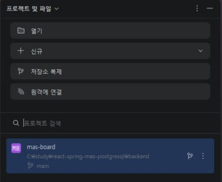

**② backend 폴더 고르기** - `C:\study\board` 로 들어가서 **`backend` 를 한 번 클릭**하고 **폴더 선택**. `board` 가 아니라 그 안의 `backend` 다. (`build.gradle` 이 들어 있는 폴더를 열어야 IntelliJ 가 Gradle 프로젝트로 알아본다)

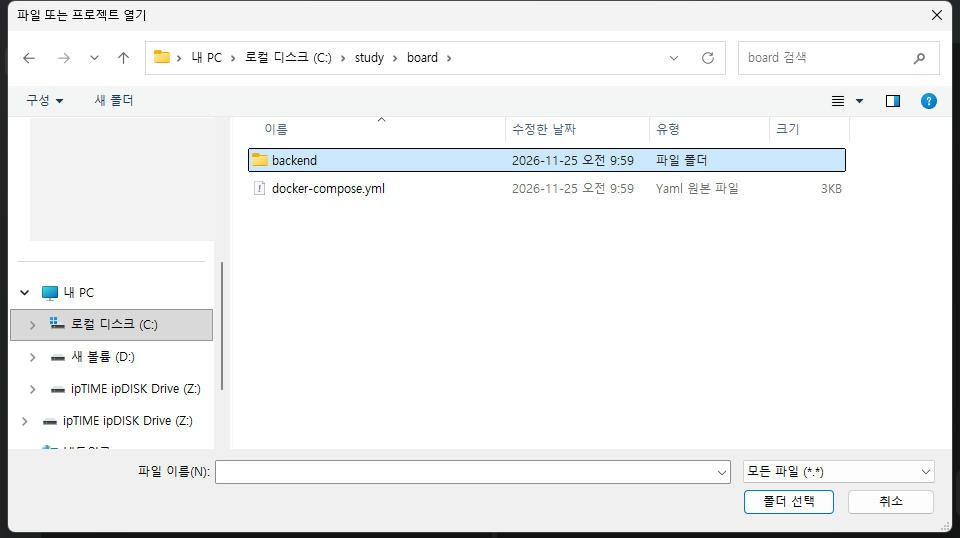

**③ 프로젝트 신뢰** - "프로젝트 'backend'을(를) 신뢰하고 여시겠어요?" 가 나오면 **프로젝트 신뢰**(Trust Project). 아래의 **Microsoft Defender 제외 목록에 추가** 칸은 체크를 **해제**한다. 켜 두면 관리자 권한을 묻고 백신 검사에서 이 폴더를 빼 버린다. 실습에는 필요 없다.

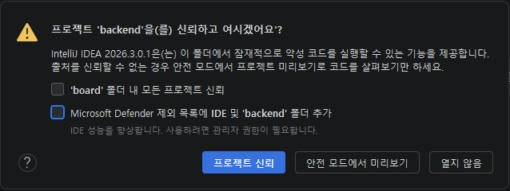

**④ Gradle 가져오기 기다리기** - 오른쪽 아래에 "Gradle 프로젝트 가져오는 중" 막대가 돈다. Gradle 이 필요한 라이브러리를 받는 중이다(**Gradle sync**). 처음에는 **1~5분** 걸린다. 막대가 사라질 때까지 기다린다. 끝나면 `src/main/java` 가 파란 폴더로 보이고, 위쪽 실행 구성 칸에 `BoardApplication` 이 나타난다.

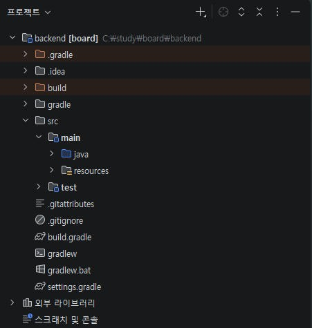

> 오른쪽 아래에 **"Microsoft Defender 가 IDE 에 영향을 줄 수 있습니다"** 알림이 뜨기도 한다. **폴더 제외** 를 누르지 않고 그냥 둔다. (③ 과 같은 이유)

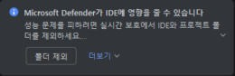

**⑤ JDK 21 확인** - 화면 위쪽에 **"Project JDK is not defined"**(프로젝트 JDK 가 정의되지 않음) 같은 노란 줄이 보이거나, java 파일에 빨간 줄이 가득하면 JDK 를 골라 준다. ☰ → **파일(File) → 프로젝트 구조(Project Structure)** → **프로젝트** → **SDK** 칸.

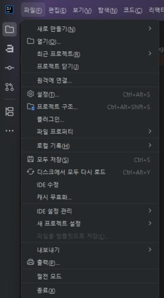

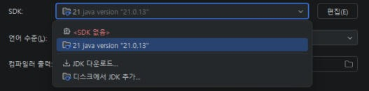

> **IntelliJ 왼쪽 프로젝트 창이 비어 있거나 java 파일 아이콘에 빨간 표시가 있다면** 아직 Gradle sync 가 끝나지 않았거나 JDK 가 지정되지 않은 것이다. 오른쪽 끝의 **Gradle** 창(코끼리 아이콘)을 열고 🔄 (모든 Gradle 프로젝트 다시 로드)을 누른다.

열린 프로젝트는 이렇게 생겼다.

```text
backend
├─ build.gradle                    ← 라이브러리 목록 (Gradle 설정)
├─ settings.gradle                 ← 프로젝트 이름
├─ gradlew, gradlew.bat, gradle/   ← Gradle 래퍼 (Gradle 을 따로 설치하지 않아도 된다)
└─ src
   ├─ main
   │  ├─ java/com/example/board
   │  │  ├─ BoardApplication.java      ← 시작점 (main 메서드, ▶ 실행)
   │  │  ├─ post                        ← 게시글 기능
   │  │  │  ├─ Post.java                  Entity: posts 테이블의 한 줄
   │  │  │  ├─ PostRepository.java        DB 창구 (SQL 은 Spring 이 만든다)
   │  │  │  ├─ PostRequest.java           요청 JSON 모양 + 입력 검사
   │  │  │  ├─ PostResponse.java          응답 JSON 모양
   │  │  │  ├─ PostService.java           업무 규칙 (없는 글이면 404 ...)
   │  │  │  └─ PostController.java        주소(API) 담당
   │  │  ├─ common                      ← 오류를 { "detail": ... } JSON 으로
   │  │  └─ config                      ← CORS 설정
   │  └─ resources
   │     └─ application.yml             ← 포트, DB 접속 정보 등 설정
   └─ test                              ← 테스트 코드
```

> **이 프로젝트를 처음부터 만들고 싶다면** https://start.spring.io 에서 Project **Gradle - Groovy**, Language **Java**, Spring Boot **4.1.2**, Group `com.example`, Artifact `board`, Java **21**, Dependencies 에 **Spring Web**, **Spring Data JPA**, **PostgreSQL Driver**, **Validation** 을 넣고 **GENERATE** 로 zip 을 받아 풀면 된다. 저장소의 backend 는 이렇게 만든 뒤 `/docs` 화면용 springdoc 한 줄을 더한 것이다.

<!-- file: basic/board/backend/build.gradle -->

```groovy
// build.gradle - 기초 과정 게시판 API 서버의 빌드 설정 (Gradle)
//
// 이 파일이 하는 일
//   - 어떤 Java 버전으로 빌드할지, 어떤 라이브러리(의존성)를 쓸지 적는다.
//   - IntelliJ 로 backend 폴더를 열면 이 파일을 읽어 라이브러리를 자동으로 받는다.
//     (처음 열 때 오른쪽 아래에 진행 막대가 보이고, 몇 분 걸릴 수 있다)
//   - Spring Initializr(start.spring.io)가 만들어 준 파일에 springdoc 한 줄을 더하고 주석을 달았다.

plugins {
	id 'java'
	id 'org.springframework.boot' version '4.1.2'              // Spring Boot
	id 'io.spring.dependency-management' version '1.1.7'       // 라이브러리 버전을 Spring Boot 에 맞춰 준다
}

group = 'com.example'
version = '0.0.1-SNAPSHOT'

java {
	toolchain {
		languageVersion = JavaLanguageVersion.of(21)          // Java 21 로 빌드
	}
}

repositories {
	mavenCentral()                                            // 라이브러리를 받아 올 곳
}

dependencies {
	implementation 'org.springframework.boot:spring-boot-starter-webmvc'      // REST API (@RestController)
	implementation 'org.springframework.boot:spring-boot-starter-data-jpa'    // JPA (자바 객체 ↔ DB 테이블)
	implementation 'org.springframework.boot:spring-boot-starter-validation'  // 입력값 검사 (@NotBlank 등)
	implementation 'org.springdoc:springdoc-openapi-starter-webmvc-ui:3.2.0'  // API 시험 화면 (/docs)
	runtimeOnly 'org.postgresql:postgresql'                                   // PostgreSQL 접속 드라이버

	testImplementation 'org.springframework.boot:spring-boot-starter-webmvc-test'
	testRuntimeOnly 'org.junit.platform:junit-platform-launcher'
}

tasks.named('test') {
	useJUnitPlatform()
}
```

<!-- file: basic/board/backend/src/main/resources/application.yml -->

```yaml
# application.yml - 게시판 API 서버 설정
#
#   들여쓰기(빈칸 2칸)가 곧 구조다. 탭 문자는 쓰지 않는다.
#   ${이름:기본값} → 환경 변수 "이름" 이 있으면 그 값, 없으면 기본값

server:
  port: 8080                     # API 서버 주소 http://localhost:8080

spring:
  application:
    name: board
  datasource:                    # 데이터베이스 접속 정보 (docker-compose.yml 과 맞춘다)
    url: ${DB_URL:jdbc:postgresql://localhost:5433/board}
    username: postgres
    password: postgres           # 실습용 비밀번호
  jpa:
    hibernate:
      ddl-auto: update           # 서버가 켜질 때 Entity 를 보고 테이블이 없으면 만들고, 열이 늘면 추가한다
    show-sql: true               # 실행되는 SQL 을 콘솔에 보여 준다 (공부용)
    properties:
      hibernate:
        format_sql: true         # SQL 을 보기 좋게 줄바꿈
    open-in-view: false          # 요청이 끝날 때까지 DB 연결을 붙잡지 않는다 (권장 설정, 경고도 사라진다)

springdoc:
  swagger-ui:
    path: /docs                  # API 시험 화면 주소 http://localhost:8080/docs
```

## 9-4. Entity 와 Repository - DB 담당

Spring Boot 는 **JPA**(Java Persistence API)라는 기술로 DB 를 다룬다. Java 클래스(Entity)를 테이블과 짝지어 두면, `INSERT`·`SELECT` 같은 SQL 을 직접 쓰지 않아도 객체를 저장하고 꺼낼 수 있다.

<!-- file: basic/board/backend/src/main/java/com/example/board/post/Post.java -->

```java
package com.example.board.post;

import jakarta.persistence.Column;
import jakarta.persistence.Entity;
import jakarta.persistence.GeneratedValue;
import jakarta.persistence.GenerationType;
import jakarta.persistence.Id;
import jakarta.persistence.PrePersist;
import jakarta.persistence.PreUpdate;
import jakarta.persistence.Table;
import java.time.LocalDateTime;
import java.time.temporal.ChronoUnit;

/**
 * Post - 게시글 Entity (자바 객체 ↔ posts 테이블의 한 줄)
 *
 * 이 파일이 보여 주는 것
 *   - @Entity 가 붙은 클래스는 JPA 가 관리하는 "테이블과 짝지어진 객체" 다.
 *   - 필드 하나 = 열(column) 하나. ddl-auto: update 설정 덕분에 서버가 켜질 때 테이블이 자동으로 만들어진다.
 *       id          bigint      자동 번호 (PRIMARY KEY)
 *       title       varchar(100) not null
 *       writer      varchar(30)  not null
 *       content     text         not null
 *       created_at  timestamp    not null   ← 필드 이름 createdAt 이 created_at 열이 된다
 *       updated_at  timestamp    not null
 *   - SQL 을 직접 쓰지 않아도 PostRepository 가 INSERT·SELECT·UPDATE·DELETE 를 만들어 준다.
 */
@Entity
@Table(name = "posts")
public class Post {

	@Id
	@GeneratedValue(strategy = GenerationType.IDENTITY) // DB 가 1, 2, 3 ... 번호를 매긴다
	private Long id;

	@Column(nullable = false, length = 100)
	private String title;

	@Column(nullable = false, length = 30)
	private String writer;

	@Column(nullable = false, columnDefinition = "text")
	private String content;

	@Column(nullable = false, updatable = false) // 쓴 시각은 고칠 때 바뀌지 않게
	private LocalDateTime createdAt;

	@Column(nullable = false)
	private LocalDateTime updatedAt;

	/** JPA 가 DB 에서 읽어 올 때 쓰는 빈 생성자 (직접 쓰지 않는다) */
	protected Post() {
	}

	public Post(String title, String writer, String content) {
		this.title = title;
		this.writer = writer;
		this.content = content;
	}

	/** INSERT 직전에 JPA 가 자동으로 부른다: 쓴 시각과 고친 시각을 같은 값으로 */
	@PrePersist
	void onCreate() {
		createdAt = now();
		updatedAt = createdAt;
	}

	/** UPDATE 직전에 JPA 가 자동으로 부른다: 고친 시각만 바꾼다 */
	@PreUpdate
	void onUpdate() {
		updatedAt = now();
	}

	/** 지금 시각. PostgreSQL 은 마이크로초(소수점 6자리)까지만 저장하므로 거기에 맞춰 자른다.
	 *  (자르지 않으면 응답에 나노초 9자리가 나가서 브라우저가 날짜를 잘못 읽을 수 있다) */
	private static LocalDateTime now() {
		return LocalDateTime.now().truncatedTo(ChronoUnit.MICROS);
	}

	/** 글 수정. 값만 바꾸면 트랜잭션이 끝날 때 JPA 가 UPDATE 를 실행한다 (변경 감지) */
	public void update(String title, String writer, String content) {
		this.title = title;
		this.writer = writer;
		this.content = content;
	}

	// ---- 값 꺼내기 (getter) ----
	public Long getId() { return id; }
	public String getTitle() { return title; }
	public String getWriter() { return writer; }
	public String getContent() { return content; }
	public LocalDateTime getCreatedAt() { return createdAt; }
	public LocalDateTime getUpdatedAt() { return updatedAt; }
}
```

<!-- file: basic/board/backend/src/main/java/com/example/board/post/PostRepository.java -->

```java
package com.example.board.post;

import java.util.List;
import org.springframework.data.jpa.repository.JpaRepository;

/**
 * PostRepository - posts 테이블에 SQL 을 보내는 창구 (Spring Data JPA)
 *
 * 이 파일이 보여 주는 것
 *   - 인터페이스만 만들면 Spring 이 구현을 자동으로 만들어 준다.
 *   - JpaRepository<Post, Long> 을 물려받는 것만으로 아래 메서드를 바로 쓸 수 있다.
 *       save(post)       INSERT (새 객체) / UPDATE (이미 있는 객체)
 *       findById(id)     SELECT ... WHERE id = ?   → Optional<Post> (없을 수도 있음)
 *       findAll()        SELECT ...
 *       delete(post)     DELETE ...
 *   - 메서드 이름 규칙으로 쿼리를 만들 수도 있다.
 *       findAllByOrderByIdDesc()  →  SELECT ... ORDER BY id DESC
 */
public interface PostRepository extends JpaRepository<Post, Long> {

	/** 글 목록 - 최근 글이 위로 오게 id 큰 순서 */
	List<Post> findAllByOrderByIdDesc();
}
```

서버를 처음 켜면 `ddl-auto: update` 설정 덕분에 Hibernate(JPA 구현체)가 Entity 를 보고 테이블을 만든다. IntelliJ 실행 창(Run)에 다음과 같은 SQL 이 찍힌다. (`show-sql: true` 설정)

```text
Hibernate:
    create table posts (
        id bigint generated by default as identity,
        content text not null,
        created_at timestamp(6) not null,
        title varchar(100) not null,
        updated_at timestamp(6) not null,
        writer varchar(30) not null,
        primary key (id)
    )
```

| Java (Entity) | PostgreSQL (테이블) |
|---|---|
| `@Entity @Table(name = "posts")` 클래스 `Post` | `posts` 테이블 |
| `@Id @GeneratedValue(IDENTITY) Long id` | `id bigint generated by default as identity` (자동 번호) |
| `@Column(nullable = false, length = 100) String title` | `title varchar(100) not null` |
| `LocalDateTime createdAt` | `created_at timestamp(6)` (이름의 대문자는 `_소문자` 로) |

## 9-5. DTO · Service · Controller - API 담당

Spring 서버는 일을 세 층으로 나눈다. 각 층은 바로 아래 층만 부른다.

| 층 | 클래스 | 하는 일 |
|---|---|---|
| Controller | `PostController` | 어떤 **주소**로 무엇이 왔는지 받고, 무엇을 돌려줄지 정한다 |
| Service | `PostService` | **규칙**: 글이 없으면 404, 앞뒤 빈칸 지우기, 트랜잭션 |
| Repository | `PostRepository` | **DB**: SQL 실행 |

요청·응답 JSON 의 모양은 **DTO**(Data Transfer Object, 데이터 운반용 객체)로 따로 정한다. Entity 를 그대로 주고받지 않는 이유는 각 파일의 주석에 적어 두었다.

<!-- file: basic/board/backend/src/main/java/com/example/board/post/PostRequest.java -->

```java
package com.example.board.post;

import jakarta.validation.constraints.NotBlank;
import jakarta.validation.constraints.Size;

/**
 * PostRequest - 글쓰기·수정 때 React 가 보내는 JSON 의 모양 (요청 DTO)
 *
 *   { "title": "제목", "writer": "민수", "content": "내용" }
 *
 * 이 파일이 보여 주는 것
 *   - record: 값을 담기만 하는 클래스를 한 줄로 만드는 Java 문법. (생성자·getter 가 자동으로 생긴다)
 *     꺼낼 때는 request.title() 처럼 괄호를 붙인다.
 *   - 검사 규칙(Bean Validation): Controller 에서 @Valid 를 붙이면 Spring 이 먼저 검사하고,
 *     어기면 메서드를 실행하지 않고 400 오류를 돌려준다. message 는 그때 보여 줄 문장.
 *   - Entity(Post)를 그대로 받지 않고 DTO 를 따로 두는 이유: 클라이언트가 id, createdAt 같은
 *     값을 마음대로 넣어 보내지 못하게, 받을 칸만 정확히 정하기 위해서다.
 */
public record PostRequest(
		@NotBlank(message = "제목을 입력하세요")                  // null, "", "   " 모두 거절
		@Size(max = 100, message = "제목은 100자까지 쓸 수 있습니다")
		String title,

		@NotBlank(message = "작성자를 입력하세요")
		@Size(max = 30, message = "작성자는 30자까지 쓸 수 있습니다")
		String writer,

		String content                                            // 비어도 된다 (null 이면 "" 로 바꿔 저장)
) {
}
```

<!-- file: basic/board/backend/src/main/java/com/example/board/post/PostResponse.java -->

```java
package com.example.board.post;

import com.fasterxml.jackson.annotation.JsonProperty;
import java.time.LocalDateTime;

/**
 * PostResponse - API 가 돌려주는 글 하나의 JSON 모양 (응답 DTO)
 *
 *   { "id": 1, "title": "...", "writer": "민수", "content": "...",
 *     "created_at": "2026-11-20T09:37:30.266017", "updated_at": "..." }
 *
 * 이 파일이 보여 주는 것
 *   - Entity(Post)를 JSON 으로 바로 내보내지 않고, 보여 줄 칸만 골라 담는다.
 *   - Java 는 이름을 createdAt(카멜 표기)으로 쓰지만, React 쪽 코드는 created_at(밑줄 표기)을 쓴다.
 *     @JsonProperty 로 JSON 에 나갈 이름을 정해 준다. (JavaScript 쪽 관례를 따르지 않고 DB 열 이름과 맞췄다)
 *   - from(post) : Entity → DTO 로 바꾸는 작은 도우미 메서드
 */
public record PostResponse(
		Long id,
		String title,
		String writer,
		String content,
		@JsonProperty("created_at") LocalDateTime createdAt,
		@JsonProperty("updated_at") LocalDateTime updatedAt
) {

	public static PostResponse from(Post post) {
		return new PostResponse(post.getId(), post.getTitle(), post.getWriter(), post.getContent(),
				post.getCreatedAt(), post.getUpdatedAt());
	}
}
```

<!-- file: basic/board/backend/src/main/java/com/example/board/post/PostService.java -->

```java
package com.example.board.post;

import com.example.board.common.ApiException;
import java.util.List;
import org.springframework.http.HttpStatus;
import org.springframework.stereotype.Service;
import org.springframework.transaction.annotation.Transactional;

/**
 * PostService - 게시글 "업무 규칙" 을 담당하는 계층
 *
 * 이 파일이 보여 주는 것
 *   - Controller(주소 담당) → Service(규칙 담당) → Repository(DB 담당) 로 일을 나눈다.
 *       Controller : 어떤 주소로 무엇이 왔는지, 무엇을 돌려줄지
 *       Service    : 글이 없으면 404, 앞뒤 빈칸 지우기 같은 규칙
 *       Repository : SQL 실행
 *   - @Transactional : 메서드 안의 DB 작업을 하나로 묶는다. 중간에 오류가 나면 모두 취소(rollback)된다.
 *     readOnly = true 는 "읽기만 한다" 는 표시 (조금 더 가볍게 동작한다).
 *   - 생성자 주입: Spring 이 PostRepository 객체를 만들어 생성자로 넣어 준다. (new 를 직접 하지 않는다)
 */
@Service
@Transactional(readOnly = true)
public class PostService {

	private final PostRepository postRepository;

	public PostService(PostRepository postRepository) {
		this.postRepository = postRepository;
	}

	/** 글 목록 (최근 글이 위로) */
	public List<PostResponse> findAll() {
		return postRepository.findAllByOrderByIdDesc().stream() // List<Post>
				.map(PostResponse::from) //                        → List<PostResponse>
				.toList();
	}

	/** 글 하나 */
	public PostResponse findOne(Long id) {
		return PostResponse.from(getPost(id));
	}

	/** 새 글 저장 → INSERT */
	@Transactional // 쓰기 작업이므로 readOnly 를 풀어 준다
	public PostResponse create(PostRequest request) {
		Post post = new Post(request.title().strip(), request.writer().strip(), clean(request.content()));
		return PostResponse.from(postRepository.save(post)); // save 후 id·시각이 채워진 객체를 돌려준다
	}

	/** 글 수정 → UPDATE (값만 바꾸면 메서드가 끝날 때 JPA 가 알아서 UPDATE 한다) */
	@Transactional
	public PostResponse update(Long id, PostRequest request) {
		Post post = getPost(id);
		post.update(request.title().strip(), request.writer().strip(), clean(request.content()));
		postRepository.flush(); // UPDATE 를 지금 실행해 updatedAt 이 채워진 값으로 응답하게 한다
		return PostResponse.from(post);
	}

	/** 글 삭제 → DELETE */
	@Transactional
	public void delete(Long id) {
		postRepository.delete(getPost(id));
	}

	/** id 로 글을 찾고, 없으면 404 오류를 던진다 */
	private Post getPost(Long id) {
		return postRepository.findById(id)
				.orElseThrow(() -> new ApiException(HttpStatus.NOT_FOUND, "글을 찾을 수 없습니다"));
	}

	/** 내용은 비어도 되지만 null 은 "" 로, 앞뒤 빈칸은 지운다 */
	private String clean(String content) {
		return content == null ? "" : content.strip();
	}
}
```

<!-- file: basic/board/backend/src/main/java/com/example/board/post/PostController.java -->

```java
package com.example.board.post;

import jakarta.validation.Valid;
import java.util.List;
import org.springframework.http.HttpStatus;
import org.springframework.web.bind.annotation.DeleteMapping;
import org.springframework.web.bind.annotation.GetMapping;
import org.springframework.web.bind.annotation.PathVariable;
import org.springframework.web.bind.annotation.PostMapping;
import org.springframework.web.bind.annotation.PutMapping;
import org.springframework.web.bind.annotation.RequestBody;
import org.springframework.web.bind.annotation.RequestMapping;
import org.springframework.web.bind.annotation.ResponseStatus;
import org.springframework.web.bind.annotation.RestController;

/**
 * PostController - 게시판 REST API 의 주소 담당
 *
 * 이 파일이 보여 주는 것
 *   - @RestController : 메서드가 돌려주는 객체를 JSON 으로 바꿔 응답한다.
 *   - @RequestMapping("/api/posts") : 아래 모든 주소 앞에 /api/posts 가 붙는다.
 *   - 주소 + 방식(HTTP 메서드) 하나에 메서드 하나.
 *
 *   주소                 방식     메서드     CRUD     성공 상태 코드
 *   /api/posts           GET      list       Read     200 OK
 *   /api/posts/{id}      GET      get        Read     200 OK
 *   /api/posts           POST     create     Create   201 Created
 *   /api/posts/{id}      PUT      update     Update   200 OK
 *   /api/posts/{id}      DELETE   delete     Delete   204 No Content
 *
 *   - @PathVariable : 주소의 {id} 자리 값을 Long 으로 받는다.
 *   - @RequestBody  : 요청 본문(JSON)을 PostRequest 객체로 바꿔 받는다.
 *   - @Valid        : PostRequest 의 검사 규칙(@NotBlank 등)을 먼저 검사한다. 어기면 400.
 */
@RestController
@RequestMapping("/api/posts")
public class PostController {

	private final PostService postService;

	public PostController(PostService postService) {
		this.postService = postService;
	}

	@GetMapping
	public List<PostResponse> list() {
		return postService.findAll(); // List → JSON 배열
	}

	@GetMapping("/{id}")
	public PostResponse get(@PathVariable Long id) {
		return postService.findOne(id);
	}

	@PostMapping
	@ResponseStatus(HttpStatus.CREATED) // 성공하면 200 대신 201
	public PostResponse create(@Valid @RequestBody PostRequest request) {
		return postService.create(request);
	}

	@PutMapping("/{id}")
	public PostResponse update(@PathVariable Long id, @Valid @RequestBody PostRequest request) {
		return postService.update(id, request);
	}

	@DeleteMapping("/{id}")
	@ResponseStatus(HttpStatus.NO_CONTENT) // 204: 성공했지만 돌려줄 내용 없음
	public void delete(@PathVariable Long id) {
		postService.delete(id);
	}
}
```

> **객체를 new 로 만들지 않았는데 어떻게 쓰지?** `@Service`, `@RestController`, `@Repository` 가 붙은 클래스는 Spring 이 서버를 켤 때 **하나씩 만들어 보관**한다(이런 객체를 **Bean** 이라 한다). 생성자에 필요한 것(`PostService(PostRepository ...)`)을 적어 두면 Spring 이 보관해 둔 객체를 넣어 준다. 이것을 **의존성 주입**(DI)이라 한다.

**오류 응답을 한 곳에서** - 없는 글, 입력 규칙 위반 등 모든 오류를 `{ "detail": "이유" }` 모양으로 돌려준다. React 쪽은 `data.detail` 하나만 읽으면 된다. (이 장의 기초 게시판 화면은 간단하게 `저장하지 못했습니다 (400)` 처럼 **상태 코드만** 보여 주고, 이유는 F12 → Network → Response 에서 본다. 이유 글자를 화면에 띄우는 것은 심화 과정 7장의 `api.js` 에서 한다)

<!-- file: basic/board/backend/src/main/java/com/example/board/common/ApiException.java -->

```java
package com.example.board.common;

import org.springframework.http.HttpStatus;

/**
 * ApiException - "이 상태 코드와 이 문장으로 응답해 줘" 라는 뜻의 우리 앱 전용 예외
 *
 *   throw new ApiException(HttpStatus.NOT_FOUND, "글을 찾을 수 없습니다");
 *
 * 던지기만 하면 GlobalExceptionHandler 가 받아서 { "detail": "글을 찾을 수 없습니다" } (404) 로 응답한다.
 * RuntimeException 을 물려받았으므로 throws 를 적지 않아도 된다.
 */
public class ApiException extends RuntimeException {

	private final HttpStatus status;

	public ApiException(HttpStatus status, String message) {
		super(message);
		this.status = status;
	}

	public HttpStatus getStatus() {
		return status;
	}
}
```

<!-- file: basic/board/backend/src/main/java/com/example/board/common/GlobalExceptionHandler.java -->

```java
package com.example.board.common;

import java.lang.reflect.RecordComponent;
import java.util.Arrays;
import java.util.Comparator;
import java.util.List;
import java.util.Map;
import org.springframework.http.HttpStatus;
import org.springframework.http.ResponseEntity;
import org.springframework.http.converter.HttpMessageNotReadableException;
import org.springframework.validation.FieldError;
import org.springframework.web.HttpMediaTypeNotSupportedException;
import org.springframework.web.HttpRequestMethodNotSupportedException;
import org.springframework.web.bind.MethodArgumentNotValidException;
import org.springframework.web.bind.annotation.ExceptionHandler;
import org.springframework.web.bind.annotation.RestControllerAdvice;
import org.springframework.web.method.annotation.MethodArgumentTypeMismatchException;
import org.springframework.web.servlet.resource.NoResourceFoundException;

/**
 * GlobalExceptionHandler - 오류를 한 곳에서 받아 같은 모양의 JSON 으로 응답한다
 *
 * 이 파일이 보여 주는 것
 *   - @RestControllerAdvice : 모든 Controller 에서 던져진 예외를 여기서 받는다.
 *   - @ExceptionHandler(예외클래스.class) : 그 예외가 나면 이 메서드가 응답을 만든다.
 *   - 오류 응답은 항상 { "detail": "이유" } 모양으로 맞춘다.
 *     → React 쪽에서는 data.detail 하나만 읽으면 된다.
 *     (여기서 처리하지 않으면 Spring 기본 모양 {"timestamp":..., "status":400, "error":"Bad Request"} 이 나가서
 *      화면에는 "요청 실패 (400)" 처럼 이유 없는 문구만 보이게 된다)
 *
 *   예외                                   상태 코드   언제
 *   ApiException                           지정한 값   없는 글(404) 등 우리가 직접 던진 것
 *   MethodArgumentNotValidException        400        @Valid 검사 실패 (제목이 비었음 등)
 *   HttpMessageNotReadableException        400        본문이 비었거나 올바른 JSON 이 아님
 *   MethodArgumentTypeMismatchException    400        /api/posts/abc 처럼 숫자 자리에 글자가 옴
 *   NoResourceFoundException               404        /api/nothing 처럼 없는 주소
 *   HttpRequestMethodNotSupportedException 405        PATCH 처럼 만들지 않은 요청 방식
 *   HttpMediaTypeNotSupportedException     415        Content-Type 이 application/json 이 아님
 */
@RestControllerAdvice
public class GlobalExceptionHandler {

	@ExceptionHandler(ApiException.class)
	public ResponseEntity<Map<String, String>> handleApi(ApiException e) {
		return detail(e.getStatus(), e.getMessage());
	}

	@ExceptionHandler(MethodArgumentNotValidException.class)
	public ResponseEntity<Map<String, String>> handleValidation(MethodArgumentNotValidException e) {
		return detail(HttpStatus.BAD_REQUEST, firstMessage(e));
	}

	@ExceptionHandler(HttpMessageNotReadableException.class)
	public ResponseEntity<Map<String, String>> handleNotReadable(HttpMessageNotReadableException e) {
		return detail(HttpStatus.BAD_REQUEST, "요청 본문이 올바른 JSON 이 아닙니다");
	}

	@ExceptionHandler(MethodArgumentTypeMismatchException.class)
	public ResponseEntity<Map<String, String>> handleTypeMismatch(MethodArgumentTypeMismatchException e) {
		// e.getName() : 값이 잘못된 매개변수 이름 (id, user_id ...)
		return detail(HttpStatus.BAD_REQUEST, "'" + e.getName() + "' 값이 올바르지 않습니다 (숫자를 넣어야 합니다)");
	}

	@ExceptionHandler(NoResourceFoundException.class)
	public ResponseEntity<Map<String, String>> handleNoResource(NoResourceFoundException e) {
		return detail(HttpStatus.NOT_FOUND, "없는 주소입니다");
	}

	@ExceptionHandler(HttpRequestMethodNotSupportedException.class)
	public ResponseEntity<Map<String, String>> handleMethod(HttpRequestMethodNotSupportedException e) {
		return detail(HttpStatus.METHOD_NOT_ALLOWED, e.getMethod() + " 방식은 이 주소에서 쓸 수 없습니다");
	}

	@ExceptionHandler(HttpMediaTypeNotSupportedException.class)
	public ResponseEntity<Map<String, String>> handleMediaType(HttpMediaTypeNotSupportedException e) {
		return detail(HttpStatus.UNSUPPORTED_MEDIA_TYPE, "Content-Type 을 application/json 으로 보내세요");
	}

	/** { "detail": message } 응답을 만드는 작은 도우미 */
	private static ResponseEntity<Map<String, String>> detail(HttpStatus status, String message) {
		return ResponseEntity.status(status).body(Map.of("detail", message));
	}

	/**
	 * 여러 칸이 한꺼번에 틀렸을 때 보여 줄 "첫 번째" 이유를 고른다.
	 *   - Spring 이 돌려주는 오류 목록은 순서가 매번 달라질 수 있다.
	 *     그래서 record 에 칸을 적은 순서(title → writer ...)대로 골라, 항상 위쪽 칸의 오류가 먼저 보이게 한다.
	 *   - 한 칸에 오류가 둘이면(빈 아이디: @NotBlank 와 @Pattern) "입력하세요"(NotBlank) 를 먼저 보여 준다.
	 */
	private static String firstMessage(MethodArgumentNotValidException e) {
		Object target = e.getBindingResult().getTarget(); // 검사한 객체 (PostRequest 등)
		List<String> order = (target != null && target.getClass().isRecord())
				? Arrays.stream(target.getClass().getRecordComponents()).map(RecordComponent::getName).toList()
				: List.of();
		return e.getBindingResult().getFieldErrors().stream()
				.min(Comparator.<FieldError>comparingInt(err -> order.indexOf(err.getField()))
						.thenComparingInt(err -> "NotBlank".equals(err.getCode()) ? 0 : 1))
				.map(FieldError::getDefaultMessage)
				.orElse("입력값을 확인하세요");
	}
}
```

**CORS 가 뭐길래?** 브라우저는 보안을 위해, 지금 페이지의 **출처**(origin = 프로토콜 + 호스트 + 포트)와 다른 출처로 보내는 요청의 응답을 기본으로 막는다. React 는 `http://localhost:5173`, API 는 `http://localhost:8080` 이므로 포트가 달라 **다른 출처**다. 서버가 응답 헤더로 "5173 에서 온 요청은 괜찮아" 라고 말해 줘야 브라우저가 응답을 React 에게 넘긴다.

<!-- file: basic/board/backend/src/main/java/com/example/board/config/WebConfig.java -->

```java
package com.example.board.config;

import org.springframework.context.annotation.Configuration;
import org.springframework.web.servlet.config.annotation.CorsRegistry;
import org.springframework.web.servlet.config.annotation.WebMvcConfigurer;

/**
 * WebConfig - CORS 설정 (React 개발 서버에서 오는 요청 허락하기)
 *
 * 브라우저는 "다른 출처(주소·포트)" 로 보내는 요청의 응답을 기본으로 막는다.
 *   React 개발 서버  http://localhost:5173
 *   API 서버        http://localhost:8080   ← 포트가 다르면 다른 출처
 * 그래서 API 서버가 "5173 에서 온 요청은 받아도 된다" 고 응답 헤더로 알려 줘야 한다.
 *
 * @Configuration : Spring 이 시작할 때 읽어 가는 설정 클래스라는 표시
 */
@Configuration
public class WebConfig implements WebMvcConfigurer {

	@Override
	public void addCorsMappings(CorsRegistry registry) {
		registry.addMapping("/api/**") //                                     /api 로 시작하는 주소에
				.allowedOrigins("http://localhost:5173", "http://127.0.0.1:5173") // 이 출처에서 온 요청을
				.allowedMethods("GET", "POST", "PUT", "DELETE") //               이 방식으로
				.allowedHeaders("*"); //                                         어떤 헤더든 허락
	}
}
```

CORS 설정을 빼면 브라우저 콘솔(F12)에 이런 빨간 오류가 뜬다.

```text
Access to fetch at 'http://localhost:8080/api/posts' from origin 'http://localhost:5173'
has been blocked by CORS policy: No 'Access-Control-Allow-Origin' header is present on the requested resource.
```

> CORS 는 **브라우저**가 하는 검사다. `/docs` 화면이나 PowerShell 로 보내는 요청에는 적용되지 않는다. "/docs 에서는 되는데 React 에서는 안 된다" 면 CORS 를 의심하자.

| 상태 코드 | 뜻 | 이 서버에서 |
|---|---|---|
| 200 OK | 성공 | 목록, 읽기, 수정 |
| 201 Created | 새로 만들었음 | 글쓰기 |
| 204 No Content | 성공, 돌려줄 내용 없음 | 삭제 |
| 400 Bad Request | 입력이 규칙에 안 맞음 | 제목이 비었음, 100자 초과 (`@Valid` 검사), JSON 모양이 틀림, `/api/posts/abc` 처럼 번호 자리에 글자 |
| 404 Not Found | 없음 | 없는 글 번호, `/api/nothing` 처럼 없는 주소 |
| 405 Method Not Allowed | 그 주소에 없는 요청 방식 | `PATCH /api/posts/1` (만들지 않은 방식) |
| 415 Unsupported Media Type | 본문 종류가 틀림 | `Content-Type: application/json` 을 빠뜨림 |

## 9-6. 서버 실행과 /docs 에서 시험하기

IntelliJ 에서 `src/main/java/com/example/board/BoardApplication.java` 를 연다.

<!-- file: basic/board/backend/src/main/java/com/example/board/BoardApplication.java -->

```java
package com.example.board;

import org.springframework.boot.SpringApplication;
import org.springframework.boot.autoconfigure.SpringBootApplication;

/**
 * BoardApplication - 게시판 API 서버의 시작점 (main 메서드)
 *
 * IntelliJ 에서 이 파일을 열고 class 이름 왼쪽의 초록색 ▶ 버튼을 누르면 서버가 켜진다.
 * (터미널에서는 backend 폴더에서 .\gradlew.bat bootRun)
 *
 * @SpringBootApplication 은 "이 패키지(com.example.board)와 그 아래 패키지를 훑어서
 * @RestController, @Service, @Repository, @Configuration 이 붙은 클래스를 찾아 등록하라" 는 뜻이다.
 * 그래서 다른 클래스들은 반드시 com.example.board 아래 패키지에 둔다.
 */
@SpringBootApplication
public class BoardApplication {

	public static void main(String[] args) {
		SpringApplication.run(BoardApplication.class, args);
	}
}
```

프로젝트 창에서 `src` → `main` → `java` → `com.example.board` 의 화살표(▸)를 차례로 눌러 펼치고 **BoardApplication** 을 **두 번 클릭**한다.

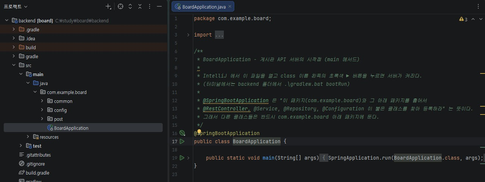

`class BoardApplication` 왼쪽의 **초록색 ▶** 를 누르고 맨 위의 **'BoardApplication.main()' 실행**(Run) 을 고른다.

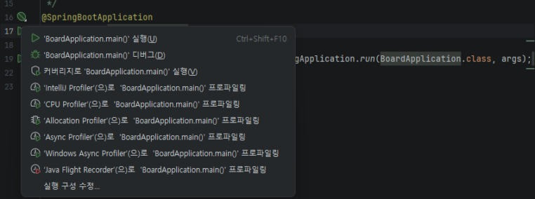

아래쪽 **실행**(Run) 창에 로그가 흐르다가 다음 줄이 보이면 성공이다. (교안을 만들 때 실행한 로그에서 앞부분을 줄였다)

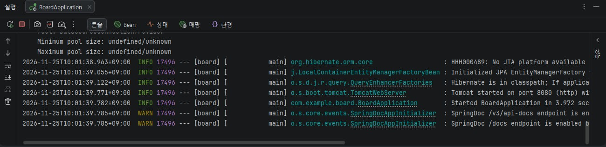

```text
... INFO ... o.s.boot.tomcat.TomcatWebServer : Tomcat started on port 8080 (http) with context path '/'
... INFO ... com.example.board.BoardApplication : Started BoardApplication in 8.349 seconds (process running for 9.294)
```

> **노란색 WARN 줄은 괜찮다.** 시작할 때 `SpringDoc /v3/api-docs endpoint is enabled by default. To disable it in production ...` 같은 WARN 이 두 줄 보인다. "실제 서비스에서는 API 시험 화면(/docs)을 꺼 두라" 는 안내일 뿐, 실습에서는 켜 두는 것이 맞다. **ERROR** 줄이 보이거나 `Started BoardApplication` 이 나오지 않을 때만 부록 A 를 찾아보자.

한 번 실행한 뒤에는 화면 위쪽 실행 구성(`BoardApplication`) 옆의 단추로 다시 실행하고 끈다. 코드를 고쳤으면 **■ 로 끄고 다시 ▶**.

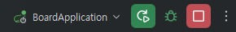

> **터미널에서 실행하려면** `C:\study\board\backend` 에서 `.\gradlew.bat bootRun` 을 친다. (JDK 설치 때 JAVA_HOME 을 설정했어야 한다.) 끌 때는 **Ctrl+C**.

> **`Port 8080 was already in use`** 오류가 나면 이미 서버가 하나 켜져 있는 것이다. IntelliJ 의 Run 창 탭이 여러 개인지, 다른 터미널에서 bootRun 을 하고 있는지 확인해 하나를 끈다.

브라우저에서 **http://localhost:8080/docs** 를 연다. springdoc 이 만들어 주는 API 시험 화면(**Swagger UI**)으로 바뀐다.

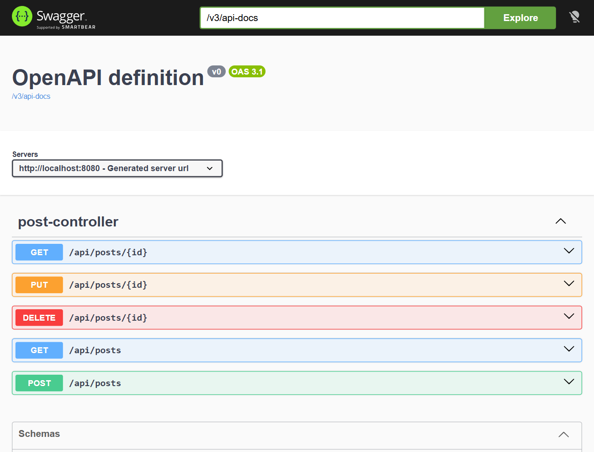

1. **POST /api/posts** 를 눌러 펼치고 **Try it out** 을 누른다.
2. Request body 를 아래처럼 고치고 **Execute**.

```json
{
  "title": "React 게시판 첫 글입니다",
  "writer": "민수",
  "content": "Spring Boot 와 PostgreSQL 에 저장된 글입니다."
}
```

3. 아래 Responses 에 **Code 201** 과 함께 저장된 글이 나온다.

```json
{
  "id": 1,
  "title": "React 게시판 첫 글입니다",
  "writer": "민수",
  "content": "Spring Boot 와 PostgreSQL 에 저장된 글입니다.",
  "created_at": "2026-11-20T10:43:20.882643",
  "updated_at": "2026-11-20T10:43:20.882643"
}
```

4. 글을 두세 개 더 쓰고, **GET /api/posts** 를 Execute 해서 목록이 오는지 본다. 브라우저 주소창에 `http://localhost:8080/api/posts` 를 직접 쳐도 JSON 이 보인다.
5. 제목을 빈칸(`"  "`)으로 보내 보자. **400** 과 함께 `{"detail": "제목을 입력하세요"}` 가 온다. `PostRequest` 의 `@NotBlank` 규칙을 `@Valid` 가 검사하고, `GlobalExceptionHandler` 가 이 모양으로 바꿔 준 것이다.

**데이터베이스에 정말 들어갔을까?** 컨테이너 안의 psql 로 직접 확인해 보자.

**[PS]**

```powershell
docker exec spring-board-db psql -U postgres -d board -c "SELECT id, title, writer, created_at FROM posts ORDER BY id;"
```

```text
 id |           title            | writer |         created_at
----+----------------------------+--------+----------------------------
  1 | React 게시판 첫 글입니다   | 민수   | 2026-11-20 10:43:20.882643
  2 | useEffect 로 목록 불러오기 | 지수   | 2026-11-20 10:43:20.898685
  3 | CORS 오류가 났을 때        | 현우   | 2026-11-20 10:43:20.909459
  4 | 오늘 배운 useState 정리    | 서연   | 2026-11-20 10:43:20.920226
(4 rows)
```

내 화면에는 내가 쓴 글이 나온다. 그리고 IntelliJ Run 창에는 그때마다 JPA 가 만든 SQL(`insert into posts ...`, `select ... from posts ...`)이 찍힌다. 여기까지 되면 백엔드는 완성이다. **서버는 켜 둔 채로** 다음으로 넘어간다.

## 9-7. React 프로젝트 만들기

**[PS]** 새 터미널(+)을 열고

```powershell
cd C:\study\board
npm create vite@latest frontend -- --template react --no-interactive
cd frontend
npm install
```

1장에서처럼 정리한다.

1. `src/App.css`, `src/index.css` 의 내용을 지운다. (`App.css` 는 9-12 에서 채운다)
2. `src/assets` 폴더는 쓰지 않으니 지워도 된다.
3. `src/components` 폴더를 만든다.

완성하면 폴더는 이렇게 된다.

```text
C:\study\board
├─ docker-compose.yml
├─ backend                    ← IntelliJ 로 연 Spring Boot 프로젝트
│  ├─ build.gradle
│  └─ src/main/java/com/example/board/...
└─ frontend
   ├─ index.html
   └─ src
      ├─ main.jsx
      ├─ App.jsx               ← 화면 전환 (어떤 화면을 보여 줄지)
      ├─ App.css               ← 게시판 모양
      ├─ config.js             ← API 주소, 날짜 바꾸기 함수
      └─ components
         ├─ PostList.jsx       ← 목록      (GET 목록)
         ├─ PostDetail.jsx     ← 글 읽기   (GET 하나, DELETE)
         └─ PostForm.jsx       ← 글쓰기·수정 (POST, PUT)
```

## 9-8. config.js 와 App.jsx - 화면 전환

API 주소는 여러 파일에서 쓰므로 한 곳에 둔다.

<!-- file: basic/board/frontend/src/config.js -->

```js
// config.js - 여러 파일이 함께 쓰는 설정 값
//
// API 서버(Spring Boot) 주소. 서버 주소가 바뀌면 이 한 줄만 고치면 된다.
export const API_URL = "http://localhost:8080/api";

// 날짜 글자 "2026-11-20T10:30:00.123+09:00" → "2026. 11. 20. 오전 10:30" 처럼 읽기 좋게 바꾼다
export function formatDate(text) {
  return new Date(text).toLocaleString("ko-KR", {
    year: "numeric",
    month: "2-digit",
    day: "2-digit",
    hour: "2-digit",
    minute: "2-digit",
  });
}
```

이 게시판은 화면이 세 가지(목록·읽기·글쓰기/수정)다. **"지금 어떤 화면인가"** 를 App 의 state 하나로 관리하고, 화면을 바꾸는 함수를 자식들에게 props 로 내려준다 (6-5 state 끌어올리기).

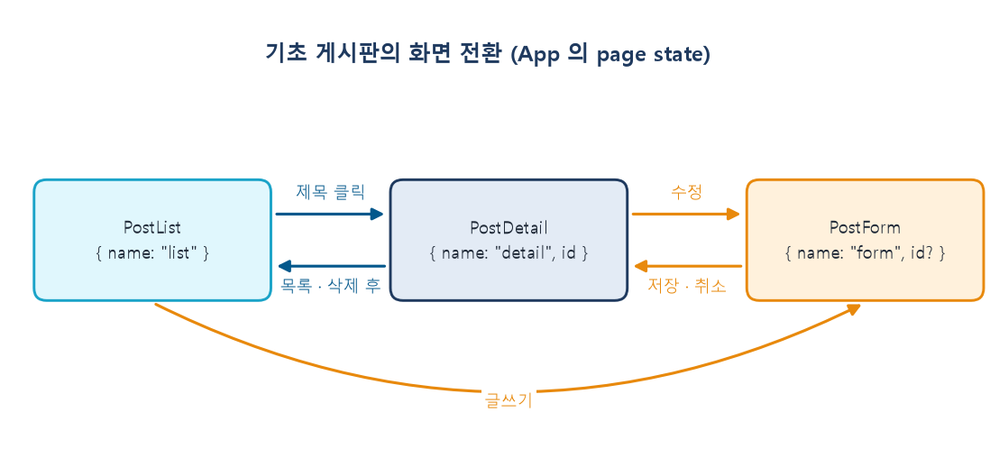

<!-- file: basic/board/frontend/src/App.jsx -->

```jsx
// App.jsx - 게시판의 "화면 전환" 을 맡는 부모 컴포넌트
//
// 이 파일이 보여 주는 것
//   - 지금 어떤 화면을 보여 줄지를 state 하나(page)로 관리한다.
//       { name: "list" }              → 글 목록
//       { name: "detail", id: 3 }     → 3번 글 읽기
//       { name: "form" }              → 글쓰기
//       { name: "form",   id: 3 }     → 3번 글 수정
//   - 화면을 바꾸는 함수(go...)를 자식에게 props 로 내려준다 (6장 state 끌어올리기).
//   - 조건부 렌더링(5장)으로 page.name 에 맞는 컴포넌트 하나만 그린다.
//
//   ※ 이 방식은 주소창의 주소가 바뀌지 않는다. 그래서 새로 고침하면 목록으로 돌아가고,
//     "3번 글" 주소를 친구에게 보낼 수도 없다. 심화 과정에서 React Router 로 해결한다.

import { useState } from "react";
import PostList from "./components/PostList";
import PostDetail from "./components/PostDetail";
import PostForm from "./components/PostForm";
import "./App.css";

function App() {
  const [page, setPage] = useState({ name: "list" }); // 처음 화면은 목록

  // 화면을 바꾸는 함수들 - 자식 컴포넌트가 불러서 쓴다
  const goList = () => setPage({ name: "list" });
  const goDetail = (id) => setPage({ name: "detail", id });
  const goForm = (id) => setPage({ name: "form", id }); // id 가 없으면 글쓰기, 있으면 수정

  return (
    <div className="container">
      <header className="header">
        {/* 제목을 누르면 언제든 목록으로 */}
        <h1 onClick={goList}>📋 React 게시판</h1>
        <span className="badge">Spring Boot + PostgreSQL</span>
      </header>

      {page.name === "list" && <PostList onSelect={goDetail} onWrite={() => goForm()} />}
      {page.name === "detail" && (
        <PostDetail id={page.id} onBack={goList} onEdit={goForm} onDeleted={goList} />
      )}
      {page.name === "form" && (
        <PostForm
          id={page.id}
          onSaved={goDetail} // 저장이 끝나면 그 글 읽기 화면으로
          onCancel={() => (page.id ? goDetail(page.id) : goList())} // 수정 취소 → 글로, 글쓰기 취소 → 목록으로
        />
      )}
    </div>
  );
}

export default App;
```

> 이 단계에서는 아직 세 컴포넌트 파일이 없어서 오류 화면이 뜬다. 9-9 ~ 9-11 에서 하나씩 만들면 사라진다.

## 9-9. PostList - 목록 (Read)

8장의 Ex0802Fetch 와 같은 모양이다. 주소만 Spring Boot 서버로 바뀌었다.

<!-- file: basic/board/frontend/src/components/PostList.jsx -->

```jsx
// PostList.jsx - 글 목록 화면 (CRUD 의 R: Read 목록)
//
// 이 파일이 보여 주는 것
//   - 화면에 처음 나타날 때 useEffect(..., []) 로 GET /api/posts 를 한 번 요청한다 (8장).
//   - loading / error / posts 세 state 로 "불러오는 중 · 실패 · 목록" 을 나눠 그린다.
//   - 제목을 누르면 부모(App)가 내려준 onSelect(id) 를 불러 읽기 화면으로 바꾼다.

import { useEffect, useState } from "react";
import { API_URL, formatDate } from "../config";

function PostList({ onSelect, onWrite }) {
  const [posts, setPosts] = useState([]);
  const [loading, setLoading] = useState(true);
  const [error, setError] = useState(null);

  useEffect(() => {
    async function load() {
      try {
        const res = await fetch(`${API_URL}/posts`); // GET 은 fetch(주소) 만 쓰면 된다
        if (!res.ok) throw new Error(`목록을 불러오지 못했습니다 (${res.status})`);
        setPosts(await res.json()); // JSON 배열 → 자바스크립트 배열
      } catch (err) {
        // 서버가 꺼져 있으면 fetch 자체가 실패한다 (TypeError: Failed to fetch)
        setError(err.message === "Failed to fetch" ? "API 서버에 연결할 수 없습니다. 서버가 켜져 있나요?" : err.message);
      } finally {
        setLoading(false);
      }
    }
    load();
  }, []); // [] → 처음 한 번만

  if (loading) return <p className="info">⏳ 불러오는 중...</p>;
  if (error) return <p className="error">⚠️ {error}</p>;

  return (
    <div>
      <div className="toolbar">
        <span>전체 {posts.length}개</span>
        <button className="primary" onClick={onWrite}>
          ✏️ 글쓰기
        </button>
      </div>

      {posts.length === 0 ? (
        <p className="info">아직 글이 없습니다. 첫 글을 써 보세요!</p>
      ) : (
        <table className="post-table">
          <thead>
            <tr>
              <th className="col-id">번호</th>
              <th>제목</th>
              <th className="col-writer">작성자</th>
              <th className="col-date">작성일</th>
            </tr>
          </thead>
          <tbody>
            {posts.map((post) => (
              <tr key={post.id}>
                <td className="col-id">{post.id}</td>
                <td>
                  {/* 링크처럼 보이지만 주소 이동이 아니라 state 를 바꾸는 버튼 */}
                  <button className="link" onClick={() => onSelect(post.id)}>
                    {post.title}
                  </button>
                </td>
                <td className="col-writer">{post.writer}</td>
                <td className="col-date">{formatDate(post.created_at)}</td>
              </tr>
            ))}
          </tbody>
        </table>
      )}
    </div>
  );
}

export default PostList;
```

## 9-10. PostDetail - 글 읽기 (Read) 와 삭제 (Delete)

<!-- file: basic/board/frontend/src/components/PostDetail.jsx -->

```jsx
// PostDetail.jsx - 글 읽기 화면 (R: Read 하나 + D: Delete)
//
// 이 파일이 보여 주는 것
//   - props 로 받은 id 의 글을 GET /api/posts/{id} 로 불러온다.
//     useEffect 의 의존성 배열에 [id] 를 넣어, id 가 바뀌면 다시 불러온다.
//   - 삭제: confirm 으로 한 번 더 묻고 → DELETE /api/posts/{id} → 성공(204)하면 목록으로.
//   - 404(없는 글)도 오류 문구로 보여 준다.

import { useEffect, useState } from "react";
import { API_URL, formatDate } from "../config";

function PostDetail({ id, onBack, onEdit, onDeleted }) {
  const [post, setPost] = useState(null); // 아직 못 받았으면 null
  const [error, setError] = useState(null);

  useEffect(() => {
    async function load() {
      try {
        const res = await fetch(`${API_URL}/posts/${id}`);
        if (res.status === 404) throw new Error("글을 찾을 수 없습니다. 이미 지워졌을 수 있어요.");
        if (!res.ok) throw new Error(`글을 불러오지 못했습니다 (${res.status})`);
        setPost(await res.json());
      } catch (err) {
        setError(err.message);
      }
    }
    load();
  }, [id]);

  const handleDelete = async () => {
    if (!confirm("정말 삭제할까요? 되돌릴 수 없습니다.")) return; // 취소를 누르면 여기서 끝
    // fetch 의 두 번째 인자로 "방식(method)" 을 정한다. 기본값은 GET
    const res = await fetch(`${API_URL}/posts/${id}`, { method: "DELETE" });
    if (res.ok) {
      onDeleted(); // 부모에게 "지웠어요" → 목록 화면으로
    } else {
      alert(`삭제하지 못했습니다 (${res.status})`);
    }
  };

  if (error)
    return (
      <div>
        <p className="error">⚠️ {error}</p>
        <button onClick={onBack}>목록</button>
      </div>
    );
  if (!post) return <p className="info">⏳ 불러오는 중...</p>;

  return (
    <article className="post-detail">
      <h2>{post.title}</h2>
      <div className="meta">
        {post.writer} · {formatDate(post.created_at)}
        {/* 고친 적이 있으면 고친 시각도 보여 준다 */}
        {post.updated_at !== post.created_at && ` · 수정 ${formatDate(post.updated_at)}`}
      </div>
      {/* 줄바꿈을 그대로 보이게 하려고 CSS 에 white-space: pre-wrap 을 주었다 */}
      <div className="content">{post.content || "(내용 없음)"}</div>

      <div className="buttons">
        <button onClick={onBack}>목록</button>
        <button onClick={() => onEdit(post.id)}>수정</button>
        <button className="danger" onClick={handleDelete}>
          삭제
        </button>
      </div>
    </article>
  );
}

export default PostDetail;
```

`fetch` 의 두 번째 인자로 요청 방식을 정한다. GET 은 기본값이라 생략했고, 삭제는 `{ method: "DELETE" }` 를 넘긴다.

## 9-11. PostForm - 글쓰기 (Create) 와 수정 (Update)

<!-- file: basic/board/frontend/src/components/PostForm.jsx -->

```jsx
// PostForm.jsx - 글쓰기 / 수정 화면 (C: Create, U: Update)
//
// 이 파일이 보여 주는 것
//   - 하나의 폼으로 글쓰기와 수정을 함께 처리한다.
//       id 가 없으면 → 빈 폼 → POST /api/posts         (새 글)
//       id 가 있으면 → 그 글을 불러와 폼을 채움 → PUT /api/posts/{id}  (수정)
//   - 입력 칸 여러 개를 객체 state 하나(form)로 관리한다 (7장 Ex0702Form 과 같은 모양).
//   - JSON 을 보낼 때는 method, headers(Content-Type), body(JSON.stringify) 세 가지를 쓴다.
//   - 저장 중에는 버튼을 막아(disabled) 두 번 눌러 글이 두 개 생기는 일을 막는다.

import { useEffect, useState } from "react";
import { API_URL } from "../config";

const EMPTY = { title: "", writer: "", content: "" };

function PostForm({ id, onSaved, onCancel }) {
  const isEdit = id !== undefined; // 수정 화면인가?
  const [form, setForm] = useState(EMPTY);
  const [saving, setSaving] = useState(false);
  const [error, setError] = useState(null);

  // 수정 화면이면 원래 글을 불러와 폼에 채운다
  useEffect(() => {
    if (!isEdit) return; // 글쓰기면 할 일 없음
    async function load() {
      const res = await fetch(`${API_URL}/posts/${id}`);
      if (!res.ok) {
        setError("글을 불러오지 못했습니다");
        return;
      }
      const post = await res.json();
      // 서버가 준 글에는 id, created_at 등도 있지만 폼에는 세 칸만 필요하다
      setForm({ title: post.title, writer: post.writer, content: post.content });
    }
    load();
  }, [id, isEdit]);

  const handleChange = (e) => {
    const { name, value } = e.target;
    setForm({ ...form, [name]: value });
  };

  const handleSubmit = async (e) => {
    e.preventDefault();
    if (!form.title.trim() || !form.writer.trim()) {
      setError("제목과 작성자를 입력하세요.");
      return;
    }
    setSaving(true);
    setError(null);
    try {
      const res = await fetch(isEdit ? `${API_URL}/posts/${id}` : `${API_URL}/posts`, {
        method: isEdit ? "PUT" : "POST",
        headers: { "Content-Type": "application/json" }, // "본문은 JSON 입니다" 라고 알린다
        body: JSON.stringify(form), //                      객체 → JSON 글자
      });
      if (!res.ok) throw new Error(`저장하지 못했습니다 (${res.status})`);
      const saved = await res.json(); // 서버가 돌려준 글 (새 글이면 새 번호가 들어 있다)
      onSaved(saved.id); //              부모에게 알림 → 그 글 읽기 화면으로
    } catch (err) {
      setError(err.message);
      setSaving(false); // 실패했을 때만 버튼을 다시 살린다 (성공하면 화면이 바뀐다)
    }
  };

  return (
    <form className="post-form" onSubmit={handleSubmit}>
      <h2>{isEdit ? `${id}번 글 수정` : "새 글 쓰기"}</h2>
      {error && <p className="error">⚠️ {error}</p>}

      <label>
        제목
        <input name="title" value={form.title} onChange={handleChange} maxLength={100} />
      </label>
      <label>
        작성자
        <input name="writer" value={form.writer} onChange={handleChange} maxLength={30} />
      </label>
      <label>
        내용
        <textarea name="content" value={form.content} onChange={handleChange} rows={8} />
      </label>

      <div className="buttons">
        <button type="button" onClick={onCancel}>
          취소
        </button>
        {/* type="button" 이 아닌 버튼은 submit → onSubmit 실행 */}
        <button type="submit" className="primary" disabled={saving}>
          {saving ? "저장 중..." : "저장"}
        </button>
      </div>
    </form>
  );
}

export default PostForm;
```

JSON 을 보내는 fetch 는 세 가지를 꼭 넣는다.

```jsx
fetch(주소, {
  method: "POST",                                   // ① 방식
  headers: { "Content-Type": "application/json" },  // ② "본문은 JSON 입니다"
  body: JSON.stringify(form),                       // ③ 객체 → JSON 글자
});
```

`Content-Type` 을 빠뜨리면 브라우저가 글자 본문을 `text/plain` 으로 보내고, Spring 은 그 본문을 `PostRequest` 로 바꾸지 못해 **415** (`{"detail": "Content-Type 을 application/json 으로 보내세요"}`)를 돌려준다.

## 9-12. App.css - 모양 입히기

<!-- file: basic/board/frontend/src/App.css -->

```css
/* App.css - 게시판 화면 꾸미기 (CSS 는 HTML 수업 때와 똑같다. className 으로 연결) */

.container {
  max-width: 820px;
  margin: 0 auto;
  padding: 20px;
}

/* ---------- 머리글 */
.header {
  display: flex;
  align-items: center;
  gap: 10px;
  padding-bottom: 12px;
  margin-bottom: 16px;
  border-bottom: 3px solid #61dafb;
}

.header h1 {
  margin: 0;
  font-size: 24px;
  color: #1f3a5f;
  cursor: pointer;
}

.badge {
  padding: 2px 8px;
  border-radius: 10px;
  background: #eef3f8;
  color: #03588c;
  font-size: 12px;
}

/* ---------- 버튼 */
button {
  padding: 6px 14px;
  border: 1px solid #c9d3df;
  border-radius: 6px;
  background: white;
  font-family: inherit; /* 버튼은 기본으로 다른 글꼴을 쓰므로 바깥 글꼴을 물려받게 한다 */
  font-size: 14px;
  cursor: pointer;
}

button:hover {
  background: #f2f6fa;
}

button.primary {
  border-color: #03588c;
  background: #03588c;
  color: white;
}

button.danger {
  border-color: #c0392b;
  color: #c0392b;
}

button:disabled {
  opacity: 0.5;
  cursor: not-allowed;
}

/* 링크처럼 보이는 버튼 (목록의 제목) */
button.link {
  padding: 0;
  font-size: 15px;
  border: none;
  background: none;
  color: #1f3a5f;
  text-align: left;
}

button.link:hover {
  text-decoration: underline;
}

/* ---------- 목록 */
.toolbar {
  display: flex;
  justify-content: space-between;
  align-items: center;
  margin-bottom: 10px;
  color: #6b7280;
}

.post-table {
  width: 100%;
  border-collapse: collapse;
}

.post-table th {
  padding: 9px 6px;
  background: #1f3a5f;
  color: white;
  font-weight: normal;
}

.post-table td {
  padding: 9px 6px;
  font-size: 15px;
  border-bottom: 1px solid #e5e9ef;
}

.col-id,
.col-writer {
  width: 80px;
  text-align: center;
}

.col-date {
  width: 190px;
  text-align: center;
  color: #6b7280;
  font-size: 13px;
}

/* ---------- 읽기 */
.post-detail h2 {
  margin: 0 0 6px;
}

.meta {
  padding-bottom: 10px;
  border-bottom: 1px solid #e5e9ef;
  color: #6b7280;
  font-size: 13px;
}

.content {
  min-height: 120px;
  padding: 16px 2px;
  white-space: pre-wrap; /* 내용의 줄바꿈을 그대로 보여 준다 */
  line-height: 1.7;
}

.buttons {
  display: flex;
  gap: 6px;
  justify-content: flex-end;
  margin-top: 12px;
}

/* ---------- 글쓰기·수정 */
.post-form label {
  display: block;
  margin-bottom: 12px;
  font-weight: bold;
  color: #374151;
}

.post-form input,
.post-form textarea {
  display: block;
  box-sizing: border-box;
  width: 100%;
  margin-top: 4px;
  padding: 8px;
  border: 1px solid #c9d3df;
  border-radius: 6px;
  font: inherit;
  font-weight: normal;
}

/* ---------- 안내·오류 문구 */
.info {
  padding: 20px;
  text-align: center;
  color: #6b7280;
}

.error {
  padding: 10px 12px;
  border-radius: 6px;
  background: #fdecea;
  color: #c0392b;
}
```

`src/index.css` 에는 1-4 의 내용(글꼴·여백)을 넣는다.


## 9-13. 전체 실행하기

세 가지가 모두 켜져 있어야 한다.

| 어디서 | 폴더 | 할 일 | 확인 |
|---|---|---|---|
| VS Code 터미널 1 | `C:\study\board` | `docker compose up -d` (한 번 켜 두면 됨) | `docker compose ps` 가 healthy |
| IntelliJ | `C:\study\board\backend` | `BoardApplication` ▶ 실행 | http://localhost:8080/docs |
| VS Code 터미널 2 | `C:\study\board\frontend` | `npm run dev` | http://localhost:5173 |

http://localhost:5173 을 열면 게시판이 나온다. 처음에는 글이 없어서 이렇게 보인다.

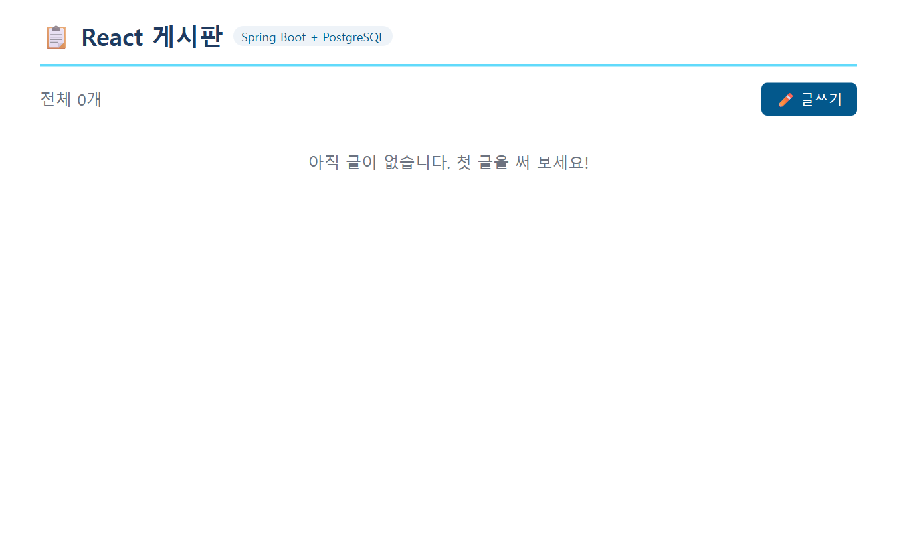

글을 몇 개 쓰면 목록이 채워진다.

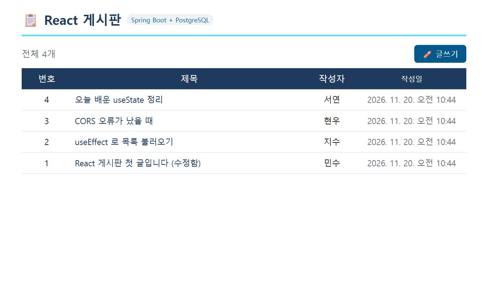

**글쓰기** 버튼 → 제목·작성자·내용 입력 → **저장**.

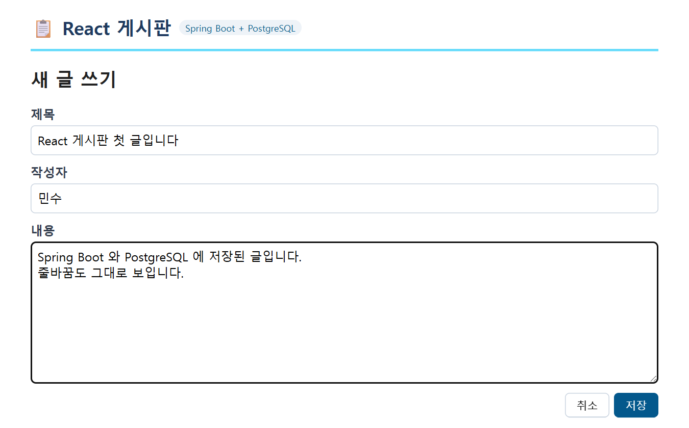

저장하면 방금 쓴 글의 읽기 화면으로 바뀐다. **수정**, **삭제**(확인 창이 뜬다)도 해 보자.

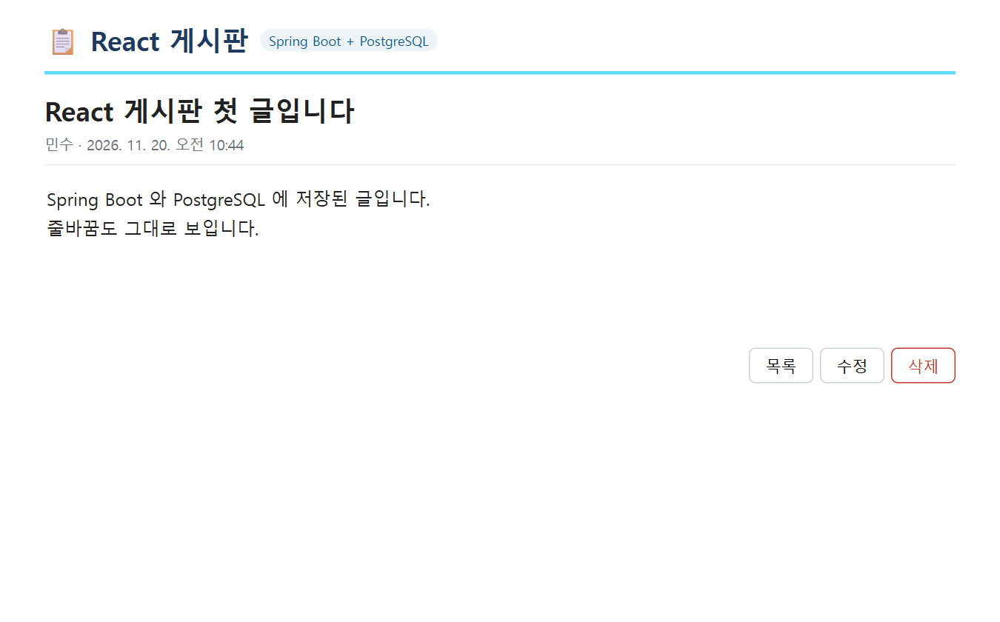

> **IntelliJ Run 창도 함께 보자.** 화면에서 무언가를 할 때마다 JPA 가 실행한 SQL(`select`, `insert`, `update`, `delete`)이 찍힌다. React 의 버튼 하나가 서버를 거쳐 어떤 SQL 이 되는지 눈으로 확인할 수 있다.

**F12 → Network 탭**을 열어 두고 글쓰기를 해 보면, `posts` 요청을 눌러 **Payload**(보낸 JSON)와 **Response**(받은 JSON)를 직접 볼 수 있다. 무언가 안 될 때 가장 먼저 볼 곳이다. 글쓰기·수정·삭제 때는 그 앞에 `OPTIONS` 요청(preflight)이 먼저 보이는데, 브라우저가 "이 요청 보내도 돼?" 하고 CORS 를 미리 물어보는 **사전 요청**이다.

> 내 코드가 잘 안 되면 저장소의 완성본(`basic/board/frontend`)에서 `npm install` → `npm run dev` 로 실행해 비교해 보자. 완성본과 내 프로젝트를 동시에 켜면 하나는 5174 번 포트로 뜨는데, **CORS 는 5173 만 허락**했으므로 5174 쪽은 목록을 못 불러온다. 하나만 켜자.

## 9-14. 끝내기와 다시 시작하기

| 하고 싶은 일 | 방법 |
|---|---|
| React 끄기 | VS Code 터미널에서 **Ctrl+C** |
| Spring Boot 끄기 | IntelliJ 의 ■ (Stop) 버튼 (터미널 bootRun 이면 Ctrl+C) |
| DB 잠시 멈추기 (데이터 유지) | `docker compose stop` |
| DB 다시 켜기 | `docker compose up -d` |
| DB 와 **모든 글 삭제** | `docker compose down -v` (되돌릴 수 없음) |

다음 날 다시 할 때는 9-13 의 표 순서대로 세 가지를 켜면 된다. 글은 Docker 볼륨에 저장되어 있어서 그대로 남아 있다.

## 9-15. 도전 과제

스스로 해 보는 확장 과제다. 정답은 없고, 심화 과정에서 비슷한 기능을 만든다.

1. **글 개수 표시 꾸미기** - 목록 위에 "오늘 쓴 글 N개" 를 함께 보여 주기. (`created_at` 의 날짜를 오늘 날짜와 비교)
2. **검색** - 목록 위에 검색 칸을 두고, 제목에 검색어가 들어간 글만 보여 주기. (서버는 그대로 두고 React 에서 `filter`)
3. **조회수** - `Post` Entity 에 `int views` 필드를 추가하고(서버를 다시 켜면 `ddl-auto: update` 가 열을 추가한다), 글을 읽을 때마다 1 올리기. (`PostService.findOne` 을 `@Transactional` 로 바꾸고 `post.increaseViews()` 같은 메서드 호출)

> 2번 검색을 서버 쪽에서 하고 싶다면 `GET /api/posts?q=검색어` 처럼 `@RequestParam` 으로 받고, Repository 에 `List<Post> findByTitleContainingOrderByIdDesc(String q)` 를 추가하면 된다. 메서드 이름만으로 `WHERE title LIKE '%검색어%'` 가 만들어진다.

## 정리

- 아래부터 쌓는다: DB(Docker) → API(Spring Boot, /docs 로 확인) → 화면(React).
- Spring 서버는 Controller(주소) → Service(규칙) → Repository(DB) 로 나누고, JSON 모양은 DTO 로 정한다.
- REST API: 같은 주소라도 방식(GET·POST·PUT·DELETE)으로 하는 일을 구분한다.
- React 는 `fetch(주소, { method, headers, body })` 로 요청하고, `res.ok` 로 성공을 확인한다.
- 다른 출처(포트)의 API 를 부르려면 서버에서 **CORS** 를 허락해야 한다.
- 기초 게시판은 state 로 화면을 바꾸므로 **주소가 바뀌지 않는다.** 새로 고침하면 목록으로 돌아가고, 3번 글 주소를 친구에게 보낼 수도 없다. → 심화 과정에서 **React Router** 로 해결한다.

## 확인 문제

1. 글 수정 요청의 방식과 주소, 성공했을 때의 상태 코드를 쓰시오. 그 요청을 받는 Java 메서드는 어느 클래스의 무엇인가?
2. React 화면에서 글 목록이 안 나오고, 콘솔에 `blocked by CORS policy` 오류가 보인다. 무엇을 확인해야 하는가?
3. PostForm 에서 `headers: { "Content-Type": "application/json" }` 을 지우면 저장할 때 어떤 일이 생기는지 직접 해 보고, Network 탭의 상태 코드를 쓰시오.
4. Spring Boot 서버를 끈 상태에서 목록 화면을 새로 고치면 어떤 문구가 보이는가? 그 문구는 어느 파일의 어느 코드에서 나온 것인가?
5. `docker compose down` 과 `docker compose down -v` 의 차이를 쓰시오.
6. `PostRequest` 의 `@Size(max = 100 ...)` 를 `max = 50` 으로 바꾸고 서버를 다시 켠 뒤, 60자 제목으로 글을 써 보시오. 화면에 무엇이 보이는가?
